## 目录

- [背景知识](#背景知识)
  - [嵌入式绪论](#嵌入式绪论)
  - [单片机概述](#单片机概述)
  - [计算机组成原理](#计算机组成原理)
- [数电基础](#数电基础)
  - [数制与编码](#数制与编码)
  - [逻辑门电路](#逻辑门电路)
  - [锁存器和触发器](#锁存器和触发器)
  - [时序逻辑电路](#时序逻辑电路)
- [地址位带](#地址位带)
  - [架构背景](#架构背景)
    - [Cortex-M3 架构](#cortex-m3-架构)
    - [Cortex-M3 内核](#cortex-m3-内核)
  - [寄存器组](#寄存器组)
  - [地址映射](#地址映射)
  - [背景知识](#背景知识-2)
  - [数据处理指令寻址方式](#数据处理指令寻址方式)
  - [内存访问指令寻址方式](#内存访问指令寻址方式)
  - [堆栈操作指令寻址方式](#堆栈操作指令寻址方式)
  - [数据传送指令](#数据传送指令)
  - [数据处理指令](#数据处理指令)
  - [跳转类型指令](#跳转类型指令)
  - [其他类型指令](#其他类型指令)
- [时钟及配置](#时钟及配置)
- [中断及配置](#中断及配置)
- [端口及配置](#端口及配置)
- [GPIO 控制寄存器](#gpio-控制寄存器)
- [GPIO 寄存器实例](#gpio-寄存器实例)
- [通讯及配置](#通讯及配置)
  - [串口通信](#串口通信)
  - [其他通讯协议](#其他通讯协议)
- [定时器及配置](#定时器及配置)
  - [通用定时器](#通用定时器)
- [看门狗及配置](#看门狗及配置)
- [Keil5 软件基础](#keil5-软件基础)
- [实验代码专题](#实验代码专题)
- [实验程序指令](#实验程序指令)
  - [实验一:指令与程序结构](#实验一指令与程序结构)
  - [实验二:程序设置与调试](#实验二程序设置与调试)
  - [汇编作业](#汇编作业)
- [实验控制小灯](#实验控制小灯)
  - [实验四:按钮控制小灯](#实验四按钮控制小灯)
- [实验其他外设](#实验其他外设)
  - [实验七:串口通讯](#实验七串口通讯)

# 背景知识

### 嵌入式绪论

##### 电子计算机

电子计算机发展史

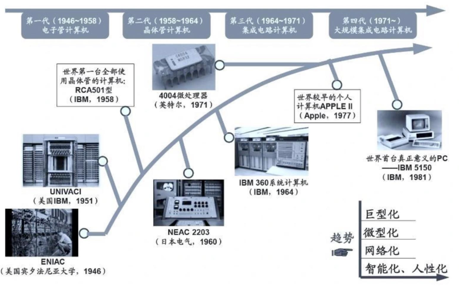

通用计算机与嵌入式计算机的对比

|  | 通用计算机 | 嵌入式计算机 |
| --- | --- | --- |
| 形式与类型 | 实实在在的计算机 按其体系结 。 构 运算速度和规模可分为大型 、 机 中型机 小型机和微机 、    、 | “    ” 看不见 的计算机,形式多样,应用领域 广泛,按应用进行分类 |
| 组成 | 通用处理器 标准总线和外设、 、 软硬件相对独立 | 面向特定应用的微处理器,总线和外设一般集成在处理器内部,软硬件紧密结合 |
| 系统资源 | 系统资源充足,有丰富的编译器 集成开发环境、调试器等 、 | 系统资源紧缺,系统内没有编译器等相关开发工具 |
| 开发方式 | 开发平台和运行平台都是通用计算机 | 采用交叉编译方式,开发平台一般是通用计算机,运行平台是嵌入式系统 |
| 二次开发性 | 应用程序可重新编程 | 一般不能重新编程开发 |

嵌入式系统的定义

嵌入式系统本身是一个可大可小的专用计算机系统,一个手持的 MP3、MP4 和一个 PC104 小型工控机都可以认为是嵌入式系统。

嵌入式系统都是采用 量体裁衣 的方式把所需的功能嵌入到各种应用系统中。嵌入式系统是一种计算机软件与硬件的综合体,特别强调 量身定做 的原则,针对某一种特殊用途开发出的截然不同的一项系统,这就是所谓的客定制化(Customized)系统。

嵌入式系统的组成

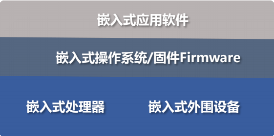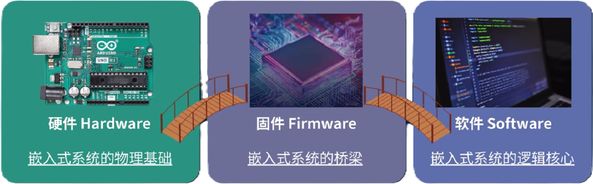

##### 嵌入式的发展

###### 总线的发展

在嵌入式系统中,总线是一种传输数据的通道,它允许各种组件(如处理器、存储器和输入/输出设备)进

行通信

1976 年Intel 推出Multibus,1983 年扩展为带宽达 40MB/S 的Multibus II。 1978 年Prolog 设计简单的STD 总线广泛用于小型嵌入式系统。

1981 年Motorola 推出的VMEBus 则与MultibusII 瓜分高端市场。

目前在工业控制领域,嵌入式PC、PC104、CPCI(Compact PCI)总线已广泛应用到工业控制领域。

总线(Bus)是指多个硬件组件之间传输数据的公用通信通道。总线允许各种部件如处理器(CPU)、内存

(RAM)、储存设备以及输入/输出设备等相互连接和交换信息。总线可以被视为计算机内部或者系统之间的公路,信息和数据就像车辆一样在这条公路上行驶,到达各自的目的地。

PC104 和CPCI 是两种常见的总线标准,它们以其低成本和良好的兼容性被广泛应用于工业和军事领域。 PC104 总线因其小型化设计适用于体积受限的嵌入式应用,而CPCI 则提供了一种高性能的嵌入式总线解决

方案

###### 微处理器的问世

嵌入式系统的发展与微电子工艺水平的提升紧密相关。随着技术的进步,集成电路(IC)设计和制造商能够在单个芯片上集成更多的功能,这使得单片机的应用变得越来越广泛。

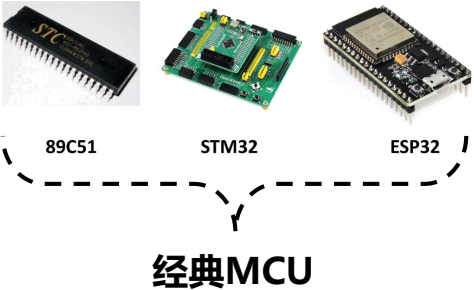

单片机(Microcontroller, MCU)

单片机是一种集成电路,它将微处理器核心与所需的内存(RAM、ROM)、输入/输出接口(I/O)、模数转换器(A/D 转换器)、数模转换器(D/A 转换器)、串行接口(如UART、SPI、I2C 等)等功能集成在

一块单独的芯片上。这种集成程度的提高带来的好处包括:尺寸减小;功耗降低;成本降低;可靠性提高。

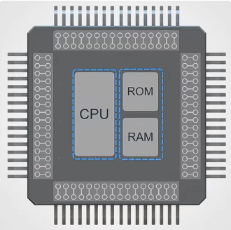

单片机广泛应用于各种嵌入式系统中,如家用电器、汽车电子、工业控制等领域。

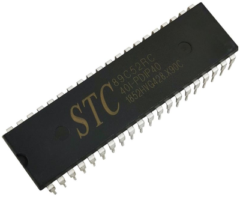

数字信号处理器(Digital Signal Processor, DSP)

数字信号处理器DSP 是专门设计来执行信号处理算法的微处理器。与通用微处理器相比,DSP 在需要快

速、高效信号处理的应用中非常有用,如音频和视频处理、通信系统、雷达和声纳系统,以及任何需要处理模拟信号转换成数字信号后的应用。

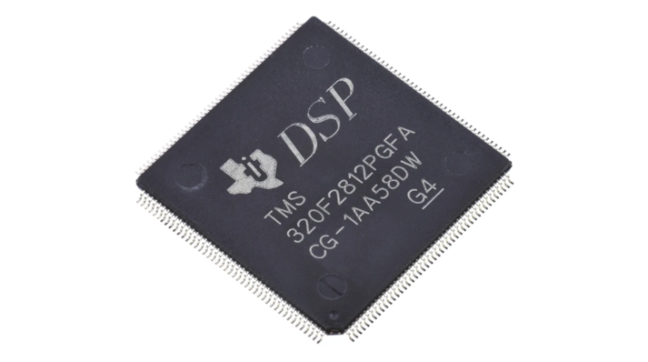

随着微电子技术的进步,单片机和DSP 都代表了在各自领域内进行高度专业化和集成化设计的趋势。单片机提供了一种成本效益高、体积小巧的解决方案,适用于控制导向的应用,而DSP 则提供了专门的处理能

力,适用于需要高速和复杂运算的信号处理应用。

DSP 正在朝着更高的运算速度、更好的信号处理精度和更低的能耗方向发展。这些特点使得DSP 非常适合于如音频处理、图像处理和通信系统等需要快速和精确运算的领域。

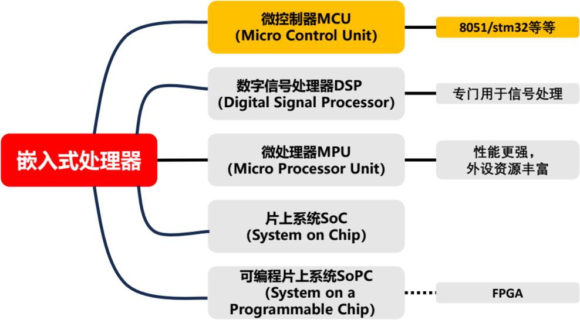

系统芯片(SoC)

将DSP 与通用嵌入式微处理器集成到单一的系统芯片(SoC)中可以提供更高的性能和更低的功耗,同时也减少了系统的总成本。这种集成化的解决方案在智能手机、IP 电话等消费电子产品中十分常见。

在工业控制领域,嵌入式PC 和 32 位嵌入式SoC 凭借其强大的计算能力和丰富的输入输出接口,已经在自动化设备、机器人技术和各类控制系统中得到了广泛应用。

32 位嵌入式微处理器

随着 32 位微处理器性能的提高和生产成本的降低,它们已经逐步取代了 4 位、8 位和 16 位处理器,尤其在需要更高计算能力和更大内存支持的应用中。

现代的 32 位处理器不仅集成了核心的CPU 功能,还集成了各种外设接口、内存管理单元(MMU)、浮点运算单元(FPU),这大大增加了单片机的功能性和灵活性。

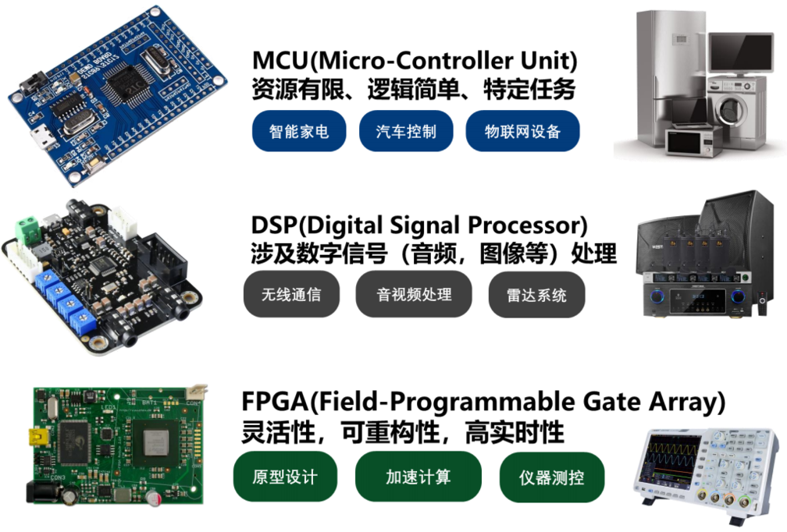

###### 软件技术的进步

微处理器出现初期,嵌入式软件开发主要依靠汇编语言来保证程序的运行效率。由于早期的微处理器资源有限(如CPU 处理速度慢、RAM 和ROM 容量小),汇编语言允许开发者编写直接与硬件打交道的低层代 码,从而精确地控制硬件资源消耗和程序执行时间。但是,汇编语言编程复杂、耗时,并且可读性和可维护性较差。

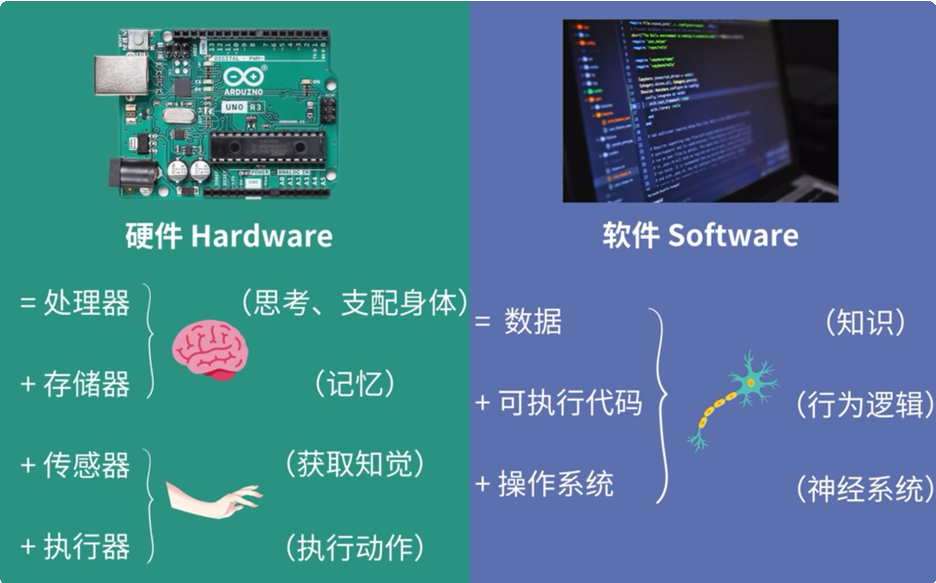

随着微电子工艺技术的进步,微处理器的性能得到了显著提升。使用PL/M、C 等高级语言编写嵌入式软件变得可行。高级语言提供了更好的抽象,简化了编程过程,并且使得代码更易于理解和维护。C 语言由于其接近硬件的特性和高效性,在嵌入式系统开发中尤为流行,并被广泛应用。

对于复杂的嵌入式系统,除了高级语言外,还通常需要以下支持:

嵌入式开发工具:包括交叉编译器、调试器、仿真器等,这些工具可以帮助开发者编写、调试和测试嵌

入式软件。

嵌入式实时操作系统(RTOS):为了满足对实时性能的要求,复杂的嵌入式系统可能需要一个实时操作系统。RTOS 能够提供确定性的任务调度、中断管理和资源管理,确保系统能够及时响应外部事件。

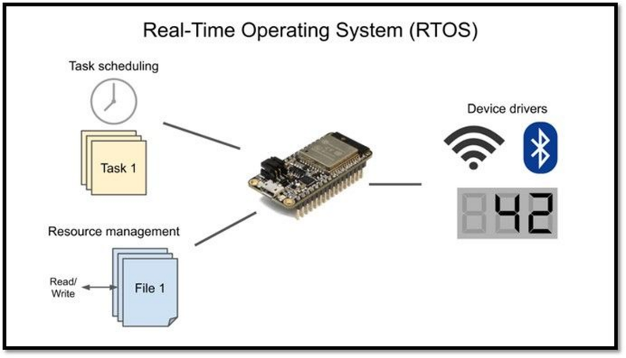

##### 时间信号

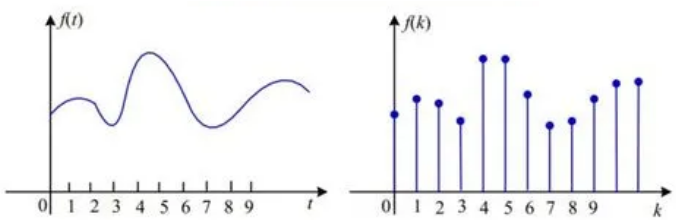连续时间信号:在时间轴上的取值是连续的信号称为连续时间信号离散时间信号:在时间轴上的取值是离散的信号成为离散时间信号

两者的区别仅在于时间轴的取值是否连续。

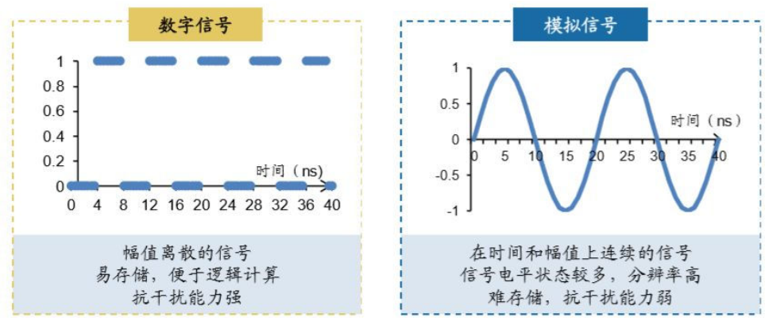

模拟信号:载荷消息的信号参量取值是连续(不可数、无穷多)的,这里连续的含义是指信号载荷的消息的参量连续变化,在某一取值范围内可以取无穷多个值,而不一定在时间上也连续, 比如未经量化的采样信号就是一种模拟信号。

数字信号:载荷消息的信号参量只有有限个取值,注意这个参量不仅仅是指信号的幅值,还可以是信号的频率、相位,但绝对不是时间,也就是说数字信号时间轴上未必是离散的,比如二电平信号,二相位信号等这些在时间轴上连续的数字信号。

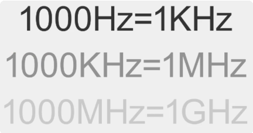

### 单片机概述

##### 单片机的组成

单片机(Microcontroller,MCU)是一种集成了处理器、存储器和I/O 接口的紧凑型计算设备,通常用于嵌

入式系统中。下面分别介绍单片机的主要组成部分:

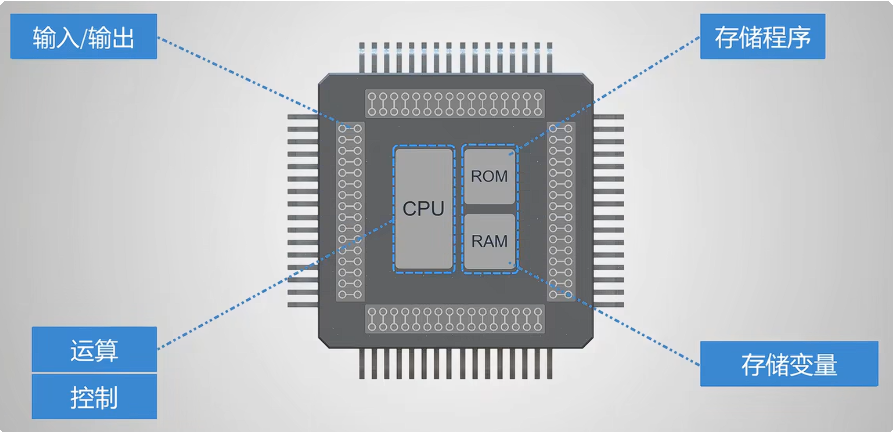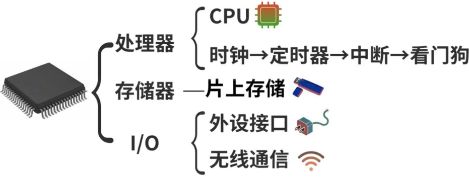

处理器(CPU)

核心:单片机中的处理器是其核心部分,负责执行程序中的指令,控制和处理数据。

架构:处理器可以基于不同的架构设计,例如 8 位、16 位或 32 位,这影响了其处理能力和效率。

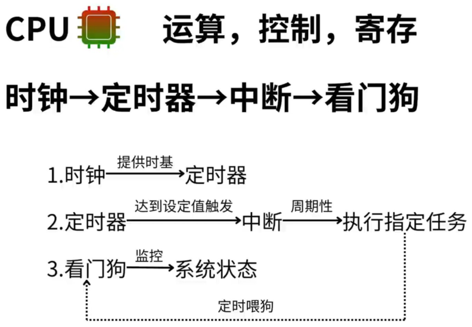

时钟(Clock)产生周期性的时钟信号,用来驱动微处理器中的各种操作,保证数据传输、处理和其他操作的顺序性和同步性。

定时器(Timer)在嵌入式系统中用于计时和延时操作。它可以用来测量时间间隔,产生定时中断,或者在特定时间后执行任务。微处理器可以使用定时器来精确控制需要在特定时间执行的任务。

看门狗定时器(Watchdog Timer)是一种特殊的定时器,用于监视系统是否运行正常。如果系统运行异常或软件崩溃,看门狗可以在预设的时间内复位系统,从而恢复到正常工作状态。

看门狗可以确保嵌入式系统可以在出现故障时自我恢复,防止系统挂起导致的长时间停机。

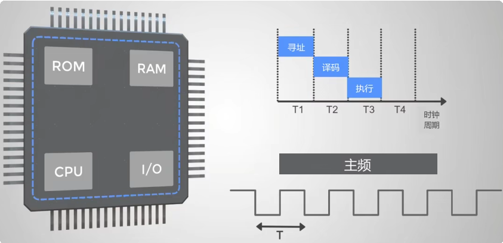

存储器(Memory)

存储器(Memory)是嵌入式系统中用于存储指令和数据的部分,包括了微控制器中所有用于数据和指令存储的组件。常见的存储器类型包括:

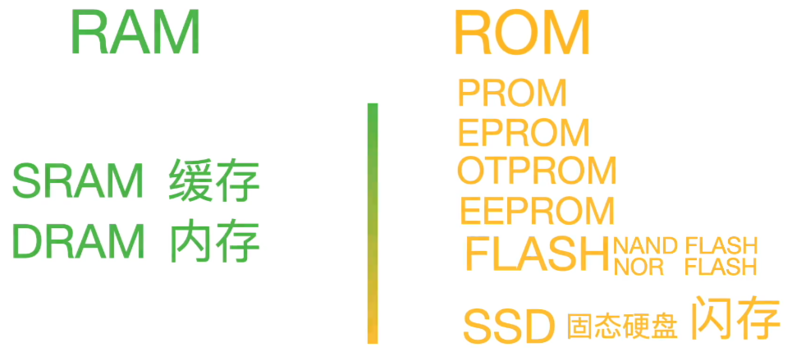

ROM (Read-Only Memory):只读存储器ROM 包含了微控制器的启动代码或不需要修改的固定程序。这些数据在生产时烧录,正常情况下是不会被改变的。

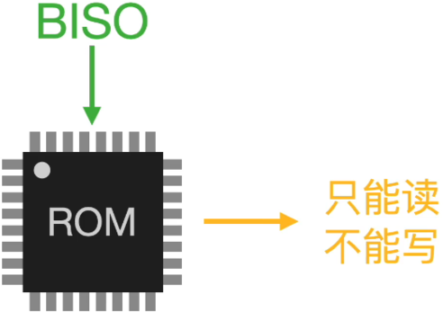

RAM (Random-access memory):随机存取存储器,用于存储临时数据和程序运行时的数据,比如变量和栈。RAM 是易失性存储器,断电后数据会丢失。

RAM   访问速度很快,仅次于寄存器,适合于运行期间需要频繁访问和修改的数据。

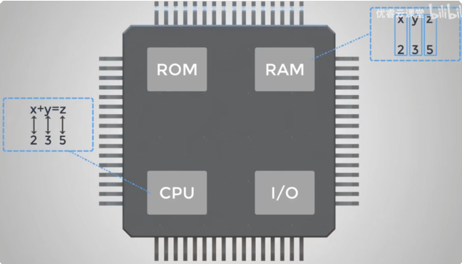

Flash Memory:Flash 用于存储程序代码和可能需要更新的数据。在Cortex-M3 微控制器中,flash 存储器通常用来保存用户的应用程序代码,因为它能够在断电后保留数据,并且可以被擦写和重写。

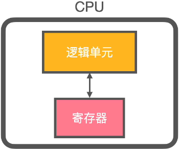

注意,单片机内部除了存储器可以储存数据,还有一个极小容量存储单元——寄存器 它用于保存当前正在 执行的指令需要的数据、地址及中间计算结果,是处理器直接操作的对象。它的访问速度是所有类型存储中最快的,因为它们物理上就位于处理器核心附近。

输入/输出(I/O)接口

单片机的输入/输出(I/O)接口是单片机与外界通信的桥梁。它们允许单片机发送控制信号到外部设备(输出),以及从外部设备接收信号(输入)。

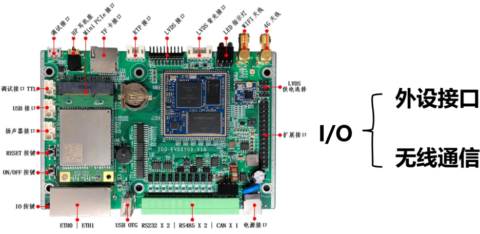

注意:图上绿色的板子是PCB(印刷电路板)。单片机是集成电路(IC)芯片,是被焊接在PCB 上的一个电子元件,其形状是一个黑色的小方块,有金属引脚。

(单片机的I/O 接口,通常是指单片机芯片上的I/O 引脚,但是有时指PCB 上的接口,而不是单片机芯

片本身的引脚)

输入/输出(I/O)接口有以下部分组成:

GPIO(通用输入/输出)端口:可以被配置为输入或输出的端口,用于连接各种外部设备,如传感器、执行器等

模拟输入:如ADC(模拟-数字转换器),用于将模拟信号转换为数字信号,以便处理器处理。模拟输出:如DAC(数字-模拟转换器),用于将数字信号转换为模拟信号。

通信接口:如串行通讯接口(UART、I2C、SPI 等),用于单片机与其他设备或单片机之间的数据通信。

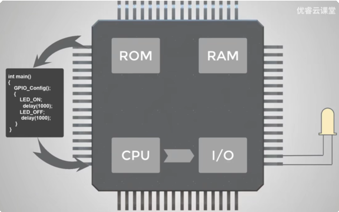

##### 微处理器的型号

英国ARM 公司

ARM 公司专门设计处理器核心,并将这些设计以许可证的形式授权给其他公司。这些合作伙伴公司(如高通、苹果、三星等)可以将ARM 的核心集成到它们自己的芯片设计中,或者根据自己的需要对核心进行定

。

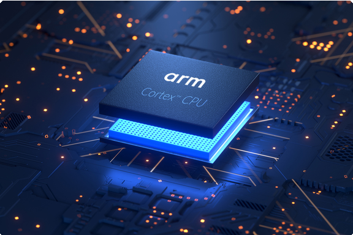

ARM 架构以其高性能、低功耗和低成本而著称,这使得它成为智能手机、平板电脑、多媒体设备和其他无数嵌入式产品的首选处理器。

ARM 处理器

ARM 公司在经典处理器ARM11 以后的产品都改用Cortex 命名,主要分成A、R 和M 三类,旨在为各种不同的市场提供服务。可以大致分为几个系列:

Cortex-A 系列:面向高性能计算和多任务处理,适用于智能手机、平板电脑、云服务器等需要较强处理能力的应用。

Cortex-R 系列:专为实时应用设计,提供可靠的实时性能和可预测性,适用于汽车电子、工业控制和嵌入式系统等领域。

Cortex-M 系列:针对低功耗和资源受限的嵌入式应用,提供紧凑的处理能力和实时性能,适用于物联

网设备、传感器节点等。

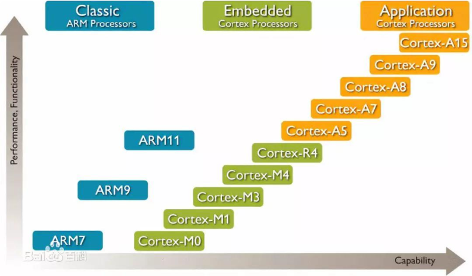

STM32 微控制器

STM32 微控制器(MCU)系列采用了ARM Cortex-M 体系结构。ARM Cortex-M 是一种 32 位的精简指令集计算机(RISC)体系结构,专门设计用于低功耗、实时嵌入式系统。

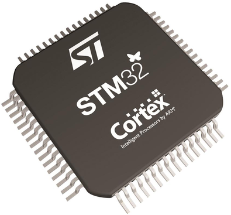

在STM32 系列中,常见的ARM Cortex-M 内核包括:

ARM Cortex-M0: Cortex-M0 是ARM 的基本入门级内核,具有较低的功耗和成本,适用于低功耗、资源有限的应用。它提供了较为基本的指令集和外设集成。

ARM Cortex-M3: Cortex-M3 是一种更强大的内核,具有较高的性能和更多的外设集成。它支持更复杂的应用和操作系统,具备较大的存储器地址空间和更多的调试和异常处理能力。

ARM Cortex-M4: Cortex-M4 在Cortex-M3 的基础上增加了数字信号处理(DSP)扩展指令集和单精度浮点运算支持,使其适用于更多的信号处理和计算密集型应用。

ARM Cortex-M7: Cortex-M7 是ARM Cortex-M 系列中性能最强大的内核。它具有更高的时钟频率、更高的指令执行效率和更丰富的外设集成。Cortex-M7 可应对更复杂的实时应用和高性能计算需求。

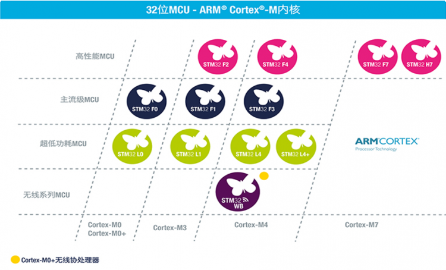

STM32F103 和STM32F407 是STMicroelectronics 公司推出的两个不同系列的STM32 微控制器。

STM32F103:使用了ARM Cortex-M3 处理器架构。Cortex-M3 是ARM 的第三代 32 位RISC 处理器核,具有高性能、低功耗和较强的实时性能。

STM32F407:使用了ARM Cortex-M4 处理器架构。Cortex-M4 是ARM 的第四代 32 位RISC 处理 器核,它在Cortex-M3 的基础上增加了浮点运算单元(FPU),提供了更强大的计算能力。采用了 Cortex-M4 核心,并且具有更高的性能和更丰富的外设集成。适用于要求较高性能和复杂功能的应用,如音频处理、图像处理、工业控制等。

STM32F103 是 STMicroelectronics(ST)公司生产的一款基于 ARM Cortex-M3 内核的中高性能微控制器(MCU),属于 STM32 F1 系列。这个系列的 MCU 非常受欢迎,因为它提供了强大的性能和丰富的特

性,且价格适中,非常适合商业和业余爱好者的各种应用。

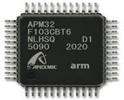

核心:32 位 ARM Cortex-M3 CPU,高性能和低功耗。频率:CPU 运行频率可达 72 MHz。

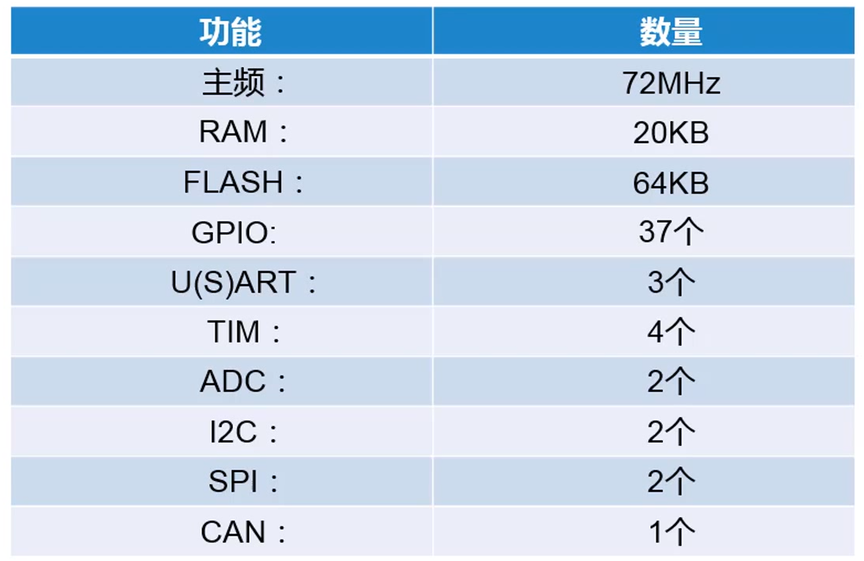

编程语言和开发环境

C/C++:使用 Keil MDK-ARM、IAR EWARM 或者免费的 STM32CubeIDE 等集成开发环境。 Arduino:通过 STM32Duino 项目,可以在 Arduino IDE 中开发 STM32F103。

###### 开源硬件平台

Arduino

Arduino 是一个基于简单的微控制器板和开发环境的开源电子原型平台,特别适合初学者和业余爱好者。

微控制器:Arduino 板一般搭载了一个如ATmega 系列的单片机。

易用性:Arduino   提供了一个简单的集成开发环境(IDE),可以让用户轻松地编写代码并将其上传到板

子上。

I/O 接口:提供多个数字和模拟的输入/输出引脚,可以连接于各种传感器、执行器和其他电子元件。社区和库:有一个庞大的线上社区和丰富的库支持,可以帮助解决编程和硬件集成问题。

它通常用于简单的单片机项目,如自动化控制、传感器集成等。 Raspberry Pi

Raspberry Pi 是一个小型、低成本的单板计算机,它的功能和能力比 Arduino 更强大,更接近于一个完整的桌面计算机

处理器:搭载了更强大的 CPU,通常是 ARM 架构。 操作系统:可以运行包括 Linux 在内的多种操作系统。

内存和存储:具有更大的 RAM 和通过 SD 卡或 USB 存储设备提供的存储。 多功能:具备高清视频输出(HDMI)、USB 端口、以太网连接等多功能接口。

Raspberry Pi 适用于需要更多计算能力的项目,如媒体中心、小型服务器、复杂的机器人项目或者作为学习编程和计算机科学的工具。

Arduino 适用于对实时性和硬件接口要求高、计算要求不是很高的嵌入式系统项目,而 Raspberry Pi 更适合需要运行完整操作系统、高级计算和网络功能的项目。

##### 微处理器的架构

冯· 诺依曼架构

冯· 诺依曼架构(Von Neumann architecture)是计算机设计的一种基础架构。这种架构的主要特点是将程序指令存储和数据使用同一个存储系统(存储器)存放,并通过一个通用的数据总线进行处理。

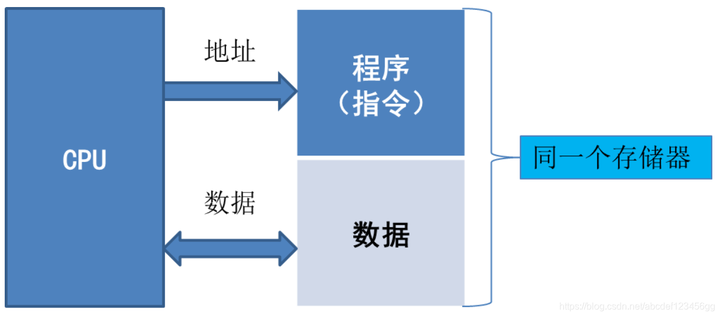

特点:

程序存储性(Program Stored Concept):程序以机器语言形式存在于内存中,计算机工作时从中读取指令。

顺序处理:指令按顺序执行,下一条指令通常在当前指令完成后执行。

可编程性:由于程序存储在可变的内存中,计算机可以通过加载不同的程序来完成不同的任务,而无需更改硬件

瓶颈问题:指令和数据通过同一总线在处理器和内存之间传输,可能产生瓶颈,这被称为 冯· 诺依曼瓶颈

。

###### 哈佛架构

哈佛架构是一种计算机架构,它的主要特征是物理上分离存储程序指令和数据的内存空间。

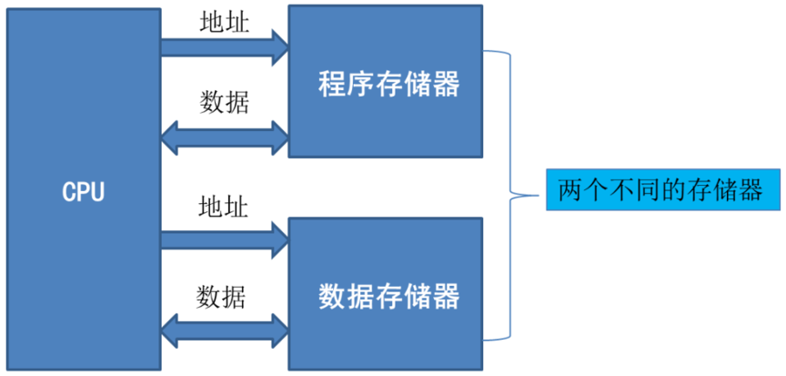

特点:

分离存储:拥有独立的存储空间和总线来处理指令和数据,这使得CPU 可以同时访问指令和数据,提高了处理速度。

并行访问:因为指令存储器和数据存储器是分离的,所以CPU 可以在同一时刻读取指令和读取/写入数据,从而能够更加高效地运行。

性能优势:分离的总线允许指令和数据有更高的带宽,减少了冯· 诺依曼瓶颈的影响,这在需要大量数据处理的应用中尤其有优势。

现代计算机系统,特别是微处理器,常常使用这两种架构的混合形式,例如,它们可能采用哈佛架构的方式分开处理缓存,同时在主存储器中使用冯· 诺依曼架构。

ARM 架构采用了一种称为“改进的哈佛体系结构”的设计    这种设计结合了冯· 诺依曼和哈佛体系结构的优点,通过分离指令和数据总线来提高性能,同时允许更灵活的编程和易于使用的特性。

### 计算机组成原理

一台完整的计算机包括硬件和软件两部分,另外还有一部分固化的软件称为固 件(Firmware),固件兼具软件和硬件的特性,常见的如个人计算机中的 BIOS。硬件与软件结合才能使计算机正常运行并发挥作用。

##### 计算机硬件系统

计算机硬件系统是构成计算机系统的电子线路和电子元件等物理设备的总称。

20 世纪 40 年代中期,美国科学家冯· 诺依曼(Von Neumann)大胆地提出了采用二进制作为数字计算机数制基础的理论

相比十进制,二进制的运算规则更简单, 0 和 1 两个状态更容易用物理状态实现,适合采用布尔代数的方法实现运算电路

存储程序和程序控制是冯·  诺依曼结构计算机的主要设计思想。

存储程序就是将解题的步骤编制成程序,然后将程序和运行程序所需要的数据以二进制的形式存放到存储器中,方便执行。

程序控制则是指计算机中的控制器逐条取出存储器中的指令并按顺序执行,控制各功能部件进行相应的操作,完成数据的加工处理。

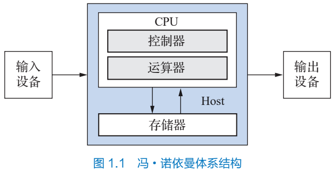

按照冯· 诺依曼的设计思想,计算机的硬件系统包含运算器、控制器、存储器、输入设备和输出设备五大部件。运算器与控制器又合称为中央处理器(Central Processing Unit, CPU);CPU 和存储器通常称为主机

(Host)。

###### 存储器

存储器的主要功能是存放程序和数据。程序是计算机操作的依据,数据是计算机操作的对象。不管是程序还是数据,在存储器中都是用二进制形式表示的,它们被统称为信息。

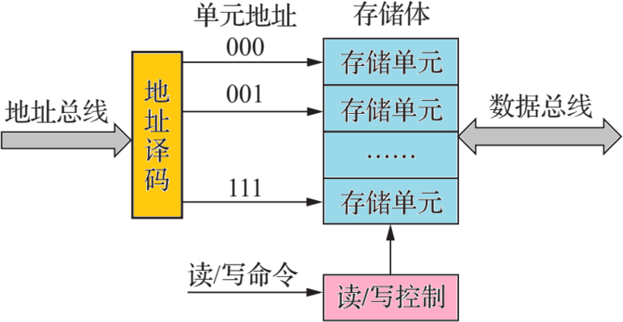

计算机的主存储器都是半导体存储器。存储体由许多个存储单元组成。存储单元按某种顺序编号,每个存储单元都对应一个编号,称为单元地址。

信息按单元存放。存储单元地址与存储在其中的信息一一对应。每个存储单元的单元地址只有一个且固定不变,而存储在其中的信息则可改变。

地址总线与数据总线分别为访问存储器传递地址信息和数据信息,地址总线是单向的,数据总线是双向

。

###### 运算器

运算器是一种用于信息加工处理的部件,它对数据进行算术运算和逻辑运算。算术运算是按照算术规则进行的加、减、乘、除等运算。

逻辑运算一般泛指非算术运算,如比较、移位、逻辑加、逻辑乘、逻辑取反及异或等。运算器通常由算术逻辑单元(ALU)和一系列寄存器组成。

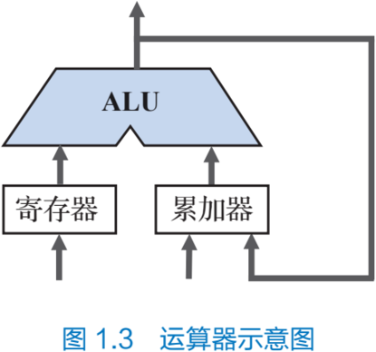

ALU 是具体完成算术与逻辑运算的部件;寄存器用于存放运算操作数;累加器除存放运算操作数外,在连续运算中,还用于存放中间结果和最后结果,累加器也由此而得名。

一般将运算器一次运算能处理的二进制位数称为机器字长,它是计算机的重要性能指标。常用的计算机字长有 8 位、16 位、32 位及 64 位。寄存器、累加器及存储单元的长度一般与机器字长相等。

###### 控制器

控制器是整个计算机的指挥中心,它可使计算机各部件协调的工作。

控制器工作的实质就是解释程序,发出命令。它每次从存储器读取一条指令,经过分析译码产生一串操作命令,再发给各功能部件控制各部件动作,以实现指令和程序的功能。

控制器是控制流信息的发源地。控制器产生控制流信息的依据来自 3 个方面:存放在指令寄存器中的机器指令,它是计算机操作的主要依据

状态寄存器,用于存放反映计算机运行的状态信息。

时序电路,它能产生各种时序信号,使控制器的操作命令被有序地发送出去

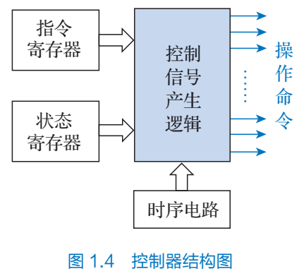

计算机中有两股信息在流动:一股是控制流信息,即操作命令,它分散流向各个功能部件;另一股是数据流信息,它受控制流信息的控制,从一个部件流向另一个部件,在流动的过程中被相应的部件加工处理。

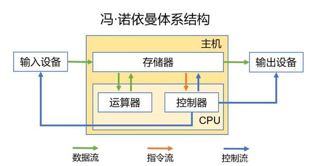

###### 输入输出设备

输入设备就是将信息输入计算机的外部设备,它将人们熟悉的信息形式转换成计算机能接收并识别的信息形式。

输入的信息有数字、文字、图形、图像、声音等多种形式;送入计算机的只有一种形式,就是二进制数据

常用的输入设备有键盘、鼠标、扫描仪及模 / 数(A/D)转换器等。A/D 转换器能将模拟量转换成数字量。(模拟量是指用连续物理量表示的数据,如电流、电阻、压力、速度及角度等)

输出设备就是将计算机运算结果转换成人们和其他设备能接收和识别的信息形式的设备,如字符、文字、图形、图像、声音等。

输出设备与输入设备一样,需要通过接口与主机连接。常用的输出设备有打印机、显示器、数 / 模

(D/A)转换器等。

总之,计算机硬件系统是运行程序的基本组成部分,人们通过输入设备将程序与数据存入存储器,计算机运

行时,控制器从存储器中逐条取出指令,将它们解释成控制命令去控制各部件的动作。数据在运算器中被加

工处理,处理后的结果通过输出设备输出。

###### 系统互连

计算机硬件系统各功能部件还需要有组织地以某种方式连接起来,从而实现数据流信息和控制流信息在不同部件之间的流动及数据信息的加工处理。

总线(Bus)是连接两个或多个设备(部件)的公共信息通路。它主要由数据线、地址线和控制线组成。 CPU 连接计算机中各主要部件的总线称为系统总线。

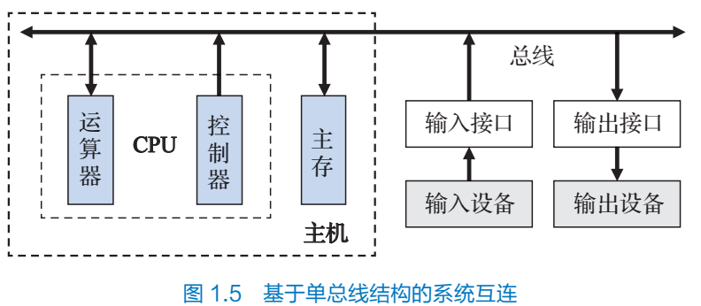

##### 程序设计语言

一台计算机中全部程序的集合统称为这台计算机的软件系统。计算机软件按其功能分成应用软件和系统软件两大类。

程序设计语言是用于书写计算机程序的语言,其基础是一组记号和一组规则。程序设计语言通常分为 3 类:机器语言、汇编语言和高级语言。

1. 机器语言
机器语言是用二进制代码表示的计算机能直接识别和执行的一种机器指令的集合。

每台机器的指令格式和代码所代表的含义都是事先规定好的,故机器语言也称为面向机器的语言,不同硬件结构的计算机的机器语言一般是不同的。机器语言程序执行速度快,但由于对机器的依赖程度高,因此编程烦琐、硬件透明性差、直观性差、容易出错。

1. 汇编语言
为了克服机器语言难读、难编、难记和易出错的缺点,人们发明了便于记忆和描述指令功能的汇编语言。

汇编语言是一种用助记符表示的面向机器的计算机语言。相比机器语言编程,汇编语言编程更加灵活,在一定程度上简化了编程过程。

使用汇编语言编程必须对处理器内部架构有充分的了解,汇编程序必须利用汇编器转换成机器指令才能执

。

1. 高级语言
高级语言是与人类自然语言相接近且能为计算机所接受的,语意确定、规则明确、自然直观和通用易学的计算机语言。目前广泛使用的高级语言有 Basic, C/C++, Java, Python 等。

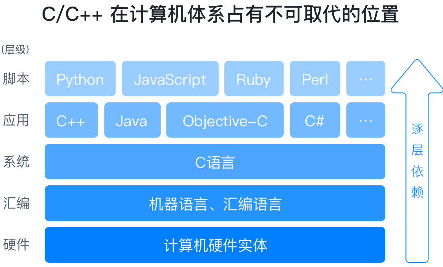

高级语言是面向用户的程序设计语言,需要通过相应的语言翻译程序才可变成计算机硬件能识别并执行的目标程序。其根据执行方式可分为解释型与编译型两类。

解释型语言采用边解释、边执行的方法,不生成目标程序,如 Basic, Java 语言编译型语言必须先将源程序翻译成目标程序才能执行,典型的如 C 语言等

语言翻译程序主要包括编译程序、汇编程序、解释程序和其他软件操作程序。

  1. 编译程序负责将高级语言翻译成汇编代码,也称为编译器;
  1. 汇编程序负责将汇编语言翻译成机器语言目标程序,也称为汇编器;
  1. 解释程序用于将源程序中的语句按执行顺序逐条翻译成机器指令并执行,且不生成目标程序,也称为解释器
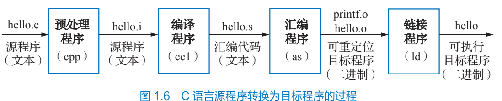

背景知识 - 18

# 数电基础

### 数制与编码

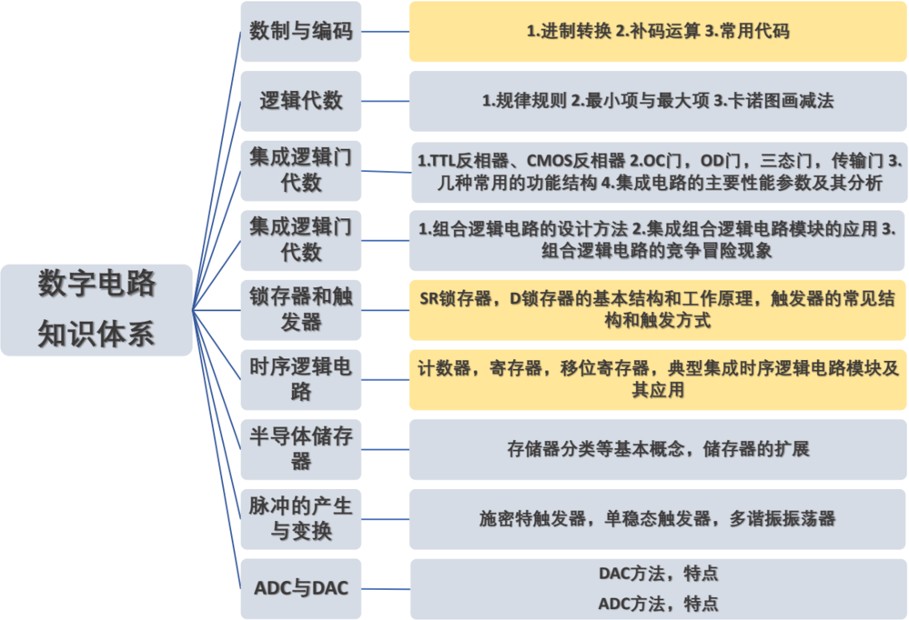

计算机内部流动的信息可以分为两大类:一类为数据信息,另一类为控制信息。数据信息是计算机加工处理的对象,而控制信息则用于控制数据信息的加工处理。

数制就是计数进位制,数制规定了数码处于不同位置所代表的数值。

##### 进制转换

###### 计数进位制

十进制(Decimal)

十进制是最常用的数制,它是一种基数为 10 的位置记数系统。

十进制有 10 个基本数字:0, 1, 2, 3, 4, 5, 6, 7, 8, 9。

每个位置的数值取决于其基数和位置大小的乘积。例如,数字 235 可以表示为 2×102 + 3×101 + 5×100。

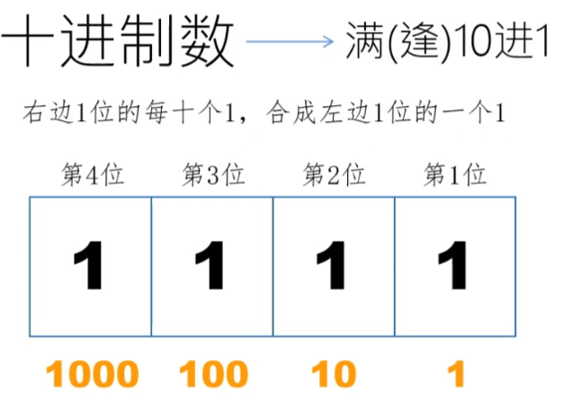

二进制(Binary)

二进制是计算机科学中使用最广泛的数制,因为计算机的基本单元(比特)只能表示两种状态:开或关,通常对应于 1 和 0。

二进制是一种基数为 2 的位置记数系统。

二进制只有两个基本数字:0 和 1。

类似于十进制,每个位置的数值取决于其基数和位置大小的乘积。例如,二进制数字 1011 可以表示为 1×23

+ 0×22 + 1×21 + 1×20,换算成十进制就是 11。

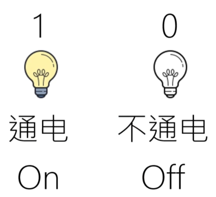

R 进制转十进制

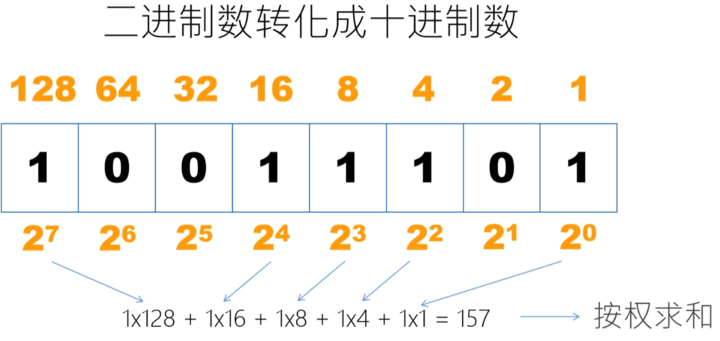

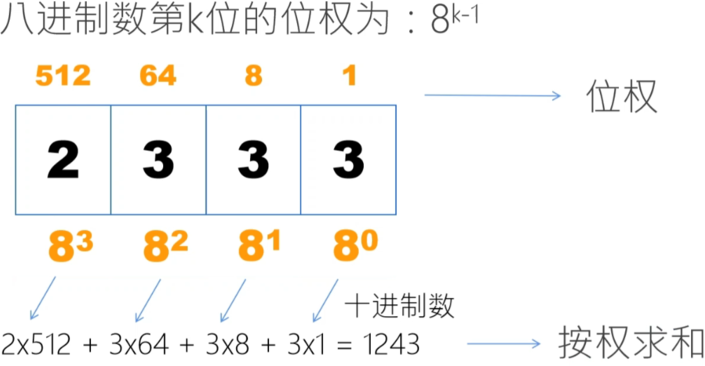

带小数的二进制数转换为十进制数:

(11010.101)2 = 1 × 24 + 1 × 23 + 1 × 21 + 1 × 2−1 + 1 × 2−3

= 16 + 8 + 2 + 0.5 + 0.125

= (26.625)10

十进制转R 进制

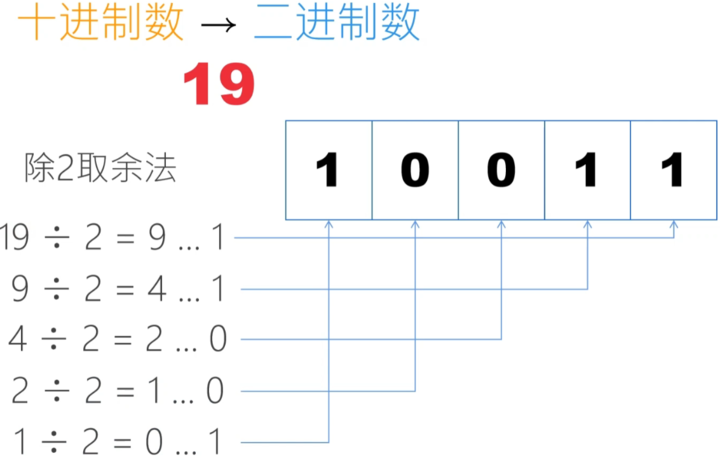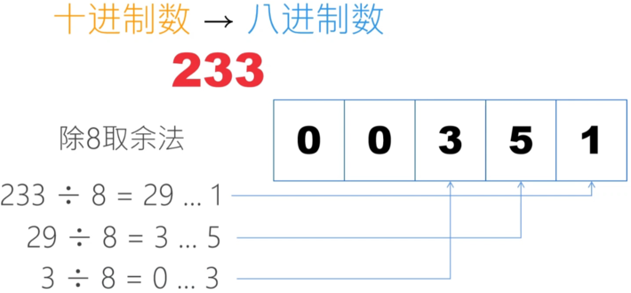

带小数的十进制数 57.6875 转换成二进制数:

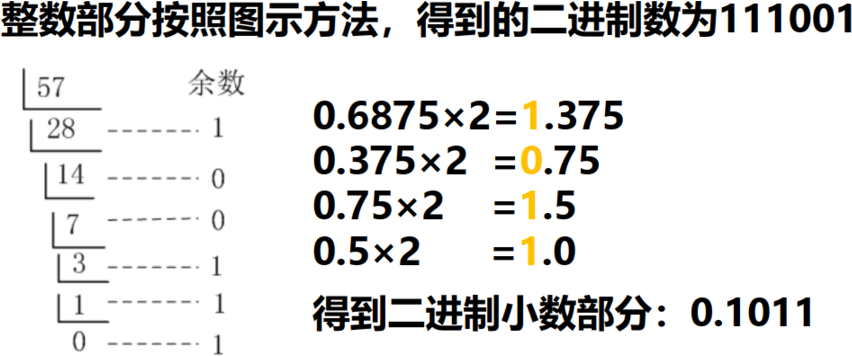

##### 机器码运算

###### 信息的二进制编码

信息:符号、文字、颜色、数值等;

编码:若干个数字量组合表示一个信息;

同一类信息内,信息必须与其编码一一对应,编码使用数字量的位数取决于需要编码的信息数量,一般地,

用 Bit(位)或 Byte(字节)或 Word(字)编码;

1 Byte = 8 Bit; 1 Word = CPU 字长 = 32 Bit(STM32F1)

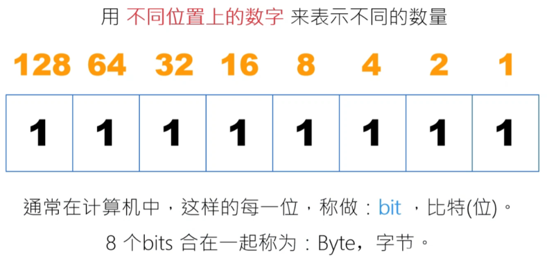

所有信息以二进制形式存储、运算、传输;

不需要进行算术运算的信息(如非数值信息)的编码原则上可以随意,但为方便译码,应按照统一标准编

。

例如,文本信息通常使用ASCII 码或Unicode 编码方案。ASCII 是早期的编码标准,定义了 128 个字符的编码,包括英文字母、数字和一些特殊符号。中文字符常用的UTF-16 就是 Unicode 的一种编码方式。

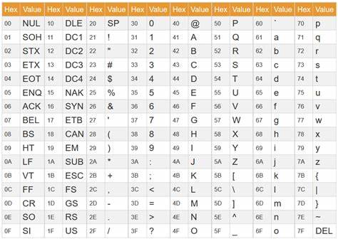

在ASCII 码中,英文字符占一个字节(8 位二进制),在UTF-16 编码下,一个中文字符占 2 个字节(16 位

二进制)

###### 数的表示方法

二进制数与十进制数一样有正负之分。书写时直接用 + 和 - 来表示数据的符号,这种数据书写格式也称为真值。

由符号和数值一起编码表示的二进制数称为机器数或机器码。常用的定点数机器码有原码、反码、补码和移码等,不同的机器码具有不同的特点。

原码

原码是一种直观的表示数字的方法,其中最高位用作符号位。在一个字节(8 位)中,最高位(符号位)为 0 表示正数,为 1 表示负数。剩下的 7 位表示数字的绝对值。

的原码表示为

(最高位为 0,表示正数)

的原码表示为

(最高位为 1,表示负数)

反码(负数的最高位不变,其他取反)

反码用于表示负数。正数的表示与原码相同,而负数的表示是将其正数的原码除了符号位外的其他所有位取反(即 0 变 1,1 变 0)。

的反码:的反码:

仍然是

的最高位不变,其他位取反,所以是

反码有一些缺点,在进行加法运算时,如果最高位产生进位,需要将进位加回到结果的最低位,这称为端点进位。

补码(负数的反码+1)

补码是目前计算机中最常用的表示负数的方法。正数的补码与其原码相同,而负数的补码是其反码加 1。

的补码:    仍然是

的补码:

的反码

加 1,得    。

补码便是为了弥补反码的缺点。能防止最高位溢出丢失产生的计算错误

###### 计算示例

假设我们要计算

+5 的原码表示为

-5 的原码表示为

:

(注意符号位是 1)

我们尝试直接计算这两个数的和:

结果

看起来像是 -8 的原码表示,但实际上我们期望的结果应该是 -2。原码不能处理正负数

相加的问题,这是用原码进行运算的不足。

为了克服原码的一些问题,人们引入了反码表示法。现在用反码进行加法计算:

|  |  |  |  |  | Arduino |
| --- | --- | --- | --- | --- | --- |
| 1 |  | 1111 | 1010 | (-5的反码) |  |
| 2 | + | 0000 | 0011 | (+3的反码) |  |
| 3 |  |  |  |  |  |
| 4 |  | 1111 | 1101 | (得到反码) |  |
| 5 | \* | 1000 | 0001 | (转成原码-1) |  |
| 6 | \* | 1000 | 0010 | (因最高位溢出,要末端进位 \*原码-2) |  |

得到的结果是

,如果我们将这个反码转换回原码,得到

,这是-1,并不是正确答

案-2,这是因为运算过程中最高位溢出了,因此人们规定在反码运算时,如果最高位溢出了,要在端位补

1。

有了“端点进位”,反码表示的运算就可以处理各种加法问题了,但是在硬件上过于繁琐。

补码解决了原码和反码的不足之处。补码运算自动处理了进位,如果最高位(符号位)产生进位,补码运算不会影响最终结果。

|  |  |  |  |  | Arduino |
| --- | --- | --- | --- | --- | --- |
| 1 |  | 1111 | 1011 | (-5的补码) |  |
| 2 | + | 0000 | 0011 | (+3的补码) |  |
| 3 |  |  |  |  |  |
| 4 |  | 1111 | 1110 | (得到补码) |  |
| 5 | \* | 1000 | 0010 | (转成原码-2) |  |

### 逻辑门电路

##### 二进制运算符

###### 异或运算符

异或运算符是一种二元运算符,通常表示为

或者

,用于执行逻辑运算。

| A(输入) | B(输入) | A XOR B(输出) |
| --- | --- | --- |
| 0 | 0 | 0 |
| 0 | 1 | 1 |
| 1 | 0 | 1 |
| 1 | 1 | 0 |

如果我们对数字

(二进制

) 和

(二进制

) 进行异或运算,结果是

(二进制    ):

在许多编程语言中,例如C、C++、Java、Python  等,都支持使用

符号进行异或运算。

###### 位移运算符

位移运算符是用于处理二进制数的位置移动的运算符。位移运算符分为两类:左移位运算符(    )和右移

位运算符(    )。

左移位运算符将数的所有二进制位向左移动指定的位数。左边的位被丢弃,右边新增的位补 0。

表示将    的二进制表示向左移动    。

右移位运算符将数的所有二进制位向右移动指定的位数。

这表示将    的二进制表示向右移动    。

左边新增的位通常用符号位填充(这种行为称为算术移位),而对于无符号整数,左边通常补 0(逻辑移位)。

例如,对于 8 位有符号整数:

可以看到,在右移过程中,新出现的位用 1 填充,以保持数值为负。

对于 8 位无符号整数:

位移运算符在底层编程、图形处理、加密算法等领域中非常有用,因为它们提供了一种快速高效地处理二进制数据的方法

##### 门电路

###### 基本概念

门电路是数字电路的基本构建块,它实现了逻辑函数,即根据输入信号的不同组合产生特定的输出。门电路通常使用半导体设备如晶体管来实现,并在集成电路中大量使用。

这些门电路遵循布尔代数的原则,并用于执行基本的逻辑操作,例如与(AND)、或(OR)、非

(NOT)、异或(XOR)等。

###### 基本门电路

非门(NOT Gate)

非门,也称为反相器,仅有一个输入。它产生与输入相反的输出,即当输入为高电平时输出为低电平,反之亦然

与门(AND Gate)

与门有两个或更多输入,只有当所有输入都为高电平(通常表示为逻辑  1)时,输出才为高电平。

或门(OR Gate)

或门有两个或更多输入,只要至少有一个输入为高电平,输出就为高电平。

异或门(XOR Gate)同为 0,异为 1

异或门有两个输入,当输入不同(即一个为高电平,一个为低电平)时,输出为高电平。

###### 反相门电路

与非门(NAND Gate)

与非门是与门的反相输出,即当所有输入都为高电平时,输出为低电平。

或非门(NOR Gate)

或非门是或门的反相输出,即只有当所有输入都为低电平时,输出才为高电平。

同或门(XNOR Gate)同为 1,异为 0

同或门是异或门的反相输出,即当两个输入相同时输出为高电平。

### 锁存器和触发器

锁存器(Latch)

锁存器(Latch)是一种基本的存储设备,它能够存储一个二进制位的信息(0 或 1)。锁存器可以通过电路的控制信号来改变其状态,以及保持该状态直到进一步的控制信号指示其改变。锁存器是构建更复杂存储设备如触发器(Flip-Flops)、寄存器和内存单元的基础。

一个锁存器代表一个盒子,盒子内部有一个开关,开关的开闭代表锁存器可以存储的两种状态(1 或 0)存储:通过开关的开闭,锁存器可以保存一个二进制位(1 或 0)

控制:盒子的盖子可以控制你什么时候可以改变里面的内容。只有当盖子打开时,你才能操作开关。在锁存器中,这个 盖子 是一个控制信号,当它被激活时,锁存器里的信息可以改变。

保持:当盖子关闭时,无论外界发生什么,盒子里的开关都不会改变。同样的,锁存器在没有接收到新的控制信号时会保持它的状态不变。

触发器

触发器(Flip-Flop)和锁存器相似,用于存储一个二进制位(0 或 1)。但是触发器对于何时允许信息改变有着更精确的控制。前面的锁存器是在输入端为高电平状态时,做出响应,而触发器是在某一输入端的电平的上升沿或下降沿,做出响应。

即锁存器的电平触发的,触发器是边沿触发的(上升边沿或下降边沿发生时触发)。

想象另一个盒子,但这个盒子的盖子有一些特殊的规则:它只在你鼓掌的瞬间打开一次,然后立即关闭。这意味着你只有在鼓掌的那一瞬间才能改变里面的内容。

触发器是在盖子打开的瞬间改变状态的。这就是我们所说的 边沿触发 ,在数字电路中,这通常对应于时钟信号的一个特定边缘(上升沿或下降沿)。

SR 锁存器

SR 锁存器(Set-Reset Latch)是最简单的锁存器类型,由两个交叉耦合的逻辑门构成,通常是NAND 门或NOR 门。SR 锁存器可用于存储一位二进制信息。"SR"代表"Set-Reset",这反映了该锁存器的两个控制输入

对于使用或非门NOR 的SR 锁存器,下图是它的初始状态,Q=1,此时锁存器储存值为 1。

Set(置位)操作: 当S=1,R=0 时,锁存器被置位。NOR 门的逻辑确保Q 输出变为 1,而非Q 输出变为 0。由于反馈的存在,即使S 恢复为 0,这个状态也会被保持(锁存)。因此给S 端一个脉冲,锁存器会储存 1。

Reset(重置)操作: 当S=0,R=1 时,锁存器被复位。在这种情况下,Q 输出变为 0,而非Q 输出变为 1。这个状态同样会在R 恢复到 0 后被保持。因此给R 一个脉冲,锁存器的储存值会归 0。

保持(Latch)状态: 当S=0,R=0 时,锁存器保持当前状态不变。这是因为NOR 门的反馈保持了当前的输出状态,所以无论之前是置位还是复位状态,都将被保持。

无效状态: 当S=1,R=1 时,会产生一个无效状态,因为两个输出Q 和非Q 都会被置为 0,这违反了 Q 和非Q 应该是互补的原则,这种输入组合应该避免。

总之,对于用或非门的SR   锁存器,保持低电平情况下,给一个置位脉冲S,Q=1,给一个复位脉冲R,Q=0

(高电平有效锁存器)

而对于右图用与非门的SR  锁存器,则刚好相反,被称为低电平有效锁存器。

D 锁存器

D 锁存器(D Flip-Flop),有时也称为数据或延迟锁存器,用于捕获并存储一位数字数据(0 或 1)。

它有一个数据输入(D)、一个输出(Q)、一个非Q 输出,以及一个使能输入E(通常称为时钟信号C 或 CLK)

D 锁存器的基本行为可以概括为:

锁存(Latch): 当时钟信号C(使能输入E)为高电平(1)时,D 锁存器的输出Q 跟随输入D,即 D 的值会被传递到Q。此时D 锁存器的输入直接映射到输出。这时,它就像一个开关,允许数据通过。

保持(Hold): 当时钟信号C 为低电平(0)时,D 锁存器保持其输出不变,不论输入D 如何变化。此时D 锁存器是不透明的,输出Q 保留了最后一次E 为高电平时D 的值。

D 锁存器的基本真值表

| Enable (E) | Data (D) | Output (Q) |
| --- | --- | --- |
| 0 | X | No Change |
| 1 | 0 | 0 |
| 1 | 1 | 1 |

E 是使能端,仅在E 为 1 时,D 锁存器才会响应输入D

D 是数据输入端 Q 是输出端

X 表示无关紧要的输入(因为使能端为 0,D 的变化不会影响Q 的状态)

D 触发器

D 触发器

要实现在边沿触发,只需要在原有锁存器的基础上加上一点结构,下图为D 触发器的结构(由D 锁存器改进

而来)。

D 触发器的逻辑符号:

虽然触发器的工作方式与锁存器有一些不同,但是他们的真值表是相同的。 D 触发器的基本真值表

| Clock (CLK) Edge | Data (D) | Output (Q) |
| --- | --- | --- |
| ↑ (Rising Edge) | 0 | 0 |
| ↑ (Rising Edge) | 1 | 1 |
| Other | X | No Change |

CLK 是时钟输入端,D 触发器只在时钟的特定边沿(如上升沿)变化时响应。 D 是数据输入端。

Q 是输出端。

X 表示在非触发边沿,D 的状态对Q 没有影响。

从下图可以看到,当在CLK  信号的上升沿发生时,D  的电平状态被传递到了Q

### 时序逻辑电路

##### 基础寄存器

寄存器的构造

一系列触发器就可以组成一个寄存器。通过前面的学习,我们知道一个触发器可以存储一位二进制信息,即 0 或 1。

那么如果一个寄存器里有 8 个触发器,相当于一个盒子里放了 8 个开关,它可以储存八位二进制信息。

一个 8 位寄存器可以存储从 0 到 255(二进制的 00000000 到 11111111)的任何数字。

同步触发

不管是什么类型的寄存器,寄存器中的所有触发器共享一个公共的时钟信号。这个时钟信号负责同步每一个触发器的数据捕获。

因此所有的触发器都会在时钟信号的同一边沿同时更新它们的状态。这意味着整个寄存器的内容会在一个单

一的时刻被更新。

一旦寄存器捕获了数据,它就会维持这些数据,直到下一次时钟信号的边沿。在此期间,外部电路可以读取寄存器的输出。

输入输出方式

上图是一个并行输入,并行输出(PIPO)的寄存器构造,它还有很多种其他输入输出方式:

串行输入:每加载一个时钟脉冲,就会使得一个数据位进入寄存器的第一触发器。下一个时钟脉冲到来时,所有触发器中的数据位都往后移动一位,为新的数据位腾出空间——数据是一位接一位地进入寄存器的

串行输出:数据从寄存器的最后一端按顺序地一位一位输出。

并行输入:每加载一个时钟脉冲,所有的数据位同时被送到各自对应的触发器中。

并行输出:每加载一个时钟脉冲,可以同时读取寄存器中的所有位,而不是按序列一个接一个地读取。

根据这些信息,我们可以对寄存器进行分类:

##### 移位寄存器

移位寄存器(Shift Register)用于顺序地存储和移动(或 移位 )它的二进制数据。它也是由一系列触发器组成,每个触发器(通常是D 触发器)能够存储一位数据。

移位寄存器可以按照时钟信号的节拍(上升沿),将数据从一级(stage)传送到下一级。

在时钟脉冲的作用下,每个触发器的输出(Q)会被传送到下一个触发器的输入(D)。因此,整个寄存器中的数据会按照时钟信号的节拍移动一位。

数据通过移位寄存器从左向右移动的效果可以用表示为:

下面以 4bit 单向寄存器(串行输入、并行输出)为例:

给一个输入数据信号脉冲D(010,如图),则在第一个时钟脉冲Clk 上,FFA 的输出QA 将被设置为高电平 1 ,而所有其他输出仍保持低电平 0 。

第二个时钟脉冲Clk 将 FFA 的输出QA 更改为逻辑 0 ,FFB 的输出QB 将被设置为高电平 1 ,这就好像 1 被右移了一位,以此类推。

在第四个时钟脉冲结束后,4 位数据(0-0-0-1)存储在寄存器中,并且如果寄存器的时钟停止,数据将保留在那里

工作流程可以表示为:

| 1 | 初始状态: 0000 |  |
| --- | --- | --- |
| 2 | 输入一个1: 1000 |  |
| 3 | 第一个时钟脉冲后: | 0100 |
| 4 | 第二个时钟脉冲后: | 0010 |
| 5 | 第三个时钟脉冲后: | 0001 |
| 6 | ... |  |

如果给的输入数据信号脉冲D 为 1101,那么具体流程可以用下面表示:

寄存器的作用

视频中寄存器内部使用的是主从触发器(Master-Slave Flip-Flop),由前后两级RS 触发器构成,相当于 RS 触发器的改进版,用于实现更加稳定的边沿触发。

##### 计数寄存器

分频器

了解计数器之前,首先要了解一下分频器。分频器用于将输入的时钟信号频率降低(分频)。

当我们把一个触发器的输出(Q)被连接到同一触发器的输入(D),就形成了一个反馈回路。当触发器在 每个时钟脉冲CLK 上触发时,它的输出状态Q 受到反馈回路的影响而改变(从 0 变到 1,或从 1 变到 0),这样就实现了频率减半。

也就是说,如果原本Q 的输出保持为 0,那么Q 非就是 1,并连接到D,当经历一个时钟上升沿,D 的值就被传递到Q,此时Q 保持为 1,Q 非为 0;再经历一个时钟上升沿,Q 又会保持为 0...。也就是说每经历一个时钟上升沿,Q 会变化一次,因此该触发器的输出Q 的波形要比时钟信号稀疏一半。

这就是一个最简单的分频器,这一个触发器实现了对时钟信号的一次二分频。纹波计数器

如果我们把这些触发器串行连接起来。第一个触发器由原始时钟信号触发,然后其输出作为下一个触发器的时钟输入,依此类推。

这种连接方式导致输出的变化像波纹一样从第一个触发器传播到最后一个触发器,因此这种计数器被称为纹波计数器

正如下图中,一个高频率的时钟信号被被第一个触发器“除以二”(ƒ ÷ 2),输出QA;然后再次被第二个触发器“除以二”(ƒ ÷ 2 ),输出QB,以此类推。

利用输出的QA, QB, QC, QD 就可以创建一个 4 位的二进制计数器:

把它倒过来,就是一个个二级进制序列了:

##### 定时计数器

定时器模块的核心是一个计数器,通常由一系列D 型触发器构成。

D 型触发器的工作原理相对简单:其数据输入端(D)接收数据信号,时钟输入端(CLK)接收时钟脉冲信号,只有当时钟信号从 0 跳变到 1 时,输出(Q)才会更新,并且输出的状态与数据输入保持一致;而Q 非的输出则与Q 相反。

一个基本的三位二进制计数器示例中,第一位的输出是时钟信号的取反Q1,其他位的输出直接连接到各自触发器的Q 端,而每个Q 非的输出又连接到下一个触发器的输入。如果CLK 接入时钟信号,那么每次时钟信号的上升沿都使计数器的值变化一次,这就构成了一个个简单的分频器。将这些分频器串联起来,每一次时

钟脉冲,就会使

的值递增一次,从

增至

(一共 8 次计数)。接收到下一

个脉冲后,计数器会溢出并回到 000。

如果串联更多触发器,比如添加额外 5 个触发器,就可以构建一个 8 位计数器,使其能够计数至 255。

为了实现定时功能,单纯一个计数器是不够的,还需要时钟源和分频器:

时钟源:外部的石英晶振或单片机内部的RC   振荡器,主要提供时钟脉冲。

分频器:本质上就是计数器。例如,一个计数器,每接收 8 个脉冲,其第四位(Q4)输出才会反转一次。如果输出接在Q4,这就构成了一个 8 分频器,即时间减慢了 8 倍;如果接在Q3,每 4 个脉冲Q3反转一次,实现 4 分频,时间减慢了 4 倍。

CPU 在使用定时器时首先需要配置一些参数,比如设置定时器的初始值,预分频值等。设置完成后,CPU可以继续执行其他任务,而定时任务由定时器模块独立完成。

例如,若时钟源频率为 1MHz,每秒能提供 100 万个脉冲,每个脉冲持续 1 微秒。当一个八位计数器计数到 0XFF(255)时,再来一个脉冲就会使计数器溢出,总共计数了 256 个脉冲,此时定时器模块会给CPU 发送中断信号,告知CPU 定时了 256 微秒。

若要进行更长时间的定时,比如一分钟(6000 万微秒),需要对计数器进行分频处理。进行 256 分频后, 256 个脉冲才让计数器加 1,那么计数器溢出一次需要 256×256 即 65536 微秒。计数器需要多次溢出以达到所需的定时时间。

除了定时,定时器模块还具备计数功能。例如,通过将时钟源接到单片机的某个引脚上,并在该引脚接霍尔开关,可以实现速度计数,如自行车速度监测。当车轮上的磁铁经过霍尔开关时,触发器每次都会增加计数值,从而根据每秒钟的计数量推断出速度。

RAM 存储器

六晶体管RAM 单元

六晶体管RAM 单元(6T RAM cell)是静态随机存取存储器(SRAM)的基本存储单元。

一个六晶体管存储单元是由六个晶体管构成的。这些晶体管一起工作以存储一个位(bit)的数据,并且能够在不需要刷新的情况下保持该位的状态(这是静态RAM 与动态RAM(DRAM)之间的一个主要区别)

下图的绿色方块代表单个 6T SRAM 存储单元,每个都能存储一个二进制位(0 或 1)。这些单元按照矩阵排列构成一个更大的存储阵列,每个单元对应于阵列中的一个位。

AX 和AY 地址线:用于定位存储阵列中的特定行和列,这样可以指定要访问的特定单元。 WR 和RD 线:分别是写入和读取控制信号,控制数据的读写操作。

DO-D7 数据线:表示 8 位数据总线,用于在存储器和其他系统部分之间传输数据。

每个 6T SRAM 单元都通过地址线被精确选择,并通过数据线进行数据通信。读写操作通过WR 和RD 信号进行控制,这些信号确保数据可以被正确地写入或从存储单元中读取。

通过这种方式,可以读写矩阵中任何位置的数据,实现随机存取。

数电基础 - 24

# 地址位带

### 架构背景

#### Cortex-M3 架构

Cortex-M3 是一个 32 位处理器内核。内部的数据路径是 32 位的,寄存器是 32 位的,存储器接口也是

32 位的。

内核:Cortex-M3 是一个 32 位的处理器内核。

数据路径:能够在一个周期内同时处理、传输或操作 32 位的数据。

寄存器:Cortex-M3 的通用寄存器是 32 位的,包括程序计数器、堆栈指针和状态寄存器等。存储器接口:存储器接口也是 32 位的,意味着它在访问内存时能够一次读写 32 位数据。

内存地址仍按字节编址:虽然寄存器可能是 32 位的,但每个独立的内存地址对应 8 位数据。

由于每个内存地址点对应 8 位,一个 32 位的寄存器将覆盖 4 个连续的内存地址:

第一个地址对应寄存器的最低有效 8 位(LSB,最低字节)。第二个地址对应寄存器的次低字节。

第三个地址对应寄存器的次高字节。

第四个地址对应寄存器的最高有效 8 位(MSB,最高字节)。

如果一个 32 位寄存器的起始地址是 0x20000000 ,则这个寄存器将占据    、

、

、 0x20000003 这四个地址。

上图展示了简化的微控制器的主要组成部分及其之间的连接。如果我们把各部分内容展开:

该单片机由四个驱动单元和四个被动单元组成:

驱动单元:

ARM Cortex 内核(CPU)、数据总线、系统总线、两个DMA(直接存储器访问单元,与CPU 有同等地位,他们的作用就是在硬件上绕过CPU,直接在内存与I/O 设备之间开辟一条数据传输的通道,从而较低 CPU 开销,提高效率)

被动单元:

内存SRAM(临时存储)、闪存Flash(永久存储执行代码)、可变静态存储器控制器FSMC(用于给单片机拓展静态资源)和片内外设(片内资源:I/O 口,模数转换器、串口等)。

驱动单元和被动单元之间通过总线矩阵和AHB  系统总线连接和协调。

#### Cortex-M3 内核

Cortex-M3 内核采用了哈佛结构,拥有独立的指令总线和数据总线,可以让取指与数据访问并行不悖,从

而提升了性能。

虽然指令总线和数据总线被分开了,但它们仍被共享在同一个存储器空间(一个统一的存储器),仍然是 4GB 的寻址空间

处理器核心:Cortex-M3 内核采用三级流水线:取指、解码和执行。分别对应处理器内核系统中的取指单元、指令解码器以及寄存器组与算术逻辑单元(ALU),它们构成了中央处理核心。

寄存器组:Cortex-M3 拥有一组 32 位寄存器,包括 13 个通用寄存器(R0 至 R12)、栈指针

(SP)、链接寄存器(LR)、程序计数器(PC)以及程序状态寄存器(xPSR),其中包括应用程序状态寄存器(APSR)、中断程序状态寄存器(IPSR)和执行程序状态寄存器(EPSR)。

存储器(内存):包括程序存储器(如Flash 存储器)和数据存储器(如SRAM)。程序存储器用于存放微控制器的程序代码,而数据存储器用于暂存程序运行时的数据。

时钟系统:系统定时器(SysTick)为操作系统提供的简单的 24 位清零写入、递减、归零回绕计数器,并具有灵活的控制机制

中断控制器(IC):NVIC 嵌套向量中断控制器,管理中断请求,允许优先级排序和中断嵌套。WIC 唤醒中断控制器,允许微控制器在低功耗模式下被中断唤醒。

接下来会分别介绍这几个关键组件。

##### 堆栈与指针

堆栈(Stack):简称为栈。一种线性表数据结构,是一种只允许在表的一端进行插入和删除操作的线性表。

它按照后进先出(LIFO, Last In First Out)的原则工作。可以想象一叠盘子,你只能在顶部添加或移除盘

子。

特别是在函数调用时,堆栈用来存储局部变量、函数参数、返回地址等。当调用一个函数时,其信息(如参数、局部变量和返回地址)被"推入"(push)堆栈,创建了一个堆栈帧(stack frame)。函数完成后,其信息被"弹出"(pop)堆栈,控制返回给调用者,其对应的堆栈帧被移除。

指针 (Pointer):即指针变量,它的值通常是内存地址的引用。即指针存储了一个内存地址,表示数据在内存中的位置

在 C 或 C++ 等语言中,我们在程序中使用指针,就可以在运行时访问和修改内存中的数据。指针可以指向变量、数组、函数或任何其他类型的数据。

堆栈指针(Stack Pointer):

堆栈指针是一个特殊的指针,它指向当前堆栈帧的顶部。在处理器架构中,有一个专用的寄存器用作堆栈指

。

指向顶部: 堆栈指针总是指向当前堆栈帧的顶部。

上移下移: 当数据被推入堆栈或从堆栈弹出时,堆栈指针会相应地上移或下移。关键作用: 堆栈指针对于正确管理函数调用和返回机制至关重要。

### 寄存器组

Cortex-M3 微控制器内部有一个寄存器组。在处理器执行指令时,用于存储临时数据、程序状态和控制信息。它具有非常快的访问速度,比访问存储器要快得多,这使得处理器能够高效地执行程序。

为了提高指令执行效率,为不同的任务提供专用的寄存器,内部划分了不同的寄存器组。

在编写程序时,我们不需要直接操作这些寄存器,因为高级编程语言和操作系统抽象了这些细节。然而,在以后学习汇编语言或者进行系统编程时,理解这些寄存器的作用就显得非常重要。

##### 模式与特权

Cortex-M3 支持 2 个模式和两个特权等级。操作模式

Cortex-M3 没有像其他一些ARM 处理器那样的多种操作模式(如用户模式、系统模式、中断模式等)。它只有两种模式:

1. 线程模式(Thread mode):这是处理器执行应用程序代码的正常模式。在这个模式下,处理器可以运
行特权级别或用户级别

1. 处理模式(Handler mode):当处理器响应异常或中断时,会自动进入处理模式。在这个模式下,处理器总是运行在特权级别
特权级别

在Cortex-M3 处理器中,特权级别控制着程序的访问权限,它们决定了程序能否访问保护的系统资源。 Cortex-M3 有两种特权级别:

1. 特权级别(Privileged):在这个级别下,代码具有执行任何指令的能力,包括访问所有的外设和系统控制资源。操作系统的内核通常在这个级别上运行,以便能够管理硬件资源和执行任务调度。
1. 用户级别(Unprivileged):在用户级别下,代码的执行受到限制,不能执行某些可能会影响系统安全或稳定性的指令,也不能访问受保护的资源。用户应用程序一般在这个级别上运行,以保护系统免受恶意软件或错误代码的影响。

| 归纳 | 特权级 | 用户级 |
| --- | --- | --- |
| 异常处理的代码 | 处理者模式 | 错误用法 |
| 应用程序的代码 | 线程模式 | 线程模式 |

模式会关联能使用的寄存器,因此STM32F1 的寄存器数量也相对较少,大致可分为通用寄存器与特殊功能寄存器两种。

##### 通用寄存器

R0-R12 都是 32 位通用寄存器,是用于数据操作“最通用目的”的寄存器,其中R0-R7 为低组寄存器,R8-R12 为高组寄存器。

低组寄存器R0-R7

最基本的通用寄存器,用于保存临时数据、函数参数、返回值等。它们在所有的指令中都可以使用,并且在所有的执行状态下都是可见的。在许多函数调用约定中,R0-R3 被用作传递函数参数和返回函数结果。

高组寄存器R8-R12

在某些复杂的函数中,可能需要更多的寄存器来保存数据,这时高组寄存器就会被使用。它们在不同模式下的行为与低组寄存器几乎相同。

绝大多数 16 位 Thumb 指令只能访问 R0-R7,而 32 位 Thumb-2 指令可以访问所有寄存器。

这里涉及到“指令集”,ARM 处理器支持 Thumb 和Thumb-2 指令集,指令集指明了处理器可以执行的各项操作。

接下来是三种比较特殊的寄存器组,相对难懂,但是可以把这些寄存器想象成处理器程序执行过程中的 导航 ,三种寄存器代表了三种 标志 。

堆栈寄存器是 你现在在哪里 的标志,标记着当前活动的函数的局部变量存储位置。

链接寄存器是 你从哪里来 的标志,标记着函数调用完成后应该返回到哪里。

程序寄存器是 你要去哪里 的标志,指明下一步的目的地。 堆栈寄存器R13

在程序运行时,函数的局部变量和传递给函数的参数通常会被推送到堆栈上,需要有一个寄存器时刻定位这些变量参数的最新位置,这就是堆栈寄存器的作用。

堆栈寄存器(通常称为SP,Stack Pointer)用于跟踪程序当前堆栈帧的顶端位置。在函数调用过程中,它会随着局部变量的分配和释放而上下移动,从而确保堆栈指针都指向最新位置(堆栈的顶部)。

堆栈寄存器有两个堆栈指针:

主堆栈指针(Main Stack Pointer, MSP):用于系统级的栈操作。默认的堆栈指针,由OS 内核、异常服务进程以及所有需要特权访问的应用程序代码使用,可用于线程模式和处理者模式。

进程堆栈指针(Process Stack Pointer, PSP):用于应用级的栈操作。用于常规的应用程序代码(不处于异常服务例程中时),只用于线程模式。

访问堆栈时,只需要两条指令:PUSH(入栈)和POP(出栈),默认使用主堆栈指针 MSP。通常进入子程序后,第一件事是把寄存器值PUSH 入堆栈中,子程序退出前会POP 曾经PUSH 过的寄存器。

连接寄存器R14

在一个函数被调用时,链接寄存器(LR,Link Register)会存储返回地址。这样,当这个函数被执行完毕后,处理器可以使用连接寄存器中的地址来返回到正确的位置继续执行整个程序。

程序寄存器R15

程序计数器(PC,Program Counter)确保处理器知道接下来要执行哪条指令,从而使程序能够顺利进行。每当一条指令执行后,程序计数器都会更新,指向下一条指令。

##### 特殊功能寄存器

程序状态寄存器

程序状态寄存器(Program Status Register,PSR)用于储存处理器的状态信息,这些信息描述了处理器在执行指令时的各种状态。

有 3 种程序状态寄存器:应用程序PSR(APSR),中断号PSR(IPSR),执行PSR(EPSR)程序状态寄存器里存放了两类信息:

一类体现当前指令执行结果的各种状态信息,如有无进位(CY 位),有无溢出(OV 位),结果正负

(SF 位),结果是否为零(ZF 位),奇偶标志位(P 位)等。

一类存放控制信息,如允许中断(IF  位),trace  标志(TF  位)等执行PSR(EPSR)包含两个重叠的区域:

用于 If-Then( IT)指令的执行状态区,以及T 位(Thumb 状态位)。可中断-可继续(interruptible continuable)指令( ICI)区,用于被打断的多寄存器加载和存储指令。

例如,在应用程序PSR(APSR)中,会记录最近算术或逻辑操作的结果信息,如是否产生了溢出、是否结果为零、是否有借位或进位等。根据这些标志的状态,决定了程序的下一步执行路径。

通过 MRS/MSR 指令,这 3 个 PSRs 即可以单独访问,也可以组合访问。当使用三合一的方式访问时,应使用名字 xPSR 或者 PSR 。

中断屏蔽寄存器

在外设或软件的运行中,有时会遇到异常导致中断发生,这时它们会发送 中断 信号给处理器,告诉处理器需要注意某些事件。

中断屏蔽寄存器(Interrupt Mask Register)是用于控制处理器对中断请求的响应,即是否要 屏蔽 这些中断信号的接收。

启用中断:如果中断屏蔽寄存器允许某个中断,当该中断发生时,处理器会暂停当前任务,转而处理中断请求

禁用中断:相反,如果中断被屏蔽,即使中断发生,处理器也会忽略它,继续执行当前任务。

通过适当配置中断屏蔽寄存器,系统可以确保在关键任务执行期间不会被其他中断信号影响而被迫停止。中断控制寄存器有三种:

控制寄存器

控制寄存器CONTROL 相当于处理器内部的 设置 或 配置面板 。用于控制和配置处理器的操作和访问权限。

在Cortex-M3 中,控制寄存器的第 0 号位    用于控制 线程模式 下的特权级别。此外,它的

第 1 号    还决定了使用哪个堆栈指针——主堆栈指针(MSP)还是进程堆栈指针(PSP)

| 寄存器名 | 位 | 值 | 描述 | 限制 |
| --- | --- | --- | --- | --- |
| CONTROL | CONTROL\[0\] | 0 | 状态:线程模式,特权级 | 处于特权级才可修改 |
| CONTROL | CONTROL\[0\] | 1 | 状态:线程模式,用户级 | 处于特权级才可修改 |
| CONTROL | CONTROL\[1\] | 0 | 选择:主堆栈指针 MSP(复位后默认值) | 处于线程模式的特权级才可修改 |
| CONTROL | CONTROL\[1\] | 1 | 选择:进程堆栈指针 PSP | 处于线程模式的特权级才可修改 |

只有处于特权级的代码才可以通过    来设置 线程模式  的级别。用户级下的代码不能再试图修

改    来回到特权级

而不管是任何原因产生了任何异常,处理器都将以特权级来运行其服务例程,异常返回后,系统将回到产生异常时所处的级别。因此,从用户级别返回到特权级别的唯一途径就是异常,由那个异常来修改

,才能在返回到线程模式后拿到特权级。

如果在程序执行过程中触发了一个异常,处理器总是先切换入特权级,并且在异常服务例程ISR 执行完毕退出时,返回先前的状态。这种机制保证了操作系统内核的安全性和稳定性。

以上过程,还可以用下图来总结:

把代码按特权级和用户级分开对待,使架构更加安全和健壮。例如,当某个用户程序代码出问题时,不会让它成为害群之马,因为用户级的代码是禁止写特殊功能寄存器和 NVIC 中寄存器的。

### 地址映射

地址映射(memory map)的本质是生成一张存储器的地图,它是一种将物理存储单元(比如内存、寄存器等)对应到处理器的地址空间的技术。

在Cortex-M3 这类微控制器中,处理器地址空间是一个连续的虚拟地址区域,它的大小是 4GB。

这里的 映射 就是把物理实体用一串地址数字来代替。 映射 使处理器只需要访问内部的一个虚拟地址区域,就可以与外部设备或内部寄存器进行通信。

##### 划分地址

在了解地址映射之前,要先了解数据在内存中的储存形式——地址

###### 内存地址

1 个字节→8 位比特

比特Bit 是计算机最小的存储单位, 大家都知道计算机实质上都是用二进制数 0 或者 1 来存储数据的, 所以 Bit 实际上是存放 1 个二进制数字的 1 个位置。也就是说bit 只有 2 种值, 0 或者 1。

1 个字节Byte 可以看成是有 8 个物理上连续的Bit 组成的,1 个Byte = 8Bit。那么 1 个Byte 能表示多少种值呢, 很简单就是 2^8 = 256 种

这 256 个值分别是 0~255 所以 1 个字节能表示最大的值就是 255, 所以很多时候我们见到有 255 最大的限制(例如ip 地址)就是这个原因

2 位十六进制→8 位二进制

1 个字节是由 8 个位组成的, 每 4 个位可以看成 1 组,每组有 2^4 = 16 种,可以由 1 个十六进制数字来表

示。 也就是说二进制的 0000 - 1111 可以表示十六进制的 0-F,所以用 16 进制和 2 进制的转化其实是很方便的

内存的基本结构

内存里存放的数据是什么呢? 其实也是只是存放 0 或者 1 这两个二进制数字。所以内存里实际上有海量的小格子,每 1 个格子是 1 个bit,就只能存放 1 个数字(0 或者 1)。

内存里的格子数量非常巨大, 如果cpu 要读出某个指定的数据, 怎么去找呢?不可能 1 个 1 个格子去遍 历,实际上内存是把 8 个bit 排成 1 组, 每 1 组成为 1 个单位, 大小是 1byte(字节), cpu 每一次只能访

问 1 个byte, 而不能单独去访问具体的 1 个小格子(bit)。也就是说 1 个byte 字节就是内存的最小的IO 单位

(一个内存单元)。

内存地址的概念

即使我们把内存分成了以字节为单位的结构, 但是实际上内存里还是有非常多的字节的,例如 1MB=1048576byte

但是一个接着一个字节去历遍的话...还是很浪费时间的行为,所以为了避免去遍历内存,计算机系统就引入了内存地址这个概念。

系统会给内存每 1 个字节分配 1 个内存地址,cpu 只需要知道某个数据类型的地址,就可以直接去对应位置去提取数据了,这就是直接寻址技术——CPU 不用一个个历遍寻找,直接跳到对应的位置

内存地址的表示

那么内存地址的长度是多少呢?在 32 位系统中, 内存的地址就是 32 位的 2 进制数, 那么假如 32 位系统的某个内存地址是:

那么它可以用十六进制表示成:

。

。所以你见到这种字母数字混合的地址方式,就是这样得来

内存地址的数量决定cpu 能访问的内存大小。既然 32 位系统里内存地址长度是 32 位的,所以 32 位的地址

范围就是从 0000 0000 0000 0000 0000 0000 0000 0000 到

1111 1111 ( Ox00000000 ~ OxFFFFFFFF ),这里有几个地址呢? 明显是有 2^32 个。

前面讲过,一个地址对应一个字节,2^32byte=4GB,所以 2^32 个地址就总共能对应 4GB 的内存容量。

假如你给 32 位的系统配上了 8GB 的内存, 操作系统最多也只能给其中 4GB 分配地址, 其余 4GB 是没有地址,因为地址不够用, 所以 32 位系统最多支持 4GB 内存。

内存地址的大小

一个内存地址对应一个 8 位的内存空间(1byte),其本身是一个 32 位的二进制数(大小是 4byte)

大家都知道指针变量是用来存放内存地址的,那么对于 32 位系统来讲,内存地址是 1 个 32 位长度的 2 进制数,而每 1 个内存单位长度只有 1byte = 8bit(位),所以 1 个指针 就需要 4byte 的内存来存放该指针的内容(1 个内存地址)。

###### 储存顺序

计算机内存中有大端序和小端序的概念。例如,你有一串数字 2019,现在需要把这个数字放进几个小抽屉

里,每个抽屉只能放一个数字。

大端序(Big-endian):大端序可以看作将数据按照人类阅读数据的方式来存储。它从大端 2

开始储存

小端序(Little-endian):正好相反,它从最不重要的部分开始放(小端“9”)

假设我们有一个 32 位的十六进制整数,其值为

进制)。那么储存这个数需要分配几个 抽屉 (地址)呢?

(

是一个提示符号,表示这个数是十六

内存地址的一个 抽屉 的大小是 1 字节(byte)。我们知道一个字节由 8 位(bits)组成,足以表示 256 个不同的值。

十六进制数的每一位可以表示 16 个不同的值,两位十六进制数可以表示 16×16 个数,刚好是 256,那么一

个 抽屉 就可以放一个两位的十六进制数(    到    )。

也就是要分配四个地址,每个地址存两位数,用小端储存的话:

用大端储存的话:

到了存储器内,就是这样的:

ARM Cortex-M3 采用的是小端序存储方式(对于 2019,它会先存 9 ,而不是 2 )

到了STM32 的地址空间中,地址A 就变成一个十六进制的数,如六进制数,就代表了每一个区域的起始地址。

。如下图中的左右两侧十

注意:绝大多数计算机是按字节(byte)寻址的,也就是一个地址指向大小为一个字节(byte)的内存单元,一个字节有 8 位,也就是一个地址指向 8 位的内存单元。我们称其最小寻址单位为字节。

##### 两种映射

###### 存储器映射

在Cortex-M3 微控制器中,有随机访问存储器(RAM)、只读存储器(ROM)、及其他类型的存储器。

每一种存储器都会被分配一个或多个特定的地址范围,软件通过读写这些地址就可以访问对应的存储器内容。

例如,Cortex-M3 的RAM 存储器被分配到 0x20000000 到 0x200FFFFF 这个地址范围。当CPU 发送了一个在这个范围内的地址的读写请求时,它实际上就会访问RAM 的实际位置。

###### 寄存器映射

对于寄存器映射,情况类似,但这次映射的对象是微控制器内部的寄存器或连接到微控制器的外部设备的寄存器。

在Cortex-M3 中,所有的外设寄存器(比如定时器、串行接口、模数转换器等)都被映射到了特定的内存地址。这意味着,要发送一个命令到 定时器 ,你需要向一个特定的内存地址写入命令。同样地,要读取定时器的当前值,你只需要从一个特定的地址读取。

例如,一个定时器有一个控制寄存器,它被映射到地址 0xE000E010。写入特定的值到这个地址会启动或停

止定时器。读取这个地址可以告诉你定时器是否正在运行。

##### 地址空间

Cortex-M3 微控制器的地址空间是基于 32 位地址总线的,意味着它可以寻址从 0x00000000 到 0xFFFFFFFF 的内存地址,总共有 4GB(Gigabytes)的地址空间。

###### 空间划分

地址空间被分割成几个区域,每个区域都有特定的用途和访问权限。由于计算机的储存顺序都是从下端起始,因此从最底下的代码区介绍:

B0 代码区域(Code):

范围: 0x00000000 - 0x1FFFFFFF;大小: 512MB

描述: 此区域用于存储微控制器的程序代码。通常,这部分内存是只读的,并且在这里可以放置启动代码和其他执行指令。微控制器在复位后开始执行的第一条指令通常位于这个区域。

B1 片上SRAM(静态随机存取内存):

范围: 0x20000000 - 0x3FFFFFFF;大小: 512MB

描述: SRAM 区域是用于放置数据的内存区域。这是一个非易失性的存储区域,主要用于存放程序运

行时的变量、栈和其他临时数据。

B2 片上外设(Peripherals):

范围: 0x40000000 - 0x5FFFFFFF;大小: 512MB

描述: 这个区域用于映射微控制器上的各种外设,如定时器、串行接口、模数转换器等。通过读写这个区域的特定地址,程序可以控制这些外设的行为。

B3-B4 片外RAM:

范围: 0x60000000 - 0x9FFFFFFF;大小: 1GB

描述: 用于连接外部的RAM。当内部的SRAM 不足以满足程序需求时,可以添加外部RAM,并通过这个地址区域与之通信。

B5-B6 片外外设:

范围: 0xA0000000 - 0xDFFFFFFF;大小: 1GB

描述: 类似于外部RAM 区域,这个区域是为了映射连接到微控制器的外部设备,比如外部存储器、其他类型的硬件接口等。

B7 系统级别:

###### 区域细分

对于原本是 系统级别 的区域,被细分成了三个区域。首先是底部是外部PPB 和内部PPB:

内部PPB 里有系统控制空间(SCS),它包含NVIC、SysTick、MPU 和代码调试的寄存器,用于控制微控制器的核心功能

我们还可以发现,对于内部RAM 和内部外设,其区域的底部,有一个特别的小区域:位带区: 1MB 大小

位带别名区: 32MB 大小,对应位带区,提供了 8M 个位变量

位带操作

在 51 单片机中,最小寻址单位为位,也就是可以直接对位进行操作。但是STM32 内核的最小寻址单位与绝

大数计算机一样,是字节,无法直接对位进行操作。

##### 优越性

###### 直接操作的弊端

STM32 的按字节分配地址,也就是只能读取并处理整个字节。如果我们需要修改某一位的值,就会导致一些问题。

举个例子,进程A 要修改地址为 0x20000000 的数据的 5 号位,把 0 改成 1;进程B 要修改地址为 0x20000000 的数据的 4 号位,把 1 改成 0。当它们同时进行时,会出现:

| 4 | 线程A按一个字节读取到\[ | 0 | 0 | 0 | 1 | 1 | 1 | 1 | 0 | \] |
| --- | --- | --- | --- | --- | --- | --- | --- | --- | --- | --- |
| 5 | 线程B也按一字节读取到\[ | 0 | 0 | 0 | 1 | 1 | 1 | 1 | 0 | \] |
| 6 | 线程A将读取内容处理为\[ | 0 | 0 | 1 | 1 | 1 | 1 | 1 | 0 | \] |
| 7 | 线程B将读取内容处理为\[ | 0 | 0 | 0 | 0 | 1 | 1 | 1 | 0 | \] |
| 8 | 最终结果为B的处理结果\[ | 0 | 0 | 0 | 0 | 1 | 1 | 1 | 0 | \] |

那么,会发现因为同时进行的缘故,线程A 的操作被B 覆盖了。

因此我们要确保当多个线程尝试同时读写共享数据时,每个操作都是完整和独立的(原子性)。位带操作的设计在执行过程中不会被任何其他操作中断,无论是来自操作系统的中断,还是来自其他线程的干预。

这就需要位带操作了。我们可以用一个简单的例子理解位带操作:

###### 位带操作的例子

位带区:例如,有一个 8 个停车位的小停车场。每个停车位可以看作是 1 位(0 或 1)。当一个车位被占用时,对应的位设置为 1;当车位空出来时,对应的位重置为 0。

位带别名区:现在,为了更有效地管理这个停车场,我们建立了一个远程管理办公室。办公室给每个停车位都分配 32 个按钮,这些按钮可以控制停车位的状态。假如第一个按钮用来占用车位(设置位为 1),而相应的第二个按钮用来释放车位(设置位为 0)。

位带操作:如果你想改变停车位 1 的状态,你就去办公室里找到停车位 1 对应的一组 32 个按钮中的第一个按钮。当你按下这个按钮,就相当于在原始停车场将停车位 1 的状态设为 占用 (1)。

这样做的好处是,即使多个管理员同时操作远程管理办公室的按钮也不会相互干扰,因为每个按钮只控制一个特定的停车位的特定功能。这可以确保停车场的状态被正确地更新,不会被相互干扰,避免冲突。

##### 位带操作

###### 基本概念

STM32 的位操作是通过访问位带别名区来实现的,即将每个比特位膨胀为一个 32 位的字,当访问这些字的时候就达到了访问比特位的目的。

如上图所示,位带区中的一个地址(一行)中的一个比特位被膨胀到了位带别名区中的 32 个比特位,对应了四个地址(四行)。

位带区:这是内存中可以进行位带操作的区域。STM32 有两个这样的区域,一个在片上外设区域中,另

一个在片上SRAM 区域中。

位带别名区:这是一个映射区域,位带区的每个位在别名区都有一个 32 位的地址。即一个 32 位的字可以代表位带区中的一个单独位

映射:通过在位带别名区修改的值,会直接同步到位带区。

###### 计算方法

既然要通过位带别名区来修改位带区的值,那么我们就需要知道位带别名区的地址:

对于 SRAM 位带区的某个比特,记它所在字节地址为 A,位序号为 n(0<=n<=7),则该比特在别名区的地址为:

对于片上外设位带区的某个比特,记它所在字节的地址为 A,位序号为 n(0<=n<=7),则该比特在别名区的地址为:

根据上述两个公式的特点,将其统一为一个公式表示:

位带区中相邻的比特位在别名区跨 4 个地址

SRAM 区中的位带地址映射:

片上外设区中的位带地址映射:

用图形来表示是这样的:

| 1 | LDR | R0, | =0x22000000 | ; | R0 = 0x22000000 |
| --- | --- | --- | --- | --- | --- |
| 2 | MOV | R1, | #7 | ; | R1 = 0x00000007(0b111) |
| 3 | STR | R1, | \[R0\] | ; | R1的数加载到R0指向的地址,即\[0x22000000\] = 0x00000007 |
| 4 |  |  |  | ; | 但实际上,0x22000000在别名区,不会被修改 |
| 5 |  |  |  | ; | 0x22000000指向的是0x20000000的0bit位 |
| 6 |  |  |  | ; | 当别名区\[0x22000000\]的第一位被置1时,会触发位带操作 |
| 7 |  |  |  | ; | 即位带区\[0x20000000\] = 0x00000001 |
| 8 |  |  |  |  |  |

##### 数据手册

学习这些,是为了让我们能看懂单片机数据手册中的内存映射图表:

我们要知道的是,想要对存储器进行读写,或者对外设进行控制,就应该去读写对应的内存地址。

假设我们想要操作GPIO 端口B 的第 3 号引脚(PB3),并且我们想要设置这个引脚为高电平。在STM32中,GPIO 的输出数据寄存器(ODR)用于控制端口引脚的高低电平状态。

首先,我们需要知道GPIOB 的ODR 寄存器的地址。STM32 的参考手册里会有这个信息。

假设你找到了GPIOB 的ODR 寄存器的基地址为    。在ODR  寄存器中,每一位对应一个

GPIO 引脚的输出状态,其中第 0 位对应PB0,第 1 位对应PB1,以此类推,第 3 位对应PB3。

我们可以根据上述计算方法得到位带别名区的地址:

将这些值代入计算:

这样,我们得到了PB3  对应位在位带别名区的地址    。现在,我们可以直接写入这个地址以控

制PB3 的状态。要将PB3 设置为高电平,我们只需将位带别名区的这个地址写为 1。在C 语言中,这可以

通过如下代码实现:

这条语句将会把位带别名区的地址

处的 32 位字设置为 1,然后这个值会被同步映射回

的第 3 位(对应PB3),将其被设置为 1,从而使得GPIOB 的第 3 号引脚输出高电平。

地址位带 - 25

汇编寻址指令

### 背景知识

###### RISC 和CISC

指令的强弱是CPU 的重要指标,指令集是提高微处理器效率的最有效工具之一。从现阶段的主流体系结构来讲,指令集可分为精简指令集(RISC)和复杂指令集(CISC)两部分。

精简指令集(RISC)的架构强调指令集的简化与统一,以及高效硬件的利用,通过固定长度的指令和流水线技术来提升处理器性能。而复杂指令集(CISC)的架构提供丰富的指令集和复杂的寻址模式,允许执行更为复杂的指令,但这也导致硬件的复杂性升高。

| 特征 | RISC 架构 | CISC 架构 |
| --- | --- | --- |
| 指令集 | 精简,固定长度 | 丰富,变长 |
| 硬件设计 | 简单,以寄存器为中心 | 复杂,以内存操作为中心 |
| 内存访问 | 通过加载/存储指令操作 | 指令可直接操作内存 |
| 指令执行 | 流水线化,每个阶段执行不同指令 | 微码执行复杂指令 |
| 执行效率 | 高,因为指令简单且执行时间均匀 | 取决于指令和硬件优化程度 |
| 总结 | 每条指令实现的功能简单,单条指令耗电低,效率高 | 每条指令实现的功能复杂,单条指令耗电高,效率低 |

举个例子:A 要坐车去B

精简指令集RISC:准备四个轮子和一个座位→把A 放在座位上→座位放在四个轮子上→去B复杂指令集CISC:仓库找车→坐车→去B

同样的事情,虽然结果是一样把A 送到了目的地,但是基于RISC 的ARM 指令集没有仓库,什么都要造。

而x86(基于CISC)有一堆提前备好的仓库,可以直接用。

这样的差异在于ARM 过程中消耗少,因为就车壳加轮子,而x86 的车是提前做好的,但是车上的灯光,空调,多余的空座位等,是本次任务中不需要的东西,也一起弄进去了,所以占用资源比ARM 大,但是做复杂的事因为x86 啥都有,所以比ARM 开发更简单,统一标准的库也能让效率更高。

因此,现代处理器设计常常结合了RISC 和CISC 的设计理念,以提供最优的性能和能效。例如,现代x86处理器在内部使用RISC 类似的技术来执行CISC 指令集。

###### 处理器架构区别

x86 架构:最早由英特尔公司推出,后来成为PC 和服务器领域的主流架构。x86 处理器广泛应用于个人电脑、工作站、服务器和数据中心等领域。常见的x86 处理器包括英特尔的Core 系列和AMD 的Ryzen 系

。

ARM 架构:最初设计用于低功耗嵌入式系统,如智能手机、平板电脑和物联网设备。然而,由于其能效优势和灵活性,ARM 处理器逐渐扩展到其他领域,如移动计算、服务器和工业自动化。ARM 处理器的代表性产品包括ARM Cortex-A 系列(应用处理器)和Cortex-M 系列(嵌入式处理器)。

RISC-V 架构:是一种开源指令集架构(ISA),它基于精简指令集计算机(RISC)设计。RISC-V 的开放性和灵活性使其受到广泛关注,并在学术界和一些特定领域的商业应用中得到采用。RISC-V 架构的特点包括可定制性、扩展性和简化的许可模型。

Power 架构:最初由IBM 开发,并在服务器和大型计算机领域得到广泛应用。Power 架构的特点是高性

能、可扩展性和可靠性,适用于处理复杂计算任务和企业级应用。Power 处理器主要用于高端服务器和超级计算机。

| 特性 | ARM 架构 | x86 架构(x64 架构) | Power 架构 |
| --- | --- | --- | --- |
| 指令集类型 | RISC(精简指令集) | CISC(复杂指令集) | RISC(精简指令集) |
| 功耗 | 低,适合电池供电的设备 | 相对较高,但现代设计优化了能效 | 中到高,侧重于性能 |
| 应用领域 | 移动设备、嵌入式系统 IoT 设备 、 | 个人电脑、服务器、 高性能计算 | 服务器 高性能计 、 算 |
| 软件多样性 | 随着市场份额增长 而提升 | 非常成熟,广泛的操作系统和应用支持 | 操作系统和应用支持较少 |
| 许可和生产 | IP 授权模式,多家公司生产 | Intel 和AMD 主导生产 | 主要由IBM 及其合作伙伴生产 |

##### ARM 指令集

ARM 指令集:最初的ARM 指令集基于 32 位架构设计,这意味着每条指令都是 32 位宽。这个指令集非常强大,可以进行各种复杂操作,但它的缺点是代码密度较低,即执行相同功能的代码比较占用空间。

Thumb 指令集:为了提高代码密度,即让代码占用更少的空间,ARM 公司引入了Thumb 指令集。Thumb指令集主要由 16 位宽的指令组成,这使得程序占用的空间相对较小,但是它牺牲了一部分性能和指令的多样性。简单来说,Thumb 指令集是ARM 指令集的一个 轻量级 版本,专为需要较小代码尺寸的应用设计。因此Thumb 指令集适用于资源受限的嵌入式系统。

Thumb-2 指令集:随着技术的进步和市场的需求,ARM 公司进一步发展了Thumb 指令集,创造了 Thumb-2 指令集。Thumb-2 指令集是ARM 和Thumb 的混合体,它包含了 16 位和 32 位指令,结合了两者的优点:保持了Thumb 指令集的高代码密度,并且回收了ARM 指令集的强大功能。这使得Thumb-2 指令集在保持代码紧凑的同时,也具有很高的执行效率和灵活性。

STM32 微控制器的大部分系列,特别是基于ARM Cortex-M3、M4 和M7 的系列,都使用Thumb-2 指令集。

ARM Cortex-M3 处理器使用 32 位Thumb-2 指令集,摒弃了 32 位的ARM 指令,但同时又兼容 16 位的 Thumb 指令,方便程序员编程的同时,又提高了代码的执行效率。需要注意的是:Cortex-M3 并不支持所有的Thumb-2 指令,仅仅是其的一个子集。

##### Thumb‐2 指令集

Thumb‐2 指令集,其中既包括 16 位的指令,又包括 32 位的指令,这使得在编程时不必再像从前一样去手动切换指令状态(32 位的ARM 状态和 16 位的 Thumb 状态,切换时会消耗额外的切换时间),即可达到性能和存储之间的平衡。

因为在 32 位指令下,性能极高;而在 16 位指令下,代码密度提高了一倍,可以在相同的内存和缓存中存放更多的指令。

为了使芯片结构保持简单情况下进一步提升系统的运行效率,Cortex-M3 内核采用简单的 3 级流水线。每个指令的执行分为三个步骤:取指令、译码和执行。单周期指令的 3 级流水线如下如图所示。

"取指令"时需要通过指令总线读取存储器中的对应指令,此操作会占用指令总线;"译码"时将指令转换为具体的控制信号,不占用任何总线;"执行"时进行读取寄存器堆栈、操作数在通信移位器中移位、ALU 产生相应的运算结果,并写到目的寄存器中,根据需求更改状态寄存器条件位,此时占用数据总线。

因为Cortex-M3 内核使用的是哈佛结构,具有单独的数据总线和指令总线,所以在组成 3 级流水线时,这三个操作并不会相互影响,从而将单个指令的执行时间为 3 周期,但在单周期内可以有 1 个指令的吞吐率。

ARM 程序示例

指令是微处理器能理解的最小执行动作方式,每条指令都会变成二进制的机器代码,控制具体的物理单元来执行。

另外还有一种叫伪指令,伪指令可以说是一些基本指令集的组合,由编译器来自动改变成具体的指令。

这是一个简单的ARM 程序示例。

以 ; 开始的程序是说明部分,一般包括文件名、功能介绍等。

以 AREA 开始,以 END 结尾的代码声明段,指出是程序还是数据,若是程序,则说明是 ARM 指令还是 Thumb 指令;若是数据,则说明存放的方式是字还是半字。如何访问等。

程序段一般分三栏书写,最左侧是标号,中间是指令码,最右边是指令的操作数。

ARM 指令的组成

##### 三地址指令格式

ARM  是三地址指令格式,指令基本格式如下:

其中,<>号内的项是必须的,{ } 号内的项是可选的。必要部分:

:  指令助记符,用于指定要执行的操作,如

(加法)、

(减法)等。

:  目标寄存器,指令执行的结果将存储在这里。

: 第一个操作数的寄存器。可选部分:

: 条件助记符(Condition Code),用于指定该指令在什么条件下执行(如等)。如果省略,指令在任何条件下都会执行。

、    、

: 写上S 表示该指令会影响程序状态寄存器CPSR 条件标志位,即

(负数标志)、

(零标

志)、

(进位标志)和

(溢出标志)。这些标志位会根据执行的指令和操作数的结果而改变。

:  第二个操作数,可以是寄存器或立即数。

操作数往往会有若干个,不同指令需要不同数目的操作数,并且对操作数的语法要求也可以不同。编码格式

码   指的是二进制代码,如操作码(Opcode)是指定每条指令所要执行操作的那部分二进制代码。

助记符(Mnemonic)是与操作码相对应的易记的缩写或符号,用于在编写汇编代码时表示特定的操作。例

如,助记符

表示加法操作,

表示减法操作。助记符使得程序员无需记住每条指令的二进制编

码,只需通过助记符即可编写程序。

在不同的ARM 指令中,操作码的具体位置和长度会有所不同。 16 位Thumb 指令二进制编码映射图

32 位Thumb 指令二进制编码映射图

和

后缀:

表明指令是 16 位的Thumb 指令,

表明指令是 32 位的扩展Thumb 指令。如果

没有这些后缀,处理器将根据指令的具体编码自动选择使用 16 位还是 32 位的指令格式。

UAL 等值写法

Thumb-2 引入了 统一汇编语言(UAL) 语法机制。因此它既支持传统的Thumb 语法,也支持UAL 语法允许的等值写法

不过有一项必须注意:如果使用传统的Thumb 语法,有些指令会默认地更新APSR,即使没有加上S 后缀。如果使用UAL 语法,则必须指定S 后缀才会更新。

##### 常见助记符汇总

常见操作码

| 指令助记符 | 描述 | 指令助记符 | 描述 |
| --- | --- | --- | --- |
| ADC | 带进位加法 | LSR | 逻辑右移 |
| ADD | 加法 | MOV | 数据传送 |
| AND | 逻辑与 | MUL | 乘法 |
| ASR | 算术右移 | MVN | 取反后的数据传送 |
| B | 分支指令 | NEG | 取反 |
| BIC | 逻辑位清除 | ORR | 逻辑或运算 |
| POP | 出栈 | PUSH | 压栈 |
| BL | 带链接的相对分支指令 | BLX | 带交换的分支指令 |
| ROR | 循环右移 | CMN | 相反数比较 |
| SBC | 带借位减法 | CMP | 比较指令 |
| STM | 多寄存器存储 | EOR | 逻辑异或 |
| STR | 单寄存器数据存储 | LDM | 多寄存器加载 |
| SUB | 减法 | LDR | 单寄存器加载 |
| LSL | 逻辑 左移 | SWI | 软中断 |
| BKPT | 断点指令 | TST | 位测试 |

常见条件码

| 条件码 | 条件助记符 | 含义 | APSR 标志位 |
| --- | --- | --- | --- |
| 0000 | EQ | = x | Z = 1 |
| 0001 | NE | ≠ x | Z = 0 |
| 0010 | CS/HS | 无符号数 ≥ x | C = 1 |
| 0011 | CC/LO | 无符号数 < x | C = 0 |
| 0100 | MI | x 为负数 | N = 1 |
| 0101 | PL | x 为正数或 0 | N = 0 |
| 0110 | VS | 溢出 | V = 1 |
| 0111 | VC | 未溢出 | V = 0 |
| 1000 | HI | 无符号数 > x | C = 1 且 Z = 0 |
| 1001 | LS | 无符号数 ≤ x | C = 0 且 Z = 1 |
| 1010 | GE | 有符号数 ≥ x | N = V |
| 1011 | LT | 有符号数 < x | N ≠ V |
| 1100 | GT | 有符号数 > x | Z = 0 且 N = V |
| 1101 | LE | 有符号数 ≤ x | Z = 1 或 N ≠ V |
| 1110 | AL | 无条件执行 | 忽略 |
| 1111 | NV | 从不执行 |  |

常见指令后缀

在ARM 指令集中,指令助记符可以带有后缀。指令后缀与条件助记符是一样的,只是书写位置不同。

ARM 指令集允许条件执行,几乎每条指令助记符都可以带有一个条件码后缀,它直接决定了指令在何种状态下被处理器执行。

| 后缀 | 描述 |
| --- | --- |
| S | 设置标志(Set condition codes),这表示指令将会更新状态标志位 |
| EQ | 等于(Equal),条件为 Z=1 |
| NE | 不等于(Not Equal),条件为 Z=0 |
| LT | 小于(Less than),条件为 N not equal to V |
| GT | 大于(Greater than),条件为 Z clear AND (N equals V) |

举个例子,如果你只想在两个数相等时进行加法操作,你可以直接使用带有    后缀的加法指令    。

这样一条语句就够了。而不需要编写额外的分支语句来检查这两个数是否相等,然后再进行加法操作。指令

后缀提高了代码的效率和执行速度。

使用示例

### 数据处理指令寻址方式

###### 立即数方式

立即数寻址方式是指指令直接包含了要操作的数值。即操作码字段后面部分直接是操作数本身。也就是说,数据就包含在指令中,取出指令也就取出了可以立即使用的操作数(这样的数称为立即数)。

例如,

,就使用了立即数寻址方式,它将十六进制数值

直接放入到寄存器

R0 中。这种寻址方式的优点是执行速度快,因为操作数已经在指令中直接给出,无需额外的内存访问。

下面是一些应用立即数的指令:

但是注意,由于ARM   架构的特殊机制,立即数的数值范围有一定的限制,不是所有数都是立即数。

###### 寄存器方式

寄存器寻址方式是指操作数存储在寄存器中。这种方式下,指令指定了操作数所在的寄存器,处理器需要从指定的寄存器中读取操作数进行操作。

例如,    ,处理器先到R2 寄存器中取出里面存放的操作数,然后把这个数放入R1 寄存器

下面是一些寄存器寻址方式的指令:

###### 寄存器移位方式

寄存器移位寻址方式在寄存器寻址的基础上增加了一个移位操作,允许在执行算术或逻辑操作之前对寄存器中的操作数进行位移。预处理和移位发生在同一周期内,所以有效地使用移位寄存器,可以增加代码的执行效率

例如,    ,先将寄存器R2 中的值 逻辑 左移 3 位,然后存入R0 寄存器

下面是一些在指令中使用了移位操作的例子:

| 1 | MOV | R1, | R0, | LSL | #2 |  | ;R1 | = | R0 |  | « 2 |  | (R0的值逻辑左移2位,再将结果传入R1) |
| --- | --- | --- | --- | --- | --- | --- | --- | --- | --- | --- | --- | --- | --- |
| 2 | ADD | R0, | R1, | R2, | LSL | #2 | ;R0 | = | R1 | + | (R2 | « | 2)(R2的值逻辑左移2位,R2和R1相加,最后放入R0) |
| 3 | ADD | R2, | R0, | R1, | LSR | #5 | ;R2 | = | R0 | + | (R1 | » | 5)(R1的值逻辑右移5位,再与R0相加,结果传入R2) |
| 4 | SUB | R1, | R2, | R0, | LSR | #4 | ;R1 | = | R2 | - | (R0 | » | 4)(R0的值逻辑右移4位,R2减去该值,结果传入R1) |
| 5 | MOV | R2, | R4, | ROR | R0 | ;R2 | ;R2 | = | R4 | ROR by | ROR by | R0 (R4的值循环右移R0次,结果传入R2) | R0 (R4的值循环右移R0次,结果传入R2) |

注意:只有第  2  个操作数配了移位器,可以进行移位操作,不能直接对一个操作数移位。

移位类型:

LSL 是逻辑左移(Logical Shift Left),将二进制数向左移动指定位数,右边补零。

LSR 是逻辑右移(Logical Shift Right),将二进制数向右移动指定位数,左边补零。

ASR 是算术右移(Arithmetic Shift Right),将二进制数向右移动指定位数,保持符号位不变。 ROR 是循环右移(Rotate Right),将二进制数向右移动指定位数,右边溢出的位循环移至左边。 RRX 是带扩展的循环右移一位,将C 标志位加到左边,最右边位移到C 标志位。

C 标志位是前面所说的程序状态寄存器PSR 中的一个标志位,它代表  进位  与否。

###### 相对寻址

相对寻址和基址寻址是两种用于确定操作数地址的方法。前面的几种寻址方式都可以归纳为基址寻址。此外还有相对寻址

相对寻址是一种利用当前指令地址作为基准,通过在指令中指定一个偏移量来计算目标地址的方法。相对寻址方式涉及到两种寄存器的使用:

| 名称 | 寄存器 | 说明 |
| --- | --- | --- |
| 连接寄存器LR | R14 | 当调用一个子程序时,由R14 存储返回地址 |
| 程序计数寄存器PC | R15 | 指向当前的程序地址。修改其值,能改变程序执行流程 |

连接寄存器LR 储存 你从哪里来 的地址,标记着子程序调用完成后应该返回到哪里。用来保存返回地址的寄存器

程序寄存器PC 储存 你要去哪里 的地址,指明程序的下一个指令。持续追踪当前正在执行的指令的地

。

举一个例子:

| 1 | BL | sub | @ | call sub |
| --- | --- | --- | --- | --- |
| 2 | CMP | R1, #5 | @ | return to here |
| 3 | MOVEq | R1, #0 |  |  |
| 4 | ... |  |  |  |
| 5 | sub: ... |  | @ | sub entry point |
| 6 | ... |  |  |  |
| 7 | MOV | PC, LR | @ | return |

:

这条指令的功能分为两部分。首先,它计算出

标签的地址,然后跳转到

函数开始执行。

其次,它将当前指令的下一条指令的地址(即    的地址)保存到链接寄存器LR 中。这是为了

在

函数执行完毕后,程序能够知道返回到哪里继续执行。

:

这条指令不会立即执行,因为前面已经通过    指令跳转到了    函数

那么在执行完 sub 函数并返回之后,这条指令会比较寄存器R1 中的值和立即数 5。

指令基本上执行

的是 R1 - 5 操作,但结果不会被保存,它仅用于更新程序状态寄存器CPSR 的标志位,如果于 5,零标志Z 会被设置。

的值等

:

是条件执行的MOV 指令,意为 如果等于则移动 。因此它仅在它前面的

指令结果为 相

等 时执行(即当    等于 5 时)。

如果

:

指令的结果显示

的值与

相等,则执行

,将

赋值给

这个标签代表着一个子程序或函数的开始。

指令跳转到此处执行。在

函数内部可能会有多条

指令执行,最终通过    指令从函数返回。

:

子程序的末尾通常都会有这样一条指令,它的作用是将链接寄存器LR 的值(即保存的返回地址,也就是地址)移动到程序计数器PC 中。这样就能从子程序返回到主程序,继续执行

### 内存访问指令寻址方式

###### LDR/STR 指令

LDR  指令用于从内存中加载数据到寄存器中。

LDR 指令:目标寄存器 ←加载← 内存地址 STR 指令:目标寄存器 →储存→ 内存地址

这条指令非常灵活,主要由寻址方式的不同决定,寻址方式指的是如何计算出内存中数据的地址。

指令表示 加载 ,从后面的内存地址中,加载数据到寄存器R0

指令表示 储存 ,储存寄存器R0 的数据,到后面的内存地址中(与

反过来)。

表示目标寄存器,要对它执行加载(load)或储存(store)操作

表示操作时要用到的内存地址,可以直接是地址数,也可以是寄存器里储存的数此外,还有这些符号要注意:

表示将寄存器的值作为地址来访问内存

表示在操作后更新基址寄存器

表示对地址的直接增加或减少

例如:

: R3 寄存器中存的 数值 是一个存储器地址。

若R3 里面存了

代表 指向/寻址到 地址为FFFFFFF1 的那个存储器。

代表 指向/寻址到    地址为FFFFFFF2  的那个存储器,

R3 保持原有数值#0bFFFFFFF1 不变。

代表 指向/寻址到    地址为FFFFFFF2 的那个存储器

R3 现在存的数值也发生编号,加 1,成了#0xFFFFFFF2

##### 字及无符号字节的 Load/Store 指令

上表中,    表示完成数据传输后要更新基址寄存器。

指是基址寄存器的值加上一个变址量来确定最终的内存地址。

LDR 指令:目标寄存器 ←加载← 内存地址(基址寄存器+ 变址量) STR 指令:目标寄存器 →储存→ 内存地址(基址寄存器+ 变址量)

示例:

立即数偏移寻址    :

从基址寄存器Rn 的值出发,加上或减去一个 12 位的立即数偏移量,得到的地址用于访问内存。

寄存器偏移寻址    :

使用基址寄存器Rn  的值加上或减去另一个寄存器Rm  的值,然后使用结果作为地址。

带移位的寄存器偏移寻址    :

基址Rn  加上或减去寄存器Rm(被移位后的),然后使用结果作为地址。

"前"和"后"的区别在于是否在内存操作之前或之后更新基址寄存器的值。

立即数前索引寻址    :

从基址寄存器Rn 的值出发,加上或减去一个立即数偏移量,再用得到的值更新基址寄存器Rn,最后,得到的值当做地址用于访问内存。

寄存器前索引寻址    :

使用基址寄存器Rn 的值加上或减去另一个寄存器Rm 的值,再用得到的值更新基址寄存器Rn,最后,得到的值当做地址用于访问内存。

带移位的寄存器前索引寻址    :

基址Rn 加上或减去寄存器Rm(被移位后的),再用得到的值更新基址寄存器Rn,最后,得到的值当做地址用于访问内存。

直观表现在出现

,指直接使用一个寄存器的值作为内存地址。

LDR 指令:目标寄存器 ←加载← 基址寄存器指向的地址 STR 指令:目标寄存器 →储存→ 基址寄存器指向的地址

示例:

立即数后索引寻址    :

使用

当前的值作为地址访问内存,访问后再对

本身应用偏移量更新。

寄存器后索引寻址    :

使用

作为地址访问内存,然后根据

更新

带移位的寄存器后索引寻址    :

使用

的当前值作为地址来访问内存,访问后,将

更新为

经过移位操作后的结果。

##### 杂类 Load/Store 指令

前面的Load/Store 指令还可以增加一些限制,允许对内存中的特定类型数据(如半字、带符号字节或双字等)进行加载(Load)或存储(Store)。

LDR+ 指定类型后缀 指令:目标寄存器 ←加载← 内存地址 STR+ 指定类型后缀 指令:目标寄存器 →储存→ 内存地址

###### 语法格式

指令表示从内存加载数据到寄存器;    指令表示从寄存器存储数据到内存。

后缀,条件执行码,允许指令在满足特定条件时才执行。后缀,指定了操作的数据类型

用于指示操作的数据是否为带符号数(Signed)

代表半字(Halfword),

为有符号半字

代表操作的是字节(Byte)数据,

为有符号字节

代表双字(Dword)。

是目标寄存器,存储加载的数据或从中读取要存储的数据。

###### 六种寻址方式

其实和前面的 字及无符号字节的 Load/Store 指令 是一样的,只是多了对数据的限制。

1. 立即数偏移寻址
这种寻址方式使用基址寄存器最终的内存地址

的值,并在此基础上加上或减去一个  8 位的立即数(偏移量),以形成

举个具体例子

首先在计算机中,最常用的表示方法是二进制补码(Two's Complement)。在这种表示法中,正数的

最高位(即最左边的位)是 0,负数的最高位是 1。

代表-1。

(即

二进制)在 8 位带符号数中

假设 R1 寄存器的值为 100000000 (

),加 3 得 100000000 (

)。从内存地址

100000000 ( 0x103 ) 处加载一个带符号的字节,例如 11111111 (-1 的补码,    )到寄存器

因为是    ,表示加载一个带符号的字节并符号扩展。所谓 符号扩展 就是把这个字节变成一个与

之相同值的 32 位数,同时保留它的符号(正或负)。

所以会将这个字节的符号位(在这个例子中是

)扩展到 R0 寄存器的剩余位,即

将被填充为

(-1 的补码, 0xFFFFFFFF )。

1. 寄存器偏移寻址

此寻址方式将基址寄存器

的值与另一个寄存器

的值相加或相减,使用结果作为内存地址。

1. 立即数前索引寻址

类似于立即数偏移寻址,不过在访问内存之后,作完成后会发生变化。

会被更新为新计算出的地址。这意味着

的值在操

1. 寄存器前索引寻址

使用基址寄存器

。

的值加上或减去另一个寄存器

的值来访问内存,操作后将

更新为这个新的地

1. 立即数后索引寻址
首先使用基址寄存器量)。

当前的值作为内存地址进行访问,然后将

的值加上或减去一个立即数(偏移

1. 寄存器后索引寻址

使用

当前值作为内存地址进行访问,完成后基于

的值来更新    的值

##### 批量 Load/Store 指令

批量 Load/Store 指令在 ARM 架构中用于高效地处理数据传输,它们允许在一个操作中将多个寄存器的数据加载到内存中,或者将一片连续内存单元的数据加载到寄存器组中。

LDM+ 寻址方式后缀 指令:基址寄存器(对应多个内存地址)→ 多个寄存器 STM+ 寻址方式后缀 指令:基址寄存器(对应多个内存地址)← 多个寄存器

语法格式:

(感叹号)表示在操作结束后,基址寄存器    的值会被更新。

(尖号)主要用于

和

指令中与特权模式相关的操作,用于在加载时同时更新CPSR(当

前程序状态寄存器)从SPSR(已保存的程序状态寄存器),不常用于一般的应用程序中。

###### 四种寻址模式

寻址模式产生一个内存单元的地址范围,编号低的寄存器对应于内存中低地址单元,编号高的寄存器对应于内存中的高地址单元。

假设每个寄存器的数据大小为 4 字节(32 位架构,一个寄存器跨越 4 个地址),因此每次加载或存储操作后地址递增或递减的值为 4。

IA(Increment After)事后递增方式

每次传送后地址加  4,其中的寄存器从左到右执行

IB(Increment Before)事先递增方式

每次传送前地址加  4,其中的寄存器从左到右执行

DA(Decrement After)事后递减方式

每次传送后地址减  4,其中的寄存器从右到左执行

DB(Decrement Before)事先递减方式

每次传送前地址减  4,其中的寄存器从右到左执行

###### 多寄存器寻址

上面那些也可以称为  多寄存器寻址 ,即一次可传送几个寄存器值,允许一条指令传送 16 个寄存器的任何

子集或所有寄存器。

STM 与LDM 相似,只是方向不一样:

示例图解:

### 堆栈操作指令寻址方式

处理器拥有R0-R15 的寄存器组。其中R13 作为堆栈指针SP。SP 有两个,但大多数情况只需使用指针 MSP。

主堆栈指针(MSP):这是缺省的堆栈指针,它由OS 内核、异常服务例程以及所有需要特权访问的应用程序代码来使用。

进程堆栈指针(PSP):用于常规的应用程序代码(不处于异常服用例程中时)。

R13 的最低两位被硬线连接到 0,并且总是读出 0,这使堆栈总是 4 字节对齐的。也就是说堆栈指针不是连续的,总是跨 4 个地址(4 个字节)。

##### 堆栈的分类

堆栈分为以下 4 种:

1. 满栈:堆栈指针指向最后压入栈的数据,即栈顶元素(last used location)。
1. 空栈:堆栈指针指向下一个将要放入数据的位置,即第一个可用元素(the first unused location)。

1. 递减栈:堆栈向内存地址减小的方向生长。
1. 递增栈:堆栈向内存地址增加的方向生长。

##### 堆栈操作指令

堆栈操作和批量传送指令类似,也有 4 种模式

FD: 满递减堆栈 (每次传送前地址减 4)→STM32 的Cortex-M3 内核采用满递减栈 FA: 满递增堆栈 (每次传送后地址减 4)

ED: 空递减堆栈 (每次传送前地址加 4) EA: 空递增堆栈 (每次传送后地址加 4)

堆栈操作和批量传送指令之间的关系如下表所示:

| 批量传送指令(加载) | 说明 |  | 堆栈操作指令(出栈) | 说明 |
| --- | --- | --- | --- | --- |
| LDMDA | 事后递减 | → | LDMFA | 满递增 |
| LDMIA | 事后递增 | → | LDMEA | 空递增 |
| LDMDB | 事前递减 | → | LDMFD | 满递减 |
| LDMIB | 事前递增 | → | LDMED | 空递减 |
| 批量传送指令(存储) | 说明 |  | 堆栈操作指令(入栈) | 说明 |
| STMDA | 事后递减 | → | STMFA | 满递増 |
| STMIA | 事后递增 | → | STMEA | 空递增 |
| STMDB | 事前递减 | → | STMFD | 满递减 |
| STMIB | 事前递增 | → | STMED | 空递减 |

汇编寻址指令 - 24

汇编指令汇总

### 数据传送指令

在微机原理中,x86 的一条MOV 指令可以实现存储器和寄存器间的任意传送。在ARM 中是不行的,这也是CISC 和RISC 内核的一个比较明显的区别。

CISC 架构设计理念倾向于使用少量的复杂指令完成多样的任务,而RISC 架构则倾向于使用更多简单的指令集,通过组合这些简单指令来执行复杂操作。

##### 寄存器到寄存器传送数据

ARM 处理器支持直接将一个寄存器的数据传送到另一个寄存器,这种操作由

和

指令完成。

: 这条指令将R3 寄存器的内容复制到R8 寄存器中。这意味着

。

的最终值将与    一

: 这条指令将R3 寄存器的内容取反然后存入R8 寄存器。这里的取反是指对R3 的二进制表示进行位取反(即逐位反转 1 变 0,0 变 1),而不是求负值。如果你想要求补码(即负值),通常还需要在取反的基础上加 1。

在ARM 汇编中,    指令用于将某个标签(即内存地址)的值加载到寄存器中。

这是一个伪指令,实际上它通过一系列指令的组合来计算标签的地址,并将其存储在指定的寄存器    。它是用于获取程序内部特定数据或函数地址的一种方便方式。

##### 寄存器与存储器间传送数据

寄存器与存储器间的数据传送在ARM 体系结构中通过一系列加载(load)和存储(store)指令完成。这些指令允许CPU 与内存之间交换数据。

存储器到寄存器传送指令有    指令    指令

指令根据后缀或者省略(word)

的不同,可以加载不同大小的数据单元:B(byte)、H(half word)、D(Double word)

| 示例 | 功能描述 |
| --- | --- |
| LDRB Rd, \[Rn, #offset\] | 从地址Rn+offset 处读取一个字节送到Rd |
| LDRH Rd, \[Rn, #offset\] | 从地址Rn+offset 处读取一个字节送到Rd |
| LDR Rd, \[Rn, #offset\] | 从地址Rn+offset 处读取一个字送到Rd |
| LDRD Rd1, Rd2, \[Rn, #offset\] | 从地址Rn+offset 处读取一个双字(64 位整数)送到Rd1(低 32 位)和Rd2(高 32 位)中。 |

LDRx 链表操作

链表(linked list)是一种线性数据结构,其中的每个元素都是一个节点对象,各个节点通过“引用”相连接。引用记录了下一个节点的内存地址,通过它可以从当前节点访问到下一个节点。

链表的元素包括 2 个字,第一个字包含一个字节数据,第 2 个字包含指向下一个链表元素的指针。 R0:用作链表中当前节点的指针。

R1:存储我们要搜索的数据值。

R2:临时存储从当前节点读取的数据,用于与R1  比较。

链表操作示例代码使用了    指令来遍历链表,并搜索含有特定值的元素:

:首先,要检查是否到达了链表的末尾。通过检查R0 寄存器(指针)的值是否为 0,用以判断是否到达链表的末尾。执行后,CPSR 寄存器中的条件标志位Z 被更新。

**LDRNEB**** ****R2,**** ****\[R0\]**** **:    后缀表示这条指令会先检查CPSR  中的条件标志位Z,即只有当上一条

CMP 指令表明 R0 与 0 不相等时,才执行LDR 加载操作。

如果R0 不为 0(即链表尚未结束),则从R0 指向的当前链表元素中加载第一个字节(即该元素存储的数据)到R2 寄存器。

如果R0 为 0(意味着链表已到末尾),则不执行这条加载指令。

位被更新

:比较R1(存储要搜索的数据)和R2(当前元素的数据)是否相等。执行后,条件标志

:    作用同上。如果当前元素的数据不等于要搜索的数据,程序将读取当前

节点的下一个元素指针(即R0 指向地址的后 4 个字节处),并将这个新地址更新到R0 中,以便下一

次迭代时检查下一个节点。

:同样根据 NE 条件进行分支,如果最近的找到匹配项),就跳转回 llsearch 开始新一轮搜索。

指令显示比较结果不相等(即没有

:如果找到了匹配的元素或达到了链表末尾,将链接寄存器(LR)的值(即函数调用前的下一条指令地址)移回到程序计数器(PC),从而返回到调用这段代码的位置继续执行。

LDRx 指令的应用

LDR-简单的串比较

字符串在内存中是按字节(8 位)序列存储的,且以一个特殊的结束字符(通常是'\\0',ASCII 码为 0)标示字符串的结束。因此,字符串的比较通常是逐字节进行的,需要每次从两个字符串中各取出一个字节来比较。

下面是一个简单的字符串比较函数。它比较由R0 和R1 寄存器指向的两个字符串的差异,并将差异结果 R2-R3 保存在R0 寄存器中。

R0  和R1:作为指针,分别指向两个要比较的字符串的起始地址。

R2  和R3:作为临时存储,分别存储从两个字符串当前比较位置加载的字符。

具体来说,执行前R0 指向第一个字符串,R1 指向第二个字符串;执行后R0 保存两个字符串第一个不匹配字符的ASCII 码差值。

如果两个字符串在某位置的字符不相同,R0  将保存它们的差值

如果一个字符串是另一个的前缀,或者两个字符串完全相同(即比较过程遇到了字符串结束符'\\0'),函数也会结束,R0 将保存 0

加载字符并自增地址:

:从R0 指向的地址加载一个字节到R2,然后R0 的值增加 1。这意味着R2 获取了第一个字符串的当前字符,并且R0 的指针移动到下一个字符。

:同样的操作应用于R1 和第二个字符串,将当前字符加载到R3,并且R1 的指针也移动到下一个字符。

比较字符是否为字符串结束符:

:检查R2 中的字符是否为    (即字符串的结束符)。

CMPNE R3, #0 :如果R2 中的字符不是结束符(即R2 不等于 0),则检查R3 中的字符是否为结束符。这里使用 CMPNE 是为了只在R2 不为 0 的情况下才比较R3,因为如果第一个字符串已经结束了,没有必要检查第二个字符串。

处理字符串结束的情况:

:如果前面的任一 CMP 指令发现了字符串结束符(这意味着要么R2 是 0,要么R2 不是 0 但R3 是 0),则跳转到 return 标签。

比较两个字符:

:如果两个字符串的当前字符都不是结束符,比较这两个字符是否相等。

。

计算比较结果:

:如果当前字符相等,则跳转回

标签(即函数的开始),继续比较下一个字

:在    标签处,从R2 中减去R3,结果存放在R0 中。这将给出两个字符串

第一个不匹配字符ASCII 值的差,或者如果一个字符串是另一个的前缀,则显示为 0 和非 0 值。

函数返回:

:将链接寄存器(LR)中的返回地址移动到程序计数器(PC),实现函数返回。

LDR-长跳转

通过直接向PC 寄存器中读取字数据,程序可以实现 4GB 的长跳转。

PC 寄存器具有预存储机制,即PC 存储的是本行指令加上 8 字节的代码地址

ARM 架构中的一条指令占 4 个字节(32 位宽)。这意味着每个指令的地址相对于前一个指令的地址增加 4 个字节。

下面代码是如何使用    指令实现长跳转,并将控制权传递给一个远程的子程序(    )。

当执行到

。

时,PC 被更新为

的地址,程序跳转到

开始执

执行完毕后,如果它通过    指令来返回,那么控制权将回到    标签

处的代码继续执行,因为LR  已经被设置为这个地址。

STRx 指令

寄存器到存储器传送指令有

指令

批量指令。这些指令允许你将数据从寄存器传送到内存

中的指定位置,或者根据需要更新内存地址。

STRx 指令的x 同样可以是

(byte)、

(half word)、

(double word)或者省略(word)。

| 示例 | 功能描述 |
| --- | --- |
| STRB Rd, \[Rn, #offset\] | 把Rd 中的低字节(低 8 位)存储到地址Rn+offset 处 |
| STRH Rd, \[Rn, #offset\] | 把Rd 中的低半字(低 16 位)存储到地址Rn+offset 处 |
| STR Rd, \[Rn, #offset\] | 把Rd 中的字(32 位)存储到地址Rn+offset 处 |

预索引和后索引是指定内存地址的两种方法,它们允许在执行内存访问指令时自动更新基址寄存器    的

。

预索引(Pre-indexing)

上面语句的意思是先把地址R1+20 处所存储的数值加载到R0,然后R1=R1+ 20(    );

后索引(Post-indexing)

把R0 的值存储到地址R1 处。完毕后,R1=R1-12。在这种情况下,基址寄存器的更新发生在内存访问之后,这就是为什么称之为 后索引 。

注意,\[R1\]后面是没有    的。在后索引中,基址寄存器是无条件被更新的。

后缀明确指出指令应以 32 位ARM 指令的形式执行,而不是可能的 16 位Thumb 指令。

LDMxy 指令和STMxy 指令

批量传送

指令和    指令可以一次传送更多的数据。

X 可以为要I 或D,I 表示自增(Increment),D 表示自减(Decrement)。

Y 可以为A 或B,表示自增或自减的时机是在每次访问前(Before)还是访问后(After)。 LDM 与STM 使用示例

| 示例 | 功能描述 |
| --- | --- |
| LDMIA Rd!, { 寄存器列表} | 从Rd 处读取多个字,并依次送到寄存器列表中的寄存器。每读一个字后Rd 自增一次,16 位指令 |
| LDMIA.W Rd!, { 寄存器列表} | 从Rd 处读取多个字,并依次送到寄存器列表中的寄存器。每读一个字后Rd 自增一次 |
| STMIA Rd!, { 寄存器列表} | 依次将寄存器列表中各寄存器的值存储到Rd 给出的地址 每存一个字后Rd 自增一次,16 位指令 。 |
| STMIA.W Rd!, { 寄存器列表} | 依次将寄存器列表中各寄存器的值存储到Rd 给出的地址 每存一个字后Rd 自增一次 。 |
| LDMDB.W Rd!, { 寄存器列表} | 从Rd 处读取多个字,并依次送到寄存器列表中的寄存器。每读一个字前Rd 自减一次 |
| STMDB.W Rd!, { 寄存器列表} | 存储多个字到Rd 处。每存一个字前Rd 自减一次 |

这里需要特别注意感叹号的存在(!),它表示要自增(Increment)或自减(Decrement)基址寄存器Rd 的值,时机是在每次访问前(Before)或访问后(After)。

例子:

批量指令的应用——简单块复制

复制:把R12 指向的地址的数据,先加载到R0-R11 寄存器,然后这些寄存器的值传递到R13 指向的地址

批量指令的应用——子程序进入和退出

和

用者的环境

指令用于在进入和退出函数时管理调用者保存的寄存器,确保函数的调用不会影响到调

##### 组合式传送数据

堆栈操作

和    指令是为堆栈操作设计的简化指令,用于入栈和出栈操作。

Cortex-M3 使用满递减堆栈方式,即堆栈指针在数据入栈时减小,在数据出栈时增加。

等效指令

和

指令等效于以堆栈指针(SP)为基址进行的

和

操作,并且这些操作会自

动更新SP 的地址。

对于每个操作的寄存器,堆栈指针(SP,R13)每操作一个寄存器增加或减少  4  字节。

##### 立即数的加载

指令用于将一个立即数或另一个寄存器的值移动(复制)到一个寄存器中。

其支持 8 位立即数加载,这意味着可以直接将任意 8 位值(8 位二进制)加载到寄存器中。

如果要加载更大的立即数(如 16 位或 32 位整数)到寄存器,可以使用

和    指令

指令 用于将 16 位立即数加载到目标寄存器的低 16 位中。这个操作会将寄存器的高 16 位清零。

指令 则用于将 16 位立即数加载到寄存器的高 16 位,不影响低 16 位的值。

要加载一个 32 位的立即数到寄存器中,通常需要先用

加载低 16 位,然后用

加载高 16 位。

例如,要把 0xABCD1234(8 位十六进制,32 位二进制)的数加载到R0:

在这个例子中,最终R0  的内容将是    。这种组合使用是在需要处理 32 位数值时的标准做法。

### 数据处理指令

如果在数据处理指令前使用 S 前缀,指令的执行结果将会影响 CPSR 中的标志位。

##### 加减运算指令

| 助记符 | 操作 | 行为 | 英文全拼 |
| --- | --- | --- | --- |
| ADD | 加 | Rd = Rn + op2 | add |
| ADC | 带进位的加 | Rd = Rn + op2 + C | add with carry |
| SUB | 减 | Rd = Rn − op2 | subtract |
| SBC | 带进位的减 | Rd   =   Rn−op2+C−1 | subtract with carry |
| RSB | 翻转减 | Rd = op2 − Rn | reverse subtract |

指令用于加法操作,可以用多种方式表示:

是带进位加法指令,除了两个加数之和外,还加上C  标志位的值:

指令用于减法操作:

是带借位的减法指令,从结果中减去C  标志位的补码(    ,即C 的逻辑非):

补充说明:

C 标志位:在APSR 寄存器中,C 标志位用来表示进位或借位。在无符号加法中,如果存在溢出,则C置 1;在无符号减法中,如果存在借位,则C 置 0。

立即数范围:

表示范围为 0 到 7 的立即数,

表示范围为 0 到 255 的立即数。

的范围一般是 0 到 4095,即 12 位可以表示的最大值。

STM32 的M3 是 32 位处理器,意味着一个寄存器有 32 位,那么一次运算最多处理 32 位的数值。当我们

要处理 64 位或更大的整数时,就需要用到

。

64 位加法

例如,考虑两个  64  位数的加法,这需要分别对低位和高位部分进行操作:

低位部分:使用普通的    指令处理低 32 位。

高位部分:使用    指令处理高 32 位,它将低位加法产生的进位考虑在内。

如果没有    ,程序员需要编写额外的代码手动检查和处理这个进位,这不仅增加了代码的复杂性,还可

能影响执行效率

例子:

与

配合,实现 64bit 加法运算。X, Y 都是 64 位数据,这时不能直接用ADD 加法。将X

的前 32 位储存到R4,后 32 位储存到R1,将Y 的前 32 位储存到R5,后 32 位储存到R2:

这样就实现了正确的 64 位加法运算。

64 位减法

与加法类似,时产生的借位

用于处理低 32 位的减法,而

用于处理高 32 位的减法,并且会考虑低 32 位运算

假设我们有两个 64 位的整数,分别存储在两组寄存器中:

第一个 64 位整数A:低 32 位存储在寄存器

第二个 64 位整数B:低 32 位存储在寄存器

中,高 32 位存储在寄存器    。

中,高 32 位存储在寄存器    。

反向减法指令RSB

(Reverse Subtract,反向减法)指令用来执行与

(减法)指令相反的操作。

指令执行的

是第一个操作数减去第二个操作数,而    指令则执行第二个操作数减去第一个操作数。

后缀表示这是一个 32 位操作(Word size)

可以是 0 到 4095 之间的任何数值(表示 12 位立即数的范围)

##### 乘除运算指令

| 助记符 | 操作 | 行为 | 英文全拼 |
| --- | --- | --- | --- |
| MUL | 乘(保留 32 位结果) | Rd = (Rm × Rs) \[31:0\] | multiple |
| MLA | 乘+ 累加(保留 32 位结果) | Rd = (Rm × Rs + Rn) \[31:0\] | multiply accumulate |
| MLS | 乘+ 累减(保留 32 位结果) | Rd = (Rn - Rm × Rs) \[31:0\] | multiple subtract |
| UDIV | 无符号除法,不考虑数值的正负符号 | Rd = Rn / Rm(无符号整数除法,结果为商的整数部分) | unsigned divide |
| SDIV | 有符号除法,会考虑数值的正负符号 | Rd = Rn / Rm(有符号整数除法,结果为商的整数部分) | signed divide |

是基础的乘法操作

和

指令,结果存储在

中,它们不处理余数。

适用于有符号数,可以计算出负数

除法的正确结果。

是加乘(保留 32 位结果);    是减乘(保留 32 位结果)。注意顺序是反过来的

32 位乘 32 位的乘法运算

| 助记符 | 操作 | 行为 | 英文全拼 |
| --- | --- | --- | --- |
| SMULL | 带符号的 64 位乘法 | \[RH:RL\] = Rm \* Rn | Signed Multiply Long |
| UMULL | 无符号的 64 位乘法 | \[RH:RL\] = Rm \* Rn | Unsigned Multiply Long |
| SMLAL | 带符号的 64 位乘法累加 | \[RH:RL\] += Rm \* Rn | Signed Multiply Accumulate Long |
| UMLAL | 无符号的 64 位乘法累加 | \[RH:RL\] += Rm \* Rn | Unsigned Multiply Accumulate Long |

允许将两个 32 位数相乘,并将 64 位结果分别存储在两个寄存器中。计算得到的 64 位结果被分成两部分,

低 32 位存储在    中,高 32 位存储在    。

|  |  |  |  |  |  |  |  |  |  |  | Ada |
| --- | --- | --- | --- | --- | --- | --- | --- | --- | --- | --- | --- |
| 1 | SMULL | RL, | RH, | Rm, | Rn | ;\[RH:RL\] | = | Rm | \* Rn, | 带符号的64位乘法 |  |
| 2 | UMULL | RL, | RH, | Rm, | Rn | ;\[RH:RL\] | = | Rm | \* Rn, | 无符号的64位乘法 |  |
| 3 | SMLAL | RL, | RH, | Rm, | Rn | ;\[RH:RL\] | += | Rm | \* Rn, | 带符号的64位乘法 |  |
| 4 | SMLAL | RL, | RH, | Rm, | Rn | ;\[RH:RL\] | += | Rm | \* Rn, | 无符号的64位乘法 |  |

回顾一下:

##### 比较运算指令

| 助记符 | 操作 | 行为 | 英文全拼 |
| --- | --- | --- | --- |
| CMP | 比较 | Rn−op2 并更新标志位 | compare |
| CMN | 负数比较 | Rn+op2 并更新标志位 | compare negative |

(Compare) 和    (Compare  Negative)  是用来进行比较操作的指令,它们不产生实际的结果存

储,但会更新处理器的状态标志位,如零标志(Z),负标志(N),溢出标志(V),和进位标志(C)。

这些标志位的更新对于后续的条件执行指令至关重要,因为它们决定了是否触发某些条件指令的执行。

比较指令:

指令用于比较两个数(寄存器与寄存器或寄存器与立即数)的差异。它实质上执行的是减法操作,但不保存结果,只更新状态标志位。

如果结果为零,零标志(Z)设置为 1。如果结果为负,负标志(N)设置为  1。

如果操作导致从最高有效位的借位,进位标志(C)设置为 0。如果操作结果溢出,溢出标志(V)设置为 1。

负数比较指令:

指令执行加法操作,同样不保存结果,只更新状态标志位。这条指令用于比较两个操作数相加后的结果,主要用于检测可能的溢出或特定的算术条件。

如果结果为零,零标志(Z)设置为 1。如果结果为负,负标志(N)设置为  1。

如果操作导致进位(即超出寄存器可表示的正数范围),进位标志(C)设置为 1。如果操作结果溢出(正溢出或负溢出),溢出标志(V)设置为 1。

这些指令在条件分支和循环结构中非常重要。例如,通过    检查一个变量是否为零或是否小于另一个变

量来决定程序的流程;通过

重要

来检测两个数相加是否会导致溢出,这在处理大数或防止算术错误时尤其

##### 逻辑运算指令

| 助记符 | 操作 | 行为 | 英文全拼 |
| --- | --- | --- | --- |
| AND | 逻辑与 | Rd = Rn AND Rm | AND |
| ORR | 逻辑或 | Rd = Rn OR Rm | OR |
| BIC | 位清除 | Rd = Rn AND NOT Rm | Bit Clear |
| ORN | 逻辑或非 | Rd = Rn OR NOT Rm | OR NOT |
| EOR | 逻辑异或 | Rd = Rn EOR Rm | Exclusive OR |
| LSL | 逻辑左移 | Rd = Rn << shamt | Logical Shift Left |
| LSR | 逻辑右移 | Rd = Rn >> shamt | Logical Shift Right |
| ASR | 算术右移 | Rd = Rn ASR shamt | Arithmetic Shift Right |
| ROR | 循环右移 | Rd = Rn ROTATE RIGHT shamt | Rotate Right |
| RRX | 带扩展的循环右移 | Rd = (C flag << (word size - 1)) OR (Rn >> 1) | Rotate Right with Extend |

(与)对两个寄存器的值进行位与操作。

每个比特位相同位置上的 1 和 1 的结果为 1,其它都为 0。

(或)对两个寄存器的值进行位或操作。

只要相同位置上至少有一个 1,结果就是 1。

例子:将R2 中的高 8 位数据传送到R3 的低 8 位中

(位清除)对第一个寄存器的值与第二个寄存器值的位非结果进行位与操作,常用于清除指定位。

第二个数取反后,与第一个数进行AND 操作,相当于第二个数中的 1 所在位在第一个数中被清零。

(或非)对第一个寄存器的值与第二个寄存器值的位非结果进行位或操作。

第二个数取反后,与第一个数进行OR 操作,有一个为 1 的位置就会在结果中为 1

(异或)对两个寄存器的值进行位异或操作,常用于切换特定位。

只有在两个比特位不同的位置结果才为  1。

(或非)对第一个寄存器的值与第二个寄存器值的位非结果进行位或操作。

第二个数取反后,与第一个数进行OR 操作,有一个为 1 的位置就会在结果中为 1

(逻辑左移)

所有比特位向左移动两位,右侧新出现的空位用 0 填充。

(逻辑右移)对寄存器的值进行逻辑右移操作,移出的位丢弃,左边补零。

所有比特位向右移动两位,左侧新出现的空位用 0 填充。

(算术右移)对寄存器的值进行算术右移操作,移出的位丢弃,左边补上符号位。

(假设最高位是符号位)

所有比特位向右移动两位,左侧新出现的空位用最高位(符号位)填充。

|  |  |  |  |  |  |  |  |  |  | Ada |
| --- | --- | --- | --- | --- | --- | --- | --- | --- | --- | --- |
| 1 | ASR | Rd, | Rn, | #imm5 | ; | Rd | = | Rn | » imm5 |  |
| 2 | ASR | Rd, | Rn |  | ; | Rd | = | » | Rn |  |
| 3 | ASR.W | Rd, | Rm, | Rn | ; | Rd | = | Rm | »Rn |  |

(循环右移)对寄存器的值进行循环右移操作,移出的位重新从左边进入。

所有比特位向右循环移动三位,溢出的比特位从左侧重新填充。

##### 字节序反转指令

字节序:指定如何存储多字节数据类型(如 32 位整数)中的字节。小端序是将最低有效字节存储在最低地址,而大端序是将最高有效字节存储在最低地址。

字(Word):指 32 位数据;半字(Halfword):指 16 位数据。

1

把原始数据的字节顺序完全反转,可以用于在小端序和大端序之间进行转换。

如果寄存器

。

2

的值是

,执行

后,寄存器

的值会变为

在 32 位宽的字中,分别反转高 16 位和低 16 位中的字节序。

的值是

,执行

后,寄存器

的值会变为

3

在 16 位宽的低半字中反转字节序,并将结果作为 32 位整数进行符号扩展。

如果寄存器 Rn 的值是 0x 00 00 12 80 (考虑符号位),执行的值可能变为 0x FF FF FF 80 (具体取决于原始值的符号位)。

后,寄存器

这条指令专门用于处理带符号的 16 位数据,首先反转 16 位低半字中的字节,然后根据 16 位数据的符号位

(最高位)进行符号扩展至 32 位。这是处理从不同架构系统接收到的 16 位有符号数据时非常有用的指令。

补充:

符号扩展指令

符号扩展指令是处理整数类型数据转换时非常有用,在处理小的数据类型(如字节和半字)转换为更大的数据类型(如字)时,可以保持数值的符号(正或负)正确无误。

如果 Rm 中的值是 0xFE (二进制表示为后, Rd 的值会是 0xFFFFFFFE 。

,对应于 -2 的补码表示),执行

如果 Rm 中的值是 0xFFFE (二进制表示为 1111 1111 1111 1110 ,对应于 -2 的补码表示),执行

SXTH Rd, Rm 后, Rd 的值会是 0xFFFFFFFE 。

##### 饱和运算

饱和运算是指当运算结果超出了数据类型能表示的范围时,将结果限制在一个最大或最小的值,而不是让它

溢出。这种方式可以防止溢出导致的失真或错误。

和

指令提供了这种饱和运算能力

指令用于带符号数的饱和运算。这条指令允许程序指定饱和的上下限范围,这个范围是基于给定的位数来设定的。如果运算结果超过这个范围,结果会被限制在指定的最大或最小值。

指令用于无符号数的饱和运算。这条指令只允许指定上限,因为无符号数的下限自然是 0。

是目的寄存器,存放饱和后的结果。

#imm5 立即数指定了饱和的上限,表明结果能够表示的最大正数和最小负数的位数(例如,    表示

范围是 -8 到    )。

是源寄存器,存放原始输入值。

是可选的,可以对输入值进行左移或右移操作后再执行饱和运算。

例如,希望将一个带符号的输入值限制在-128 到 127 的范围内,并且这个值来自寄存器R2,则可以使用如下指令:

### 跳转类型指令

##### 无条件跳转指令

无条件跳转指令在编程中主要用于控制程序的执行流程,使CPU   从一个代码位置直接跳转到另一个位置,

用于实现循环、条件执行和函数调用等功能。

无条件跳转类指令非常简单,常见以下四种形式:

| 无条件跳转 | 说明 | 示例 |
| --- | --- | --- |
| **B**** ****Label** | 直接跳转到标记(Label)所指示的地址处执行代码    用于无条件的代码跳转,如循 。 环或跳出当前代码块 。 | B loopA 直接跳转到 loopA 标签的位置开始执 行代码 |
| **BL**** ****Label** | 跳转到标记指定的地址,并将下一条指令的地址保存在链接寄存器(LR,R14) 中,以便之后可以通过链接寄存器返回。 用于函数调用,保存返回地址以便函数执 行完毕后返回调用点。 | BL function 跳转到 function 函数开始执 行,同时保存返回地址 |
| **BLX**** ****Rm** | 跳转到寄存器中存储的地址继续执行代 码    常用于从函数返回或跳转到动态计算 。 的地址 。 | BX R3 表示跳转到寄存器 R3 存储的地址执行代码 |
| **BLX**** ****Rm** | 类似于 BX ,但是它同时将返回地址保存到链接寄存器中。用于函数调用,特别是当函数地址是动态确定的,同时需要处理不同的指令集状态(ARM 或Thumb) | BLX R4 跳转到 R4 寄存器中的地址执行代码,同时保存返回地址 |

例子:

跳转范围是指跳转指令可以覆盖的最大地址偏移

| 操作数 | 跳转范围 |
| --- | --- |
| B label 和 BL{cond} label | -16MB~+16 MB |
| B{cond} label (IT 块外) | -1MB~+1MB |
| B{cond} label (IT 块内) | -16MB~+16 MB |
| BX{cond} Rm 和 BLX{cond} Rm | 寄存器可以表示任何值 |

##### 条件转移指令(标志位)

APSR 中的 4 个标志位:N、Z、C、V。

| 标志位 | 作用描述 |
| --- | --- |
| N | 负数标志:当上一操作的结果为负数时,N 标志被设置为 1。在二进制中,如果结果的最高有效位(MSB)为 1,通常表示负数(在补码表示法中),此时N 标志位就会被设置。 |
| Z | 零标志:如果上一操作的结果为零,则此标志被设置为 1。适用于数据操作指令的结果为零,或者比较和测试指令的结果为零的情况。 |
| C | 进位标志:在执行加法操作时如果最高位产生进位,或在执行减法时如果没有借位,C 标志位会被设置为 1。在位移操作中,如果最后一位被移出,C 也会被设置。 |
| V | 溢出标志:在进行有符号数运算时,如果结果超出了该数据类型能表示的范围,导致溢出,V 标志位被设置为 1。例如,在两个正数相加的结果为负数(即结果的MSB 为 1)时,溢出标志会被设置。 |
| Q | 饱和标志:当执行的指令导致了定点或浮点饱和时,Q 标志被设置为 1。例如乘加 (MAC)操作造成的溢出,而非仅仅是普通的算术溢出,指明运算结果已超出了数据类型的最大可表示范围,结果被强制设置到了该范围的最大值或最小值。 |

无符号数值加减法中,最高位产生进位(从最高位(左边第一位)溢出),设置进位标志C  为  1。

有符号数值加减法中,两个同号数相加得到一个异号的结果时,溢出标志V  被设置为  1。

运算的结果超过了最大可表示值,对于无符号整数运算,结果会被饱和到 255。对于 8 位有符号整数,如果结果超过 127,会被饱和到 127;如果低于-128,则会被饱和到-128。饱和标志Q 被设置为 1。

+127 的二进制表示是    。

-128 的二进制表示(补码)是    。

| 标志位 | 置 1 的情况 | 具体场景 |  |
| --- | --- | --- | --- |
| --- | --- | --- |  |
| C(进位标志) | 加法:A + B 产生进位。 减法:A - B 产生进位,无需借位(由于减法采用补码,即使进 位,也无需借位就可以得到正确 | 例如 A - B 计算为 A + (-B),如果在取反并加一(补码)的步骤中最高位产 生进位,则C 被设置为 1 |  |
|  | 的结果) |  |  |
|  | 两个正数相加结果为负。 两个负数相加结果为正。 | 加法: 正+ 正=负 | 溢出 |
| V(溢出标志) | 正数减负数结果为负。 负数减正数结果为正。 | 负+ 负=正 减法: | 溢出 |
|  |  | 正-负=负负-正=正 | 溢出(等同于正+ 正)溢出(等同于负+ 负) |

不要看这里的溢出,无符号整数操作中,我们通常不讨论溢出标志

不要看这里的进位

标志位组合的条件跳转作用

| 符号 | 条件 | 标志位 | 解释 |  |
| --- | --- | --- | --- | --- |
| --- | --- | --- | --- |  |
| EQ | 相等Equal | Z == 1 | 如果上一操作的结果为零,即相等,则条件成立。 |  |
| NE | 不等Not Equal | Z == 0 | 如果上一操作的结果非零,即不等,则条件成立。 |  |
| MI | 负数Minus | N == 1 | 如果上一操作的结果为负数(最高位为  1),则条件成立 |  |
| PL | 非负数Plus | N == 0 | 如果上一操作的结果为非负数(最高位为  0),则条件成 |  |
| VS | 溢出Overflow Set | V == 1 | 如果上一操作导致有符号数溢出,则条件成立。 |  |
| VC | 未溢出Overflow Clear | V == 0 | 如果上一操作没有导致有符号数溢出,则条件成立。 |  |
| AL | 总是Always | — | 无论标志位如何,该条件总是成立(通常在条件码中省略 |  |
| 符号 | 条件 | 关系到的标志位 | 解释 |  |
| --- | --- | --- | --- |  |
| CS/HS | 进位/无符号数大于等于 Carry Set / Unsigned Higher or Same | C == 1 | 如果进位发生(对于无符号数相等或大于),则条件成立。 |  |
| CC/LO | 未进位/无符号数小于 Carry Clear / Unsigned Lower | C == 0 | 如果没有进位发生(对于无符号数小于),则条件成立 。 |  |
| HI | 无符号数大于 Unsigned Higher | C == 1 && Z == 0 | 如果进位且结果非零(无符号数大于),则条件成立 。 |  |
| LS | 无符号数小于等于 Unsigned Lower or Same | C == 0 \ | Z == 1 | 如果未进位或结果为零(无符号数小于等于),则条件成立。 |
| GE | 带符号数大于等于 Signed Greater or Equal | N == V | 如果负数标志与溢出标志相同(结果不溢出或正负溢出相匹配),则条件成立。 |  |
| LT | 带符号数小于 Signed Less Than | N != V | 如果负数标志与溢出标志不相同(结果溢出不匹配),则条件成立。 |  |
| GT | 带符号数大于 Signed Greater Than | Z == 0 && N == V | 如果结果非零且负数标志与溢出标志相同,说明结果为正且没有溢出,条件成立。 |  |
| LE | 带符号数小于等于 Signed Less or Equal | Z == 1 \ | N != V | 如果结果为零或负数标志与溢出标志不相同 (结果为负或溢出),则条件成立。 |

### 其他类型指令

IF-THEN 指令块

(If-Then)指令块是一个强大的特性,允许根据一个条件来控制后续多达四条指令的执行。这在某种程

度上模拟了高级语言中的    结构,使得在汇编级别上可以更精细地控制代码的执行流程。

IT 的使用形式如下:

| IT 指令形式 | 数量 | 说明 |
| --- | --- | --- |
| IT <cond> | 1 | 围起单条指令的IF-THEN 块。当条件 <cond> 满 足时执行这条指令 。 |
| IT<x> <cond> | 2 | 围起两条指令的IF-THEN 块。第一条指令执行取决于 <cond> ,第二条指令执行取决于 <x> 。 |
| IT<x><y> <cond> | 3 | 围起三条指令的IF-THEN 块。每条指令执行的条件由 <cond> , <x> , <y> 顺序决定。 |
| IT<x><y><z> <cond> | 4 | 围起四条指令的IF-THEN 块。每条指令执行的条件由 <cond> , <x> , <y> , <z> 顺序决定。 |

指令后跟一个条件代码    (如 EQ, NE, GT 等),用来检查前一个算术或逻辑操作的结果。

<x> , <y> ,

在

指令中指定后续指令的条件。

表示

(满足条件执行),    表示

Else (不满足条件执行)。

要实现如下的功能:

可以写作:

例子:将R0 中的 16 进制数转成ASCII 码的(‘0’-‘9’)或(‘A’-’‘F’)

例子:

使用注意事项:

在

。

块中使用分支或修改程序计数器(PC)的指令通常不被允许,除非它们是

块的最后一条指

块内的每条指令必须带有与    条件相对应的条件码后缀,从而提高程序的可读性。

Barrier 隔离指令

| 指令名 | 功能描述 |
| --- | --- |
| DMB | 数据存储器隔离。DMB 指令确保所有在它前面的存储器访问(读取和写入)操作完全完成后,才开始执行它后面的存储器访问操作(对内存的读写以及对设备寄存器的访问)。 |
| DSB | 数据同步隔离。比DMB 严格:不仅保证所有在它前面的存储器访问操作完成,而且保证在这些操作彻底完成之前,后续的任何指令都不会执行 。 |
| ISB | 指令同步隔离。最严格:它强制处理器清空所有先前的指令流水线,确保所有在它之前的指令都已完全执行,然后才开始执行后续指令。 |

##### 其他一些有用的指令

RBIT 指令

指令(Reverse Bits)用于按位反转给定的寄存器中的数据。也就是说,它将 32 位整数的二进制表示进行反转,第一个比特位与最后一个比特位交换位置,第二个比特位与倒数第二个比特位交换位置,以此类推,直到所有位都反转。

TBB,TBH 指令

(Table Branch Byte)和    (Table Branch Halfword)指令用于实现基于查找表的跳转。这些

指令从一个表中读取一个偏移量,然后将这个偏移量乘以一个因子(对

结果加到程序计数器(PC)上,从而实现条件跳转。

是 2,对

是 4),并将

从基址

指向的表中,根据索引

的值查找一个字节,该字节值乘以 2 后加到PC 上。

类似于

示例:

,但查找的是半字(两个字节),并且乘数为 4。

指令被用来实现一个基于查找表的分支跳转,这是一种高效的方式来处理基于索引的条件分支

##### 对内存的互斥访问

Cortex-M3 中提供了三对用于互斥访问的内存的指令,分别是

不同数据大小的操作),分别对应于字、半字、字节的取出与写入。

LDREX (Load Register Exclusive)

和

,以及它们的变体(针对

指令用于从内存中加载一个值到寄存器,并设置一个独占访问标志,表示该内存位置正在被独占访

问。这是为了配合

指令使用,以实现原子的读-改-写操作。

STREX(Store Register Exclusive)

STREX 指令用来将一个寄存器的值存回到内存中,并尝试清除由相应的 LDREX 设置的独占访问标志。如

果在 LDREX 和    指令之间没有其他处理器访问过这个内存地址, STREX 操作将成功,并将独占标

志清除,否则操作将失败。

LDR 伪指令 vs. ADR 伪指令

和    伪指令用于加载地址,但它们在生成和处理地址的方式上存在重要差异。

LDR 伪指令

伪指令是用来从内存地址加载数据到寄存器中。当使用

加载一个程序地址时,ARM 编译器智能

地识别出该地址指向的是代码(程序地址),因此会自动设置地址的最低有效位(LSB)。这是因为 ARM

架构支持 Thumb 指令集,其中要求跳转到 Thumb 指令时,目标地址的 LSB 必须设置为 1。

对于LDR,如果汇编器发现要产生立即数是一个程序地址,它会自动地把LSB   置位,例如:

在这个例子中,如果 address1 指向的是程序代码(如    ),编译器自动将 LSB 置位,使

得

加载的地址实际上是 0x4001 ,确保处理器以 Thumb 模式执行跳转。

另外,如果编译器发现要加载的是数据地址,则不会自作聪明。

ADR 伪指令

伪指令用于直接生成当前程序计数器(PC)相对位置的地址,并将其加载到寄存器中。    指令不

会修改 LSB,即它不会自动适应 ARM 和 Thumb 模式间的切换,完全由程序员控制地址和模式的正确性。

ADR 指令则是“厚道人”,它决不会修改LSB    例如:

这里,

加载的是一个数据地址

,正好指向内存中的一个数据值,不会自动修改 LSB。

是直接和明确的,它假设程序员知道目标地址的正确性和用途。

区别:

自动设置 LSB:    在确定加载的是程序地址时,会自动设置 LSB 以适应 Thumb 模式,而    则

不会进行任何自动设置。

用途:

适用于从内存加载数据或地址,尤其是内容在编译时可能不确定的情况;而

适合于

生成相对于当前执行点的地址,常用于引用局部数据或近距离的代码标签。

实现:

实现了更复杂的内存访问逻辑,支持从任意内存地址加载;

则更简单,主要用于计算

相对偏移。

汇编指令汇总 - 27

# 时钟及配置

时钟系统CLK

##### 时钟信号

###### 时钟信号的作用

我们假设STM32 内部有这样一套逻辑电路,当其两个输入端A 与B 都输出高电平时,与门的输出也是高电平,异或门的输入就是两个高电平,其输出就是低电平,寄存器的值为 0。

但这只是理想状态,实际上逻辑门内部的运算需要一定的时间。当我们把B 端变为低电平,与之连接的异或

门的一个输入端瞬间接收到低电平,另一个输入端因为经过与门,还在运算中。此时异或门的输入端一低一

高,输出高电平,寄存器的值就变成了  1。

而当与门运算完毕,输出低电平,异或门收到两个低电平,输出低电平,寄存器的值又变回了   0。

这种由于门电路运算延时而产生的错误,虽然过程短暂,但依旧会导致依赖此寄存器状态的程序与其他逻辑电路出现更严重的错误。

解决办法就是在寄存器前放置一个边沿触发器,并给触发器一个方波信号(时钟信号),当触发器的CLK 端接收到的时钟信号是高低电平时,触发器不触发,CLK 端遇到上升沿时才会触发,从而允许改变寄存器的值。这就在一定程度上规避了混乱。

###### 时钟信号的产生

石英晶体具有压电效应,当石英晶体与电路相连并加电后,它会在固定频率振动,产生出电压按照固定周期变化的脉冲信号,且非常稳定。

人们利用这个特性将其做出石英晶体振荡器(晶振),其产生的频率非常精确,通常用于作为时钟信号。

把这个信号通向分频器(frequency divider),就可以转化为比较低频的信号。CPU 周期信号、节拍周期信号、节拍脉冲信号本质上都是时钟脉冲的不同分频。

时钟树

时钟是STM32 的脉搏,是驱动源。使用任何一个外设都必须打开相应的时钟。这样的好处就是,如果不使

用一个外设的时候,就把它的时钟关掉,从而可以降低系统的功耗,达到节能,实现低功耗的效果。

在STM32 芯片内部,有一个叫AHB(先进高性能总线)的总线结构,它就像STM32 芯片的主干道, STM32 芯片中的处理器内存、DMA 以及各种外设都连接到这一总线上。

上图是时钟树结构的最基本形式,其黑线就是看作是AHB  总线。

HCLK 的来源

而HCLK 就是这AHB 总线中的时钟线。HCLK 直接连入了处理器内核、内存以及DMA,为他们带来了时钟信号。假定HCLK 的频率是 72MHz 的话,与之连接的元件的时钟频率便也是 72MHz。

时钟来源:来自系统时钟SYSCLK,通过AHB 分频器进行分频,得到HCLK。

用途:HCLK 供给多个系统模块,包括CPU 核心、内存和直接内存访问(DMA)等。

另外在处理器内核中还有一个 滴答定时器 SysTick 系统,用于为我们的程序提供一个时间基准。SysTick

与时钟线HCLK 之间多了一个分频器,这个分频器有两个选项——

或

,设置为

,SysTick 仍为

72MHz,设置为    ,其频率就降为 9MHz。

AHB 分频器:AHB 分频器提供多种分频选择,包括 1、2、4、8、16、64、128、256、512 倍分频,允许系统根据性能需求和功耗限制,灵活调整时钟线HCLK 的频率。

AHB 和HCLK 的关系(HCLK 是AHB 总线中的时钟线,如同PCLK1 是APB1 总线的时钟线) AHB 总线时钟(HCLK)是系统时钟(SYSCLK)通过AHB 预分频器分频得到的。

APB1 时钟(PCLK1):HCLK 通过APB1 预分频器分频得到的时钟信号,驱动APB1 总线上的外设,如TIM2、TIM3、USART2 等。

APB2 时钟(PCLK2):HCLK 通过APB2 预分频器分频得到的时钟信号,驱动APB2 总线上的外设,如ADC、USART1、TIM1 等。

系统时钟SYSCLK 经过AHB 分频器后得到总线时钟(HCLK),送给各模块使用,如内核、内存和 DMA 等 AHB 分频器可选择 1、2、4、8、16、64、128、256、512 分频。

我们把上面这些放入时钟树中,就可以得到下图:

在STM32 芯片中,像GPIO 串口、USART 等外设并没有直接联系在AHB 总线上,而是分别连接到了两个 APB 总线上。

APB 先进外设总线:顾名思义,这两个APB 就是专门用来连接外设的。然后他们再通过一种桥接器连接到AHB 总线上与处理器、DMA 等连接到AHB 总线上的部分进行通信。

APB1(PCLK1):最大时钟频率为 36MHz,适用于低速外设(USART2/3、SPI2/3、IIC、USB、 CAN)和通用定时器和基本定时器等。

APB2(PCLK2):最大时钟频率为  72MHz,适用于高速外设(USART1,所有的GPIO  口和中断)、

高级定时器,ADC。

APB1 和APB2 的时钟结构几乎一样,区别只有APB2 中的ADC 有一个专门给它用的分频器。

定时器:比较特殊,它的前面多了一个倍频器,用来将频率再提升上去。此倍频器有    和    两个

SDIO (安全数字输入输出接口)

时钟源:可以选择HCLK 或HCLK/2。

配置:SDIO 时钟控制寄存器 (SDIO\_CLKCR)可以对SDIO 时钟源进行分频,适应不同速度的SD 卡操

。

Cortex 系统时钟

Cortex 系统时钟信号由HCLK 时钟信号经过 8 分频处理后得到STCLK 时钟,用于提供给系统内核 SysTick 定时器。

SysTick 定时器可以选择不同的时钟源进行工作:

1. 自由运行时钟FCLK:这是与HCLK 时钟相同的时钟源。
1. 外部时钟STCLK:特定配置下的Cortex 系统时钟,由HCLK 通过 8 分频得到。 FCLK(处理器时钟,自由运行时钟)
FCLK 是供给CPU 内核的时钟信号,定义了CPU 的主频。

FCLK 是自由振荡的处理器时钟,不依赖于系统时钟HCLK,使得它在系统时钟停止时仍能继续运行。

当我们为了节省电量,需要STM32 进入低功耗模式之一的 停止模式 时,AHB 总线会停止运行,HCLK 会停止传输时钟脉冲,进而所有连接到AHB 总线上的外设全部停止运行。

但是休眠只是暂时的省电手段,我们还需要重新唤醒STM32,唤醒的手段就是靠外部中断,此时FCLK 的作用就得以展现。FCLK 始终与系统时钟SYSCLK 后的AHB 预分频器的输出(即HCLK)同步。在时钟线 HCLK 停止运行时,FCLK 仍会继续运行,为中断采样提供时钟信号。

ADC 时钟

由PCLK2 时钟信号经过ADC 预分频器处理后的得到,分频因数可以是 2、4、6、8。

ADC 时钟信号频率最高为 14MHz,反推PCLK2 时钟信号的频率最大为 56MHz,因为PCLK2 时钟信号的频率最高为 72MHz。

FSMC (灵活的静态存储控制器)

时钟源是HCLK。用于控制和管理外部存储器,如NOR 和NAND 内存。FSMC 允许进行时钟分频,以调整与外部存储设备的通信速度。

前面都是从HCLK 引出的时钟信号,那么HCLK 上的时钟频率又是从哪里来的呢。HCLK 的时钟源有两个,分别为高速内部时钟HSI,高速外部时钟HSE。

外部接入的时钟源,一般通过片外的晶振元件提供更精确的时钟信号。

高速内部时钟HSI 是STM32 默认使用的时钟源,它内置在芯片内部,无需外接电路就可以使用产生 8MHz 频率的时钟信号,主打一个简单方便,但精度稍差。

高速外部时钟HSE 需要从外部电路接入晶振元件,其内部的石英晶体可以发出极其稳定的脉冲信号。 HSE 的频率也是 8MHz,虽然要从外部接入,但精度很高。

我们可以选择HSI 或者HSE 的其中之一接入时钟线HCLK。不过这并不是直接接入的,把接入的信号称为 SYSCLK,还需经过一个预分频器,才能进入时钟线HCLK。

在接入过程中,还有一个选项可以选择——锁相环PLL    它起到了倍频器的作用    锁相环PLL 的输入为 HSI 或HSE,它们都有一个分频器连接。

加上锁相环PLL,STM32 共有五个时钟源,分别是:

| 时钟源名称 | 描述 | 频率范围 |
| --- | --- | --- |
| 高速内部时钟 (HSI) | 由内部RC  振荡器产生,低精度和稳定性,主要给SYSCLK | 8MHz |
| 高速外部时钟 (HSE) | 由外部晶振提供,高精度和稳定性,主要给SYSCLK | 4~16MHz |
| 低速内部时钟 (LSI) | 由内部RC 振荡器产生,主要提供给RTC 模块 | 约 40KHz |
| 低速外部时钟 (LSE) | 由外部晶振或者信号源提供,主要提供给RTC  模块 | 32.768KHz |

1. HSI (高速内部时钟):由内部RC 振荡器产生,频率固定在 8MHz。
HSI 的误差大约为 1%,这使得它的精度比外部晶振HSE 低约 10 倍以上。HSI 通常用于系统的默认时钟源

1. HSE (高速外部时钟):可连接石英或陶瓷谐振器,其频率范围通常是 4MHz~16MHz,但可以通过外部时钟源扩展至 25MHz。

在时钟控制寄存器中设置

和

位可切换到外部时钟模式。

HSE  提供更高的精度和稳定性,适用于对时钟精度有较高要求的应用。

外部时钟信号需要连接到

引脚,并确保

引脚悬空。

1. LSI (低速内部时钟):也是由内部RC 振荡器生成的时钟源,频率为 40kHz。用作低功耗时钟源,可以在停止和待机模式下仍能维持运行,为独立看门狗和自动唤醒单元提供时钟。

1. LSE (低速外部时钟源):接入 32.768kHz 的石英/陶瓷谐振器,或者同样频率的外部时钟源。

通过在备份域控制寄存器

中设置

和

位来选择外部模式。

LSE 主要用于提供精确的低速时钟,常用于实时时钟RTC 模块。

连接配置类似HSE,需将外部时钟信号接至

引脚,并确保

引脚悬空。

1. PLL (锁相环倍频输出):PLL 可以选择HSI/2、HSE 或HSE/2 作为其输入源,并且可以设置 2 至 16 倍的频率倍增,但输出频率不能超过 72MHz。

当HSI 被用于作为PLL 时钟的输入时,系统时钟能得到的最大频率是 64MHz。 PLL 的设置必须在其被激活前完成。一旦PLL 被激活,这些参数就不能被改动。

用于给与USB  有关的串行接口引擎(SIE)提供时钟,来自锁相环PLL

时钟需求:STM32 的USB 模块中的串行接口引擎(SIE, Serial Interface Engine)需要一个精确的 48MHz 时钟源。这个时钟是用于数据传输和处理USB 协议的关键频率。

来源:只能通过PLL(锁相环)输出获取。USB 时钟对频率的要求较高,因此一般推荐使用HSE(高速外部时钟)作为PLL 的输入源,因为HSE 相对于HSI(高速内部时钟)提供更稳定和精确的频率基

。

PLL 配置:为了得到所需的 48MHz,PLL 必须使能并且配置为合适的输出频率。你可以设置PLL 输出为 48MHz 直接供给USB,或者配置为 72MHz,并通过 1.5 分频来获取 48MHz。这取决于PLL 的其他

用途和系统的整体时钟需求。

注意,USB 模块虽然需要一个单独的 48MHz 时钟信号,但它不是供 USB 模块工作的时钟,而只是提供给串行接口引擎(SIE)使用的时钟。USB 模块工作的时钟应该是由APB1 提供的。

在时钟源是HSE 或者经过PLL 倍频过的HSE 时,就可以选择开启CSS 功能。

它可以在HSE 发生故障时,立即关闭HSE,同时将时钟源切换回HSI,并且可以产生CSSI 中断,并触发不可屏蔽中断(NMI),让我们可以进行紧急制动等处理。

在NMI 处理程序中,必须通过设置时钟中断寄存器(RCC\_CIR)里的CSSC 位来清除CSS 中断,恢复系统正常运行。

FLITFCLK 分支:Flash 编程接口的时钟,它永远来自于HSI

实时时钟RTC

其时钟源是低速内部时钟LSI、低速外部时钟LSE 或者是高速外部时钟HSE 的 128 分频,挂在上面的外设是RTC 实时时钟与看门狗IWDG。

独立看门狗(IWDG,Independent Watch Dog)

独立看门狗是一个自由运行的定时器,它可以在系统发生软件错误时产生系统复位。

IWDG 由独立的低速内部时钟LSI 提供时钟信号,频率为 40KHZ,由于IWDG 有自己的独立时钟,因此即使主系统时钟失败,IWDG 仍然可以正常工作。

LSI 根据温度和工作场合情况会有一定的漂移,所以IWDG 的定时时间不是非常准确,只适用于对时间精度要求较低的场合。

时钟输出(MCO)

最下面这部分是MCU 时钟输出功能。通过复用功能设置,从PA8 引脚对外输出时钟信号,作为一个有源晶振来使用。此外通过输出的时钟信号,来观察与判断内部时钟是否配置正确。

对外输出的时钟信号可以来自PLLCLK/2、HSI、HSE 或者SYSCLK。

I2S(音频模块)

从最大 72MHz 的系统时钟SYSCLK 中引出。

下图是上文简化的时钟树:

下图是STM32CubeIDE 中的时钟树:

下图是STM32 数据手册中的时钟树:(框住的是时钟源或预分频器,没用框住的是时钟信号)

复位和时钟控制RCC

RCC(复位和时钟控制)是用于管理和配置各种时钟信号和复位控制功能的外设模块,是非常关键的一个硬件部分,负责管理时钟系统和复位机制。

1. 复位 (Reset)
管理复位信号:RCC 负责管理来自不同来源的复位信号,比如外部复位引脚(通常用于硬件复位按钮)、软件复位等。

配置复位源:允许用户根据需要选择和配置复位信号的来源。

执行软件复位操作:通过 RCC 模块的功能,可以在软件层面上执行复位操作,这通常用于系统错误恢复或重新初始化系统时

1. 时钟控制 (Clock Control)
时钟源配置:可以选择内部或外部时钟源作为系统时钟。例如,STM32F103 可以使用内部的 8 MHz 振荡器或者外接的晶振

时钟切换:在系统运行中可以根据需要切换时钟源,以优化性能和功耗。时钟分频:可以设置时钟分频器来调整各种外设和核心的运行频率。

总线时钟管理:启动或关闭特定总线(如 AHB, APB1, APB2)的时钟。在使用任何外设之前必须确保其相应的时钟被启动,否则外设将不会工作。

##### 复位方式

###### 系统复位

系统复位是最广泛的复位类型,它会重置所有寄存器(除了的寄存器)。以下事件之一发生时,将触发系统复位:

寄存器中的复位标志位和备份区域中

外部复位(External Reset):当在 NRST 引脚上产生一个低电平时,会触发系统复位。这通常通过一个复位按钮或其他外部信号来实现。

看门狗定时器到期(Watchdog Timeout):包括窗口看门狗和独立看门狗。当这些定时器计数终止未被刷新时,系统将自动复位,这主要用于处理程序错误或异常情况,防止系统永久性死锁。

软件复位(Software Reset):通过软件写特定值到控制寄存器来触发复位,这种方式可以用于程序中

手动重启微控制器。

低功耗管理复位:

进入停止模式时产生复位,使能方式是将用户选项字节中的机模式时,系统复位而非进入待机模式;

进入待机模式时产生复位,使能方式是将用户选项字节中的

止模式时,系统复位而非进入停止模式。

位置 1,成功执行进入待位置 1,成功执行进入停

###### 电源复位

电源复位(Power Reset)是一种基础的复位方式,用于处理电源事件导致的系统状态重置。确保在电源变动或相关模式切换时,系统能够安全地返回到一个已知的初始状态。

电源复位会重置所有寄存器,除了备份区域中的寄存器。以下事件之一发生时,会触发电源复位: 1)上电/掉电复位(POR/PDR 复位)

上电复位 (POR):在微控制器首次接通电源时,电源电压达到微控制器稳定运行的最低电压之后,达到上电阈值之前,会触发复位,确保系统从一个清洁的状态开始运行。

掉电复位 (PDR):与上电复位相对应,当电源电压下降到无法保证微控制器正常工作的水平时,会发生掉电复位,以防在电压不稳定时发生不可预测的行为。

2)从待机模式返回

当 STM32 从待机模式唤醒时,系统会执行电源复位。待机模式是一种低功耗状态,其中大部分系统功能被关闭以节省能源。从该模式返回通常意味着系统需要完全重新初始化,以确保所有功能按预期工作。

###### 备份域复位

只影响备份域的寄存器和设置。备份域主要用于存储在微控制器断电或重启后依然需要保留的数据,例如实时时钟(RTC)配置和校准值等。

备份域复位有两种主要的触发方式:

1. 软件复位:通过设置  RCC(复位和时钟控制)模块中的备份域控制寄存器    的    (备
份域复位)位来实现。软件可以在运行时显式地请求复位备份域,例如,在更改备份域中的某些配置或

在处理特定错误情况时

1. 电源复位:当 VDD(主供电电源)和 VBAT(用于备份域的电池供电)两者均掉电时,再次给 VDD 或 VBAT 上电将触发备份域复位。
这种复位确保在电源完全断开后,备份域可以从一个清洁的状态重新开始。例如,如果系统的电池被替换或系统经历了完全的电源故障,这时复位备份域确保所有备份寄存器都被重置到其初始状态。

##### 时钟控制

系统启动

在系统启动时,可以选择一个外部的 4-16MHz 的时钟作为系统时钟。通常涉及到外部晶振或者其他时钟源

选择外部时钟后,系统会进行监视,以判断外部时钟是否成功启动并稳定运行。这一监视过程确保时钟源是可靠的,能够提供必需的系统时钟。

在外部时钟稳定之前,微控制器的某些功能(如控制器本身和软件中断管理)会被暂时禁用,以避免在时钟不稳定时进行任何关键操作。

应急措施

如果在启动过程中外部时钟失败(例如,由于晶振本身的问题或连接问题),系统会启用PLL(锁相环倍频输出)的中断管理。

通过启用PLL 中断管理,系统可以快速切换到一个预设的备用时钟源,通常是内部的HSI 时钟,这样做可以减少系统由于时钟问题而出现的停机时间。

复位时钟

在系统复位时,默认使用内部的 8MHz 晶振(HSI 振荡器)被自动选择为CPU 的时钟源。

因为HSI   作为默认的内部时钟,确保了即使外部时钟源出现问题,系统仍能够重新启动和运行。

一旦系统稳定后,可以根据需要重新配置时钟源,包括切换回外部时钟或调整PLL 设置以优化性能。

##### 寄存器与库函数

时钟配置寄存器

位:用于设置PLL  时钟的前分频器。

:不进行分频。

或

:进行分频,这通常用于将高于 16MHz 的HSE 频率降至 16MHz 以下,以满足PLL 的输

入频率要求。

位:选择PLL 的输入源。

:选择HSI/2(HSI 二分频)作为PLL 的时钟源。

:选择HSE 直接作为PLL 的时钟源。

相关位:设置PLL 的倍频系数。

到

表示不同的倍频数,可设置范围广,PLL 输出的最大频率为 72MHz。

相关位:选择系统的主时钟源。

:可以从HSI、HSE、PLL 或其他来源中选择,系统时钟最高可达 72MHz。

滴答定时器Systick

###### 滴答定时器

SysTick 是一个 24 位的倒计数定时器,它可以从最大值 0xFFFFFF 倒计到 0。它提供了一种可靠和简单的

方法来实现定时功能,非常适用于操作系统的任务调度、时间管理或简单延时。

自动重载:当计数器值倒计到 0 时,它会自动从重装载寄存器RELOAD 中重新装载预设的初始值并继续计数

中断触发:每次倒计至 0 时,SysTick 定时器会触发一个中断(15 号异常),这可以用来驱动操作系统的任务调度器或其他周期性任务。

持续运行:只要SysTick 定时器在其控制状态寄存器中被使能,它就会持续运行,除非通过软件清除使能位

###### 寄存器和库函数

SysTick 定时器的操作依赖于四个主要寄存器。在使用SysTick 产生定时的时候,只需要配置前三个寄存器,最后一个校准寄存器不需要使用。

| 寄存器名称 | 寄存器描述 |
| --- | --- |
| CTRL | SysTick 控制及状态寄存器 |
| LOAD | SysTick 重装载数值寄存器 |
| VAL | SysTick 当前数值寄存器 |

1. 控制及状态寄存器    :
使能位:控制SysTick 定时器的开/关。

中断使能位:控制是否在计数到 0 时生成中断。

计数器标志:指示计数器是否已从非零数倒数至零。时钟源选择:可以选择内核时钟还是外部时钟源。

| 位段 | 名称 | 类型 | 复位值 | 描述 |
| --- | --- | --- | --- | --- |
| 16 | COUNTFLAG | R | 0 | 如果在上次读取本寄存器 后,SysTick 已经计数到了 0,则该位为 1。如果读取该位,该位自动清零。 |
| 2 | CLKSOURCE (时钟源选择位) | R/W | 0 | 0=外部时钟源(STCLK) 1=处理器时钟(FCLK,与HCLK 同频) |
| 1 | TICKINT | R/W | 0 | 1=SysTick 倒数计数到 0 时产生 SysTick 异常请求 0=数到 0 时无动作。 |
| 0 | ENABLE | R/W | 0 | SysTick 定时器的使能位 |

1. 重装载数值寄存器 STK\_LOAD(初始值,24 位的寄存器):设置当计数器倒数到 0 后,自动重新加载的初始值。这个值决定了定时器的周期。

| 位段 | 名称 | 类型 | 复位值 | 描述 |
| --- | --- | --- | --- | --- |
| 23:0 | RELOAD | R/W | 0 | 当倒数计数至零时,将被重装载的值 |

1. 当前数值寄存器 STK\_VAL(当前值,24 位的寄存器):显示或设置当前计数器的值。写入任何值将清零计数器

| 位段 | 名称 | 类型 | 复位值 | 描述 |
| --- | --- | --- | --- | --- |
| 23:0 | CURRENT | R/W | 0 | 读取时返回当前倒计数的值,写它则使之清零。时还会清除在SysTick 控制及状态寄存器中 的COUNTFLAG 标志 |

1. 校准数值寄存器 STK\_CALIB(不常用,可忽略):提供一个参考值,用于校准周期。尽管这个寄存器在大多数应用中不常用,但它可以帮助确认定时器配置的准确性。

| 位段 | 名称 | 类型 | 复位值 | 描述 |
| --- | --- | --- | --- | --- |
| 31 | NOREF | R | 0 | 指示是否有参考时钟提供给处理器 0:提供参考时钟 1:不提供参考时钟 如果器件不提供参考时钟 ,SYST\_CSR.CLKSOURCE 标志位为 1,不可改写。 |
| 30 | SKEW | R | 1 | S 指示TENMS 的值是否精确 0:TENMS 是精确值 1:TENMS 不是精确 值或者不提供 不精确的TENMS  值影响作为软件实时时钟节拍器的适用性。 |
| 23:0 | TENMS | R | 0 | 重新加载 10ms (100Hz) 计时的值,受系统时钟偏差的错误。如果值读取为零,校准值未知。 |

例如,要使用SysTick 定时器实现xus 的延时。

假设总线时钟(HCLK)频率为 72MHz,要达到    微秒延时,需要 72 个时钟周期,则设置重装值

为

,定时器将从

倒数到

将当前值寄存器清零,确保定时器重置。

while 循环,当从LOAD 数值倒数到 0 时,COUNTFLAG 位会被设置,相当于等待计数到 0。

设置控制及状态寄存器

的第 0bit 位为 0,关闭定时器,保持第 2bit 位为 1,时钟源不变

Systick 库函数

SysTick\_CLKSourceConfig,用来修改时钟源的函数,一般我们就使用库函数默认的FCLK。

实时时钟RTC

RTC (Real Time Clock)是一种独立的定时器,专门设计用来持续跟踪实时日期和时间,即使在主系统电源断电的情况下也能继续运行。

RTC 特点

独立供电:RTC 可以独立于主系统运行,有自己的专用输入时钟和备份电源。在系统复位或主电源断电时,RTC 仍能通过连接到VBAT 的备用电源继续运行。

32 位秒计数器:RTC 内置了一个 32 位的可编程秒计数器,其基于Unix 时间戳的概念设计,它记录了

自 1970 年 1 月 1 日以来的秒数。

只记录秒数简化了硬件的复杂性。所有的日期和时间计算(如年、月、日、小时、分钟、秒)都通过软件在需要时从这个秒数计算得出。

20 位预分频器:RTC 设计了一个 20 位的预分频器,以保证不同的输入时钟信号到秒计数器的时钟频率精确为 1Hz。

多种时钟源选择:

HSE/128:使用高频外部时钟源(8MHz),通过 128 分频减少到合适的频率。

LSE:使用 32.768 kHz 的低速外部时钟,是最常用的RTC 时钟源,因为它的频率可以通过 15 位计数器自然溢出得到 1Hz(15 位即每 2 的 15 次方,为 32768,这些周期总长 1 秒)。

LSI:内置的低速内部振荡器,不如外部晶体振荡器准确,一般用于供给独立看门狗。

RTC 结构

总体划分:

核心分频和计时部分(左侧):包括分频器和计数器(CNT),负责从高频时钟源(如 32768Hz)生成低频时钟(如 1Hz)用于秒级计时。

中断输出使能和NVC 部分(右侧):管理RTC 的中断功能和NVC(中断控制器),包括秒中断、溢出中断和闹钟中断的生成和处理。

APB1 总线读写部分(顶部):通过APB1 总线与处理器进行数据交换,允许处理器读取和设置RTC 的各种参数和状态。

与PWR 关联的部分(底部):管理RTC 的唤醒功能,使得RTC 的闹钟可以唤醒设备,从待机模式中退出

后备区域(灰色填充的部分):这些部分可以在主电源掉电时使用备用电池维持RTC 的运行,确保时钟和配置数据的持久性。即待机时,这些模块维持供电,确保RTC 功能在低功耗模式下的持续运行。

核心分频和计时部分

1分频部分

时钟源RTCLK:通过RTC 的配置寄存器选择时钟源。

分频器结构包括两个计数器,一个用于持续计数,另一个用于设置目标值(即预装载寄存器)。用于将高频时钟源分频为RTC 所需的 1Hz,例如从 32768Hz 分频得到 1Hz 的秒计数频率。

预装载寄存器RTC\_PRL:用于配置预分频计数器的目标值,控制计数器何时溢出。

余数计数器RTC\_DIV:自减计数器,从预装载的目标值开始自减到 0 时(经过 1s),计数器会溢出并

生成溢出信号。每次溢出时,RTC 会生成一个输出脉冲,用于驱动后续的计时部分。

2计时部分

32 位计数器 CNT:负责持续计时和计数,一共 32 位。类似于UNIX 中的时间戳秒计数器,可以通过转换获取年、月、日、时、分、秒等时间信息。

闹钟寄存器 RTC\_ALR:是一个 32 位的寄存器,用于设定闹钟时间。通过设置RTC\_ALR 的值,当 CNT 的值与RTC\_ALR 的值相等 ( = ) 时,触发闹钟中断。闹钟中断可以用来唤醒设备,执行特定的操作,比如采集环境数据等。

中断输出使能和NVC 部分

中断源:包括每秒钟中断、溢出中断和闹钟中断,允许RTC 通过中断线触发处理器的中断服务程序。

RTC 秒中断 (RTC Second Interrupt):源自CNT 的输入时钟,每秒触发一次中断,可用于精确的时间同步操作。

溢出中断 (Overflow Interrupt):当CNT 的 32 位计数器溢出时触发的中断,通常不会被触发,因为计时到 2106 年才会溢出。

闹钟中断 (Alarm Interrupt):当CNT 的值与RTC\_ALR 相等时,会产生闹钟中断信号(IDC Alarm),这个中断信号可以被处理器捕获,从而执行相应的中断服务程序。可以利用这个功能来实现定时唤醒设备,例如每天中午 12 点执行一次操作。

中断标志和中断使能

中断标志 (Interrupt Flag): 标记是否有对应的中断事件发生。与中断使能通过逻辑与门连接。中断使能 (Interrupt Enable): 控制是否允许相应的中断。

这些信号通过或门聚集到中断控制器(NVC),确保每个中断信号能够被处理。 APB1 总线读写部分

通过APB1 总线,处理器可以读取和写入RTC 的寄存器,从而配置RTC 的参数和获取时间数据。与PWR 关联的部分

唤醒功能:RTC 的闹钟信号RTC\_Alarm 和WKUP 引脚可以唤醒设备,从低功耗待机模式中恢复正常运

。

应用: 比如在环境极端恶劣的情况下,设备需要定时唤醒并采集数据,可以利用RTC 的这些功能来实

。

总结

RTC 复位

RTC 复位过程

电源管理:

RTC 在系统电源(VDD)正常时由 3.3V 供电。

当VDD  断电时,RTC  通过VBAT(钮扣电池)维持供电,保证时间数据的持续运行。

在系统复位或从待机模式唤醒后,RTC 的时间设置保持不变,因为这些设置存储在后备区域,这部分区域独立于主电源。

寄存器复位:

RTC 的核心寄存器如RTC\_PRL(预分频器加载寄存器)、RTC\_ALR(闹钟寄存器)、RTC\_CNT

(计数器)和RTC\_DIV(分频余数寄存器)只能通过后备域复位信号进行复位。

其他非核心的RTC  相关寄存器则通过系统复位或电源复位进行异步复位。

RTC 设置

访问控制:初始复位后,对备份域(BKP)和RTC   的直接访问是被禁止的,以保护这些区域不受意外写

入操作的影响。

使能访问:

通过设置RCC\_APB1ENR 寄存器中的PWREN(电源时钟使能)和BKPEN(备份接口时钟使能)位来开启电源和备份接口的时钟。

设置电源控制寄存器(PWR\_CR)中的DBP  位来使能对备份域和RTC  的访问。

配置模式:在写入RTC 核心寄存器(如RTC\_PRL、RTC\_CNT、RTC\_ALR)之前,必须先设置 RTC\_CRL 寄存器中的CNF 位,使RTC 进入配置模式。

RTC 时间初始化

首次使用时:首次激活RTC 时需要进行完全初始化,包括上述所有设置步骤。将当前时间值写入 RTC\_CNT 寄存器,并在BKP 数据寄存器(如BKP\_DR1)中写入特定值(例如 0xA5A5 ),表示 RTC 已被初始化。

断电恢复或上电复位时:在这种情况下,不需要复位RTC 的后备区域,只需等待RTC 寄存器同步并使能RTC 秒中断即可,以继续使用先前的设置。

##### 寄存器与库函数

寄存器

库函数

时钟及配置 - 25

# 中断及配置

中断逻辑中断概述中断的概念

中断:CPU   暂时中止其正在执行的程序,转去执行请求中断的那个外设或事件的服务程序,等处理完毕后再

返回执行原来中止的程序。

中断源

能引发中断的事件。通常,中断源都与外设有关。嵌入式系统中,常见的中断源有按键、定时器溢出、串口收到数据等,与此相关的外设有键盘、定时器和串口等。

中断请求标志位

每个中断都有它的中断标志位,一旦该中断发生,其中断标志位被置位。若该标志位被清除,它对应的中断便不再被响应。因此,中断服务程序最后要清零相应的中断标志位。

中断的分类

中断分为内中断(异常)与外中断(中断),大多数的教材中,“中断”特指狭义的中断,即外中断。而内中断一般称为“异常”:

各类中断发生的路径

STM32 的中断

Cortex-M3 内核支持 256 个中断,其中包含了 16 个内核中断和 240 个外部中断,具有 256 级的可以编程设置的中断优先级

但是STM32F1 只是用了M3 内核的一部分,它只含有 84 个中断源,其中包括 16 个内核中断和 68 个外部可屏蔽中断。

###### 中断的行为

中断屏蔽

可通过设置相应的中断屏蔽位,禁止CPU 响应某个中断,从而实现某个中断。 中断允许总控制位 和 中断允许控制位 任一个关闭,该中断无法响应。

可屏蔽中断:可保证一些关键程序执行过程中不被中断

不可屏蔽中断:重要中断不能屏蔽,如系统重启、电源故障、内存出错等中断嵌套

当一个中断程序正在运行时,又有新的更高优先级中断源申请中断,CPU 就会再次暂停当前中断程序,然后去处理新的中断程序,处理完成后依次进行返回。

中断服务程序(ISR)

又叫中断处理函数,中断服务例程等。是在中断发生时,由CPU 自动执行的一段特殊的软件代码。每一个 ISR 都有一个固定的入口地址,称为中断向量,这些地址存放在中断向量表中。

中断作用和意义

实时控制:在确定时间内对相应事件作出实时响应,如温度监控故障处理:检测到故障,需要第一时间处理,如:电梯门夹人了

提高效率:CPU 无需持续检查所有设备状态,提高CPU 工作效率分时操作:有效地在多个任务之间进行切换,实现分时操作

中断与事件的区别

中断

中断触发方式:是由硬件信号引起的,它通常源于处理器外部的硬件设备(如按键、传感器、通信设备等),或者是处理器内部的定时器和其他系统事件。

中断响应方式:迫使处理器暂停当前的程序执行流程,保存当前的状态,并跳转到中断服务例程

(ISR, Interrupt Service Routine)的特殊函数来响应这个中断。

中断用途:用于处理需要立即响应的硬件相关的任务。

事件

事件触发方式:通常是指在软件中定义的一种机制,用于通知系统内部的某部分有特定的事情发

生。事件可以由软件或硬件触发,更多地依赖于软件实现和检测。

事件响应方式:通过软件机制处理,如回调函数或消息队列,可以异步通知监听器或处理程序进行处理,不必中断当前的程序执行。

事件用途:适用于处理程序内部的逻辑和较不紧急的任务。

###### 中断的过程

具体流程:

1中断响应(硬件自动实现)

保护现场:当中断发生时,硬件自动保存当前执行环境(如CPU 寄存器),以便在中断服务完成后能恢复并继续执行中断前的任务。

中断向量表:当特定的中断被触发时,系统会根据这张表自动跳转到相应的服务程序。这张表,包含了所有中断源的中断服务程序(ISR)的入口地址。

2执行中断服务程序(用户编程)

中断服务程序:这是一段特殊的、通常用C 语言编写的代码,直接处理中断源的问题。它们通常很简洁,不接受参数也不返回值。

volatile 修饰词:在中断服务程序中修改在其他程序中访问的变量,在其定义和声明时要在前面加上 volatile 修饰词。

3中断返回(硬件自动实现)

恢复现场:中断处理完成后,硬件自动恢复之前保存的执行环境(寄存器状态等),然后返回到中断前正在执行的程序,就如同没有发生中断一样继续执行。

所谓的中断,即打断程序的正常执行流程,以执行一些由突发状况引起的紧急任务。

###### 为引脚设置中断

我们通过一个外部中断EXTI 的案例:将PB12 引脚所连接的按键元件配置为外部中断输入(按下按键,触发一次中断)。

通用输入/输出端口GPIO:STM32 微控制器包括多个通用输入/输出(GPIO)端口,每个端口包含多个引脚,这些引脚可以被配置为输入、输出、模拟输入、以及特殊功能等多种模式。

不妨选择其中的    引脚作为按钮信号的输入端,下面是如何让一个引脚触发中断的操作:

(通过时钟控制寄存器    实现)

(通过GPIO 端口配置寄存器    实现)

(引脚上拉表示默认状态下是高电平;下拉表示默认状态下是底电平,也是通过GPIO 端口配置寄存器实现)

(通过“复用功能输入输出模块”AFIO 的    寄存器完成)

(在中断掩码寄存器 EXTI\_IMR 中启用对应的EXTI 线路,以允许中断请求IRQ 的生成;在EXTI 的上升/

下降触发选择寄存器 EXTI\_RTSR 和

中配置触发条件)

(通过嵌套向量中断控制器NVIC  启用    线路对应的中断向量,并设置优先级)

将上述步骤整合进代码中,可以实现通过    引脚接收按键的信号并触发中断的功能:

当引脚PB12  连接的按键被按下的一瞬间,产生下降沿,触发,激活外部中断    线路产生中断请求,进

入中断控制器NVIC,NVIC  会找到中断程序的地址,CPU  会暂停当前任务,根据该地址去执行相应的中断

服务程序(ISR)。

##### 外部中断

外部中断/事件控制器EXTI

按键产生的外部的电信号首先经过GPIO(在内部,经过上拉或下拉电阻,最后到达输入数据寄存器或片上外设)。接下来,输入线上的电信号还会到达一个特定结构——外部中断/事件控制器(EXTI,External Interrupt/Event Controller)

特点:

EXTI 可以监测指定GPIO 口的电平信号,当其指定的GPIO 口产生电平变化时,EXTI 将立即向NVIC 发出中断申请,经过NVIC 裁决后即可中断CPU 主程序,使CPU 执行EXTI 对应的中断程序

支持的触发方式:上升沿/下降沿/双边沿/软件触发

支持的GPIO 口:所有GPIO 口,但相同的Pin 不能同时触发中断

通道数:16 个GPIO\_Pin,外加PVD 输出、RTC 闹钟、USB 唤醒、以太网唤醒触发响应方式:中断响应/事件响应

EXIT 的内部结构

一共有 20  个这样的外部中断控制器EXIT(有的是 19),它们共用一套寄存器,但各自的连接是独立的。

每个外部中断∕事件输入线都可以独立地配置它的触发事件(上升沿、下降沿或双边沿),并能够单独地被屏蔽。

每个外部中断都有专用的标志位(请求挂起寄存器),保持着它的中断请求。可以将多达 112 个通用I/O 引脚映射到 16 个外部中断∕事件输入线上。

可以检测脉冲宽度低于APB2  时钟宽度的外部信号。

APB 外设总线:用于连接CPU 和各种外设。有两个APB 总线,分别是APB1 和APB2。CPU 通过APB 总线访问各个功能模块。需要注意的是,如果需要引脚触发外部中断,必须打开APB2 总线上该引脚对应端口的时钟以及AFIO 功能时钟。

边沿检测器:用于检测输入信号的变化。决定了中断信号的触发方式,可以选择上升沿、下降沿或双边沿触发。每个边沿检测器由边沿检测电路、控制寄存器、门电路和脉冲发生器等部分组成。

EXIT 在中断流程中的位置:

复用功能输入/输出模块AFIO:用于灵活地配置各个引脚的功能。

引脚复用:将一个外设功能(如USART、I2C、TIM 等)映射到多个不同的引脚上;引脚重映射:改变默认的引脚等。

外部中断线选择:通过设置AFIO 的EXTICR 寄存器,可以选择哪个GPIO 引脚连接到外部中断线EXTI上。从而指定哪个具体的GPIO 引脚(无论它属于哪个GPIO 端口)触发哪个中断线。

引脚与中断线的配对

每个外部中断都对应一组线路,因此有时也称为外部中断线。前 16 个外部中断线,从    到

,分别对应与它们编号相同的GPIO 口。例如外部中断线EXTI0 可以配置为接收任何一个GPIO 端

口上的第 0 号引脚的信号(如PA0,PB0,PC0,PD0)。

可以使用STM32 的系统配置控制器 SYSCFG 将选定的EXTI 线路映射到对应的GPIO 引脚。GPIO 端口的相同编号(.x)的引脚共享同一条 EXTI .x 线路:

EXTI 的工作流程

EXTI 被称为“外部中断/事件控制器”,意味着它还有“事件”控制的功能事件与中断的路线终点不同:

1→2→3→4:中断信号会从NVIC 抵达处理器CPU 中,从而调用中断处理函数(由用户编写或系统默认的对应的中断服务程序决定)

1→2→3→5→6:事件信号则进入相应的外设自行处理。事件会向其它功能模块(如定时器、 USART、DMA 等)发送脉冲触发信号,如何响应这个脉冲触发信号则由对应的模块自己决定。

这不是中断的内容,所以先放一边。具体解释中断的功能

中断的工作流程

不论是事件控制,还是中断控制,都会经过边缘检测电路2。它可以检测输入电平信号中是否发生了高低电平的转换。我们上文的例子中,可以选择是上升沿触发中断还是下降沿触发中断,实际上是在配置边缘检测

电路上方的两个寄存器。例如,为PB12 配置下降沿触发中断,则会在

下降沿选择寄存器

设置为 1

那么,当检测到下降沿时,边缘检测电路会传递一个高电平信号。此信号经过一个或门,达到请求挂起寄存器。该寄存器接收到高电平信号后,会将对应的位设置为 1。但是它的输出经过一个与门,该门的另一个输

入是中断屏蔽寄存器。如果中断屏蔽寄存器事先被设置为了 0,那么高电平信号就永远不会被传递下去。

也就是说中断屏蔽寄存器,掌握着中断的生杀大权。仅当中断屏蔽寄存器的对应位为 1 时,信号才能通过与

门进入到NVIC。当信号到达NVIC 后,它会找到对应的中断向量(中断处理函数的地址),进而执行中断处理函数。

中断控制器NVIC 

嵌套向量中断控制器(NVIC,Nested Vectored Interrupt Controller),是掌管着一张中断向量表IVT 的神,它会根据中断的类型找到对应的处理函数的地址。

NVIC 集成在ARM Cortex-M3 内核中,与中央处理器核心CM3Core 紧密耦合,从而实现低延迟的中断处理和高效地处理晚到的较高优先级的中断。

- 支持 84 个异常,包括 16 个内部中断和 60 个(中容量产品)外部中断;
- 使用 4 位优先级设置,具有 16 级可编程异常优先级
- 中断响应时处理器状态的自动保存,无须额外指令;
- 中断返回时处理器状态的自动恢复,无须额外指令;
- 支持嵌套和向量中断;
- 支持中断尾链技术。
NVIC 的工作流程

外设产生中断信号:当外设事件满足中断触发条件时,如EXTI 检测到GPIO 引脚电平变化,外设会向 NVIC 发送中断请求信号。

EXTI:外部中断接口,处理来自GPIO 等的外部信号的中断请求。 TIM:定时器,负责生成定时相关的中断请求。

ADC:模拟数字转换器,当转换完成或相关事件发生时,会发送中断请求。

USART:通用同步异步收发传输器,用于串行通信,在数据接收或发送完成时生成中断。

NVIC 接收并处理中断请求:NVIC 根据中断请求的优先级和当前CPU 状态决定是否立即响应中断。高优先级的中断可以打断正在执行的低优先级中断或主程序。

中断服务程序:一旦中断被接受,CPU 会根据中断向量表IVT 跳转到相应的中断服务程序ISR 执行相关操作

中断返回:中断服务完成后,CPU  将返回到被中断的地方继续执行原程序。

中断向量表IVT

向量是有方向的量,中断向量的方向指向中断处理函数,即中断向量是中断服务程序的入口地址。

把中断向量汇总成一张表,就是中断向量表IVT。当中断或异常发生时,NVIC 会找到中断向量表中的特定地址来跳转到相应的中断服务程序。

| 外部中断线的名称 | 中断处理函数/中断服务程序的名称 |
| --- | --- |
| ...... | ...... |
| EXTI0 | EXTI0\_IRQHandler |
| EXTI1 | EXTI1\_IRQHandler |
| EXTI2 | EXTI2\_IRQHandler |
| EXTI3 | EXTI3\_IRQHandler |
| EXTI4 | EXTI4\_IRQHandler |
| EXTI5 , EXTI6 , ..., EXTI9 | EXTI9\_5\_IRQHandler |
| EXTI10 , EXTI11 , ..., EXTI15 | EXTI15\_10\_IRQHandler |
| ...... | ...... |

观察中断向量表IVT 中列出的外部中断线,会发现只有EXTI0 到EXTI4 拥有以自己名称命名的中断处理函数,EXTI5-EXTI9 与EXTI10-EXTI15 则分别共享一个中断处理函数。

例如,按下引脚PC12  连接的按钮会触发外部中断,那么信号首先会经过外部中断线    ,当中断信号

到达NVIC,NVIC 会根据来源  EXTI12 ,在中断向量表IVT 找到对应的中断向量(地址),然后在CPU 执

行对应的中断处理函数 EXTI15\_10\_IRQHandler 。

总结一下(下图中的 中断通道 即中断处理函数):

###### 清除请求挂起寄存器

NVIC  一直在检测某个中断线有无中断信号产生,即是否处于中断激活状态。

在上面的例子中,如果中断处理函数完成后,NVIC  依旧检测到    处于激活状态,则会再次执行对应

的中断处理函数。因此,我们需要在中断处理函数中清除请求挂起寄存器的对应位,以防止重复执行。

因此,在

函数

中,还需要一行代码,调用名为    的

从该函数内部调用了地执行中断处理函数

函数,清除了请求挂起寄存器的 1,防止NVIC 再次错误

NVIC 的内部结构

下图是NVIC 的内部结构。当中断信号到达NVIC,它首先会查看这个中断是否被允许。如果相应的中断在 ISER(中断设置使能寄存器)中被标记为“使能”,这个中断就可以被处理    如果它在ICER(中断清除使能寄存器)中被标记为“失能”,那么CPU 就会忽略这个中断信号

如果中断是被允许的,NVIC 接下来会查看它的优先级。每个中断信号都有一个与之相关联的优先级,这个优先级是通过IPR(中断优先级寄存器)来设置的。优先级决定了当多个中断同时到来时,哪个中断会被 CPU 先处理。

IPR(中断优先级寄存器)有很多个,一个IPR 寄存器虽然都是 8 位宽的,但是只有其中的 4 位用于储存一个中断的优先级信息。

对于内核中断,NVIC 也会接收到来自系统异常(如SysTick 定时器溢出)的中断,这些中断的优先级是通过SHPR(系统处理器优先级寄存器)来设置的。

##### 中断优先级

前面我们探讨了单一中断的情形。但当两个或多个中断同时触发时,如何安排它们的执行顺序就成了一个关键问题。

中断优先级就是当有多个中断源同时申请中断时,CPU 会根据中断源的轻重缓急进行裁决,优先处理更加紧急的中断源。STM32 的中断的优先级通过NVIC 控制。

###### 优先级的类别

STM32 中,中断向量不仅指向中断处理函数,还包含了中断优先级信息,这些信息一般分为两级:抢占优先级和响应优先级,其中数字越小表示优先级越高。不同的中断,抢占优先级和响应优先级可以配置为相同。

抢占优先级:高抢占优先级可以打断正在执行的低优先级,进行中断嵌套响应优先级:高响应优先级优先执行,但是不能互相打断

自然优先级:中断向量表的优先级,抢占和响应都相同的情况下,自然优先级越高的先执行

| 名称 | 处理函数 | 抢占优先级 | 响应优先级 |
| --- | --- | --- | --- |
| ...... | ...... | ...... | ...... |
| EXTI0 | EXTI0\_IRQHandler | 0-15 | 0 |
| EXTI1 | EXTI1\_IRQHandler | 0-15 | 0 |
| EXTI2 | EXTI2\_IRQHandler | 0-15 | 0 |
| EXTI3 | EXTI3\_IRQHandler | 0-15 | 0 |
| EXTI4 | EXTI4\_IRQHandler | 0-15 | 0 |
| EXTI9\_5 | EXTI9\_5\_IRQHandler | 0-15 | 0 |
| EXTI15\_1 0 | EXTI15\_10\_IRQHandle r | 0-15 | 0 |
| ...... | ...... | ...... | ...... |

###### 优先级的比较

同时产生多个中断时,抢占优先级高的可以打断当前中断,响应优先级高的可以优先执行,抢占优先级和响应优先级均相同的按照默认中断顺序执行。

存在两种情况需要判断中断优先级:

如果一个中断正在执行过程中,另一个中断信号突然到达,此时只比较两个中断的抢占优先级。如果新到达的中断的抢占优先级高于正在执行的中断,则新的中断会打断当前的中断执行。一旦新的中断执行完成,系统会恢复之前中断的执行

当两个中断几乎同时发生时,NVIC(中断控制器)会首先比较两个中断的抢占优先级。如果一个中断的抢占优先级高于另一个,即数字较小,则该中断会被首先执行。

如果它们的抢占优先级相同,则比较它们的响应优先级,响应优先级更高的中断将先执行。如果这两个级别的优先级也相同,那么它们的执行顺序将根据它们在中断向量表中的位置(自然优先级)来决定。

也就是说,两中断同时发生时,先比较抢占优先级若抢占优先级相同,再比较响应优先级;某中断正在执行中,另一中断突然发生,只比较二者抢占优先级。

###### 优先级的分组

STM32  为每个中断向量预留了四个二进制位

来存储中断优先级信息(0-15)。我们可以通过

AIRCR(应用中断和复位控制寄存器)将这四个bit  位自由分配给抢占优先级和响应优先级。

也就是说,我们可以选择不同的方案,以决定多少位用于表示抢占优先级,剩下多少位用于表示响应优先级:

| 分组编号 | 抢占优先级的位数 | 响应优先级的位数 |
| --- | --- | --- |
| 分组 0 | 0 位,无抢占优先级 | 4 位,取值范围为 0~15 |
| 分组 1 | 1 位,取值范围为 0~1 | 3 位,取值范围为 0~7 |
| 分组 2 | 2 位,取值范围为 0~3 | 2 位,取值范围为 0~3 |
| 分组 3 | 3 位,取值范围为 0~7 | 1 位,取值范围为 0~1 |

默认情况下,所有四位都用于设置抢占优先级,这意味着每个中断向量的抢占优先级可以从 0 到 15 中选 择,而响应优先级被固定为 0。虽然可以配置两位用于抢占优先级,两位用于响应优先级,使得两者都能在 0 到 3 之间选择,但实际应用中响应优先级的作用不大,所以我们一般只设置抢占优先级。

以上内容在具体设置时,涉及到对寄存器的操作。

AIRCR 寄存器是一个位于系统控制块SCB 中的寄存器,主要用于系统级别的设置。AIRCR 寄存器的 8bit 位至 10bit 位(AIRCR\[10:8\])用于决定优先级的分组方式。

IPR 寄存器的 4bit 位至 7bit 位用于存储各个中断向量的优先级信息,

| 分组 | AIRCR\[10:8\] | IPR\[7:4\] | 优先级的分组说明 |  |
| --- | --- | --- | --- | --- |
| --- | --- | --- | --- |  |
| 0 | 111 | \ | 0000 | 0 位抢占优先级,4 位响应优先级 |
| 1 | 110 | 0\ | 000 | 1 位抢占优先级,3 位响应优先级 |
| 2 | 101 | 00\ | 00 | 2 位抢占优先级,2 位响应优先级 |
| 3 | 100 | 000\ | 0 | 3 位抢占优先级,1 位响应优先级 |
| 4 | 011 | 0000\ |  | 4 位抢占优先级,0 位响应优先级 |

最后,当NVIC 确定了哪个中断信号将被处理,它会通知CPU 来处理这个中断。CPU 会暂时停下当前的任务,转而执行与该中断相对应的中断服务例程(ISR)。这个例程是一段代码,它定义了当这个特定的中断发生时,CPU 需要做的事情。当中断处理完成后,CPU 会返回到它之前的任务。

注意,优先级是从 0 开始的,其中 0 代表最高优先级,而更高的数值表示较低的优先级。但是有一些特殊优先级是负数,一些系统异常的优先级,例如复位(Reset)、非屏蔽中断(NMI)等,他们是由处理器内核 预先定义的,具有固定的优先级,高于所有用户定义的中断优先级。

##### 外部中断的总结

在中断信号处理方面,首先由外部产生的引脚信号,经过输入驱动器的上拉或下拉配置,处理高低电平信  号。当边缘检测电路捕获到我们设置的边沿信号后,它会向请求挂起寄存器输出一个高电平信号。一旦我们已经开启了对应的中断,这个信号就可以进入NVIC,NVIC 会找到此中断线对应的中断向量并执行相应的中断处理函数。在中断处理函数中,需要清除请求挂起寄存器,以防止中断的重复触发。

针对多个中断同时发生的情况,我们可以利用中断优先级来规定它们的执行顺序,通常只需设置抢占优先级即可。

此外,除了外部中断,如串口USART、定时器(TIM)、I2C 等STM32 外设也可以触发多种类型的中断,它们的中断触发机制与外部中断类似,虽然没有外部中断线这样的结构,但同样涉及请求挂起寄存器和中断屏蔽寄存器。触发中断后,仍需NVIC 通过中断向量找到并执行中断处理函数,并且需要清除请求挂起寄存

。

##### 中断程序的编写

内部中断

内部中断是来自CPU  内部产生的中断,一般也称为异常。

Cortex‐M3 内核支持大量异常,包括 11 个系统异常和最多 240 个外部中断(IRQ),但是外部中断具体用多少个要看具体的MCU 的设计。

异常说明以及向量表偏移地址,如下表所示。其中异常标号用于分辨当先发生的异常类型,以及根据偏移地址计算中断回调函数的地址。异常编号可以在程序状态寄存器(xPSR 或PSR)中获取到。

| 异常编号 | 类型 | 偏移地址 | 优先级 | 简介 |
| --- | --- | --- | --- | --- |
| 0 | N/A | 0x00 | N/A | 异常编号为 0 表示此时无异常发生。 因为此时无异常,故向量表偏移地址 0x00 处无中此处用来存储MSP(主堆栈指针)的初始值。 |
| 1 | 复位 | 0x04 | -3(最 高) | 复位中断,偏移地址 0x04 处存放复位中断回调函特殊的,此处存储的地址在内核上电复位后自动赋器指针),故程序会首先运行复位中断回调函数。 |
| 2 | NMI | 0x08 | -2 | 不可屏蔽中断(来自外部NMI 输入脚) |
| 3 | 硬件异常 (hard fault) | 0x0C | -1 | 当被失能的异常触发时将产生硬件异常(hard fault) |
| 4 | 存储器管理异常 | 0x10 | 可编程 | 存储器管理异常。 MPU 访问犯规以及访问非法位置均可引发。企图在也会引发此 fault。 |
| 5 | 总线异常 | 0x14 | 可编程 | 从总线系统收到了错误响应,原因可以是预取流产(产,或者企图访问协处理器 |
| 6 | 用法异常 | 0x18 | 可编程 | 由于程序错误导致的异常。通常是使用了一条无效的状态转换,例如尝试切换到 ARM 状态。 |
| 7-10 | 保留 | 0x1C-0x28 | N/A | N/A |
| 11 | SVCall | 0x2C | 可编程 | 执行系统服务调用指令(SVC)引发的异常 |
| 12 | 调试监视器异常 | 0x30 | 可编程 | 调试监视器发起的请求产生的异常,包括设置的断或者是外部调试请求    (注意,异常并不一定是错误 。 序执行的事件都称为异常) |
| 13 | 保留 | 0x34 | N/A | N/A |
| 14 | PendSV | 0x38 | 可编程 | “    ”    pendable reque 为系统设备而设的 可悬挂请求 ( |
| 15 | SysTick | 0x3C | 可编程 | 系统滴答定时器(周期性溢出的一个内核级别的定时 |
| 16-255 | 外部中断 16- 255 | 0x40- 0x3FF | 可编程 | 外部中断 16 到 外部中断 255 “    ”    Cortex‐M3 内核的外部,与stm32 的外 外部 指 |

备份寄存器BKP

备份寄存器 (BKP, Backup Registers)是STM32 微控制器中用于存储重要用户数据的特殊寄存器。BKP 寄存器在主电源不供电的情况下可以保持储存的信息,也不受复位影响。

BKP 基本结构

橙色的备份区域主要包括BKP 备份寄存器和RTC 相关电路。

备用电源:当主电源VDD(2.0 至 3.6V)正常供电时,BKP 寄存器由此电源供电。当VDD 供电断开时,BKP 寄存器将自动切换到VBAT(1.8 至 3.6V)备用电源。即使在系统电源完全断开的情况下, BKP 寄存器中的数据仍然得以保存。

数据保持:在系统进入待机模式、系统复位或电源复位时,BKP 寄存器中的数据不会被清除,保证数据安全。

侵入检测:通过外部的TAMPER 引脚,可以检测到物理侵入事件(如设备被非法打开)。一旦侦测到侵

入事件,所有BKP  寄存器中的内容将被清除,从而保护敏感数据不被访问。

时钟输出:BKP 寄存器还与实时时钟(RTC)功能紧密关联,支持输出RTC 校准时钟、闹钟脉冲和秒脉冲等

存储容量:对于不同的STM32 系列微控制器,BKP 寄存器的容量有所不同。中小容量型号为 20 字 节。大容量和互联型设备为 84 字节。C8T6 是中容量设备提供 20 字节的存储空间(DR1 到DR10)。每个备份寄存器为 16 位宽,能存储两个字节的数据。

BKP 状态检测

BKP 侵入检测(状态检测)

通过监测TAMPER 引脚上的信号变化来检测是否有未授权的物理访问。当检测到信号变化时,可以使系统做出反应,如清空所有备份寄存器中的内容,以保护存储在其中的敏感数据不被未授权访问。

边沿检测:侵入检测功能基于边沿检测机制。根据备份控制寄存器(BKP\_CR)中的TPAL 位的设置,侵入检测可以配置为检测上升沿或下降沿。

侵入检测允许位:必须设置BKP\_CR   寄存器中的侵入检测允许位,这样侵入事件才能触发数据清除。

侵入事件中断:通过设置BKP\_CSR 寄存器中的TPIE 位为‘1’,可以使得侵入事件产生一个中断,从而配置系统作出更多的响应。

这个功能用于安全敏感的应用,比如支付系统或者需要保护的数据记录设备。侵入检测确保在设备被非法打开或篡改时,关键数据能够被即时销毁。

RTC 校验

RTC 校验功能允许通过外部测量RTC 的输出,以校准和微调RTC 的时间精度。

RTC 输出配置:通过设置BKP\_RTCCR 寄存器中的CCO 位,可以将RTC 时钟信号经 64 分频后的信号,输出到TAMPER 引脚,用于外部测量和校验RTC 的时钟精度。

CAL\[6:0\]位:通过配置这些位,可以调整RTC 时钟频率,最多可以调慢 121ppm。这对于校准那些因晶振老化或温度变化导致的微小频率偏差非常有用。

适用于需要高精度时间记录的应用,如数据采集、事件记录器或其他对时间精度要求高的系统。

###### 寄存器与库函数

寄存器

备份控制寄存器

库函数

中断及配置 - 21

# 端口及配置

GPIO 端口(引脚)

##### 所有引脚的分布

而下图是STM32F103 芯片本身封装的引脚布局。这种布局一般需要焊接到定制的PCB(印刷电路板)上。这些引脚按照芯片的物理布局分布,位于芯片的四周。

在实际应用中,引脚的物理位置(在开发板上还是在芯片上)对于它们的功能没有影响。无论是在开发板上侧还是在芯片的四周,每个引脚的功能(如GPIO、ADC 输入、通讯接口等)都是由STM32F103 的内部硬件决定的

共 48 个引脚:从 1 到 48 号。功能分类:

供电引脚(红色):如VDD(正电源输入)、VSS(地线)。

启动方式(黄色):用于选择微控制器的启动模式。BOOT0 引脚决定了从系统内存还是主闪存启动。

时钟源(绿色):OSC32\_IN (PC14)、OSC32\_OUT (PC15)用于连接 32.768 kHz 的低速外部晶振。 OSC\_IN (PD0) 和 OSC\_OUT (PD1)用于连接高速外部晶振。

复位(紫色):复位引脚NRST,用于复位微控制器,从初始状态开始运行。

烧写调试(灰色):PA13,PA14,连接SWD   接口,用于烧写程序和进行调试。

下面是一个基于STM32F103 的开发板的引脚分布图。这个开发板上的引脚已经做了额外的处理,使得它们更容易连接到其他电路或扩展板。这是为了便于开发。可以看到引脚被布局在开发板的两侧,以便可以插入

面包板或连接其他模块

GPIO 通用输入/输出端口

通用输入/输出(GPIO)引脚:是微控制器(MCU)数字输入输出的基本模块,可以实现MCU 与外部环境进

行数字交换。借助GPIO,微控制器可以实现对外围设备(如LED 和按键等)最简单、最直观的监控。当微控制器没有足够的I/O 引脚或片内存储器时,GPIO 还可用于串行和并行通信、存储器扩展等。

GPIO 引脚:STM32F103 微控制器的I/O 引脚依次分布在不同的端口中。

端口号:端口号通常以大写字母命名,从A 开始,依次类推。例如,GPIOA、GPIOB、GPIOC、...等。

引脚号:每个端口一般有 16 个I/O 引脚,分别命名为 0-15。例如,GPIOA 端口有 16 个引脚,分别为 PA0、PA1、PA2、PA3、...、PA14 和PA15。

应该是AHB 的APB2

STM32F103C8T6 的通用IO 被分为了 3 组,PAx, PBx, PCx.

每个端口组下有一系列编号的引脚,如PA0, PA1, PA2...,PB0, PB1, PB2...,PC13, PC14, PC15 等等。

STM32 微控制器包括多个通用输入/输出(GPIO)端口,每个端口包含多个引脚,这些引脚可以被配置为输入、输出、模拟输入、以及特殊功能等多种模式。

GPIO 的工作模式

GPIO 全名叫做General-Purpose Input/Output,即多功能(或通用)输入输出引脚,从名称即可知道GPIO

口可以设置为多种模式。可设置的模式中共有三大种类:输出模式、输入模式和复用模式。而根据电路结构

又可以分为上拉、下拉、浮空、推挽等模式。

| 模式 | 结构全称 | 对应寄存器 | 解释 |
| --- | --- | --- | --- |
| 输入模式 | 上拉输入 | GPIO\_Mode\_IPU | 当外信号悬空时,输入为高电平 |
| 输入模式 | 下拉输入 | GPIO\_Mode\_IPD | 当外信号悬空时,输入为低电平 |
| 输入模式 | 浮空输入 | GPIO\_Mode\_IN\_FLOATI NG | 输入的电平完全由外信号决定 |
| 输入模式 | 模拟输入 | GPIO\_Mode\_AIN | 读取模拟信号,如模拟外设ADC |
| 输出模式 | 推挽输出 | GPIO\_Mode\_Out\_PP | 输出高电平(VDD),低电平(VSS) |
| 输出模式 | 开漏输出 | GPIO\_Mode\_Out\_OD | 高电平可调,通过外部上拉电阻 |
| 输出模式 | 复用推挽输出 | GPIO\_Mode\_AF\_PP | 内部外设输出,PWM 或USART |
| 输出模式 | 复用开漏输出 | GPIO\_Mode\_AF\_OD | 内部外设输出,适合I2C 总线 |

简单来说,GPIO 是微控制器用于与外部世界交互的基本接口。它们可以被配置为输入模式,用于读取外部信号,或输出模式,用于驱动外部组件。GPIO 端口能够以数字信号的形式,读取高电平(通常等同于供电电压)或低电平(接地电压)。

输入模式:上拉输入(Pull-up)和下拉输入(Pull-down)

上拉电阻将未连接的GPIO 引脚连接与高电平连接,而下拉电阻则将其拉至低电平。这样,当输入引脚未与任何输入连接时,也就是没有信号传入时,可以保证GPIO 端口有一个默认的电平状态(上拉模式读取为高电平,下拉模式读取为低电平),而不是不确定的浮空状态。

| 上拉输入 | 上拉输入 | 下拉输入 | 下拉输入 | 浮空输入 | 浮空输入 |
| --- | --- | --- | --- | --- | --- |
| 端口输入 | 寄存器读取 | 端口输入 | 寄存器读取 | 端口输入 | 寄存器读取 |
| 1 | 1 | 1 | 1 | 1 | 1 |
| 0 | 0 | 0 | 0 | 0 | 0 |
| 无信号 | 1 | 无信号 | 0 | 无信号 | ?不能确定 |

输出模式:推挽输出(Push-pull)和开漏输出(Open-drain)

在推挽模式下,GPIO 端口能够直接驱动外部负载至与VDD 相同的高电平或低电平,适用于大多数通用的数字输出场景。推挽输出具有较强的驱动能力,但是它不能改变高电平的电压,因此需要开漏模式。

在开漏模式中,GPIO 端口在低电平时接地,在高电平时则处于高阻态(即 开 状态),通过外部上拉电阻可以改变输出的高电平电压。

开漏模式有两个作用,一是改变输出的高电平的电压,防止输出过大烧毁连接的元件,二是支持 线与 ,即

支持几个GPIO 的输出合并成一个输出。因此,开漏输出常用于多个设备共享同一信号线的情况,如I2C 通讯协议,它允许任何一个设备将线路拉低而不影响其他设备。

GPIO 输入驱动电路

每个GPIO 内部都有这样一个电路结构,上面是输入电路,输入的是外部电路的电平信号,下面是输出电路,输出的是微控制器内部的控制信号。

###### 输入电路元件

1. 保护二极管:输入引脚通常配备两个保护二极管,用以防止端口电压超出安全范围,从而保护内部电路免受损坏:
正向钳位:当引脚电压高于供电电压(VDD,3.3V)时,连接至VDD 的二极管导通,将输入钳位至 VDD 左右。这防止高电压直接进入芯片内部。

反向钳位:当引脚电压低于地(VSS,0V)时,连接至VSS 的二极管导通,将输入钳位至VSS 左右。这样做可以防止负电压对芯片造成损害。

1. TTL 施密特触发器:一种特殊的数字逻辑电路,用于将模拟信号转化为数字信号。这种触发器具有两个不同的阈值电压——一个用于上升沿,一个用于下降沿,这有助于消除信号的噪声和振荡,保证输出信号的稳定性。

1. 输入数据寄存器:用于存储从外部输入端口采集到的信号。通过设置不同的输入模式,可以控制信号如何被读取和解释。

| 上拉模式 | 上拉模式 | 下拉模式 | 下拉模式 | 浮空模式 | 浮空模式 |
| --- | --- | --- | --- | --- | --- |
| 端口输入 | 寄存器读取 | 端口输入 | 寄存器读取 | 端口输入 | 寄存器读取 |
| 1 | 1 | 1 | 1 | 1 | 1 |
| 0 | 0 | 0 | 0 | 0 | 0 |
| 无信号 | 1 | 无信号 | 0 | 无信号 | 不能确定 |

输入模式定义了微控制器如何处理来自I/O 端口的信号。不同的模式适用于不同的应用场景:

###### 输入驱动线路

浮空输入模式

寄存器直接读取IO  端口的电平,不论是否有信号输入。

如果IO 端口悬空,读取的电平是不确定的,依赖于环境电磁干扰等因素。优点:具有高输入阻抗,能单纯采集外部信号,

缺点:在信号较弱或干扰较多的环境下可能导致读取不稳定。

上拉输入模式

寄存器直接读取IO 端口的电平。

如果IO 端口为高电平或悬空(无信号输入),读取的是高电平。

这种模式适合信号线可能被悬空的场景,避免读取到随机噪声。

下拉输入模式

寄存器同样直接读取IO  端口的电平。

如果IO 端口为低电平或悬空,读取的是低电平。

较少使用,但在某些特定应用中可能需要确保悬空状态被解释为低电平。

上拉和浮空模式是较为常见的选择,因为它们能有效地减少环境干扰对信号读取的影响。模拟输入模式

在模拟输入模式下,IO 端口的模拟信号,不经过施密特触发器,直接输入到片上的模拟外设,比如ADC 模块。这意味着原始的模拟信号被直接输入。

GPIO 输出驱动电路

###### 输出电路元件

置位/复位寄存器(BSRR):用于设置或清除GPIO 的输出引脚的状态,而不影响其他IO 引脚。置位操作:通过向BSRR 的低 16 位写入 1,将相应的GPIO 引脚置为高电平。

复位操作:通过向BSRR 的高 16 位写入 1,将相应的GPIO 引脚复位为低电平。

输出数据寄存器(ODR):通过修改ODR 的位值,即设置对应位的状态为高(1)或低(0),可以直接改变相应GPIO 引脚的输出状态

复用功能输出:允许引脚由片上外设直接控制,如定时器、ADC、串口等,而不是作为通用输入/输出使

。

控制源:复用功能输出的控制信号来源于芯片内部的外设,这些外设通过特定的配置寄存器与GPIO 引脚相连

配置:需要在GPIO 的模式和配置寄存器中设置相应的复用功能,使引脚从片上外设获取其输出状态。输出驱动器:二选一选择器→输出控制模块→MOS 管

二选一选择器:可能存在多个源要求控制同一个GPIO。二选一选择器(MUX,Multiplexer)会决定了哪一个信号源将控制GPIO 引脚的输出。

输出控制:负责根据选择的信号源生成最终的控制信号,这个控制信号决定了连接的MOS 管是导通还是截止

MOS 管:P-MOS 管用于输出高电平。N-MOS 管通常用于拉低电平。

###### 输出驱动线路

推挽输出模式

结构:包含两个MOS 管:上面的P-MOS 管和下面的N-MOS 管。在推挽模式中,这两个MOS 管不会同时导通;当一个导通时,另一个则关闭。

当P-MOS 管导通(N-MOS 管关闭)时,输出端口输出高电平(3.3V)。当N-MOS 管导通(P-MOS 管关闭)时,输出端口输出低电平(0V)。

开漏输出模式

结构:只使用有一个N-MOS 管。

当N-MOS 管导通时,输出端口信号被拉低(输出低电平,0V)。

当N-MOS 管截止时,它的电阻可以看作无穷大,输出端口进入高阻态,此时通过外部上拉电阻,可以输出自定义的高电平,例如从 3.3V 输出调整为 5V。一般适用于电平不匹配的场合。

具有"线与"功能,适用于多个开漏输出引脚连接的情况,只有当所有引脚都输出高电平时,整体输出才是高电平,但凡有一个开漏输出低电平,所有的引脚电压都会被这一个拉低,从而输出低电平。

下面介绍复用输出模式:

复用输出模式中,普通的推挽输出和开漏输出连接的是上面的黑线,我们可以通过直接编程这一根线来控制它的输出高低电平

而复用推挽输出和复用开漏输出模式则连接的是下面的绿线,它连接的是单片机的内部外设,比如PWM、 UART 串口等。

由于这些通讯的频率很高(10KHz),如果我们使用常规的推挽或者开漏输出方式,那我们就需要通过编程这个引脚来控制它的输出。但是,如果我们启用了它的复用功能,这些模块会直接控制它的引脚输出,极大地方便了我们的编程工作

具体使用哪一种复用模式,这得看它的工作方式。

如果用在需要线与功能的场合,如I2C,就需要使用单片机的复用开漏输出模式。

对于需要高频通讯的应用,如PWM 或串口通讯,就应该使用复用推挽输出模式。

这样的设计使得单片机能够以四种不同的输出模式来满足各种不同的硬件和通讯需求。

复用推挽输出模式

类似于推挽输出,但控制源来自片上外设,如PWM、串口等。

复用开漏输出模式

类似于开漏输出,但控制源也来自片上外设,例如用于高级通信协议的接口。

## GPIO 控制寄存器

##### 寄存器的分类

每个GPIO 端口都有几个 32 位的常用配置寄存器,例如GPIOx 口的几个常用寄存器功能如下表所示。

| 分类 | 寄存器 | 解释 |
| --- | --- | --- |
| 配置寄存器 | 端口配置低/高寄存器 **GPIOx\_CRL/CRH** | 配置低/高 8 位引脚的模式和输出速度 |
| 配置寄存器 | 端口输出类型寄存器 GPIOx\_OTYPER | 设置引脚的输出类型是推挽还是开漏 |
| 输入寄存器 | 端口输入数据寄存器 **GPIOx\_IDR** | 读取引脚的当前输入值 |
| 输出寄存器 | 端口输出数据寄存器 **GPIOx\_ODR** | 控制引脚的输出电平 |
| 输出寄存器 | 端口置位/复位寄存器 **GPIOx\_BSRR** | 原子地控制引脚的输出电平 |
| 其他寄存器 | 端口位清除寄存器 **GPIOx\_BRR** | 原子地清除输出引脚 |
| 其他寄存器 | 端口配置锁定寄存器 **GPIOx\_LCKR** | 锁定GPIO  的配置,防止意外修改 |
| 其他寄存器 | APB2 外设时钟使能寄存器 **RCC\_APB2ENR** | 使能连接到APB2 总线的外设的时钟 |

GPIO 输出速度:即端口电平状态改变的快慢。例如,GPIO 输出由高电平(例如 3.3V)切换到低电平

(0V)的速度,输出速度决定了这个变化完成所需的时间。

可以通过配置对应寄存器来选择I/O 端口的输出速度(如 2MHz、10MHz、50MHz)。用户可以根据自己的需要选择合适的速度。一般推荐I/O 引脚的输出速度是其输出信号速度的 5-10 倍。

对于连接LED、数码管和蜂鸣器等外部设备,这些设备不需要高速切换,一般设置为 2MHz。对于UART 串口来说,2MHz 的GPIO 速度通常足以支持常见的串口通信需求。

对于I2C 接口,可以选用 10MHz 的GPIO 引脚速度,可以提供足够的边沿清晰度,确保信号的稳定性和可靠性。

对于SPI 接口,通常用于高速数据传输,需要选择 50MHz 的GPIO 引脚速度

对于用作FSMC 复用功能连接存储器的输出引脚,其用于连接各种类型的存储器,一般设置为 50MHz的I/O 引脚速度。

##### 查询数据手册

端口配置低寄存器

端口配置高寄存器

端口输入数据寄存器

端口输出数据寄存器

端口位设置/清除寄存器

端口位清除寄存器

端口配置锁定寄存器

APB2 外设时钟使能寄存器

AFIO 高级输入输出

通用功能(普通IO)

在这种模式下,GPIO 引脚用作通用输入或输出(普通IO): 输入模式:通过编程直接从引脚读取数字电平(高或低)。

输出模式:通过编程直接向引脚写入数字电平,控制例如LED 灯或其他简单外设。复用功能

复用功能模式下,GPIO 引脚不再直接由用户程序控制,而是由STM32 的内部模块(如定时器、串行接口等)控制。

例如,当引脚设置为USART 发送(Tx)或接收(Rx)功能时,用户不再直接写入或读取引脚状态,而是通过配置USART 模块来发送或接收数据。

| GPIO | 模式类型 | 功能描述 |
| --- | --- | --- |
| PA9 | 普通IO | 直接作为普通的数字输出或输入使用 |
| PA9 | 复用功能 | USART1\_Tx(发送端)/TIM1\_CH3(定时器 1 的通道 3) |
| PA10 | 普通IO | 直接作为普通的数字输出或输入使用 |
| PA10 | 复用功能 | USART1\_Rx(接收端)/TIM1\_CH4(定时器 1 的通道 4) |

重映射功能

AFIO 重映射允许将片上外设的复用功能从其默认的GPIO 引脚移至其他引脚。这对于解决PCB 设计中的物理布局问题或避开已损坏/占用的GPIO 引脚非常有用。

例如:USART1

默认配置:USART1\_Tx 和USART1\_Rx 分别位于PA9 和PA10。

重映射后:将USART1\_Tx 和USART1\_Rx 功能重映射到PB6 和PB7。这一般用于PA9 或PA10 不可用的时候,或设计上需要避开这些默认引脚时。

STM32F103C8T6 的引脚定义表(包括复用和重映射)。引脚定义表主要涉及到微控制器芯片本身的功能配置,例如哪些引脚可以用作 GPIO,哪些可以用作 ADC 输入、定时器输出、串行通信接口等。

注意:常见的开发板如 STM32F103C8T6 "Blue Pill",PC13 用于连接一个板上内置的LED,而芯片本身没有LED,在STM32F103C8T6 的引脚定义表是没有的,应该查看开发板的文档或资料。

外部中断配置功能

AFIO 还负责配置GPIO 引脚上的外部中断线(EXTI)。这使得任何GPIO 引脚都能被配置为外部中断源,进

一步增强了微控制器的接口灵活性。

AFIO 控制寄存器

## GPIO 寄存器实例

如果需要实现 8 个LED 闪烁程序,则需要对相应的寄存器进行配置。

##### 寄存器配置方式

(1) 端口配置低寄存器    :

配置说明:

MODEy\[1:0\]= 01:输出模式,最大速度 10MHz。 CNFy\[1:0\]= 00:通用推挽输出模式

GPIOC\_CRL=

(2.1) 端口输出数据寄存器    :

管脚输出 0,低电平,点亮这 8 个小灯:

管脚输出 1,高电平,熄灭这 8 个小灯:

(2.2) 端口位设置/清除寄存器

管脚输出 0,低电平,点亮这 8 个小灯:

管脚输出 1,高电平,熄灭这 8 个小灯:

(3)APB2 外设时钟使能寄存器

IOPCEN:IO 端口C 时钟使能 (I/O port C clock enable) 0:IO 端口C 时钟关闭;

1:IO 端口C 时钟开启。 RCC\_APB2ENR=

##### 库函数配置方式

| 函数名 | 描述 |
| --- | --- |
| **GPIO\_DeInit** | 将外设 GPIOx 寄存器重设为缺省值(默认值) |
| **GPIO\_AFIODeInit** | 将复用功能(重映射事件控制和 EXTI 设置)重设为缺省值 |
| **GPIO\_Init** | 根据 GPIO\_InitStruct 中指定的参数初始化外设 GPIOx 寄存器 |
| **GPIO\_StructInit** | 把 GPIO\_InitStruct 中的每一个参数按缺省值填入 |
| **GPIO\_ReadInputDataBit** | 读取指定端口管脚的输入 |
| **GPIO\_ReadInputData** | 读取指定的 GPIO 端口输入 |
| **GPIO\_ReadOutputDataBi**** ****t** | 读取指定端口管脚的输出 |
| **GPIO\_ReadOutputData** | 读取指定的 GPIO 端口输出 |
| **GPIO\_SetBits** | 设置指定的数据端口位 |
| **GPIO\_ResetBits** | 清除指定的数据端口位 |
| **GPIO\_WriteBit** | 设置或者清除指定的数据端口位 |
| **GPIO\_Write** | 向指定 GPIO 数据端口写入数据 |
| **GPIO\_PinLockConfig** | 锁定 GPIO 管脚设置寄存器 |
| **GPIO\_EventOutputConfi**** ****g** | 选择 GPIO 管脚用作事件输出 |
| **GPIO\_EventOutputCmd** | 使能或者失能事件输出 |
| **GPIO\_PinRemapConfig** | 改变指定管脚的映射 |
| **GPIO\_EXTILineConfig** | 选择 GPIO 管脚用作外部中断线路 |

1. 函数
函数原形:

功能:使能或者失能 APB2 外设时钟输入参数 1:

参数    从以下取值中选取一个或多个:

| 宏变量 | 描述 |
| --- | --- |
| RCC\_APB2Periph\_AFIO | 功能复用IO 时钟,用于AFIO 端口的时钟管理 |
| RCC\_APB2Periph\_GPIOA | 管理GPIOA 端口的时钟 |
| RCC\_APB2Periph\_GPIOB | 管理GPIOB 端口的时钟 |
| RCC\_APB2Periph\_GPIOC | 管理GPIOC 端口的时钟 |
| RCC\_APB2Periph\_GPIOD | 管理GPIOD 端口的时钟 |
| RCC\_APB2Periph\_GPIOE | 管理GPIOE 端口的时钟 |
| RCC\_APB2Periph\_ADC1 | 模拟数字转换器ADC1 的时钟 |
| RCC\_APB2Periph\_ADC2 | 模拟数字转换器ADC2 的时钟 |
| RCC\_APB2Periph\_TIM1 | 定时器TIM1 的时钟 |
| RCC\_APB2Periph\_SPI1 | 串行外设接口SPI11 的时钟 |
| RCC\_APB2Periph\_USART 1 | 通用同步异步收发器USART1 的时钟 |
| RCC\_APB2Periph\_ALL | APB2 总线上所有外设的时钟 |

输入参数 2:

这个参数可以取:ENABLE 或者 DISABLE,指定外设时钟的新状态例如,打开GPIO 端口C 组引脚的时钟:

1. 函数
函数原形:

1 void GPIO\_Init(GPIO\_TypeDef\* GPIOx, GPIO\_InitTypeDef\* GPIO\_Init Struct)

功能:根据 GPIO\_InitStruct 中指定的参数初始化外设 GPIOx 寄存器

输入参数 1:

:x 可以是 A,B,C,D 或者 E,来选择 GPIO 外设

指向结构 GPIO\_InitTypeDef 的指针,包含了外设 GPIO 的配置信

,    ,    ,

参数    的赋值选项

| 宏变量 | 描述 |
| --- | --- |
| GPIO\_Pin\_None | 无管脚被选中,表示不操作任何GPIO  引脚 |
| GPIO\_Pin\_0 | 选中管脚 0,用于指定操作GPIO 端口的第 0 号引脚 |
| GPIO\_Pin\_1 | 选中管脚 1,用于指定操作GPIO 端口的第 1 号引脚 |
| GPIO\_Pin\_2 | 选中管脚 2,用于指定操作GPIO 端口的第 2 号引脚 |
| GPIO\_Pin\_x | 选中管脚x,x 可以是 0~15,操作GPIO 端口的第x 号引脚 |
| GPIO\_Pin\_All | 选中全部管脚,用于指定操作GPIO 端口的所有引脚 |

参数    的赋值选项

| 宏变量 | 描述 |
| --- | --- |
| GPIO\_Speed\_10MH z | 最高输出速率 10MHz |
| GPIO\_Speed\_2MHz | 最高输出速率 2MHz |
| GPIO\_Speed\_50MH z | 最高输出速率 50MHz |

参数    的赋值选项

| 宏变量 | 描述 |
| --- | --- |
| GPIO\_Mode\_AIN | 模拟输入,配置该引脚用于原始的模拟信号输入 |
| GPIO\_Mode\_IN\_FLOATIN G | 浮空输入,配置该引脚为没有固定电平的数字输入 |
| GPIO\_Mode\_IPD | 下拉输入,配置该引脚为带有下拉电阻的数字输入 |
| GPIO\_Mode\_IPU | 上拉输入,配置该引脚为带有上拉电阻的数字输入 |
| GPIO\_Mode\_Out\_OD | 开漏输出,没有默认电平的输出,需要外部上拉电阻 |
| GPIO\_Mode\_Out\_PP | 推挽输出,可以直接输出高电平 3.3V 或低电平 0V |
| GPIO\_Mode\_AF\_OD | 复用开漏输出,配置该引脚的控制源来自片上外设 |
| GPIO\_Mode\_AF\_PP | 复用推挽输出,配置该引脚的控制源来自片上外设 |

例如,设置第十三号引脚为推挽输出模式,输出速度 10MHz

1. 函数
函数原形:

输入参数 1:    :x 可以是 A,B,C,D 或者 E,来选择 GPIO 外设

输入参数 2 :    : 待写入端口数据寄存器的值

例如:将GPIOA 的全部引脚的值设置为 0xAA,实现间隔点亮。

那么如果对应GPIOC 端口写入数据分别为 0xFE(1111 1110)、0xFD(1111 1101)、0xFB(1111 1011)、0XF7(1111 0111)、0xEF(1110 1111)、0xDF(1101 1111)、0xBF(1011 1111)、0x7F(0111 1111)。会实现从 0 号LED 开始,每

个LED 依次点亮。

1. 函数    /
函数原形:

输入参数 1:    :x 可以是 A,B,C,D 或者 E,来选择 GPIO 外设

输入参数 2 :

:待设置的端口位。该参数可以取

(x 可以是 0-15)的任意组合

例如:设置PB3 和PB5 的电平状态

1. 函数
函数原形:

输入参数 1:    :x 可以是 A,B,C,D 或者 E,来选择 GPIO 外设

输入参数 2 :

:待设置的端口位。该参数可以取

(x 可以是 0-15)的任意组合

输入参数 3: BitVal :该参数指定了待写入的值该参数必须取枚举BitAction 的其中一个值:

Bit\_RESET (清除数据端口位,置 0) 和

(设置数据端口位,置 1)

例如,设置GPIO 端口的PC13 引脚的输出为低电平

端口及配置 - 24

# 通讯及配置

### 串口通信

串口是一种应用十分广泛的通讯接口,串口成本低、容易使用、通信线路简单,可实现两个设备的互相通信单片机的串口可以使单片机与单片机、单片机与电脑、单片机与各式各样的模块互相通信,极大地扩展了单

片机的应用范围,增强了单片机系统的硬件实力。

##### 基本概念

数字通信的目的:将一个设备的数据传送到另一个设备,扩展硬件系统。

###### 通信协议

通信协议:制定通信的规则,通信双方按照协议规则进行数据收发。

###### 通信方式

串行通信

使用一条数据线。数据一位一位地在这条数据线上依次传输。

优点:硬件需求低,只需要一条数据线。成本较低,适合长距离传输。

缺点:成本较低,适合长距离传输。控制较为复杂,需要处理数据位的顺序和同步问题。

并行通信

使用多条数据线传输数据。并行通信时,各个位同时在不同的数据线上传送,一次传输多个位。数据可以字或字节为单位并行传输。

优点:传输速度快,因为多个数据位同时传输。控制相对简单,适用于短距离高速数据交换。缺点:需要多条数据线,增加了硬件成本。抗干扰能力较差,不适合长距离传输。

异步通信

异步通信数据传送按帧传输,每帧数据包含起始位、数据位、校验位和停止位。不需要额外的时钟信号,使用起始位和停止位标识数据帧的开始和结束。 通信双方必须约定相同的波特率,以确保数据的正确接收。

适合于数据量不大且通信频率不高的应用,如常见的PC  和外围设备通信。

由于不依赖于共享的时钟信号,发送方和接收方必须事先采用一致的数据格式和波特率(即每秒传输的符号数),从而确保数据位的准确识别。但实际上,传输速度大时,波特率可能出现偏差,因此只适合低速。

每帧数据格式:

同步通信

数据传输由同步时钟控制,每帧数据以同步字符作为起始位,触发数据传输的开始,包含多字节数据位。数据传输严格按照同步时钟进行,确保数据的准确性和时序。

多字节数据之间不允许有空隙,每位占用的时间相等,维持连续的数据流。适用于实时系统和高速数据传输,例如高速网络通信、高性能计算。

数据的发送和接收双方严格依据一个共享的时钟信号进行数据的传输。即数据必须在时钟信号的特定相位

(如上升沿或下降沿)上发送和读取。从而确保了数据流的准确性,因此传输速度可以很大。

每帧数据格式:

###### 通信制式

根据数据交换的方式,通信制式可以分为单工、半双工和全双工。单工

单工制式(Simplex)是指甲乙双方通信时只能单向传送数据。系统组成以后,发送方和接收方固定。单向传输:数据只能在一个方向上传输,发送方只能发送数据,而接收方只能接收数据。

无反馈:发送方无法接收来自接收方的任何数据或反馈。

例如,收音机广播,广播站向多个接收器发送信号,但不接收来自这些接收器的信号。

半双工

半双工制式(Half Duplex)是指通信双方都具有发送器和接收器,既可发送也可接收,但不能同时接收和发送,发送时不能接收,接收时不能发送。

交替传输:一个设备在某一时刻是发送方或接收方,但不能同时充当这两个角色。共享线路:通常使用同一通信频道或线路,需要协调好发送和接收的时机。

例如,早期的对讲机,使用者按下按钮说话时,不能同时接收对方的声音。

全双工

全双工制式(Full Duplex)是指通信双方均设有发送器和接收器,并且信道划分为发送信道和接收信道,因此全双工制式可实现甲方(乙方)同时发送和接收数据,发送时能接收,接收时也能发送。

同时双向传输:可以同时进行数据发送和接收,效率最高。

独立的传输媒介:通常每个方向都有独立的线路。

例如,电话通话,在通话中,双方可以同时说话和听对方说话,无需等待。

###### 电平标准

电平标准规定了不同的电压水平如何表示数据的逻辑状态(1 和 0)。是传输线缆中人为规定的电压与数据的对应关系,串口常用的电平标准有如下三种:

| 电平标准 | 高电平"1" | 低电平"0" | 说明 |
| --- | --- | --- | --- |
| TTL | +3.3V/+5V +2.4V~+5V | 0V 0V~+0.4V | TTL(晶体管-晶体管逻辑)电平通常用于与微控制器等数字电路的直接接口。这种电平容易与现代数字设备集成,但并不适合长距离传输。 |
| RS232 | -3V ~-15V | +3V~+15V | RS232 是一种较老的串行通信标准,用于PC 和某些外围设备之间的通信    由于其使用高电压,较为适 。 合在电气噪声环境下工作,能支持更长的通信距离。 |
| RS485 | +2V~+6V (两线压差) | -2V~-6V (两线压差) | RS485 使用差分信号传输,可以极大地提高在噪声环境中的数据完整性    适用于工业环境,支持长距离 。 和一对多通信。 |

TTL 电平

这种电平标准使用电压+2.4V~+5V 表示逻辑"1",而 0V~+0.4V 表示逻辑"0",适合于芯片间或短距离通信。

RS232 电平

串口通信中使用的较传统的标准。它使用负电压来表示逻辑"1",正电压表示逻辑"0",电压范围在较高的

±3V 到±15V 之间。这使得RS232 比TTL 电平更能抵抗长距离传输过程中的电压衰减和电磁干扰。

RS485 电平

采用差分信号的方式,即通过两条电线上相对电压差表示传输的数据,电压差为+2V 到+6V 表示逻辑"1",电压差为-2V 到-6V 表示逻辑"0"。

差分信号提供了优越的抗干扰能力和更远的传输距离,因此,其传输频率和距离都比RS232   高。

这种传输线路使用 双绞线 ,在某一时刻受到干扰时,电压会同时增大或减小,但是差值基本不变。

总结

全双工通信:简单双向串口通信有两根通信线(发送端TX 和接收端RX)TX 与RX 要交叉连接。半双工通信:当只需单向的数据传输时,可以只接一根通信线

当两设备串口电平标准不一致时,需要加电平转换芯片

###### USB to TTL

标准的USB 供电电压是 5V,STM32 单片机的引脚输出电压通常为 3.3V,直接与电脑的USB 端口连接会导致无法区分高低电平,同时USB 信号是基于差分信号的复杂协议,而TTL 信号是相对简单的逻辑电平,因此需要使用USB to TTL 模块处理这种信号的转换。

线路连接:

STM32 的TX (发送) 端口连接到USB to TTL 模块的RX (接收) 端口。 STM32 的RX (接收) 端口连接到USB to TTL 模块的TX (发送) 端口。 STM32 的GND (地) 端口连接到USB to TTL 模块的GND (地) 端口。

共地连接可以确保两个设备有共同的电位参考,避免信号的高低电平被错误识别,保证数据传输的准确性。

###### 数据模式

在进行STM32 与电脑之间的数据通信时,可以选择不同的数据显示模式来查看传输的数据。这些模式包括 HEX 模式(十六进制模式或二进制模式)和文本模式(字符模式)。

串口调试工具和软件都提供了在这两种模式间切换的功能,以适应不同的调试和数据处理需求。 HEX 模式(十六进制模式/二进制模式)

在HEX 模式下,数据以其原始的二进制形式显示,但为了易于阅读和处理,将二进制数据被转换为十六进制。当需要精确分析数据内容,如调试协议或检查数据包的结构和错误时,十六进制的显示模式非常有用。

HEX 数据包

这些数据包在显示时,展示了发送或接收到的每个字节的十六进制值。

文本模式(字符模式)

是数据显示的另一种方式,其中数据按照其编码(如ASCII 或UTF-8)解释和显示为字符。在这种模式下,每个数据字节根据指定的字符编码转换成相应的字符,使得数据的读取更接近人类语言的形式。

文本数据包

这些数据包以文本形式展示信息,适用于当数据内容是人类可读的文本时。

编码转换表

##### 串口通信

###### 数据格式

在串行通信中,数据是按照一个定义好的帧结构发送的,这个结构通常包括:

起始位:数据帧的开始标志,当一个高电平到低电平(逻辑 0),告诉接收设备一个新的数据帧开始。数据位:紧随起始位之后的是数据位,通常是 8 位(一个字节),用来表示实际的数据内容。对于

ASCII 字符 A ,其ASCII 码是 65,二进制表示为    (在数据帧中反过来    )。

校验位(可选):在数据位之后,有时会添加一个奇偶校验位,用于根据数据位中 1 的数量的奇偶性,来判断在传输过程中是否出错。

停止位:数据帧的结束标志,总是一个高电平(逻辑 1)。停止位可以是 1 位,有时为了确保通信的可靠性,会设置为 2 位。

当想发送一个字符比如 A 时:

发送过程:发送设备会将 A 的ASCII 码(65)转换成二进制(01000001),然后按照上述数据帧结构发送出去。首先发送起始位(0),接着发送数据位(01000001),然后是可选的校验位,最后是停止位(1)。

接收过程:接收设备从常态的高电平检测到起始位的低电平,然后读取接下来的 8 个数据位,转换成十进制数值(65),根据ASCII 表将此值转换成对应的字符(A)。如果有校验位,还会进行错误检测。

根据不同的通信协议和设置,每帧数据的长度可以不同:

###### 三种校验位

奇偶校验:奇偶校验在发送数据时,数据位尾随的 1 的位数为奇偶校验位(1 或 0),当设置为奇校验时,数据中 1 的个数与校验位 1 的个数之和应为奇数;当设置为偶校验时,数据中 1 的个数与校验位中

的 1 的个数之和应为偶数。

累加和校验:是指发送方将所发送的数据块求和,并将“校验和”附加到数据块末尾。接收方接收数据时也是对数据块求和,将所得结果与发送方的“校验和”进行比较,相符则无差错,否则即出现了差错。

循环冗余码校验:循环冗余码校验(Cyclic Redundancy Check,简称CRC)的基本原理是将一个数据块看成一个位数很长的二进制数,然后用一个特定的数去除它,将余数作校验码附在数据块后一起发

。

###### 比特率与波特率

比特率(Bit Rate):衡量数据传输速率的一个度量,指每秒传输的比特(bit)数(bps)。

比特率 = 传输的位数/每秒

1比特 = 1位/秒(1bit/s)

比特率的倒数即为每位传输所需的时间。

###### 每位传输时间

串行通信时,必须确保通信的双方设备具有相同的比特率,否则会导致数据传输错误。

比特率越高,数据传输速度越快,但相应地,对信号质量的要求也越高。

波特率(Baud Rate):指每秒传输的码元(符号,symbol)数,其中每个码元可以携带一个或多个比特

(位)的信息。波特率与比特率的关系取决于每个码元所携带的信息量。

比特率 = 波特率× 每个码元的比特数

如果每个符号只携带  1  个比特(如在二进制传输中常见),则波特率等于比特率。

波特率侧重于传输的码元数,而比特率侧重于传输的比特数。

如果波特率是 9600 波特,则每秒可以发送 9600 个这样的数据帧。每个数据帧(码元)的时间长度是:

###### 发送时间间隔:

1 (秒)

###### 9600(个)

= 4(微秒)

USART 模块

USART 是STM32 内部集成的硬件外设,可根据数据寄存器的一个字节数据自动生成数据帧时序,从TX 引脚发送出去,也可自动接收RX 引脚的数据帧时序,拼接为一个字节数据,存放在数据寄存器里。

STM32F103 系列小容量产品有 2 个USART,中容量产品有两个USART,大容量产品有 3 个 USART+2个 UART(Universal Asynchronous Receiver/Transmitter)

自带分数波特率发生器(12 位的整数和 4 位小数),最高达 4.5Mbits/s。可配置数据位长度(8/9)、停止位长度(0.5/1/1.5/2)

可选校验位(无校验/奇校验/偶校验)

支持同步模式、硬件流控制、DMA、智能卡、IrDA、LIN

STM32F103 的三个USART 命名为: USART1 (APB2)、 USART2 (APB1)、 USART3( APB1)

##### 工作原理

发送数据流程:

数据准备:数据首先存放在一个等待区(发送数据寄存器TDR)中。

发送过程:CPU 将数据从等待区移动到发送区(发送移位寄存器),通过GPIO 引脚(TX 端)发送出去。此时TDR 寄存器空了(设置TXE=1),可以继续加载更多数据进行发送。

发送完毕:当所有数据都发送完毕后,TXE 标志位会被设置为 1,表示数据已全部发送完毕,并可以继续加载新的数据或者进行其他操作

接收数据流程:

接收数据:数据通过GPIO  引脚(RX  端)接收,并存入接收区(接收移位寄存器)。

数据处理:当接收到足够的数据后(如 8 位),接收寄存器满(设置RXNE=1),数据会从接收区移动到一个缓冲区(接收数据寄存器RDR)。

读取数据:数据存储在缓冲区后,CPU 可以安全地读取这些数据,确保接收的数据是完整的,避免读取过程中发生的错误或数据不完整。

总结:

##### 完整结构

USART 的引脚配置

任何USART 双向通信至少需要两个引脚: RX:接收数据串行输入

TX:发送数据串行输出

USART 模块的引脚配置是通过引脚复用功能实现的,这使得USART 能够与GPIO 引脚共用。有关外设的引脚复用配置需要参考STM32F103C8T6 的引脚定义表:

对于USART1,TX 是PA9,RX 是PA10,

对于USART2,TX 是PA2,RX 是PA3。对于USART3,TX 是PB10,RX 是PB11。

这些引脚都必须安装原本的定义来,但是如果别的引脚有USART   的重映射,那么可以使用这些引脚。

###### 中断输出控制

左下有 USART 中断输出控制 ,用于检测不同类型的通信事件,并相应地触发中断。

中断请求位(Interrupt Request Bits):USART 模块内部有多个状态寄存器,这些寄存器的标志位用于指示各种通信状态事件。当某些条件满足时(如数据发送完毕或接收到数据),相应的标志位会被设置。

TXE(发送数据寄存器空):当发送数据寄存器(数据缓冲区)为空,即USART 准备好接收新的数据进行发送时,该标志位被置位 1。

RXNE(接收数据寄存器非空):当接收数据寄存器中有未读取的数据时,该标志位被置位   1。

十个带标志位的中断源:

发送期间: 发送完成(TC)、清除发送(CTS)、发送数据寄存器空(TXE);

接收期间: 空闲总线检测(IDLE)、溢出错误(ORE)、接收数据寄存器非空(RXNE)、校验错误

(PE)、LIN 断开检测(LBD)、噪声错误(NE,仅在多缓冲器通信)和帧错误(FE,仅在多缓冲器通信)。

USART 中断请求:

中断配置过程:

使能中断:明确指定USART 的哪些事件将触发中断。通过设置USART 模块的中断使能寄存器(例如:

设置

和

)来完成。

中断服务程序(ISR):对于每个使能的中断,需要在软件中实现一个中断服务程序(ISR),以定义当该中断触发时的具体处理逻辑。ISR 中需要读取相应的状态寄存器来清除中断标志位,以避免中断重

。

NVIC:所有外设的中断都通过NVIC 来管理。USART 的中断需要在NVIC 中进行相应的优先级配置,以确保正确的中断响应顺序。

###### 波特率发生器

USART 模块中的波特率发生器,用于确保数据以正确的速率传输。波特率发生器本质上是一个分频器,它将处理器的APB 总线时钟(PCLK)分频以生成USART 需要的发送和接收时钟。

1时钟输入:

STM32 的USART 模块中,USART1 连接到APB2 上,USART2/3 连接到APB1。

APB2 的时钟(PCLK2)频率通常位 72 MHz,APB1 的时钟(PCLK1)通常为 36 MHz。

2波特率配置:

波特率发生器首先使用一个分频系数(/USARTDIV,波特率寄存器BRR 里的DIV)将APB 时钟分频。DIV分为整数部分和小数部分,使得波特率的设置可以非常精细。波特率的计算公式如下:

fPCLK2/1

波特率 = 16 × DIV

其中 fPCLK2/1 代表APB 时钟(PCLK2 或PCLK1),而 16 是因为STM32 的USART 模块在内部使用了 16倍的波特率采样时钟

举例:通过调整DIV 值,可以精确控制数据传输的速率。如果我们以 72MHz 的PCLK 为例,并希望设置波特率为 9600:

9600 = 72, 000, 000

16 × DIV

⟹ DIV = 72, 000, 000

9600 × 16

###### = 468.75

由于DIV 包含整数和小数部分,所以将 468.75 的整数部分和小数部分分别转换为二进制形式,并填入BRR寄存器的特定位中。

3使能波特率控制:

USART  的波特率控制可以独立于发送和接收功能进行配置。

控制寄存器中,写入TE(Transmitter Enable)可以启用发送端的波特率设置,写入RE(Receiver Enable)位,可以启用接收端的波特率设置。

###### 其他控制模块

硬件数据流控

左中有一个 硬件数据流控制 ,用于防止在数据传输过程中因为接收端处理能力不足而导致数据丢失。主要依靠RTS(Request To Send)和CTS(Clear To Send)两个信号来实现。

RTS (Request To Send):RTS 是输出信号,用来告诉对方设备发送端是否准备好接收数据。通常在 RTS 上使用低电平有效的逻辑,即当USART 准备好接收数据时,RTS 信号被设置为低电平,通知发送端可以开始发送数据。

CTS (Clear To Send):CTS 是输入信号,用来接收另一端的RTS 信号,判断是否可以发送数据给对

方。当CTS 信号为低电平时,表明对方已经准备好接收数据,当前设备可以开始发送数据。

连接:将发送设备A 的TX(发送端)连接到接收设备B 的RX(接收端),同时交叉连接RTS 和CTS。发送设备A 的RTS 连接到接收设备B 的CTS。

如果B 也是发送设备,则B 的RTS 也连接到A 的CTS。

SCLK 控制

右中有一个 SCLK 控制 输出SCLK 信号,用于STM32 的USART 模块兼容SPI 协议的通信方式。

SCLK 是用于同步通信的时钟信号,主要用在USART 的同步模式中,模拟SPI 的通信方式,确保发送和接收数据时双方的同步。

在USART 的同步模式下,SCLK 信号由 SCLK 控制 产生,作为通信过程中的时钟基准。

对于每发送或接收的一个数据位,SCLK 会产生一个时钟周期,用来指示数据位的开始和结束。这里的SCLK 仅支持输出,不支持输入。意味着STM32 的USART 只能模拟SPI 的同步输出。

唤醒单元

中央有一个 唤醒单元 ,用来支持与多设备通信的功能。

通常,串口(USART)的通信被设计为点对点的,即一对一通信。但在STM32 中,可以通过唤醒单元在同

一通信总线上连接多个设备。

地址标识:在多设备环境中,每个设备分配一个唯一的地址来识别。USART 的唤醒单元可以配置为识别特定的地址或标识符。

选择性响应:当数据传输开始时,发送设备首先发送目标设备的地址。只有当接收到自己的地址时,设备才会从低功耗模式 唤醒 进入活跃状态,准备接收随后的数据。设备在没有接收到其地址的情况下将保持低功耗或休眠状态,不响应总线上的其他数据。

唤醒单元允许在不唤醒所有设备的情况下,只唤醒目标设备来响应通信请求,这样可以大大减少功耗和提高总线上的通信效率。

##### 通信时序

###### 字长设置

字长,这里指数据位的长度。USART 允许配置数据位的长度,常见的配置有 8 位或 9 位,包括数据位和可选的校验位

在 9 位数据帧配置中,数据帧包括 8 位数据和 1 位校验位,或者全部 9 位都用作数据传输,不使用校验

位。如果选择了 9 位数据帧,很多情况下会包括校验位,以提高数据传输的可靠性。

在 8 位数据帧配置中,可以选择包括 7 位数据加 1 位校验,或者 8 位全部作为数据。如果使用校验位,

实际的数据载荷将减少到 7 位,这可能不够传输一个完整的字节。

时钟:在USART 的同步模式下,时钟信号用于同步发送和接收的数据。时钟信号在每个数据位的中间产生上升沿,接收端依据这个时钟上升沿来采样数据,确保数据的准确接收。

空闲帧和断开帧:主要用于局域网协议,如以太网,而通常不用于串口通信。空闲帧是指数据线始终为高电平,而断开帧则是数据线始终为低电平。

###### 停止位配置

停止位的设置是调整每个数据帧结尾的时长,以确保数据的正确解析和接收。停止位的长度可以设置为 0.5 位、1 位、1.5 位、2 位。

1  位是最常用的配置,即停止位的时长等于一个数据位的时长,是大多数标准串口通信的默认设置。 其他的停止位通常用于某些特定的通信协议,可能需要更长的停止位来保证数据稳定性和兼容旧设备。

###### 采样机制

输出(TX)的简单性:在发送端,串口发送端只要负责按照设定的波特率(即数据发送速度)定时改变TX引脚的电平状态,就可以形成正确的数据帧结构。

输入(RX)的复杂性:接收端不仅需要在正确的时间点接收数据,还必须准确地同步和解析传入的信号。这需要精确的时钟同步和数据采样策略。

采样频率:接收端的采样频率应该高于发送频率,确保能够准确捕捉到数据位的中心点。在实际应用

中,接收端的采样时钟频率至少为发送波特率的 16 倍,这样可以在每个数据位中采样多个点,从而更可靠地确定其电平状态

采样时机:为了最大限度地减少错误,接收端需要在每个数据位的正中央进行采样。如果采样点偏离中

心,尤其是在电平切换的边缘时,就可能导致数据错误。

区分噪声:串口接收端必须能够区分真实的数据信号和噪声。可以通过奇偶校验错误、帧错误和溢出错误等

针对这一问题,STM32 对接收端设计了如下采样机制:起始位侦测与采样对齐

起始位侦测:串口接收电路首先需要侦测到起始位。起始位通常是位电平从高到低的跳变。接收器检测到这种电平跳变后,将此视为数据帧的开始。

采样频率:为了确保能准确地读取每个数据位,串口接收机制会采用波特率的  16  倍频率进行数据采样。

即在每个数据位的时间段内,接收电路进行了  16  次采样,大幅提高了数据正确识别的几率。

采样对齐:侦测到起始位之后,接收机制将采样点对齐至数据位的中心。理论上,如果起始位的采样已经准确,后续的数据位采样也将准确对齐。

起始位侦测的机制:

具体来说,最开始时,空闲状态的信号一直是高电平,在某个位置,突然采样到 0,那么说明在两次采样之间出现了下降沿,如果不是噪声,那么之后就是数据帧的起始位,然后在起始位中,进行 16 次采样。理想下,这 16 次都应该是 0,但是如果有噪声,就会出现 1。

起始位规定:在 3-7 次的一批采样和 8-10 次的一批采样中,每 3 位中至少需要有 2 个 0,否则不识别为起始位,电路就会忽略这部分数据,重新检测下降沿。

如果出现了这里面出现了 1,说明存在噪声,就会在状态寄存器中设置NE(Noise Error)噪声标志位。这个标志位提醒系统该数据位在接收时受到了一定程度的噪声干扰。

采样对齐的机制:

如果通过了起始位侦测,说明已经“采样对齐”,接收状态由空闲变为“起始位”。由于第 8、9、10 次采样的位置正好在每一位的中间,那么后续数据位就只需要对第 8、9、10 次采样进行侦测。

检测噪声的数据采样流程:

##### 寄存器与库函数

波特率寄存器USART\_BRR

寄存器USART\_XX

USART 库函数

### 其他通讯协议

USART(通用同步异步收发传输器)是一种常见的串行通信接口,但它存在一些局限性。这些局限性促使 了SPI(串行外设接口)和I2C(Inter-Integrated Circuit,集成电路总线)等其他通信协议的发展和使用。

SPI 接口

USART 的通信速度受限于波特率设置,通常最高 115200 波特。而SPI 的速度可以更高,理论上可以达到主控芯片支持的最大速度,甚至超过 10 兆赫兹,这对于需要快速大量数据传输的应用(如SD 卡和屏幕)非常有用

原因是SPI 使用一个单独的时钟线(SCK)数据传输的同步完全依赖于时钟信号,而不依赖于发送和接收设备的系统时钟同步,避免了两边的时钟不一致导致的数据错误问题。

SPI(Serial Peripheral Interface)-串行外设接口:

一种高速的、全双工、同步的串行通信总线。同步体现在主从设备间有时钟线,主设备提供时钟信号。可以实现采用主从方式工作,实现一对多,其中主设备通过多个CS 片选引脚来控制和从设备的通信。在传输数据时,一个字节传送完成后,无须应答即可开始下一个字节的传送。

主设备/从设备在时钟线的上升沿或者下降沿往数据线上发送数据,在下降沿或者上升沿从数据线上读取数据

STM32F103 系列小容量产品 1 个SPI,中容量产品 2 个,大容量产品 3 个。SPI1 在APB2 总线, SPI2/3 在APB1 总线。

SCK(Serial Clock\_,时钟线,由主设备产生。不同的设备支持的时钟频率不同。 MOSI (Master Output Slave Input),主设备数据输出/从设备数据输入线

MISO (Master Input Slave Output),主设备数据输入/从设备数据输出线。 SS (Slave Select),也叫CS (Chip Select),SPI 从设备选择信号线。

硬件互连:

所有SPI 设备的SCK、MOSI、MISO 分别连在一起。

主机另外引出多条SS 控制线,分别接到各从机的SS 引脚。输出引脚配置为推挽输出,输入引脚配置为浮空或上拉输入。

I2C 总线

USART 原则上不支持一对多的通信,如果系统里有很多个传感器,那就需要多个串口去挨个连接,这样就浪费了资源。即在传统的串口通信设置中,只能实现点对点(一对一)的通信模式,这限制了其在需要与多个设备通信的系统中的应用。

I2C 通信的优势:

单总线多设备连接:I2C 允许多个设备共享同一条总线(两根线:数据线SDA 和时钟线SCL)。每个设备通过独特的地址进行识别,这样任何一个设备都可以作为总线的主设备或从设备。

寻址和通信:在I2C 通信中,主设备通过在总线上发送目标设备的地址来启动通信,只有被寻址的设备才会响应并进行数据交换,而其他设备则忽略该命令。

I2C 只需要两根线,相比那些需要为每个设备单独设置通信线的方案,I2C 可以显著减少所需的物理连接和系统的复杂性,非常适合资源受限的应用。

I2C (Inter\_Integrated Circuit)-集成电路总线:

一种简单、双向、二线制、同步的串行通信总线。

同步体现在主从设备间有时钟线,主机提供时钟信号。

I2C 总线支持连接多个器件,支持多主机通信。

通讯及配置 - 25

电源和ADC

PWR 电源模块

##### 电源标号

###### VCC 和VEE

对于一个三极管(BJT 晶体管)电路,一般情况下,单个晶体管的电源都会加在集电极C 和发射极E 之间,可以写成VCE 表示了C 和E 之间的电压,也就是电源电压。

但是实际情况,一个电路中包含大量的晶体管,电路的连接方式多种多样,用VCE 已经无法正确表达;后

面规范了电源标法,将下标的第一个字母重复一遍,再加上另一个参考点就用来表示电源(电源电压 VCE→VCCE)。

但是在一个复杂电路中,无法确定另一个参考点,所以就忽略参考点,用VCC 表示;后面就一直沿用到晶体管集成电路的电源正极;同理VEE/GND 用来表示晶体管集成电路的电源负极。

1. VCC:正电源引脚,接正电源电压。常用于一些模拟运算放大器和数字IC(如TTL 逻辑芯片)的正电源输入
1. VEE :负电源引脚,接负电源电压或接地。用于一些特定的数字芯片和特殊类型的运算放大器中。
1. GND (Ground):表示芯片电源的参考零电平引脚,连接到电源的负端或地球接地,几乎在所有电子设备和电路中都会用到。
###### VDD 和VSS

在晶体管之后,又发明了MOS 管(FET 场效应晶体管)。MOS 管分为栅极G、漏极D、源极S。通常电源连接是在漏极D 和源极S 之间,用VDS 表示。用MOS 管制成的芯片也使用了相同的电源标注方式,正极 VDD,负极VSS

目前的单片机芯片都使用了CMOS  工艺制成,所以单片机的电源标号沿用了MOS  管的方式。

VDD:微控制器的正电源输入,表示正极,供给其内部的数字电路。对于STM32F103,需要+3.3V 的输入电压。

VSS:数字电路的接地或零电压参考点,表示负极。所有的数字逻辑电平都是相对于这个接地电平来定义的。

VDDA:微控制器内部模拟电路的正电源输入,表示模拟正极。A 即模拟电路。由于模拟电路对电源的噪声和稳定性要求更高,因此其与 VDD 分开供电,确保模拟电路的准确性和稳定性。

VSSA:模拟电路的接地或零电压参考点,表示模拟负极。与 VDDA 配对使用。提供一个清洁的接地参考,有助于最小化模拟电路中的噪声和干扰。

同理也有用VDDD 和VSSD 表示数字电路电源,其中D 表示数字电路的意思 VREF+:基准参考电压正极(REF 为英文单词Reference 缩写)

VREF-:基准参考电压负极

电源控制模块PWR

PWR 模块,即电源控制模块,主要负责管理STM32F103 内部的电源供电部分。该模块能够实现可编程电压监视器(PVD)和多种低功耗模式。

睡眠模式(Sleep)停机模式(Stop)

待机模式(Standby)

这些模式的主要目的是在系统空闲时降低STM32F103 的功耗,延长设备使用时间。这对于许多依赖电池供电的设备来说尤为重要,如数据采集设备、车钥匙、遥控器、报警器等。这些设备在其生命周期中大部分时间都处于空闲状态。尽管单片机程序一旦开始正常运行就不会停止,通常以死循环结束,即使设备处于空闲状态也会持续消耗电能。例如,如果遥控器在不使用时仍然执行空循环,很快就会耗尽电池。

因此,我们需要低功耗模式在设备空闲时关闭不必要的硬件(例如直接断电CPU 或关闭时钟),同时保留 必要的唤醒电路,如串口接收数据的中断唤醒、外部中断唤醒和RTC 闹钟唤醒等,确保在需要时STM32 能够立即重新投入工作。设计低功耗模式时,我们需要综合考虑关闭哪些硬件、保留哪些硬件以及如何实现有效唤醒。关闭的硬件越多,设备越省电,但唤醒就越复杂,这也是设计低功耗模式时的主要挑战和考虑因

。

###### 模块说明

电源框图描绘了芯片内部的供电方案,可分为三个主要部分:模拟部分供电、数字部分供电和后备供电。

1 模拟供电模块VDDA

供电区域: VDDA 主要负责模拟部分的供电。

包含电路: 包括AD 转换器、温度传感器、复位模块和PLL 锁相环。供电极性: 供电正极为VDDA,负极为VSSA。

参考电压: AD 转换器具有两个参考电压供电脚,称为VREF+ 和VREF-。

2 数字供电模块VDD

VDD 供电区域

包含电路: 包括IO 电路、待机电路、唤醒逻辑和独立看门狗。

电压转换: VDD 通过电压调节器降压至 1.8V,供给后面的 1.8V 供电区域。

1.8V 供电区域

包含电路: CPU 核心、存储器和内置数字外设。

低电压运行: 这些关键电路大多以 1.8V 的低电压运行,目的是降低功耗。虽然外部看似全部以 3.3V运行,实际内部关键部件如CPU 和外设则采用 1.8 伏供电。

3 后备供电模块VBAT

包含元件: 包括LOSE 32K 晶体振荡器和后备计算器RCC BDCR。

供电控制: 还有一个低电压检测器,控制VDD 有电时由VDD 供电,无电时由VBAT 供电。

###### 上电复位和掉电复位

上电复位POR 和掉电复位PDR 是一种自动保护机制,确保在电源电压过高或过低时,内部电路可以安全地重置,防止因电压不稳定导致的随机操作或错误。

复位机制:

作用:当VDD 或VDDA 电压过高或过低时,芯片内部直接产生复位信号,使STM32 进行复位。

迟滞:介于复位和非复位状态之间设有 40mV 的迟滞。这样的设置有助于防止电压在临界阈值附近波动时导致复位信号频繁变化,增加系统稳定性。

迟滞比较器:有两个阈值:

上电阈值:当电源电压上升超过此阈值时,复位信号被解除,设备开始正常操作。掉电阈值:当电源电压下降低于此阈值时,复位信号被激活,设备进行复位操作。

复位信号:这里的复位信号(RESET)是低电平有效,即在低电平时激活复位操作。

在STM32 数据手册的 内嵌复位和电源控制模块特性 中。典型的下限阈值(PDR)为 1.88 伏,上限阈值

(POR)为 1.92 伏。这两个阈值之间的差,即迟滞阈值,为 40 毫伏。滞后时间(T\_RSTTEMPO)的典型值为 2.5ms。

可编程电压检测器PVD

阈值可调:PVD 和上电掉电复位机制一样,都用于监测VDD 和VDDA 供电电压。但是PVD 的阈值电压可以通过通过配置PLS 寄存器自定义。通常阈值范围从 2.2V 到 2.9V。

监测范围:PVD 持续监控VDD 电压。当电压进入预设的监测范围 2.9V 到 2.2V 时,PVD 变为激活状态。如果电压继续下降并越过下限阈值(<2.2V),PVD 触发一个中断。

如果电压恢复并超过上限阈值(>2.9V),中断将被清除。

迟滞比较器:PVD 也包含一个迟滞比较器,同时设定的阈值之间存在 100mV 的迟滞(为了防止电压在临界值附近波动时输出频繁抖动)

输出信号:PVD 在电压过低时输出高电平(1),电压正常时输出低电平(0)。这个输出信号可以用来触发外部中断,从而在电压变化时提醒程序进行适当的处理。

在设计低功耗模式时,STM32 允许通过外部中断唤醒设备。除了PVD 之外,其他如RTC 的闹钟信号和 USB、ETH 的唤醒信号也通过外部中断来实现唤醒设备的功能。

##### 低功耗模式

低功耗模式是一项重要功能,使设备能在不同情况下最大限度地减少电力消耗。STM32F103 中有三种低功耗模式:睡眠模式(Sleep Mode)、停机模式(Stop Mode)和待机模式(Standby Mode)。

这三种模式从上到下关闭的电路越来越多,对应的越来越省电,同时也越来越难唤醒。

睡眠模式Sleep Mode

睡眠模式相当于是一种“浅睡眠”,在此状态下,只有CPU 的活动被暂停,但外设可以继续运行,并且设备可以快速响应外部中断或事件。

适合于那些需要快速响应外部事件而不需要持续CPU 运算的场景。例如,设备可能需要响应外部传感器信号,但在没有信号时不进行任何处理,从而大幅减少功耗。

进入方式

WFI (Wait For Interrupt):使CPU 进入等待状态,CPU 时钟关闭,CPU 停止工作,直到中断的发生。尽管CPU 停止工作,其他外设(如ADC、定时器、通信接口)的时钟保持激活状态,仍然可以运行并处理任务

WFE (Wait For Event):与WFI 类似。WFE 使CPU 等待一个事件信号。与WFI 不同,

通常在应用程序的主循环末尾执行WFI 或WFE,这样,每次唤醒后,主循环可以再次执行,然后再次进入睡眠

唤醒条件

对于WFI:任何配置的外部或内部中断都可以唤醒CPU。当中断发生时,CPU 将被唤醒,然后开始处理中断,执行相应的中断服务程序。

对于WFE:可以通过配置特定事件(如外部中断设置为事件模式)来触发唤醒,也可以通过未配置 NVIC 的中断触发。由于可以通过事件唤醒,唤醒后一般不会执行中断服务程序,而是直接从中断处继续执行代码

电路影响

CPU 时钟关闭:在睡眠模式下,只有CPU 的时钟会被关闭,意味着CPU 停止所有操作,但不影响已启动的外设功能

所有IO 引脚保持其进入睡眠前的状态。例如,如果某个LED 在进入睡眠前被点亮,它将保持点亮状态,直到有程序更改其状态或微控制器重新启动。

1.8 伏区域和VDD 区域不变:

1.8 伏区域:CPU 时钟关闭,但其他时钟如ADC 时钟不受影响,保持正常工作。 VDD 区域:此区域的时钟没有影响,所有设备均正常工作。

电压调节器开启:电压调节器保持开启状态,确保 1.8V 区域的其他元件仍然获得必要的电力供应,意味着CPU 和外设的寄存器数据维持原状,不会丢失。

停机模式Stop Mode

停机模式是一种深度睡眠状态,旨在大幅降低功耗,同时保留唤醒逻辑和必要的状态以快速恢复正常操作。

这种模式尤其适用于应用中需要极低功耗但又要求能从外部事件快速恢复的情况。

进入方式

设置Sleep Deep 位:这一设置通过编程告知CPU 准备进入深度睡眠状态。

PDDS 位:这一位用于区分是进入停机模式还是待机模式。设置PDDS 为 0 时,设备进入停机模式;设置为 1 时,进入待机模式。

电压调节器设置:当设置LPDS 位为 1 时,电压调节器进入低功耗模式;设置为 0 时,电压调节器保持开启状态。

调用WFI/WFE:配置好相关位后,通过调用WFI(Wait For Interrupt)或WFE(Wait For Event)指令,设备即可进入停机模式。

唤醒条件

在停机模式下,设备的唤醒较为限制,通常只能通过外部中断来唤醒。这些外部中断包括:外部中断:常规的GPIO 中断

部分外设+ 外部中断线路EXTI:如PVD、实时时钟RTC、USB 和ETH 唤醒,这四个可以借道外部中断线路EXTI 触发。

电路影响

CPU 和外设时钟关闭:所有 1.8V 区域的时钟被关闭,这意味着CPU 和所有外设的时钟都将停止,包括定时器和串口,PLL 锁相环等。

所有的I/O  引脚仍然保持它们在运行模式时的状态

高速时钟关闭:内部高速时钟(HSI)和外部高速时钟(HSE)也会被关闭,因为CPU 和外设时钟关闭,这些时钟也没有用处。

注意,退出停止模式时,HSI 会被选为系统默认的时钟源,如果之前用的不是HSI,唤醒后要重新配置这些时钟设置,以恢复到停机模式前的运行状态。

低速时钟保持:内部低速时钟(LSI)和外部低速时钟(LSE)可以继续运行,如果它们在进入模式前已被启用。

电压调节器开启:

CPU   和外设寄存器的数据得以保留,不会丢失,被唤醒后,程序可以从停止的地方无缝继续执行。

可以设置为 开启状态 或 低功耗模式 。低功耗模式可以进一步减少电耗,但在唤醒时可能需要更多时间来稳定电压;如果电压调节器保持开启,则唤醒时间会更短。

看门狗保持

待机模式Standby Mode

待机模式是设计用于实现极端省电的状态,此模式下几乎所有的功能和时钟都会被关闭,仅保留少数唤醒

。

待机模式适用于需要极低功耗且设备使用间隔较长,几乎无需维持任何活动状态的应用场景。

进入方式

设置Sleep Deep 位:通过设置系统控制寄存器中的SLEEPDEEP 位,告知CPU 准备进入深度睡眠状

。

设置PDDS 位:将PDDS 位设置为 1,指示微控制器进入待机模式而非停机模式。

执行WFI 或WFE 指令:通过调用WFI(等待中断)或WFE(等待事件)指令,使CPU 停止所有操作并进入待机模式

唤醒条件

待机模式的唤醒条件非常苛刻,只有特定的外部信号可以唤醒微控制器:

WKUP 引脚的上升沿、RTC 闹钟事件的上升沿、NRST 引脚上外部复位、IWDG 复位退出待机模式 唤醒引脚Wake-up Pin:配置在PA0,当检测到此引脚上的高电平信号时,可以唤醒微控制器。实时时钟RTC:可以设置RTC 产生一个闹钟事件,当达到预设时间时唤醒微控制器。

外部复位NRST  引脚:当此引脚被激活时(如按下复位按钮),也能唤醒设备。

独立看门狗IWDG 复位:如果启用了独立看门狗并且发生了超时,也能唤醒微控制器。电路影响

在待机模式下,几乎所有可关闭的系统都将被关闭:

几乎所有时钟关闭:包括 1.8 伏区域的时钟(CPU 和外设时钟)和两个高速时钟(HSI 和HSE)。

所有的I/O 引脚变为高阻态(浮空输入),也就是没有输出

电压调节器关闭:意味着 1.8V 区域的电源完全断开,导致内部存储器和寄存器的数据丢失(某些特定区域如备份寄存器的数据会保留下来,用于存储关键数据)

唤醒后程序从头开始运行。SRAM 和寄存器内容丢失,只有备份的寄存器和待机电路维持供电。

低速时钟保持:这两个低速时钟一般不会被关闭,因为它们需要维持RTC 和IWDG 的运行,确保即使在待机模式下,这些功能依然可用。

看门狗保持

##### 寄存器与库函数

电源控制寄存器

当指令WFI(等待中断)或WFE(等待事件)被执行时,微控制器通过查看一系列配置位来确定进入哪种模式:

1. Sleep Deep 位: 这是第一个判断依据。
如果    等于  0,微控制器进入浅睡眠模式,即普通的睡眠模式。

如果    等于  1,表示要进入更深层的睡眠模式,具体是停机模式或待机模式。

1. 中断退出等待(SLEEPONEXIT):

如果

位设置为 0,无论当前执行上下文在何处,执行WFI 或WFE 都会立即导致微

控制器进入指定的低功耗模式

如果

位设置为 1,则执行WFI 或WFE 后,微控制器会等待当前所有中断处理完成

后才进入睡眠。这种模式适用于不希望中断处理被过早打断的场景。

1. 深度睡眠判断:PDDS  位用来决定是进入停机模式还是待机模式。
如果    等于 0,进入停机模式。

如果    等于 1,进入待机模式。

1. 电压调节器状态(LPDS):在停机模式下,根据
入低功耗状态

位的设置,电压调节器可能保持正常运行或进

如果

等于  0,电压调节器保持开启状态。

如果

。

等于   1,电压调节器进入低功耗模式,这有助于进一步降低能耗但增加了唤醒时的延

电源控制寄存器的总览图

电源控制寄存器

电源控制/状态寄存器

电源控制库函数

模数转换器ADC

STM32 主要是数字电路,而数字电路只有高低电平,没有几伏电压的概念。因此,如果想读取电压值,就需要借助ADC 模数转换器来实现。ADC 读取引脚上的连续的电压值转化为离散的数据,存放在寄存器里,我们再把这个数据读取到变量里来,就可以进行显示、判断、记录等操作。

##### 模数转换原理

###### 基本步骤

ADC 可以将引脚上连续变化的模拟电压转换为内存中存储的数字变量,建立模拟电路到数字电路的桥梁。进行模数转换一般包含三个关键步骤:采样、量化、编码。

1采样

采样是在间隔为T 的T、2T、3T、...时刻抽取被测模拟信号幅值,相邻两个采样时刻之间的间隔T 也被称为采样周期。

2量化

对模拟信号进行采样后,得到一个时间上离散的脉冲信号序列,但每个脉冲的幅度仍然是连续的。然而, CPU 所能处理的数字信号不仅在时间上是离散的,而且数值大小的变化也是不连续的,因此,必须把采样后每个脉冲的幅度进行离散化处理,得到被CPU 处理的离散数值,这个过程就称为量化。

3编码

把量化的结果二进制表示出来称为编码。而且,一个n 位量化的结果值恰好用一个n 位二进制数表示。这个 n 位二进制数就是ADC 转换完成后的输出结果。

总结

###### 逐次逼近

逐次逼近型属直接式A/D 转换器,其原理可理解为将输入模拟量逐次与UREF/2、UREF/4、

UREF/8、...、UREF/2N-1 比较,模拟量大于比较值取 1(并减去比较值),否则取 0。逐次逼近式A/D 转

换器转换精度高,速度较快,价格适中,是目前种类最多、应用最广的A/D 转换器,典型的 8 位逐次逼近式A/D 芯片有ADC0809。

STM32F103 系列产品采用逐次逼近型ADC,12bit,转换时间 1us。

ADC0809 原理举例

ADC0809 是一款经典的逐次逼近型模数转换器(ADC),由于早期的单片机性能有限,通常需要外挂此类 ADC 芯片,实现模拟信号到数字信号的转换。

1. 基本结构和功能
输入通道选择:ADC0809 有八个模拟输入通道。通过一个通道选择开关,用户可以选择哪一个通道的信号进行转换。

逐次逼近寄存器SAR:这是ADC  的核心部分,根据比较器的输出结果,上调或下调DAC  的设置值,从

而逐步确定输入信号的数字等效值。

比较器:输入的模拟信号与一个内部生成的电压(由DAC 产生)进行比较。比较器判断这两个电压的大

小关系,并用二分法调整DAC  的输出,直到两者足够接近。

1. 转换过程
启动转换:当ADC  接收到开始转换的信号后,会从选择的输入通道读取模拟信号。

逐次逼近过程:不断使用二分法逼近输入信号的真实电压值。具体来说,DAC 最初设置为中间值(若是 8 位ADC,则为 128)。根据比较结果,DAC 值会上调或下调一半,逐步细化到最接近的数字值。

结束转换:当DAC 的输出电压与输入电压足够接近时,逼近过程结束。此时,DAC 的输入数据就是外部电压的数字表示。该结果会被保存到 8 位锁存缓冲器。

1. 输入与输出
VCC 和GND:供电电压和地线,通常决定了ADC  的输入电压范围。

参考电压VREF:决定了ADC   能处理的最大和最小输入电压,从而影响转换的准确度和分辨率。

数字输出:转换完成后,数字结果可通过芯片的数据输出线路获取。

控制信号:包括转换开始信号(START)、转换结束信号(EOC)和时钟信号(CLOCK)。EOC 在转换完成时变为高电平,指示数据已经准备好被读取。

随着单片机技术的进步,现代单片机往往已经集成了更高性能的ADC,支持更多的输入通道和更高的转换速度与分辨率,如STM32 系列的内置 18 通道ADC。因此,外挂的ADC 芯片像ADC0809 这样的使用频率已经大幅减少

###### 计算过程

举例:计算 0~5V 中 2.4V 对应的 8 位ADC 的值是多少,采用逐次逼近法

*V**DAC** *=

5*V** ** *⋅ *DAC** *= 0.0196 ⋅ *DAC*

###### 255

开始时,DAC 设在 128(即 256 的中间),对应电压为 2.5088 V。

根据比较结果(大于或小于 2.4 V),DAC 值向上或向下调整一半的当前步骤范围(初始为 64,然后 32,16,依此类推)。

每一步的调整都是基于上一步的结果,逐步进行到第八次。最终得到的二进制为:01111010

| 步骤 | DAC 值 | 对应DAC 输出电压 | 比较结果 | 确定二进制位 |
| --- | --- | --- | --- | --- |
| 1 | 128 | 2.5088 V | 大于 2.4 V | 0 |
| 2 | 128-64=64 | 1.2544 V | 小于 2.4 V | 1 |
| 3 | 64+32=96 | 1.8816 V | 小于 2.4 V | 1 |
| 4 | 96+16=112 | 2.1952 V | 小于 2.4 V | 1 |
| 5 | 112+8=120 | 2.352 V | 小于 2.4 V | 1 |
| 6 | 120+4=124 | 2.4304 V | 大于 2.4 V | 0 |
| 7 | 124-2=122 | 2.3912 V | 小于 2.4 V | 1 |
| 8 | 122+1=123 | 2.4108 V | 大于 2.4 V | 0 |

3 位分辨率(0~7 级)的效果

##### 结构特点

ADC (Analog-Digital Converter) 模拟-数字转换器:ADC 可以将模拟信号转换为数字信号,是模拟电路到数字电路的桥梁

功能:将引脚上连续变化的模拟电压转换为数字变量,存储在内存中。这使得原本仅具备处理数字信号的微控制器(如STM32)能够读取和处理模拟信号,如温度、光强等。

分辨率:此型号的ADC 是 12 位逐次逼近型,12 位的数值表示范围就是 0 ∼ 212 − 1 ,即量化结果的范围是 0 到 4095。位数越高,量化结果就越精细,对应分辨率就越高。

转换时间:1 微秒,指从采样到转换完成需要 1 微秒。对应的转换频率就是 1MHz。这是STM32 的 ADC 的最快转换频率。如果你需要转换一个频率非常高的信号,那就要考虑这个转换频率是否足够。

电压范围:此ADC 的测量电压范围为 0~3.3V,与STM32 的输入电压一致。一个电压值对应 0 到 4095 的一个数字。

###### 基本结构

输入电压

VDDA (模拟输入电压):模拟电路的供电电压,2.4V~VDD(3.6V),使ADC 正常工作 VSSA (模拟输入电压地):模拟电路的接地,避免地线噪声影响ADC 的精度。

VREF+ (模拟参考电压正极):2.4V~VDDA,提供足够的范围,决定了ADC 测量的最大电压范围。 VREF- (模拟参考电压负极):设为VSSA(模拟地,0V),作为测量的基准点。

在STM32F103 芯片上,简化了外部电路连接,VREF+ 和VREF-没有单独的引脚,它们内部已经连接到 VDDA 和VSSA。因此,ADC 的输入电压范围等于供电电压范围,即 0V 到VDDA(3.3V)

输入通道

提供最多 18 个输入通道

16 个外部通道,用于测量外部模拟信号,即 16 个GPIO 口,可以直接输入模拟信号。

2 个内部信号源,一个是内部温度传感器,用于测量如芯片温度,另一个是内部参考电压,即一个 1.2V左右的基准电压,不会随外部供电电压变化而变化,防止芯片供电电压 3.3V 不准而带来的影响。

这 16 个信号源的输出接到 模拟多路开关 ,用于指定所需的通道。多路开关的输出到模数转换器中,执行逐次比较过程。转换结果会直接放在数据寄存器里,读取寄存器就能知道ADC 转换的结果。

STM32F103 配置了ADC1,ADC2,但每个ADC 有 10 个外部输入通道。ADC1 有 2 个内部信号源

注该芯片没有ADC3,也没有PC0-5

转换模式

普通的ADC 转换流程是启动一次转换,读一个值,然后再启动再读值(单次转换)。但是STM32 的ADC

比较高级,可以列一个组,一次性启动一个组,连续转换多个输入通道的值,并且有规则组(Regular Group)和注入组(Injected Group)两种转换模式。

规则组:最多连续转换 16 个不同的输入通道。

但规则组只有一个数据寄存器用于存储转换结果。当多个通道被配置时,每个通道的转换结果会依次更新这个单一的寄存器。因此,如果不及时读取数据,前面的数据会被后面的数据覆盖。

因此,规则组通常与直接存储访问(DMA)配合使用,自动将每个通道的数据直接传输到内存中,防止数据丢失。

如果仅是一般模拟输入信号的转换,那么将该模拟输入信号的通道设置为规则通道即可。

注入组:最多连续转换 4 个不同的输入通道。

拥有 4 个独立的数据寄存器,每个通道有自己的寄存器,转换的数据可以并行存储,无需担心数据被覆盖

注入组的转换可以被外部或内部事件触发,具有比规则组更高的优先级。因此规则组用于更高优先级的采样任务,如对某些快速变化的信号进行监控。

如果需要转换的模拟输入信号的优先级较其它的模拟输入信号要高,那么可以将该模拟输入信号的通道归入注入通道组中。

触发转换

类似于ADC0809  芯片的转换开始信号(START),触发ADC  开始对模拟信号进行转换。

软件触发方式:在软件触发模式下,ADC 的转换是通过设置ADC 控制寄存器中的SWSTART 位,以发出启动转换的命令。这种方法控制简单,可以在需要精确控制转换时刻的应用中非常方便地使用。

硬件触发方式:硬件触发的配置较为复杂,其触发源有规则组和注入组两种。触发源主要来自定时器,包括定时器的各个通道CHx 和定时器的主模式输出TRGO。

划分到规则通道组(group of regular channel)中的通道称为规则通道。

划分到注入通道组(group of injected channel)中的通道称为注入通道。

1规则组的触发源:

:定时器x 的通道y。

:外部中断引脚 11。

:定时器x 的主模式输出。

这些触发源通过设置EXTSEL\[2:0\]控制位来选择。

2注入组的触发源:

通过JEXTSEL\[2:0\]控制位选择触发源,优先级高于规则组。

定时器的TRGO 作为触发源的作用:

ADC 经常需要在固定的时间间隔内进行转换。例如,每隔 1ms 进行一次转换。传统的做法是每隔 1ms 触发

一次定时器中断,在中断服务程序中手动启动ADC 转换。但频繁的中断会影响程序的执行效率。而且在有多个中断源时,不同中断之间的优先级可能会导致某些中断不能及时响应,从而影响ADC 的转换频率。

解决办法:通过硬件触发来自动启动ADC 转换。例如,配置TIM3 每隔 1ms 产生一次更新事件

(TRGO),然后在ADC 中选择TIM3 的TRGO 作为触发源。这样,TIM3 的更新事件会自动触发ADC 转换,无需进入中断,大大节省了中断资源。当然也可以通过外部触发引脚EXTI\_x 来实现硬件中断。

中断触发

转换结束(设置EOC 标志位)、注入转换结束(设置JEOC 标志位)和触发 模拟看门狗 时,触发中断。 EOC 信号(End of Conversion) :用于指示ADC 转换操作的完成。每次ADC 完成一次转换,都会产生

一个EOC 信号。EOC 信号会在状态寄存器中设置一个标志位。

当规则组完成一次转换时,会设置ADC\_SR 寄存器中的EOC 位。通过检查EOC 标志位,可以判断规则组的转换是否完成。

当注入组完成一次转换时,会设置ADC\_SR 寄存器中的JEOC 位。通过检查JEOC 标志位,可以判断注入组的转换是否完成。

如果启用了相应的中断(通过设置ADC\_CR1 寄存器中的EOCIE 和JEOCIE 位),EOC 和JEOC 信号会触发中断,并发送到NVIC,从而执行相应的中断服务程序。

模拟看门狗:实时监控输入电压是否超出预设的阈值。如果指定的输入通道的值超出了设定范围(设置的高阈值和低阈值),ADC 可以自动触发一个中断,中断信号会发送到NVIC,从而触发ADC 模拟看门狗中断处理程序,实现自动化的过程控制。

ADC 时钟信号

ADC 的时钟ADCCLK 用于驱动内部的逐次比较过程,而这个时钟是通过RCC 模块的得到的。ADC 的时钟来源于APB2 总线时钟(PCLK2,最大频率是 72 MHz),通过ADC 预分频器,得到ADCCLK,最大 14MHz(选择/6,得到 12MHz,/8,得到 9MHz)。

结构总结

###### 转换模式

ADC 规则组中,有四种转换模式,通过配置ADC 初始化结构体中的两个参数:单次转换/连续转换和扫描模式/非扫描模式,可以实现不同的转换方式。

单次转换,非扫描模式

这是最简单的模式。仅对一个通道进行一次转换。适用于对单个通道进行一次性采样的情况。

工作流程:配置规则组的第一个通道,例如指定通道 2。触发一次转换。ADC 对通道 2 进行转换,转换结果存储在数据寄存器中。设置EOC(End of Conversion)标志位。判断EOC 标志位,读取转换结果。如果需要再次转换,需要重新触发转换。

连续转换,非扫描模式

在非扫描模式下,对单个通道进行连续的转换。适用于需要对单个通道进行连续采样的情况,例如实时监测单个传感器的输出。

工作流程:配置规则组的第一个通道,例如指定通道 2。触发一次转换。ADC 对通道 2 进行转换,转换结果存储在数据寄存器中。设置EOC 标志位。ADC 继续自动开始下一次转换,重复上述过程。读取数据寄存器中的转换结果,不需要手动重新触发转换。

单次转换,扫描模式

在扫描模式下,对多个通道进行一次性依次转换。适用于需要一次性采集多个通道数据的情况,例如一次性采集多传感器的数据。

工作流程:配置规则组的通道序列,例如依次为通道 2、通道 5 等。设置通道数目,例如设置为 7。触发一次转换。ADC 依次对配置的 7 个通道进行转换,转换结果存储在数据寄存器中。使用DMA 及时传输数据,防止数据覆盖。设置EOC 标志位,表示一次扫描转换完成。再次触发才能进行下一轮转换。

连续转换,扫描模式

在扫描模式下,对多个通道进行连续的转换,每次转换完成后立即开始下一次转换。适用于需要对多个通道进行连续采样的情况,例如实时监测多个传感器的输出。

工作流程:配置规则组的通道序列,例如依次为通道 2、通道 5 等。设置通道数目,例如设置为 7。触发一次转换。ADC 依次对配置的 7 个通道进行转换,转换结果存储在数据寄存器中。使用DMA 及时传输数据,防止数据覆盖。设置EOC 标志位,表示一次扫描转换完成。ADC 自动开始下一轮转换,重复上述过程。

###### 数据对齐

在STM32F103 的ADC 模块中,ADC 的转换结果是 12 位的,但是ADC 的数据寄存器是 16 位的。这就引 出了一个数据对齐的问题,即如何将 12 位的数据对齐到 16 位的数据寄存器中。ADC 提供了两种数据对齐方式:右对齐和左对齐。

右对齐(Right Alignment):12 位的转换结果向右对齐,即数据放在寄存器的低 12 位,高位多出来的 4 位用 0 填充。适用于大多数需要高精度转换结果的场景。

假设 12 位转换结果是    (十六进制),右对齐后 16 位寄存器内容为    。

左对齐(Left Alignment):12 位的转换结果向左对齐,即数据放在寄存器的高 12 位,低位多出来的 4 位用 0 填充。

适用于需要降低分辨率的场景,通过取高 8 位将 12 位结果转换为 8 位分辨率(0 到 255)。

假设 12 位转换结果是    (十六进制),左对齐后 16 位寄存器内容为    。

数据对齐方式由ADC\_CR2 寄存器中的ALIGN 位来选择。预定义的偏移值

在测量某些信号时,传感器或信号源可能会有一个固定的偏移值,称为 零点偏移 。

在注入组(Injected Group)中,每个通道的转换结果可以减去一个预定义的偏移值,该偏移值存储在 ADC\_JOFRx 寄存器中。偏移后的结果可能是负值,因此需要考虑符号扩展(SEXT 位)来表示负值。

规则组(Regular Group)通道的转换结果不需要减去偏移值,因此转换结果始终是 12 位有效数据,不涉及符号扩展。

###### 转换时间

AD 转换的步骤:采样,(保持),量化,编码 STM32F103 微控制器ADC 转换时间:

TCONV

= 采样时间+ 量化编码时间(12.5个ADC周期)

其中,量化编码时间固定为 12.5 个ADC 时钟周期。采样周期数目可以通过ADC\_SMPR1 和ADC\_SMPR2寄存器中的SMP\[2:0\]位更改。

例如:当ADCCLK 采用最大值 14MHz,采样时间为 1.5 个ADC 周期,

###### TCONV = 1.5 + 12.5 = 14个ADC周期 = 1μs

注意:计算后转换周期是 1us 所以转换频率只能是 1MHZ 了 而不能用采样周期 1.5 个时钟周期去计算实际的采样频率(不要混淆了采样和时钟)。

时序图:如下图所示,ADC 在开始精确转换前需要一个稳定时间tSTAB。在开始ADC 转换和 14 个时钟周期后,EOC 标志被设置,16 位ADC 数据寄存器包含转换的结果。

校准

ADC   模块提供了一种内置的自校准模式,通过校准可以大幅减小因内部电容器组的变化而造成的准精度误

。

在ADC 的自校准模式期间,ADC 模块会对内部电容器组进行校准,计算出每个电容器的误差修正码(数字值)。这个修正码用于消除在随后的ADC 转换过程中每个电容器上产生的误差,从而提高ADC 的精度。

启动校准:通过设置ADC\_CR2 寄存器的CAL 位启动校准。

校准过程:在校准期间,ADC 模块会自动计算出每个电容器的误差修正码。校准结束:校准结束后,CAL 位被硬件复位,表示校准完成。

校准码存储:校准码存储在ADC\_DR(数据寄存器)中。正常转换:校准完成后,可以开始正常的ADC 转换操作。

ADC 配置流程

直接内存访问DMA

外设(如串口、ADC 等) ⟺ 内存SRAM

DMA (Direct Memory Access,直接存储器访问)是一种完全由硬件执行数据交换的工作方式(不需要CPU参与)。由DMA 控制在存储器和存储器、存储器和外设之间的批量数据传输。

DMA 可以提供外设和存储器或者存储器和存储器之间的高速数据传输,无须CPU 干预,节省了CPU的资源

STM32F103C8T6 DMA 资源:DMA1(7 个通道)

每个通道都支持软件触发和特定的硬件触发

DMA 优点:

减少CPU  负担:从CPU  使用率角度,DMA  控制数据传输的整个过程,即不通过CPU,也不需要CPU

干预,都在DMA 控制器的控制下完成。

提高数据传输效率:当CPU 负责存储器和外设之间的数据传输时,先将数据从源地址存储到某个中间变量(位于CPU 的寄存器中,也可能位于内存中),再将数据从中间变量转送到目标地址上。

简化软件开发:由于在DMA 数据传输过程中,没有保存现场、恢复现场之类的工作。而且存储器地址修改、传送单位个数的计数等也不是由软件而是由硬件直接实现的。

###### 传输过程

1. DMA 请求
发起:外设,如串口、网络接口或传感器,需要发送或接收大量数据时,会向DMA 控制器发出数据传输请求

初始化:CPU 配置DMA 控制器,设定源地址、目标地址、传输数量等参数,并向外设发出操作命令以准备数据交换。

1. DMA 响应
优先级判定:DMA 控制器检查当前请求与可能存在的其他DMA 请求的优先级,并根据设置调整。 总线请求:DMA 控制器向总线裁决逻辑(通常是总线仲裁器)发出请求,以获得数据总线的控制权。

1. DMA 传输
控制权获取:一旦DMA 控制器获得总线控制权,CPU 将挂起其对总线的使用,或仅执行不涉及总线操作的内部任务

数据交换:DMA 控制器直接控制数据从源地址(内存)到目标地址(外设或内存)的移动,无需CPU介入

1. DMA 结束
传输完成:一旦完成所有数据的传输,DMA 控制器会释放总线控制权。

中断触发:DMA 控制器发送传输完成信号给CPU,可能通过中断来通知CPU,数据传输已成功完成。

##### 基本结构

存储器映像

数据转运+DMA

ADC 扫描模式+DMA

电源和ADC - 30

# 定时器及配置

定时器TIM定时器概述 定时器的分类

STM32F103 微控制器内部集成了多个可编程定时器,可以分为基本定时器(TIM6 和TIM7)、通用定时器

(TIM2~TIM5)和高级定时器(TIM1、TIM8)3 种类型。

STM32C8T6  的定时器资源:TIM1、TIM2、TIM3、TIM4。

###### 定时器的原理

基本定时器通过使用恒定频率的方波信号和寄存器来实现计时。每当方波信号的上升沿到达寄存器时,存储的数字就会增加,从而完成计时。例如,若方波信号的频率是 100Hz,即一秒钟 100 个脉冲,寄存器计数到 100 时,我们就知道一秒钟已经过去。

这个恒定频率的方波信号源,来自时钟树的定时器时钟线,APB1 连接到基本定时器和通用定时器,APB2连接到高级定时器。我们可以设置APB1 为 72MHz,那么进入基本定时器的脉冲频率为 72MHz,当计数器计数到 72M 时,代表一秒钟已经过去。

然而,基本定时器中的计数器寄存器仅为 16 位,最多能记录 65536 个数。按照这种计算,最短可以计时

0.0009 秒。

为了扩展计时能力,STM32 在定时器的计数器前增设了一个预分频器。预分频器本质也是个计数器。例

如,将预分频器设置为 0 时,它不进行分频,直接输出脉冲给计数器。设置为 1 时,预分频器会将每两个脉

冲合并为一个脉冲,实现二分频;设置为 2 时,将每三个脉冲合并为一个,实现三分频。

因此,若想让预分频器实现N 分频,只需将预分频器设置为N-1 即可。预分频器同样是 16 位,最多可以进

行 65536 分频。那么在 72MHz 的内部时钟输入下,定时器可以最多定时约 59 秒。

通过预分频器和计数器的组合,我们可以确定可以计时的时间范围。只要读取计数器的值,就可以知道当前时刻距离开始时刻过了多久。

如果要实现自定义的定时功能,还要依赖自动重装载计算器,它会监控计数器的值是否与设定值相同。当计数器计数到设定值时,它将计数器的值重置为 0,并触发一次定时器更新中断,通知STM32 定时时间到,我们就可以通过中断回调函数发送数据。

注意,因为是从 0 开始计数,如果我们想定时M 个脉冲,就需要将自动重装载计算器设置为M-1,这样计数器会从零数到M-1,共M 个数,然后重置计时并触发中断。

举一个例子,定时 1s,也就是每 1s 触发一次定时器更新中断,因为:

###### 1 s = 7200分频× 10000次×     1

72 MHz

所以,预分频器的值可以设置为 7200-1=7199,重装载值设置为 10000-1=9999。

定时器溢出时间计算公式

影子寄存器的功能

预分频器和自动重装载寄存器都有一个影子寄存器。

实际工作中的寄存器是影子寄存器。当我们设置预分频值时,这个值首先被写入预分频寄存器。然而,新设定的预分频值不会立即生效,而是会等待当前的计数周期结束,即计数器计数到与重装载寄存器的值相同并重新从 0 开始计数时,才会把新的预分频值更新到影子寄存器中并开始应用。

重装载寄存器也一样,当设置新的重装载值时,这个值同样首先进入重装载寄存器,但只有在下一个计数周期开始时才生效。这个机制确保了计数周期的稳定性,避免了中途更改预分频值引起的潜在计时错误。

整体结构图

###### 三种计数模式

1递增计数模式(向上计数)

PSC = 1;ARR = 36

2递减计数模式(向下计数) PSC = 1;ARR = 36

3中心对齐模式(向上/向下计数) PSC = 0;ARR = 6

影子寄存器的作用

##### 基本定时器

基本定时器TIM6 和TIM7 各包含一个 16 位自动装载(递增)计数器,由各自的可编程预分频器驱动。这 2 个定时器是互相独立的,不共享任何资源。

###### 完整结构

1时钟源 (触发源, 计数信号):只有一个内部时钟源CK\_INT,来自RCC 的TIMxCLK,来源于APB1 预分频器的输出,默认情况下,APB1 的时钟频率为 72MHz。

2触发控制器:只接收内部触发源,用于控制计数器的行为(如计数器复位,使能,计数),还可以直接输出TRGO 信号到DAC。

3时基单元:包括预分频寄存器

,计数器

,自动重装载寄存器

预分频器    :调整时钟信号频率,从而控制计数器的计数速度,允许根据需要调节计数频率。

如果预分频器设为 0,则不进行分频,输出频率与输入频率相同,为 72MHz。如果设为 1,则实现 2 分频,输出频率是 36MHz;设为 2,则实现 3 分频,输出频率是 24MHz。因此,预分频器的设定值+1 等于实际的分频系数。

这个预分频器是 16 位的,因此它的最大设定值可以是 65535,相当于 65536 分频。

计数器

:负责对预分频后的时钟脉冲进行计数。每当时钟发生一个上升沿,计数器的值就+1。

这个计数器也是 16 位的,其值可以从 0 增加到 65535。一旦计数器的值超过最大值,就会回到 0,重新开始。

计数器在达到自动重装寄存器设定的目标值开始下一个计数周期。

时,会产生一个中断信号,并清零计数器,从而

自动重装寄存器    :用于设定计数器达到的目标值    。

在计数过程中,一旦计数值着计时时间的结束。

等于自动重装值

,便触发更新中断,并清零计数器,这标志

###### 定时计数模式

整体流程

整个定时器的流程从基准时钟开始,通过预分频器,输入到计数器TIMx\_CNT,每经过一个脉冲,计数器的值CNT 递增一次,并不断与自动重装寄存器的值ARR(TIMx\_ARR 寄存器)进行比较,一旦二者的值相 等,即计时时间到,就会产生更新中断和更新事件,从而完成定时中断的任务。

如果使用基本定时器进行延时,延时时间可以由以下公式计算:

###### 延时时间 = (ARR + 1) × (PSC + 1) ×

1 fCLK

递增计数模式(向上计数)

基本定时器只有向上计数工作模式,其工作过程如下图,其中↑ 表示产生溢出事件。

例如,设置分频值PSC = 1,那么分频系数为 2,实现对输入信号的 2 分频;ARR = 36,也就是计数器每次计数到 36,触发溢出更新。

PSC 寄存器接收到的信号如上图所示,此时计数器处于停止计数状态。当收到开始计数信号的上升沿时↓,定时器时钟(计数信号)不会马上计数,会等一个计数信号的周期后开始计数↓(由于分频器进行了 2 分 频,那么计数信号的周期是PSC 输入信号的 2 倍)。当达到设定的ARR 值 36 时↓,计数器向上溢出,这

一轮计数结束,计数值复位为   0,同时触发更新事件,并设置更新中断标志。

对于预分频器,如果设置预分频寄存器TIMx\_PSC 的值为 3,那么预分频系数为 4,实现对输入信号的 4 分频,那么计数信号一个脉冲的周期就是原始信号的 4 倍。

DAC 触发模式

如果需要每隔一定时间自动触发数模转换器DAC,以输出它的下一个电压点,那么可以设置一个定时器来产

生中断,然后在中断服务程序中手动触发DAC 转换。这样虽然可以实现功能,但频繁的中断会影响主程序的运行和对其他中断的响应。

为了优化这一过程,基本定时器在主模式下,可以将定时器的更新事件映射到触发输出TRGO 位置。通过这种配置,每当定时器更新(计数器达到预设值触发更新事件时),TRGO 信号就会自动发送到DAC 的触发转换引脚上,直接触发DAC 转换而无需通过软件中断。

整体结构图

基本定时器从APB1 的时钟线开始,然后接入定时器的触发控制器,触发预分频器进行分频操作,进而触发计数器进行计数

如果我们将GPIO 口的电平信号,也接入到触发控制器,就可以实现对外部信号进行计数,通用定时器与高级定时器就将外部信号引入了触发控制器。

| 寄存器名称 | 寄存器缩写 | 功能描述 |
| --- | --- | --- |
| 控制寄存器 1 | TIMx\_CR1 | 用于控制定时器的基本配置,如计数方向、启动、停止等。 |
| 控制寄存器 2 | TIMx\_CR2 | 进一步的控制选项,如定时器的输出比较和输入捕获配置。 |
| DMA/中断使能寄存器 | TIMx\_DIER | 使能或禁用与定时器相关的中断和DMA  请求。 |
| 状态寄存器 | TIMx\_SR | 显示定时器的当前状态,如更新中断标志位。 |
| 事件产生寄存器 | TIMx\_EGR | 用于手动触发定时器相关事件,如更新事件。 |
| 计数器 | TIMx\_CNT | 存储当前的计数值。 |
| 预分频器 | TIMx\_PSC | 设置计数时的预分频值,用于扩展计数周期。 |
| 自动重装载寄存器 | TIMx\_ARR | 设置定时器的最大计数值,在该值后计数器重置。 |

### 通用定时器

通用定时器(TIM2、TIM3、TIM4 和TIM5)是一个通过可编程预分频器驱动的 16 位自动装载计数器构成。

它适用于多种场合,包括测量输入信号的脉冲长度(输入捕获)或者产生输出波形(输出比较和PWM)。使用定时器预分频器和RCC 时钟控制器预分频器,脉冲长度和波形周期可以在几个微秒到几个毫秒间调整。

每个定时器都是完全独立的,没有互相共享任何资源。它们可以一起同步操作。

##### 定时器结构

1. TRGI - 触发控制器的输入(Trigger Input),用于接收外部或内部事件的触发信号。
1. TRGO - 触发控制器的输出(Trigger Output),用于触发其他外设或定时器的事件,例如ADC 的启
。

###### 信号输入来源

通用定时器可以配置不同的时钟源以满足多种定时和计数需求。这些时钟源包括内部时钟、两种外部时钟模式以及内部触发输入。

1 内部时钟 (CK\_INT):内部时钟源来自于微控制器的先进外设总线APB。内部时钟源是最基本的时钟选项,适用于不需要外部信号输入的基本定时和计数任务。

2 外部时钟模式 1(TIx, x=1, 2):将外部输入引脚上的信号(TI1 或TI2)作为时钟源(计数信号源),输出 TRGI 信号到触发控制器。适合于需要外部事件直接控制计数操作的场景,例如,测量外部信号的频率或周

。

图片

3 外部时钟模式 2 (ETR):外部触发输入ETR 被配置为定时器的时钟源,然后ETRF 进入触发控制器。特定的GPIO 引脚可以被复用为TIMx\_ETR。适用于既需要外部信号作为计数信号,也需要外部信号作为从模式控制信号的情形。

图片

4 内部触发输入 (ITRx):用于接收来自芯片内部其他通用/高级定时器的触发信号,从而使多个定时器之间进行同步或级联操作。非常适合于需要多个定时器协同工作的复杂应用。

图片

触发控制器:配置输入信号的作用,是用于时钟计数(计数信号),还是用于控制定时器(控制信号)直接接收内部时钟CK\_INT 或者外部ETR 信号作为计数信号

接收外部TI 或内部ITR 信号(经过触发器产生TRGI 信号,到从模式控制器)作为功能更多的控制信号,如复位,使能,计数等。

1. ETR - 外部触发输入信号。
1. ETRP - 经过预分频器。
1. ETRF - 经过滤波器。
###### 脉冲宽度调制

脉冲宽度调制(Pulse Width Modulation,简称PWM)是一种通过调节信号的高电平("有效")持续时间

(脉冲宽度)来控制模拟信号的技术。

PWM 信号是一种方波,其高电平持续的时间可以调整,从而改变信号。使得PWM 非常适用于从简单的灯光调光到复杂的电机速度控制等多种应用。

频率:PWM 信号的更新速度。较高的频率通常意味着系统响应更快。

占空比:PWM 信号高电平状态的持续时间占一个周期的比例 *T*1 ,直接关系到输出能量的多少

例如,

*T**    *。

在电机控制中,增加占空比会导致电机转速增加。

分辨率:,指PWM 占空比的最小变化单位,通常与控制器定时器的位数相关(例如 8 位、16 位或 32位)。分辨率越高,可实现的占空比调整就越精细,允许更精确地控制输出。

##### 外部输入通道

在STM32F103 上,每个通用定时器有四个外部输入通道,其输入的信号称为TI1, TI2, TI3 和TI4,其中 TI3 和TI4 并没有进入到触发控制器。这些通道允许定时器接收和处理来自外部源的信号,使其适用于多种计时和测量功能。

1. TI1 - 输入通道 1
1. TI1FP1 - 经过滤波器处理
1. TI1F\_ED - 经过边沿检测器
###### 外部信号计数

外部时钟模式 1

外部输入通道的信号TI1 和TI2 首先经过输入滤波器、边沿检测器,然后进入触发器,最后到触发控制器中的从模式控制器。

1. 输入滤波器:用于减少信号噪声和消除由于线路干扰或其他外部因素引起的信号抖动。
1. 边缘检测器:用于设置触发模式,识别信号的下降沿或上升沿,然后输出脉冲信号。
响应模式:可以配置边缘检测器以响应上升沿、下降沿或双边沿(即上升和下降沿)。这使得定时器能够根据不同的应用需求灵活地捕获外部事件。

输出脉冲:当检测到对应的边缘时,会输出一个脉冲信号,然后传递到触发器。

1. 触发器:从通道 1 的此控制计数器的行为
,

和通道 2 的

中选择一个作为定时器的触发源,并据

1. 从模式控制器:当配置为从模式时,可以依赖外部触发信号来控制计数器的行为,如启动、停止、复位等,从而实现复杂的应用。
外部时钟模式 2

除了来自通道 1 和通道 2 的信号,触发器还接收一个独立的外部时钟信号ETR。在ETR 信号被接入触发器前,会先经过极性选择边缘检测、预分频器和输入滤波等步骤。

1. 边缘检测和极性选择:    的边缘检测只能进行上升沿检测。通过极性选择,可以将上升沿与下降沿
的身份互换,这样配合使用可以实现对上升沿或下降沿的检测。

1. 预分频器:用于将信号速度降低。最终输入到触发器的
1/4。

信号的最快频率仅为内部时钟频率的

1. 输入滤波:用于消除信号中的抖动,避免因信号质量问题引发的误操作。
1. 触发器→外部时钟模式 1:    信号和输入通道信号可以作为从模式控制器的输入信号,这种配置称为
外部时钟模式 1。这一模式下,触发器基于接收到的信号执行相应的触发任务。

1. ETR→外部时钟模式 2:    不仅可以通过触发器进入从模式控制器,还可以独立直接进入触发控制
器。这种独享的路径称为外部时钟模式 2。

总结一下,通用或者高级定时器有四个输入通道,其中通道 1 和通道 2 在经过滤波和边缘检测后,分别输出

了

和

,进入触发器。另外通道 1 还输出了一个只能是双边沿触发的

。还有个外

部触发器输入ETR,可以通过触发器进入到从模式控制器,也可以直接进入到触发控制器。

输入滤波器的原理

绝大多数情况下,抖动的脉冲宽度都远远窄于真正的脉冲信号,所以此滤波器会按照一定的采样频率f 检

测,每个经过它的脉冲,如果经过N 次检验后,脉冲依旧没有结束,则判定此脉冲有效,输出一个脉冲信号到定时器。如果在 N 次检验中的任何时刻发现脉冲已经结束,这说明脉冲的宽度不足,忽视此次脉冲。

采样频率 ( f ) 的高低直接影响到能够有效过滤的脉宽范围。如果时钟频率过高,检测周期缩短,可能会导致能通过滤波器的抖动脉冲增多

通过这种方式,输入滤波器在保证信号质量的同时,帮助系统避免因外界干扰而产生的潜在错误操作。

因此,我们只需要将从模式设置为外部时钟模式 1 或者外部时钟模式 2,并且选择一个触发源,就可以将 GPIO 口上的信号引入定时器,驱动定时器进行计数。

###### 从模式控制器

进入到从模式控制器的信号,可以被配置为外部时钟模式  1  来作为计数信号,也可以被配置为三种从模式

(复位、门或触发)作为控制信号。

从模式控制器:在触发控制器中,定时器的输入通道TI1、TI2 以及外部触发器ETR 都可以在经过触发器选择后引入到从模式控制器中。此时这些触发信号可以被配置为执行其他功能,一共有四种模式:

1. 外部时钟模式 1:使用来自某一输入通道(如TI1、TI2)或外部触发器ETR 的信号作为计数信号。
1. 复位模式(Reset Mode): 不作为计数信号,而用于复位控制。定时器的计数器会在检测到指定触发信号时被重置到初始值(0,复位),也就是从头开始计数。
1. 门模式(Gate Mode): 不作为计数信号,而用于门控制。用外部信号的上升沿来启动定时器的计数,
用下降沿来停止计数。通过配置触发器的极性,可以调整上升沿或下降沿。

1. 触发模式(Trigger Mode): 不作为计数信号,而用于触发控制。使定时器在接收到一个外部信号的上升沿后启动定时器的计数,但不涉及停止的控制。

启用从模式+ 对外部信号进行计数(使用ETR)

当从模式控制器被配置为复位模式(或门模式、触发模式),那么输入不再是外部时钟模式 1,也就不能为定时器提供计数信号,所以我们需要使用另外的时钟源充当计数信号。

如果只是单纯的计数定时可以选用内部时钟当计数信号

如果想对外部信号进行计数,由于触发器被占用,此时就可以使用外部触发器ETR

因为ETR 可以通过外部时钟模式 2 直接接入定时器,不经过触发器。那么就可以在触发器被占用的情况下,对外部信号进行计数。这也就是为何ETR 有专门的外部时钟模式 2 的重要原因。

定时器中断标志位

在STM32 微控制器的复位模式(Reset Mode)下,定时器的计数器可以通过两种方式被复位:一种是通过触发信号,另一种是当计数值达到重装载值时。为了区分这两种复位情形,可以利用中断标志位来进行识别和相应的处理。

1. 更新中断标志(UIF): 当定时器的计数值达到重装载值并回绕到初始值时,会在状态寄存器TIMx\_SR中设置更新中断标志位UIF。用于判断是否发生了更新中断。

1. 触发中断标志(TIF): 对于由触发信号导致的复位,会设置专门的触发中断标志位TIF。检查触发中断标志位,如果设置,表示复位是由外部或内部触发信号引起的。

###### 完整结构

支持三种计数模式

除了基本定时器的递增计数模式(向上计数),还支持:

递减计数模式(向下计数):PSC = 1(二分频);ARR = 36(计数到 36,共 37 下)

具体情形与基本定时器的递增计数模式同理,唯一区别在于每一轮计数从 36 递减到 0,一共经过 37 个计数脉冲。

中心对齐模式(双向计数):PSC = 0(不分频);ARR = 6(有区别)。

从 0 到ARR-1(从 0 到 5)完成一轮计数,触发计数器上溢中断,并触发更新事件从ARR 到 1(从 6 到 1)完成一轮计数,触发计数器下溢中断,并触发更新事件

##### 输入捕获模式

PWM 输入

输入捕获的功能非常简单,可以用一句话总结:当定时器输入通道上,检测到上升沿或者下降沿时,立刻将此时计数器的数值,记录到捕获寄存器中,等待程序稍后读取。

输入捕获功能的关键在于捕获寄存器。对于通用定时器和高级定时器,每个输入通道都有它自己的捕获寄存器,TI1FP1 经过一个预分频器后,连接到了捕获寄存器 1 上,同样TI2FP2 也是经过一个预分配器后,连接到了捕获寄存器 2 上。

1. 预分频器:输入通道连接的信号首先通过预分频器,这可以设置为 2、4 或 8 分频,以调整信号到达捕获寄存器的速率

1. 捕获寄存器:每个输入通道都有自己的捕获寄存器(如TI1 对应的是捕获寄存器 1,TI2 对应的是捕获寄存器 2)。当输入通道上的信号通过预分频器后,如检测到一个配置的边缘(上升或下降),相关的捕

获寄存器就会立即存储当前的定时器计数值。

1. 中断功能:如果我们还为此输入捕获开启了中断,那么在捕获事件发生时会触发中断。通知我们尽快读取捕获寄存器中的数值,这样我们就获取到了信号边缘出现时的时刻。
例如,我们配置输入通道 1 为上升沿触发,那么当TI1 信号出现上升沿时,触发TI1FP1 进入预分频器,然后激活捕获寄存器 1。当前计数器的值会被保存到捕获寄存器 1 中。之后我们查看捕获寄存器 1 的值就能知道 TI1 信号出现上升沿的时刻。

那么,如果我们要获取一个高电平信号的持续时间,可以在上升沿捕获一下,然后在下降沿捕获一下。但是输入通道的输入捕获模式并不能设定为双边沿捕获。

有一个办法,将外部输入信号既接入输入通道 1,也接入输入通道 2,其中 1 设置为上升沿捕获,2 设置为下降沿捕获,最后将捕获寄存器 2 的值减去捕获寄存器 1 的值,就可以得到高电平的持续时间。

###### 直接/间接

STM 考虑到了这个问题,实际上TI1 的边缘检测器上还有一条输出线TI1FP2,连接到了捕获寄存器 2,利用这条线,我们可以对同一个外部输入信号配置两个捕获寄存器。

直接模式:信号直接输入到对应通道的捕获寄存器。例如,TI1 的信号直接保存到捕获寄存器 1。

间接模式:信号从一个通道输入,但可以配置到另一个通道的捕获寄存器。例如,TI1 的信号可以配置为保存到TI2 的捕获寄存器 2。这种模式用于测量信号的持续时间(测量信号脉宽或周期)。

除了TI1 和TI2 这一对可以利用对方的捕获寄存器,进行间接模式的输入捕获外,TI3 和TI4 也是一对,它们拥有和TI1 和TI2 几乎一样的结构,可以设置为捕获上升沿或下降沿的事件。

唯一的区别是,TI3 和TI4 没有直接连接到从模式控制器或编码器接口。它们在一些特定的高级功能上会有所限制。

启用从模式+ 对外部信号进行捕获

脉宽测量原理:为了更准确地测量和计算外部信号的一个高电平的持续时间,往往会在捕获到上升沿的同时,复位计数器,使CNT 值从头开始计数。

直接模式

具体来说,外部信号接入输入通道 1,设置为上升沿捕获,输出TIFP1 捕获信号,这个信号既用于触发捕获寄存器 1,保持当前计数值CCRx1,又用于设置触发控制器的从模式为复位模式Reset,上升沿就会使计数器从头开始计数。

当遇到外部信号的一个上升沿,捕获寄存器 1 的CCR1 值=当前的CNT 值,同时触发复位,CNT 值=0

间接模式

测得上升沿的发生时刻,还需要测得下降沿的发生时刻,这时可以从边沿检测器中引出TI1FP2(设置为下降沿触发),输入到捕获寄存器 2,也就是得到了下降沿的发生时刻,CCR2 值=发生下降沿时的CNT 值

假设中途经过了N  次溢出,那么高电平的持续时间为:

外部信号的一个高电平持续时间:\[N × (ARR + 1) + CCRx2\] ×   1

fCLK

###### 完整结构

1. IC - 输入捕获
1. IC1PS - 经过预分频器频率测量原理

测频法:在闸门时间T 内,对上升沿计次,得到N,则频率

*f**x** *= *N*/*T*

测周法:两个上升沿内,以标准频率fc 计次,得到N ,则频率:

*f**x** *= *f**c*/*N*

中界频率:测频法与测周法误差相等的频率点

*f**m** *=

##### 输出比较模式

输出比较模式(OC, Output Compare),通过计数值CNT(比较计数器)与CCR(捕获/比较寄存器)的值的关系,来对输出电平进行置 1、置 0 或翻转的操作,用于输出一定频率和占空比的PWM 波形。

每个通用/高级定时器都拥有 4 个输出比较通道

高级定时器的前 3 个通道还支持死区生成和互补输出的功能

1. OC1 - 输出比较通道 1。
1. OC1REF - 根据捕获/比较寄存器生成的参考信号。

PWM 输出

通用定时器中生成PWM(脉冲宽度调制)信号的机制涉及到定时器的递增计数模式、自动重装载寄存器

(ARR)以及捕获/比较寄存器(CCRx)。这些组件合作生成具有特定频率和占空比的PWM 波形。

PWM 波的生成过程

计数器CNT:从 0 开始递增计数,一直计数到它达到ARR 的值,然后自动重置为 0,开始新的计数周期。这个循环持续进行,形成定时器的基础计数周期。

自动重装载寄存器ARR:  ARR 值决定了计数器重置前的最大值,相当于控制了PWM 的周期/频率。

ARR 值越小,计数器达到这个值的速度越快,因此PWM 的频率越高。

PWM 的周期 T = ( PSC + 1)(ARR + 1) × Tclk ,频率 *f** *=

信号的周期。

CK\_PSC        是时钟

( PSC +1)×( ARR +1)

分辨率        1        指    的高电平时间所占周期的最小比例    也即最小占空比

(ARR+1)

捕获/比较寄存器CCRx: CCRx 的值用于设定在计数周期中切换输出状态的时间点。

当CNT 值<CCRx 时,IO 引脚输出为 0(低电平);当CNT 值≥CCRx 时,IO 引脚输出为 1(高电平)。CCRx 的值就决定了PWM 波形中高电平持续的时间,即PWM 的占空比。

占空比    可以通过公式     CCRx

ARR+1

计算,表示高电平在整个周期中所占的比例。

例如,设置捕获/比较寄存器CCRx 值为 30,自动重装载寄存器的值为 99(共 100 下),配置为递增模 式,PWM 模式 1,假设高电平是有效电平,那么当CNT<30 时,输出高电平,当CNT≥30 时,输出低电平。

通过调整ARR 和CCRx 的值,你可以精确地控制PWM 信号的周期和占空比:

改变ARR:增加ARR 的值会延长PWM 的周期,降低其频率和分辨率;减少ARR 的值则会缩短周期,增加频率和分辨率。

调整CCRx:增加CCRx 的值会增加高电平的持续时间,从而增加占空比;减少CCRx 的值会减少高电平时间,从而降低占空比。

PWM 模式

| PWM 模式 | 描述 |
| --- | --- |
| PWM 模式 1 | 向上计数:CNT<CCR 时,REF 置有效电平,CNT≥CCR 时,REF 置无效电平 向下计数:CNT>CCR 时,REF 置无效电平,CNT≤CCR 时,REF 置有效电平 |
| PWM 模式 2 | 向上计数:CNT<CCR 时,REF 置无效电平,CNT≥CCR 时,REF 置有效电平 向下计数:CNT>CCR 时,REF 置有效电平,CNT≤CCR 时,REF 置无效电平 |

PWM  模式  1:输出信号的有效与无效电平取决于计数器(CNT)与比较寄存器(CCRx)的关系:

递增计数时:当递减计数时:当

时,输出有效电平。当时,输出无效电平。当

时,输出无效电平。时,输出有效电平。

PWM 模式 2:与模式 1 相反,输出电平的有效与无效状态在计数器值与比较值的关系上是颠倒的:

递增计数时:当

时,输出无效电平。当

时,输出有效电平。

递减计数时:当

时,输出有效电平。当

时,输出无效电平。

输出有效性控制

| 模式 | 描述 |
| --- | --- |
| 高电平有效 | 在输出为有效电平时,对应的输出引脚为高电平 |
| 高电平有效 | 在输出为有效电平时,对应的输出引脚为低电平 |

输出的高低电平有效性由TIMx\_CCER(捕获/比较使能寄存器)控制。通过设置CCxP 位,可以选择输出比较通道OCx 的有效电平:

CCxP = 0:高电平有效。这意味着在输出为有效电平时,对应的输出引脚将驱动高电平。 CCxP = 1:高电平有效。这意味着在输出为有效电平时,对应的输出引脚将驱动低电平。

不同的CCRx 的值对输出的影响

CCxREF:表示有效/无效电平的参考,高电平表示上一步输出的是有效电平,低电平表示上一步输出无效电平。

例如在PWM 模式 1 中,当CNT<CCRx 时,CCxREF 是高电平(表示有效电平);当 CNT≥CCRx 时,CCxREF 是低电平(表示无效电平)。

CCxIF:是在定时器的状态寄存器中的一个标志位,用于指示与CCRx 相关的事件。当CNT 值=CCRx值时,CCxIF 会被设置,并产生一个中断请求(如果中断使能的话)

该中断常用于执行特定任务,如读取输入捕获值,更新CCRx 值或进行其他计时相关的处理。通过中断服务程序可以清除这个标志位以准备下一个事件的捕获或比较。

完整结构

##### 编码器接口

在通用/高级定时器的触发控制器中,还有一个 编码器接口 ,其允许定时器通过其两个输入通道(输入通道 1 和通道 2)直接连接到一个增量式编码器。增量式编码器会输出两个有相位偏移的信号A 和B。

根据A 和B 信号的相对相位(旋转方向)的不同,定时器内部的计数器(CNT)会自动增加或减少。每个高级定时器和通用定时器都拥有 1 个编码器接口

两个输入引脚借用了输入捕获的通道 1 和通道 2

判断正转和反转

在同一个周期内,当A 相领先B 相时,判断为正转,此时计数器递增计数;当B 相领先A 相时,判断为反转,此时计数器递减计数。因此,如何根据信号A 和B 的波形来判断正反转就很重要。

一般以一个信号作为基准,另一个信号作为比较对象,例如,以A  信号为基准:

当A 出现上升沿↑时,如果B 是低电平(或者当A 出现下降沿↓时,B 是高电平),那么此刻A 领先 B,为正转,计数器+1;

当A 出现上升沿↑时,如果B 是高电平(或者当A 出现下降沿↓时,B 是低电平),那么此刻B 领先 A,为反转,计数器-1。

以A 为基准,上低下高为正转,否则为反转

工作实例

作业:

比较通用寄存器的输入捕获和输出模式的工作原理和异同计算 0~5V 中 2.4V 对应的 8bit 是多少,采用逐次逼近法

对应哪一个寄存器,该寄存器应该如何配置 ADC 和DMA,后面再讲串口通讯

定时器及配置 - 31

# 看门狗及配置

看门狗WDG

STM32 有两个看门狗,一个是独立看门狗,另外一个是窗口看门狗。

独立看门狗IWDG

独立看门狗本质是一个 12 位的递减计数器(4095→0),当计数器的值从某个值一直减到 0 的时候,系统

就会产生一个复位信号,即    。  如果在计数没减到 0 之前,刷新了计数器的值的话,那么就不

会产生复位信号,这个动作就是我们经常说的喂狗。看门狗功能由 VDD 电压域供电, 在停止模式和待机模

式下仍能工作。

IWDG 结构框图

1. 预分频器(8 位):独立看门狗的预分频器利用内部低速时钟LSI,其频率大约为 40 kHz。通过预分频

器,时钟可以被分频,最多支持 256 分频,通过预分频寄存器寄存器PSC),使我们可以根据需要调整看门狗的超时时间。

来配置(类似定时器的预分频

1. 递减计数器(12 位):独立看门狗的计数器是一个 12 位的向下计数器,最大值为 4095。计数器每接收
一个时钟脉冲就递减一次,直到计数到 0。一旦计数器值达到 0,且未被及时重置,看门狗会产生一个复位信号,使系统复位,从而防止软件错误导致系统长时间不响应。

1. 重装载寄存器    :为了防止看门狗计数器达到零,系统必须在计数器到达 0 之前重新加载一
个初始值(12 位)到计数器中。这个操作称为 喂狗 (类似定时器的自动重装载寄存器ARR)。

1. 键寄存器    :通过向此寄存器(Key register)写入特定的值,来执行  喂狗  操作。这种设计
可以有效防止因程序错误或外部干扰而导致的意外重置。

写入 **0xCCCC**** **:启用独立看门狗。此时计数器开始从其复位值

递减计数    当计数器计数到

末尾 0x000 时,会产生一个复位信号    。

写入

:将重装载寄存器

中的值加载到计数器中。即 喂狗 ,用于重置看门狗

计数器,防止它达到 0 时触发系统复位。

写入

:解除预分频寄存器

和重装载寄存器

的写保护(允许程序修

改这些寄存器的值),用于看门狗配置或参数调整。

写入

:将启用

和

的写保护(不会因程序错误或其他

干扰而被意外修改,提高系统稳定性和安全性)。

1. 状态寄存器    :用于显示看门狗的运行状态,通常包括更新和重载标志,这些标志有助于调试
和监控看门狗的行为。

IWDG 超时时间

超时时间:独立看门狗计时器T11:0 从设定的初始计数值递减到 0 所需的总时间。如果在这段时间内未进行喂狗操作(即未重置计时器),看门狗会引发系统重置。

TIWDG = 时钟节拍TLSI × PR预分频系数× (重装载值RL + 1)

其中: TLSI = 1/FLSI = 1/40kHz = 25微秒,即一个时钟节拍持续 25 微秒示例:PR=0 时,对应预分频系数为 4

最短时间:RL=0x000, TIWDG = 0.000025 × 4 × (0 + 1) = 0.0001秒 = 0.1 ms

最长时间:RL = 0xFFF (4095), TIWDG = 0.000025 × 4 × (4095 + 1) = 409.6 ms

当取不同的预分频系数时:

最短时间: TIWDG = 0.000025 × 预分频系数× (0 + 1)

最长时间: TIWDG = 0.000025 × 预分频系数× (4095 + 1)

###### 寄存器与库函数

IWDG 的配置

1. LSI 时钟使能:首先确保内部低速振荡器LSI 被使能,因为IWDG 依赖于此时钟源。LSI 时钟通常约为
40 kHz,提供给看门狗的基础时钟信号。

1. 启用IWDG:通过在键寄存器计数器,开始倒计时。
中写入

,来使能独立看门狗。这个操作将启动看门狗

1. 使能寄存器访问:在键寄存器
中写入

,以解除对预分频寄存器

和重装

载寄存器

外修改

的写保护。这一步是必要的,因为默认情况下,这些寄存器是锁定的,以防止意

1. 配置预分频器:通过编程预分频器寄存器    为 0 至 7 之间的值来设置预分频比。这个值决定了
时钟分频的比率,从而影响看门狗超时时间。例如,预分频器设为 0 时分频比为 4,设为 7 时分频比为

256。

1. 设置重装载寄存器:对重装载寄存器    进行编程,这个值决定了看门狗计数器的最大值。当
计数器递减到 0 时,如果未重新 喂狗 ,则会触发系统复位。

1. 等待寄存器更新:监视状态寄存器    ,确保所有寄存器更新完成。寄存器更新完毕后,
的值为    ,表明没有进行中的更新操作。

1. 刷新计数器:通过在键寄存器
中写入

,将

中的值加载到计数器中,重

新开始计数,即 喂狗 。用于重置看门狗计数器,防止系统复位。

IWDG 的寄存器

IWDG 的库函数

窗口看门狗WWDG

窗口看门狗跟独立看门狗一样,也是一个递减计数器不断的往下递减计数, 当减到 0x40 时还不喂狗的话,将产生复位,这个值叫窗口的下限,是固定的值,不能改变。这个是跟独立看门狗类似的地方,不同的地方是窗口看门狗的计数器的值在减到某一个数之前喂狗的话也会产生复位,这个值叫窗口的上限,上限值由用户独立设置。 窗口看门狗计数器的值必须在上窗口和下窗口之间才可以喂狗,这就是窗口看门狗中窗口两个字的含义

WWDG 结构框图

1. 时钟源
:位于左下角,时钟源为

,即APB1 总线时钟,标准频率为 36MHz。此时钟用

于为看门狗计数器提供基准时钟。

1. 预分频器    :位于右下角。这个预分频器与独立看门狗的预分频器具有相似功能,用于调节计数
器的时钟频率,进而影响计数器的超时时间。

1. 控制寄存器    :
  1. 激活位    :写入 1 时启用窗口看门狗,同时与门C 的一端收到 1,相当于与门导通,此时与门
只取决了另一端的输入值。

  1. 递减计数器
:位于看门狗控制寄存器

内,不同于其他看门狗设计,窗口看门狗的

控制寄存器允许直接写入    值来重装载计数器,方便 喂狗 操作。

  1. 图示中计数器T 有七位(T6 到T0),但实质是一个六位递减计数器T5:0,因为T6 位虽然也参与计数递减的过程,但是它被作为溢出标志位,实际有效位为T5 到T0。

  1. 例如,当计数器从重装载值
(七位) 不断递减至

(0x40) 时,继续递减变成

(0x3F),T6 位会从 1 变为 0,这个 0 经过或非门B,会变成 1,产生复位信号。

1. 看门狗配置寄存器    :用于设置 喂狗  的最早有效时间W6:0。如果计数器的值在未达到此值
之前就被更新(喂狗),将触发 早喂错误 导致复位。

  1. 具体是通过比较器完成的。当前计数值T6:0>最早有效时间W6:0 时,会输出 1。如果此时,写入
,更新CNT  值(喂狗),会导致与门A,同时收到  1,产生复位信号。

1. 递减计数器T\[6:0\]<0x40 时产生复位:当计数器值降至 0x40 以下(0x3F)时,发生超时,WWDG 触发复位。
1. 递减计数器T\[6:0\]在窗口W\[6:0\]外,被重新装载产生复位:如果在设定的窗口值W\[6:0\]之外对计数器 T\[6:0\]进行更新(即在窗口时间之外 喂狗 ),则会触发WWDG 复位。
1. 递减计数器T\[6:0\]等于 0x40 时,产生早期唤醒中断(EWI):当计数器值达到 0x40 时,可以触发一个早期唤醒中断。相当于即将复位警告,可以利用这个中断进行一些紧急操作(如保存重要数据,关闭危险设备等),也可以直接执行喂狗,阻止复位。
1. 定期写入 **WWDG\_CR**** **寄存器(喂狗)以避免WWDG 复位:为保持系统正常运行,需要定期更新
WWDG\_CR 寄存器的值(即定期 喂狗 ),避免了无意中触发的系统复位。

WWDG 窗口时间

窗口看门狗(Window Watchdog, WWDG)的窗口时间指的是系统可以安全喂狗的时间窗口,即在此时间内喂狗(刷新看门狗计数器)会防止系统重置。

窗口时间:在超时时间内,系统允许执行喂狗操作的一个特定时间窗口。如果在窗口时间之外(太早或太晚)执行喂狗操作,看门狗会触发系统重置

窗口时间为超时时间的一部分,具体比例由窗口寄存器W 设置 例如,如果W 寄存器设置为 1 的

。    4

超时时间    那么窗口时间即为超时时间的 1

4 。

超时时间:窗口看门狗六位计时器T5:0 从设定的初始计数值递减到 0 所需的总时间。如果在这段时间内未进行喂狗操作(即未重置计时器),看门狗会引发系统重置。

因此,需要先计算超时时间,才能得到窗口时间计算超时时间

TWWDG

= (TPCLK1

###### × 4096) × 2WDGTB

× (T\[5 : 0\] + 1);

TWWDG

TPCLK1

:看门狗计时器的超时时间。

:APB1 总线的PCLK1 时钟的周期(ms),即一个时钟节拍的时间。PCLK1=36MHz,

###### TPCLK1 =   1     × 1000 = 0.00002778 ms

4096 :窗口看门狗计数值每递减一次,占用 4096 个时钟节拍的时间(周期)

2WDGTB :预分频器值,由WDGTB 寄存器设置,用于调整计数速度

(T\[5 : 0\] + 1) :计数器从重装载值 T\[5 : 0\] 递减到 0 的总递减次数。

对于不同的 WDGTB 值和不同大小的重装载值 T\[5 : 0\] :

WDGTB = 0:

最小超时: TWWDG = 0.00002778 × 4096 × 20 × (0 + 1) = 0.1137 ms (113.7μs)

###### 最大超时: TWWDG = 0.00002778 × 4096 × 20 × (63 + 1) = 7.28 ms

WDGTB = 1:

最小超时: TWWDG = 0.00002778 × 4096 × 21 × (0 + 1) = 0.2274 ms (227.4μs)

###### 最大超时: TWWDG = 0.00002778 × 4096 × 21 × (63 + 1) = 14.56 ms

WDGTB = 2:

最小超时: TWWDG = 0.00002778 × 4096 × 22 × (0 + 1) = 0.4548 ms (454.8μs)

###### 最大超时: TWWDG = 0.00002778 × 4096 × 22 × (63 + 1) = 29.12 ms

| WDGTB | 预分频系数 | 重装载值为 0 时的超时时间 | 重装载值为 63 时的超时时间 |
| --- | --- | --- | --- |
| 0 | 1 | 113μs | 7.28ms |
| 1 | 2 | 227μs | 14.56ms |
| 2 | 4 | 455μs | 29.12ms |
| 3 | 8 | 910μs | 58.25ms |

计算窗口时间

TWIN

= TPCLK1

###### × 4096 × 2WDGTB

× (T\[5 : 0\] − W\[5 : 0\])

T\[5 : 0\] :计数器从开始计时到 0x40(窗口下限)的时间。

W\[5 : 0\] :计数器从开始计时到窗口上限的时间。

举例:假设WDGTB = 1,重装载值为 T\[5 : 0\] = 63 ,窗口上限 W\[5 : 0\] = 31 :

窗口结束时间(窗口下限)即超时时间:

###### TWWDG = 0.00002778 × 4096 × 2 × (63 + 1) = 14.56 ms

窗口开始时间(窗口上限):

###### TWIN = 0.00002778 × 4096 × 2 × (63 − 31) = 7.28 ms

寄存器与库函数

控制寄存器

配置寄存器

状态寄存器

库函数

| 5 |  | RCC\_APB1PeriphClockCmd(RCC\_APB1Periph\_WWDG, ENABLE);  // 启用WWDG时钟 |
| --- | --- | --- |
| 6 |  | WWDG\_DeInit(); // 复位WWDG寄存器到默认值 |
| 7 |  | WWDG\_SetPrescaler(WWDG\_Prescaler\_8);    // 设置WWDG预分频值为8 |
| 8 |  | WWDG\_SetWindowValue(0x40);    // 设置WWDG窗口上限值为0x50 |
| 9 |  | WWDG\_SetCounter(0x7F); // 设置WWDG计数器重装载值为0x7F(确保≥0x40) |
| 10 |  | WWDG\_EnableIT(); // 启用WWDG早期唤醒中断 |
| 11 |  | WWDG\_Enable(0x7F); // 使能WWDG并启动计数器 |
| 12 |  |  |
| 13 |  | // 配置NVIC中断 |
| 14 |  | NVIC\_InitTypeDef NVIC\_InitStructure; |
| 15 |  | NVIC\_InitStructure.NVIC\_IRqChannel = WWDG\_IRqn; |
| 16 |  | NVIC\_InitStructure.NVIC\_IRqChannelPreemptionPriority = 0; |
| 17 |  | NVIC\_InitStructure.NVIC\_IRqChannelSubPriority = 0; |
| 18 |  | NVIC\_InitStructure.NVIC\_IRqChannelCmd = ENABLE; |
| 19 |  | NVIC\_Init(&NVIC\_InitStructure); |
| 20 | } |  |
| 21 |  |  |
| 22 | // 提前唤醒中断处理函数 | // 提前唤醒中断处理函数 |
| 23 | void WWDG\_IRqHandler(void) { | void WWDG\_IRqHandler(void) { |
| 24 | if (WWDG\_GetFlagStatus() == SET) { // 检查早期唤醒中断是否设置完成 | if (WWDG\_GetFlagStatus() == SET) { // 检查早期唤醒中断是否设置完成 |
| 25 | WWDG\_ClearFlag();    // 清除提前唤醒中断标志 | WWDG\_ClearFlag();    // 清除提前唤醒中断标志 |
| 26 | WWDG\_SetCounter(0x7F); // 执行喂狗操作以避免复位 | WWDG\_SetCounter(0x7F); // 执行喂狗操作以避免复位 |
| 27 | } | } |
| 28 | } | } |
| 29 |  |  |
| 30 | int main(void) { | int main(void) { |
| 31 | WWDG\_Init(); // 初始化窗口看门狗 | WWDG\_Init(); // 初始化窗口看门狗 |
| 32 |  |  |
| 33 | while (1) { | while (1) { |
| 34 | WWDG\_SetCounter(0x7F);  // 定期喂狗 | WWDG\_SetCounter(0x7F);  // 定期喂狗 |
| 35 | // 其他处理任务 | // 其他处理任务 |
| 36 | // ... | // ... |
| 37 | } | } |

在USART  的同步模式下,外部时钟用于同步发送和接收的数据。

时钟信号在每个数据位的中间产生上升沿,接收端依据这个时钟上升沿来采样数据,确保数据的准确接收。

|  | IWDG 独立看门狗 | WWDG 窗口看门狗 |
| --- | --- | --- |
| 复位 | 计数器减到 0 后 | 计数器T\[5:0\]减到 0 后、过早重装计数器 |
| 中断 | 无 | 早期唤醒中断 |
| 时钟源 | LSI(40KHz) | PCLK1(36MHz) |
| 预分频系数 | 4、8、32、64、128、256 | 1、2、4、8 |
| 计数器 | 12 位 | 6 位(有效计数) |
| 超时时间 | 0.1ms~26214.4ms | 113us~58.25ms |
| 喂狗方式 | 写入键寄存器,重装固定值RLR | 直接写入计数器,写多少重装多少 |
| 防误操作 | 键寄存器和写保护 | 无 |
| 用途 | 独立工作,对时间精度要求较低 | 要求看门狗在精确计时窗口起作用 |

看门狗及配置 - 11

Keil 实验入门

STM32 硬件基础

STM32F103C8T6

## Keil5 软件基础

##### 软件安装

工程架构

在Keil 的项目文件中经常会见到以下三种文件类型:

汇编文件(.s):汇编语言(指令集)编写。用于实现底层硬件操作、优化代码或处理特定的硬件依赖功能    这些指令是直接对硬件进行编程

头文件(.h):C  语言编写。用于声明函数、变量、结构体等接口。它们不包含执行代码,而是像目录

一样告诉其他代码文件(如 .c 文件)可以调用哪些功能。

源文件(.c): C 语言编写。是编写具体的程序逻辑的地方。在这些文件中,你会定义和实现头文件中声明的函数和变量。这里的代码将在编译时被转换成机器代码,并最终运行在微控制器上。

还可以看到三个主要文件夹:

Start 文件夹:包含与系统启动相关的代码,如启动文件的运行环境,确保一切都准备好。

。帮助设置好基本

这些文件主要负责硬件级别的初始化,包括设置初始的堆栈指针、初始化系统时钟、设置中断向量表等。此外,还会包括对一些特定硬件寄存器的配置,确保微控制器在运行高级代码之前处于正确的状态。

Library 文件夹:这里通常存放的是硬件抽象层(HAL)或标准外设库(SPL)代码。可以看作是工具箱,提供了很多现成的工具(函数和程序),用来控制和管理微控制器的各种部件

这些库提供了一组函数和宏定义,使得用户可以更方便地控制和管理微控制器的各种外设(如 GPIO、UART、ADC 等)。通过使用这些库函数,开发者可以不必深入了解每个寄存器的细节就能配置和使用微控制器的功能。

User 文件夹:是用户编写应用程序代码的地方,如    文件,里面包含了程序的入口点

函数。这是你的创作空间,在这里编写自己的程序,使用库中的函数工具来完成想做的事情。

用户在这里调用库函数来实现特定的应用逻辑,如读取传感器数据、控制电机、处理通信协议等。此外,这个文件夹也包含用户编写的中断服务函数,用于响应硬件中断来处理定时器触发、外部事件等

###### 启动时中断流程

在Start 文件夹中,

代码。在该文件中,会有一个标签或函数,称为

是一个汇编语言文件,包含了微控制器启动时必要的初始化

,是复位中断的入口点。

复位中断 - 在微控制器中,复位中断是一种特殊的中断,用于将设备重置到初始状态。当微控制器上电或者

手动重置时,复位中断会被触发。

调用 SystemInit -

是一个在

文件中定义的函数,负责进行系统级的

初始化操作,如设置系统时钟、配置内存和其他必要的硬件设置。在    文件中,

会在执行任何其他代码之前调用

正确配置,以支持应用程序的运行。

调用 main - 在 SystemInit 函数执行完后,

函数    这是为了确保硬件环境已经被

将会调用

文件中的 main 函数。 main 函数是每个 C 程序的入口点,也就是你的应用程序代码开始执行的地

方,它包含了程序的主循环和业务逻辑。

文件除了负责处理复位中断和系统初始化之外,还设置了一个中断向量表。这个表列出了所有的中断和异常的处理函数的地址(预定义了所有的中断服务函数ISR),即各种中断的入口

点,包括外部和内部的中断。

定义中断处理函数 - 对于具体的中断处理函数的实现,位于

文件中    它代表

"STM32F10x Interrupt Table",是一个专门用来定义所有中断处理逻辑的地方。在这个文件中,会写入

具体的代码来响应不同的中断请求,比如读取传感器数据、处理通信事件或更新程序状态。

中断服务函数ISR 在启动文件和 stm32f10x\_it.c 中通常以名),例如 EXTI1 IRQHanlder

外部中断建立流程:

命名(XXX 为外设

###### 寄存器和库函数

还有多个关键文件用于硬件寄存器的配置以及各种设备的驱动和库函数。下面是一些主要文件及其功能:

Start 文件夹中还有用于描述寄存器的文件。寄存器描述文件:

外设寄存器描述:    是一个头文件,它包含了所有外设寄存器的定义、宏以及用于配置这

些外设的位域。它是库中最基础的文件之一,几乎每个源文件都会包含它。这个文件通过提供对外设寄

存器的直接访问,使得开发者可以很方便地操作这些寄存器。

内核寄存器描述:这些文件提供了对 Cortex-M3 内核寄存器的操作接口。操作处理器内核特性的函数和宏,比如系统异常处理、系统控制寄存器等。

定义了许多

在Library 文件夹中,包含了针对 STM32F10x 系列的各种外设(如 GPIO, UART, ADC 等)的库函数,这些库函数简化了外设的配置和操作。

库函数描述文件:

辅助函数:

和

文件包含了一些辅助函数,例如 NVIC(嵌套向量中断控制器)配

置、系统优先级管理等。 它们提供了微控制器核心外设和中断管理相关的高级API,帮助开发者更好地

管理中断和优先级设置。

模数转换器(ADC)驱动:    文件为 STM32F10x 系列中的 ADC(模数转换

器)外设提供了驱动实现。通过这些文件中的函数,开发者可以初始化 ADC,配置其参数,并读取转换

结果,用于处理模拟信号。

...

库函数配置:    是一个配置文件,用于使能或禁用库中的某些功能。在使用标准外

设库时,该文件允许开发者通过解注释某些行来包含特定的外设驱动头文件。它通常需要用户根据自己

的项目需求进行修改,选择需要使用的外设驱动。

总结:

.c 与.h 文件关联

在C 语言编程中有一个常见做法:使用头文件(    文件)来声明函数和变量,而使用源文件(    文

件)来调用这些函数和变量,从而具体实现某一功能。

实现“声明”,“定义”,“调用”三者之间的分离:

文件用于声明:在

文件中(如

),通常会放置函数的声明(函数原型)、宏变

量、结构体、外部变量的声明等。

文件用于定义:用于编写在头文件中声明的所有函数或变量的具体执行代码。

文件用于调用:在

文件中,只要

前面的

头文件,就能直接调用这

些函数和变量,而不需要重新定义和声明它们。

举例:    文件:

举例:    文件:

举例:    文件

| 1 | #include "stm32f10x.h" | // 引入STM32F10x系列微控制器的头文件 |  |
| --- | --- | --- | --- |
| 2 | #include "Led.h" | // 引入前面定义的头文件 |  |
| 3 |  |  |  |
| 4 | // 主函数,是程序的入口 |  |  |
| 5 | int main(void) |  |  |
| 6 | { |  |  |
| 7 | // 直接调用函数 Led\_Init,实现具体的功能 | // 直接调用函数 Led\_Init,实现具体的功能 | // 直接调用函数 Led\_Init,实现具体的功能 |
| 8 | Led\_Init(); | Led\_Init(); | Led\_Init(); |
| 9 | // 直接调用宏变量 GPIOC\_BSRR\_Hu,执行赋值操作 | // 直接调用宏变量 GPIOC\_BSRR\_Hu,执行赋值操作 | // 直接调用宏变量 GPIOC\_BSRR\_Hu,执行赋值操作 |
| 10 | GPIOC\_BSRR\_Hu = 0x00002000; | GPIOC\_BSRR\_Hu = 0x00002000; | GPIOC\_BSRR\_Hu = 0x00002000; |
| 11 |  |  |  |
| 12 | while(1) | while(1) | while(1) |

点亮小灯案例

当我们要点亮一个LED 小灯时,通常会通过一个GPIO 引脚来控制LED 是否点亮。也就是说点亮LED 小灯是通过GPIO+ 电源驱动的。那么问题在于需要用哪一个GPIO 口。

对于STM32F103C8T6,PC13 被用来控制板载LED 小灯。PC13 属于GPIO 端口的C 组,因此需要定位到 GPIOC。

##### 开启时钟

为了使GPIO 端口(在这里是GPIOC)能够工作,首先需要确保其时钟信号被激活。

复位和时钟控制(RCC)

在STM32 微控制器中,每个外设(包括GPIO 端口)都连接到一个中央时钟管理器,即复位和时钟控制

(RCC)模块。

这里的激活路径是“复位和时钟控制(RCC)”→“高速APB2     总线”→“GPIOC”

查找数据手册的 存储器映像 ,发现复位和时钟控制(RCC)的基地址是

###### RCC\_APB2ENR 寄存器

用于控制高速APB2 总线上的外设(包括GPIOC)的时钟。

查找数据手册,该寄存器的偏移地址为    。

使RCC\_APB2ENR 寄存器的 4bit 位置 1(可以通过位操作

(被激活)

),GPIO-C 组的时钟就连通了

这样就可以保证GPIOC 有足够的时钟信号供其操作,否则任何对此GPIO 端口的配置和使用都将无效。以上步骤可以用代码表示为:

##### 确定工作模式

每个GPIO 引脚可以被配置为不同的模式,如输入、输出、模拟等模式。PC13 属于GPIOC,所以还需要找到GPIOC 的基地址,并在基地址的基础上通过偏移,定位到具体的寄存器来设置它的工作模式和输出类

。

GPIO 端口C

查找数据手册的 存储器映像 ,GPIO 端口C 的基地址在

接下来需要选择端口的模式:

需要点亮LED 小灯,因此需要设置为输出模式。输出模式又有两种,开漏输出和推挽输出,其中推挽输出用于直接驱动小概率元件,如LED 小灯。因此,设置GPIOC-13 的工作模式为推挽输出。

然后,只需要设置 端口配置寄存器 的特定位的值就可以设置其为推挽输出:

###### 端口配置寄存器

GPIOC\_CRH/GPIOC\_CRL 寄存器:每个GPIO 端口有两个寄存器用于配置其引脚的模式和输出类型,这些寄存器分别是CRL 和CRH。CRL 用于配置低位引脚(0-7),而CRH 用于配置高位引脚(8-15)。对于 PC13,我们需要修改CRH 寄存器。

查找数据手册,GPIOC\_CRH 寄存器的地址为基地址加上偏移地址    。

CNF13  和  MODE13:每个引脚又有两个相关字段:配置字段(CNF)和模式字段(MODE)。

CNF13: 这个字段用于设置引脚的输出类型。对于推挽输出,这个字段应设置为味着位 23 和位 22 都设置为 0。

(二进制),这意

MODE13: 这个字段用于设置引脚的工作模式。对于 10 MHz 输出速率,MODE 应设置为制)。这就意味着位 21 为 0,位 20 为 1。

(二进

将上述配置翻译成具体数值,我们需要将

置为输出模式,其他位保持不变(默认为输入模式)。

以上步骤可以用代码表示为:

写入CRH 寄存器,这个值确保只有MODE13 被设

##### 控制高低电平

最后,控制PC13 的电平状态来开关连接到它的LED。可以通过设置 GPIOx\_BSRR 寄存器 中特定位的值,或者设置 GPIOx\_ODR 寄存器 中特定位的值来实现的。

###### 1GPIOx\_BSRR 寄存器

GPIOx\_BSRR 寄存器:BSRR(Bit Set/Reset Register)是一个非常方便的寄存器,用于安全地设置或清除指定GPIO 端口的引脚。操作此寄存器可以防止对其他GPIO 引脚的无意间干扰。

查找数据手册,GPIOx\_BSRR  的基地址是    ,加上偏移地址    。

BS13 和BR13:BSRR 寄存器的前 16 位(BS0-BS15)用于将相应引脚设置为高电平,后 16 位(BR0-

BR15)用于将引脚设置为低电平。

因此,对于PC13:

要将PC13 设置为低电平,将 29 位设为 1(BR13=1)。这可以通过向BSRR 写入    实

。

要将PC13 设置为高电平,将 13 位设为 1(BS13=1)。这可以通过向BSRR 写入    实现

使用BSRR 寄存器控制引脚的状态不仅是一个安全的方法(避免对其他引脚的误操作),而且效率很高,因为它允许在单个操作中直接设置或清除特定的位,而不需要先读后写。

2GPIOx\_ODR 寄存器

ODR 寄存器:对于控制STM32 微控制器的GPIO 引脚输出高低电平,除了使用BSRR 寄存器之外,另一个常见的选择是使用ODR(Output Data Register)寄存器。ODR 寄存器允许直接设置或清除GPIO 端口上 的每一个引脚的输出状态。

基地址:对于GPIOC 来说,ODR 寄存器的基地址是    。

偏移地址:对应ODR 的偏移地址是    。

操作ODR 寄存器设置PC13:

设置为高电平:需要将ODR 的第 13 位设为 1。这可以通过一个位或操作实现,不会影响其他引脚的状态。

设置为低电平:需要将ODR 的第 13 位清零。这通常通过一个位与操作配合位非操作实现,同样不会影响其他引脚的状态。

使用ODR 寄存器直接操作引脚的状态相比BSRR 寄存器,存在一个潜在的问题:如果同时对多个引脚的状态进行更改,可能需要先读取ODR 的当前值,然后修改特定位,最后写回寄存器。这种读-修改-写的操作可能在多任务环境中引入竞态条件,而BSRR 的设计可以避免这一问题。

以上步骤可以用代码表示为:

1使用BSRR 寄存器方式:

2使用ODR 寄存器方式:

###### 不用库但用宏和函数

C

  1. // 点亮PC13引脚上的小灯
  1. #include "stm32f10x.h" // 引入STM32F10x系列微控制器的头文件
3

1. // 直接定义寄存器的物理地址和操作
1. // RCC\_APB2ENR寄存器的地址,控制APB2总线上外设的时钟使能
1. #define RCC\_APB2ENR (\*((volatile unsigned int \*)(0x40021000 + 0x18)))
1. // GPIOC\_CRH寄存器的地址,用于设置GPIOC端口的高位引脚的模式和输出类型
1. #define GPIOC\_CRH    (\*((volatile unsigned int \*)(0x40011000 + 0x04)))
1. // GPIOC\_BSRR寄存器的地址,用于安全地设置或清除GPIOC端口的引脚状态
1. #define GPIOC\_BSRR (\*((volatile unsigned int \*)(0x40011000 + 0x10)))
1. // GPIOC\_ODR寄存器的地址,用于直接设置或清除GPIOC端口的引脚状态
1. #define GPIOC\_ODR    (\*((volatile unsigned int \*)(0x40011000 + 0x0C))) 13
1. void My\_Led\_Init(void) {
1. // 在这里添加需要的初始化操作
1. // 使能GPIOC的时钟
1. RCC\_APB2ENR \|= (1 << 4);    // 设置第4bit位为1
18

1. // 设置GPIOC的13号引脚为推挽输出模式,最大输出速度10MHz
1. // 此处的值0x00100000配置了CRH寄存器,将PC13设置为输出模式
1. // 其中20-21位设置为01,定义为输出模式,22-23位设置为00,定义为推挽输出
1. GPIOC\_CRH = 0x00100000;
23  }

24

1. int main(void) {
1. My\_Led\_Init(); // 调用前面定义的函数初始化LED
27

1. // 方法一:使用BSRR寄存器控制LED
1. // 设置GPIOC的13号引脚为高电平,熄灭LED(取决于LED连接方式)
1. GPIOC\_BSRR = 0x00002000;
1. // 设置GPIOC的13号引脚为低电平,点亮LED(取决于LED连接方式)
1. // GPIOC\_BSRR = 0x20000000;
33

1. // 方法二:使用ODR寄存器控制LED
1. // 设置GPIOC的13号引脚为高电平,熄灭LED
1. GPIOC\_ODR \|= (1 << 13);    // 通过设置ODR的13位为1来输出高电平
1. // 设置GPIOC的13号引脚为低电平,点亮LED
1. // GPIOC\_ODR &= ~(1 << 13); // 通过清除ODR的13位为0来输出低电平
39

1. while (1) {
1. //  此处可以加入其他功能执行代码,如LED闪烁控制等
42    }

43  }

###### 不用库不用宏和函数

C

1 #include "stm32f10x.h" // 引入STM32F10x系列微控制器的头文件

2

  1. int main(void)
  1. {
  1. // 使能GPIOC的时钟
  1. // 使用 \|= (0x01 << 4) 确保只修改第4位
  1. \*(volatile unsigned int \*)(0x40021000 + 0x18) \|= (0x01 << 4); 8
1. // 设置GPIOC的13号引脚为推挽输出模式,最大输出速度10MHz
1. // 此处的值0x00100000配置了CRH寄存器,将PC13设置为输出模式
1. // 其中20-21位设置为01,定义为输出模式,22-23位设置为00,定义为推挽输出
1. \*(volatile unsigned int \*)(0x40011000 + 0x04) = 0x00100000; 13
1. // 使用BSRR寄存器
1. // 设置GPIOC的13号引脚为高电平,熄灭LED
1. \*(volatile unsigned int \*)(0x40011000 + 0x10) = 0x00002000;
1. // 设置GPIOC的13号引脚为低电平,点亮LED
1. // \*(volatile unsigned int \*)(0x40011000 + 0x10) = 0x20000000; 19
1. // 使用ODR寄存器
1. // 通过设置ODR的13位为1来输出高电平,熄灭LED
1. \*(volatile unsigned int \*)(0x40011000 + 0x0C) \|= 0x00002000;
1. // 通过清除ODR的13位为0来输出低电平,点亮LED
1. // \*(volatile unsigned int \*)(0x40011000 + 0x0C) &= ~0x00002000; 25
1. while (1)
1. {
1. // 此处可以加入其他功能执行代码
29    }

30  }

茴香豆的茴字,有几种写法?

使能GPIOC 的时钟的几种方式:

| 4 | RCC\_APB2PeriphClockCmd(RCC\_APB2Periph\_GPIOC, | ENABLE); |  |  |
| --- | --- | --- | --- | --- |
| --- | --- | --- |  |  |
| 5 |  |  |  |  |
| 6 | // 定义宏变量 RCC\_APB2ENR,值为对应的内存地址 |  |  |  |
| 7 | // 使RCC\_APB2ENR寄存器的4bit位置1,来打开时钟 |  |  |  |
| 8 | #define RCC\_APB2ENR (\*(volatile unsigned int | \*)(0x40021000+0x18)) |  |  |
| 9 | RCC\_APB2ENR \ | = (0x01<<4); |  |  |
| 10 |  |  |  |  |
| 11 | // 直接对内存地址进行赋值,使能GPIOC的时钟 |  |  |  |
| 12 | // 使用 \ | = (0x01 << 4) 确保只修改4bit位 |  |  |
| 13 | \*(volatile unsigned int \*)(0x40021000 + 0x18) \ | = (0x01 << 4); | \*(volatile unsigned int \*)(0x40021000 + 0x18) \ | = (0x01 << 4); |
| 14 |  |  |  |  |

对 4 号bit 位的值置 1,有几种方式:

Keil实验入门 - 18

# 实验代码专题

##### 小灯

2→

,3→

,4→

,5→

,6→

,7→

,8→

寄存器数据手册

端口配置低寄存器

端口配置高寄存器

端口输出数据寄存器

端口位设置/清除寄存器

APB2 外设时钟使能寄存器

C

  1. // GPIOC\_CRH寄存器的地址,用于设置GPIOC端口的高位引脚的模式和输出类型
  1. #define GPIOC\_CRH    (\*((volatile unsigned int \*)(0x40011000 + 0x04))) // CRL是0x00
  1. // GPIOC\_BSRR寄存器的地址,用于安全地设置或清除GPIOC端口的引脚状态
  1. #define GPIOC\_BSRR (\*((volatile unsigned int \*)(0x40011000 + 0x10)))
  1. // GPIOC\_ODR寄存器的地址,用于直接设置或清除GPIOC端口的引脚状态
  1. #define GPIOC\_ODR    (\*((volatile unsigned int \*)(0x40011000 + 0x0C))) 14
1. // GPIOA 寄存器地址定义,把C改成A,基地址改成0x40010800,其他不变
1. // GPIOB 寄存器地址定义,把C改成B,基地址改成0x40010C00,其他不变
17

1. // 定义一个PC13引脚的初始化函数
1. void Led\_Init(void) {
1. RCC\_APB2ENR \|= (1 << 4);    // 设置第4bit位为1,使能GPIOC的时钟
1. // RCC\_APB2ENR \|= (1 << 2); // 使能GPIOA的时钟
1. // RCC\_APB2ENR \|= (1 << 3); // 使能GPIOB的时钟
23

1. // 设置GPIOC的13号引脚为推挽输出模式,最大输出速度10MHz
1. // 此处的值0x00100000配置了CRH寄存器,将PC13设置为输出模式
1. // 对于13号:23-22位设置为00,定义为推挽输出;21-20位设置为01,定义为输出模式,速度10MHz
1. GPIOC\_CRH = 0x00100000;
28  }

29

1. int main(void) {
1. Led\_Init(); // 调用前面定义的函数初始化LED
32

1. // 方法一:使用BSRR寄存器控制LED
1. // 设置GPIOC的13号引脚为高电平,熄灭LED(取决于LED连接方式)
1. GPIOC\_BSRR = 0x00002000;
1. // 设置GPIOC的13号引脚为低电平,点亮LED(取决于LED连接方式)
1. // GPIOC\_BSRR = 0x20000000;
38

1. // 方法二:使用ODR寄存器控制LED
1. // 设置GPIOC的13号引脚为高电平,熄灭LED
1. GPIOC\_ODR \|= (1 << 13);    // 通过设置ODR的13bit位为1来输出高电平
1. // 设置GPIOC的13号引脚为低电平,点亮LED
1. // GPIOC\_ODR &= ~(1 << 13); // 通过清除ODR的13bit位为0来输出低电平
44

1. while (1) {
1. // 此处可以加入其他功能执行代码,如LED闪烁控制等
47    }

48  }

小灯+ 延时

C

  1. #define GPIOC\_BSRR (\*((volatile unsigned int \*)(0x40011000 + 0x10)))
  1. #define GPIOC\_ODR    (\*((volatile unsigned int \*)(0x40011000 + 0x0C))) 10
1. // 定义滴答定时器的各寄存器的地址
12

1. // 定义一个PC13引脚的初始化函数
1. void Led\_Init(void) {
1. RCC\_APB2ENR \|= (1 << 4);
1. GPIOC\_CRH = 0x00100000;
17  }

18

1. // 定义一个熄灭LED函数,设置PC13引脚为高电平(低电平有效)
1. void Led\_Off(void){
21    GPIOC\_ODR \|= (1 << 13);

22  }

1. // 定义一个点亮LED函数,设置GPIOC的第13引脚为低电平(低电平有效)
1. void Led\_On(void){
25    GPIOC\_ODR &= ~(1 << 13);

26  }

27

1. // 定义一个函数,延时 xus 微秒
1. void Delay\_us(uint32\_t xus) {
1. SysTick->LOAD = 72 \* xus;    //设置定时器重装值
1. SysTick->VAL = 0x00;    //清空当前计数值,准备计数
1. SysTick->CTRL = 0x00000005;    //设置时钟源为HCLK,启动定时器
1. while(!(SysTick->CTRL & 0x00010000)); //等待计数到0
1. SysTick->CTRL = 0x00000004;    //关闭定时器
35  }

1. // 定义一个函数,延时 xms 毫秒
1. void Delay\_ms(uint32\_t xms){
1. while(xms--){
39    Delay\_us(1000);

40    }

41  }

42

1. int main(void) {
1. Led\_Init();
45

1. while (1) {
1. // 此处可以加入其他功能执行代码,如LED闪烁控制等
1. LED\_ON();    // 点亮LED
1. delay\_ms(500); // 延时500毫秒
1. LED\_OFF();    // 熄灭LED
1. delay\_ms(500); // 延时500毫秒
52    }

53

小灯+ 延时+ 按钮

1. //  定义按键初始化,启动时钟,配置GPIOA的10号引脚为输入上拉模式,设置引脚速度
1. void Key\_Init(void){
1. RCC\_APB2ENR \|= (1 << 2); // 设置第2bit位为1,使能GPIOA的时钟
1. // PA10:11-10位设置为10,定义为上拉/下拉输入;9-8位设置为00,定义为输入模式
1. GPIOA\_CRH = 0x00000800;
1. GPIOA\_ODR \|= (1 << 10);    // 设置PA10为上拉输入,即用ODR输出高电平
10  }

11

1. //  定义读取按键状态函数,读取到高电平且延时1秒后仍然是高电平返回1,否则为0
1. uint8\_t Key\_Read(void) {
1. uint8\_t KeyNum = 0; // 初始化按键状态变量为0
1. if (GPIO\_ReadInputDataBit(GPIOA, GPIO\_Pin\_10) == 0){ // 如果PA10读取到低电平
1. Delay\_ms(1000); // 延时1秒,避免抖动
1. // 延时后再次检查 PA10 是否仍然是低电平
1. if (GPIO\_ReadInputDataBit(GPIOA, GPIO\_Pin\_10) == 0) {
1. KeyNum = 1; // 确认按键被长时间按下,设置按键状态变量为1
20    }

21    }

22    return KeyNum; // 返回按键状态

23  }

24

1. // 如果要求按钮 PA10 闭合 1 秒后松开,灯 PC13 亮,那么应该使用下面的\`Key\_Read\`函数:
1. // 定义读取按键状态函数,消抖处理后返回按键是否被按下
1. uint8\_t Key\_Read(void){
1. uint8\_t KeyNum = 0; // 初始化按键状态变量为0
1. if (GPIO\_ReadInputDataBit(GPIOA, GPIO\_Pin\_10) == 0){ // 如果PA10读取到低电平
1. Delay\_ms(1000); // 延时1秒,避免抖动
1. // while空循环,直到返回值不是 0(即按键释放)为止
1. while(GPIO\_ReadInputDataBit(GPIOA, GPIO\_Pin\_10) == 0); // 等待直到按键释放
1. Delay\_ms(20);    // 再次延时20毫秒,避免抖动
1. KeyNum = 1;    // 将按键状态设置为1,表示按键被按下
35    }

36

37    return KeyNum; // 返回按键状态

38  }

39

总的代码模版

  1. //    定义PC13的LED灯的亮灭函数
  1. //  定义一个PC13引脚的初始化函数,用来连接小灯(推挽输出)
  1. void Led\_Init(void) {
  1. RCC\_APB2ENR \|= (1 << 4);
  1. GPIOC\_CRH = 0x00100000;
19  }

20

1. // 定义一个熄灭LED函数,设置PC13引脚为高电平(低电平有效)
1. void Led\_Off(void){
23    GPIOC\_ODR \|= (1 << 13);

24  }

25

1. // 定义一个点亮LED函数,设置GPIOC的第13引脚为低电平(低电平有效)
1. void Led\_On(void){
28    GPIOC\_ODR &= ~(1 << 13);

29  }

30

1. //    定义PA10的按钮是否被按下函数
1. //  定义一个PA10引脚的初始化函数,用来连接按钮(上拉输入)
1. void Key\_Init(void){
1. RCC\_APB2ENR \|= (1 << 2);
1. GPIOA\_CRH = 0x00000800;
1. GPIOA\_ODR \|= (1 << 10);
37  }

38

1. //  定义读取按键状态函数,读取到低电平且延时1秒后仍然是低电平,说明按键按下返回1,否则为0
1. uint8\_t Key\_Read(void) {
1. uint8\_t KeyNum = 0;
1. if (GPIO\_ReadInputDataBit(GPIOA, GPIO\_Pin\_10) == 0){
43    Delay\_ms(1000);

1. if (GPIO\_ReadInputDataBit(GPIOA, GPIO\_Pin\_10) == 0) {
1. KeyNum = 1;
46    }

47    }

48    return KeyNum;

49  }

50

1. //    定义延时函数
1. // 定义一个函数,延时 xus 微秒
1. void Delay\_us(uint32\_t xus) {
1. SysTick->LOAD = 72 \* xus;    //设置定时器重装值
1. SysTick->VAL = 0x00;    //清空当前计数值,准备计数
1. SysTick->CTRL = 0x00000005;    //设置时钟源为HCLK,启动定时器
1. while(!(SysTick->CTRL & 0x00010000)); //等待计数到0
1. SysTick->CTRL = 0x00000004;    //关闭定时器
59  }

1. // 定义一个函数,延时 xms 毫秒
1. void Delay\_ms(uint32\_t xms){
1. while(xms--){
63    Delay\_us(1000);

64    }

65  }

| 66 |  |  |  |
| --- | --- | --- | --- |
| 67 | // | 主程序,调用上面的函数 | 主程序,调用上面的函数 |
| 68 | int | main(void) { | main(void) { |
| 69 |  | Led\_Init(); | Led\_Init(); |
| 70 |  | Key\_Init(); | Key\_Init(); |
| 71 |  |  |  |
| 72 |  | while (1) { | while (1) { |
| 73 |  |  | // 此处可以加入其他功能执行代码,如LED闪烁控制等 |
| 74 |  |  | // LED\_On();    // 点亮LED |
| 75 |  |  | // delay\_ms(500); // 延时500毫秒 |
| 76 |  |  | // LED\_Off();    // 熄灭LED |
| 77 |  |  | // delay\_ms(500); // 延时500毫秒 |
| 78 |  |  |  |
| 79 |  |  | // 根据按键状态控制LED的亮灭 |
| 80 |  |  | KeyNumGet = Key\_Read();    // 读取按键状态 |
| 81 |  |  | if (KeyNumGet == 1){    // 如果按键被按下 |
| 82 |  |  | Led\_On();    // 点亮LED |
| 83 |  |  | } else { |
| 84 |  |  | Led\_Off();    // 否则熄灭LED |
| 85 |  |  | } |
| 86 |  |  |  |
| 87 |  | } |  |
|  | } |  |  |

x

实验代码专题 - 9

# 实验程序指令

### 实验一:指令与程序结构

##### 实验 1:计算一个数的绝对值

Ada

1. ; 初始化和中断向量表
1. initial\_sp EqU    0x20000400    ; 定义初始堆栈指针的地址为 0x20000400
1. EXPORT   initial\_sp    ; 导出   initial\_sp 标签,以便引用
1. AREA  RESET, CODE, READONLY    ; 定义名为 RESET 的区域,属性为代码区和只读
1. EXPORT   Vectors    ; 导出   Vectors 标签,以便引用
1. Vectors    DCD     initial\_sp    ; 在中断向量表中定义第一个条目为初始堆栈指针
1. DCD    Reset\_Handler    ; 在中断向量表中定义复位处理程序的地址
8

1. Reset\_Handler    ; 复位处理程序
1. EXPORT Reset\_Handler    ; 导出Reset\_Handler标签
11

1. LOOP    ; 程序主循环
1. LDR    R0, =TBL    ; 将数据表TBL的地址加载到R0,该表仅一个值-10
1. LDR    R1, \[R0\]    ; 从R0指向的地址加载第一个数到R1,R1 =-10
1. MOVS    R0, R1    ; 将R1的值移动到R0,R0=-10,并更新标志位N=1
1. RSBMI R0, R0, #0    ; RSBMI带符号的反向减法
1. ; RSBMI Rd, Rn #,Rd = -(Rn-#)
1. ; 如果R0为负,则R0=-(R0-0)=10,-10 -> 10
1. B    LOOP    ; 无条件跳转回 LOOP 标签,形成无限循环
1. ALIGN    ; 指令地址对齐,优化代码执行
1. TBL
1. DCD    -10    ; 定义 TBL 数据表中的第一个数据项为 -10
1. END    ; 指令文件结束
24

###### 代码解释

这段代码用于初始化一个程序的中断向量表和一个基本的程序运行环境。初始化和中断向量表

堆栈指针初始化

: 设置一个特定的内存地址作为初始堆栈指针。因为堆栈用于存储函数

调用的返回地址和局部变量。堆栈指针的正确设置是系统稳定运行的关键。

定义中断向量表

: 中断向量表包含了所有中断(包括复位)的处理函数的地址。当特定事件

(如硬件中断、复位等)发生时,处理器会根据向量表中的地址跳转到相应的处理函数。这里只定义了两个条目:堆栈指针的初始值和复位中断处理函数的地址。意味着当设备复位时,处理器会自动跳转到

指定的复位处理函数执行

复位处理程序

复位处理: 在硬件复位后(如电源重启),处理器会自动调用复位处理程序。这个程序通常负责初始化硬件设备、设置程序运行环境等前期准备工作。确保设备从一个清洁、已知的状态开始运行。

复位处理程序 (Reset\_Handler): 这是程序中断后第一个被调用的函数。

注意,上面的这些代码是在 Keil 中仿真所必须的。如果缺少中断向量表或复位处理程序的正确定义,仿真器将无法知道从哪里开始执行程序,因为没有有效的入口点和堆栈指针设置。

程序主循环

在处理器完成所有初始化任务之后,程序进入主循环部分。

| 1 | LOOP |  |  |  |  | ; | 程序主循环 |
| --- | --- | --- | --- | --- | --- | --- | --- |
| 2 |  | LDR | R0, | =TBL |  | ; | 将数据表TBL的地址加载到R0,该表仅一个值-10 |
| 3 |  | LDR | R1, | \[R0\] |  | ; | 从R0指向的地址加载第一个数到R1,R1 =-10 |
| 4 |  | MOVS | R0, | R1 |  | ; | 将R1的值移动到R0,R0=-10,并更新标志位N=1 |
| 5 |  | RSBMI | R0, | R0, | #0 | ; | RSBMI带符号的反向减法 |
| 6 |  |  |  |  |  | ; | RSBMI Rd, Rn #,Rd = -(Rn-#) |
| 7 |  |  |  |  |  | ; | 如果R0为负,则R0=-(R0-0)=10,-10 -> 10 |
| 8 |  | B | LOOP |  |  | ; | 无条件跳转回 LOOP 标签,形成无限循环 |

主循环:包括从内存中的数据表读取数据、检查数据是否为负数,并如果是负数则将其转换为正数。这个循环是无限的,它会不停地执行,直到设备关闭或重启。

是条件执行指令的一个例子,它只在    为负时才执行,将其转换为正数。

数据和编译结束

数据对齐: 在ARM 架构中,数据和指令的对齐可以影响到执行效率。代码在内存中正确对齐

指令确保接下来的数据或

数据表和编译结束: 数据表定义了程序中使用的静态数据。

指令告诉汇编器代码到此结束。

###### 仿真效果

初始化

上面的代码运行后,结果为:

主循环程序

##### 实验 2:寻址方式与汇编指令

###### LDR 和MOV

1. 编写项目,观察以下两条指令的区别。

项目代码如下:

| 4 | DCD | Reset\_Handler |
| --- | --- | --- |
| 5 | Reset\_Handler |  |
| 6 | EXPORT | Reset\_Handler |
| 7 | Loop |  |
| 8 | LDR R0, | =0X80000001    ; 正确指令 |
| 9 | MOV R0, | #0x80000001    ; 错误指令 |
| 10 | B    Loop |  |
| 11 | END |  |
| MOV | 指令 |  |

直接加载一个 8 位立即值,如

到

(即 0 到 255),无需左移。

可以加载一个 8 位立即值并进行左移后得到的数,如 0x100 (即    左移 8 位),    (即

左移 5 位),以及    (即 0x80 左移 24 位)。

不能直接加载像    这样的数值,因为这个数值无法通过一个 8 位的立即数左移来表示。

###### 其他汇编指令

1. 编写项目,程序段如下。观察程序的运行结果,并给出说明。

| 1 | MOVS | R0, | #0 |  | ; | R0 | = | 0,同时设置零标志Z=1 |
| --- | --- | --- | --- | --- | --- | --- | --- | --- |
| 2 | SBC | R3, | R2, | R1 | ; | R3 | = | R2-R1-!C,进位标志C=0,!C=1,R3=0xFFFFFFFF |
| 3 | BIC | R4, | R3, | #7 | ; | R4 | = | R3 AND (NOT 7),清除最低三位,R4=0xFFFFFFF8 |
| 4 | MVN | R0, | #255 |  | ; | R0 | = | NOT 255,R0=~255=~0xFF,R0=0xFFFFFF00 |
| 5 | EOR | R5, | R0, | #7 | ; | R5 | = | R0 XOR 7,R0与#7异或操作,R5=0xFFFFFF07 |
| 6 | MOV | R0, | #1 |  | ; | R0 | = | 1,将#1移动到R0,R0=0x00000001 |
| 7 | RSB | R6, | R0, | R1 | ; | R6 | = | R1 - R0,R1减去R0的结果存储在R6,R6=0xFFFFFFFF |
| 8 | CMPS | R7, | #1 | ; | ; | 将R7与#1比较,通过R7-1的结果设置条件标志位,N = 1 | 将R7与#1比较,通过R7-1的结果设置条件标志位,N = 1 | 将R7与#1比较,通过R7-1的结果设置条件标志位,N = 1 |
| 9 |  |  |  | ; | ; | N = 1表示结果为负 | N = 1表示结果为负 | N = 1表示结果为负 |
| 10 |  |  |  | ; | ; | Z = 1表示结果为零 | Z = 1表示结果为零 | Z = 1表示结果为零 |
| 11 |  |  |  | ; | ; | C = 1表示发生借位 | C = 1表示发生借位 | C = 1表示发生借位 |
| 12 |  |  |  | ; | ; | V = 1表示在有符号运算中发生溢出。 | V = 1表示在有符号运算中发生溢出。 | V = 1表示在有符号运算中发生溢出。 |

项目代码如下:

| 5 | Reset\_Handler |  |  |  |  |  |  |  |  |  |
| --- | --- | --- | --- | --- | --- | --- | --- | --- | --- | --- |
| --- | --- | --- | --- | --- | --- | --- |  |  |  |  |
| 6 | EXPORT | Reset\_Handler |  |  |  |  |  |  |  |  |
| 7 | Loop |  |  |  |  |  |  |  |  |  |
| 8 | MOVS | R0, #0 | ; | R0 | = | 0,同时设置零标志Z=1 |  |  |  |  |
| 9 | SBC | R3, R2, R1 | ; | R3 | = | R2-R1-!C,进位标志C=0,!C=1,R3=0xFFFFFFFF |  |  |  |  |
| 10 | BIC | R4, R3, #7 | ; | R4 | = | R3 AND (NOT 7),清除最低三位,R4=0xFFFFFFF8 |  |  |  |  |
| 11 | MVN | R0, #255 | ; | R0 | = | NOT 255,R0=~255=~0xFF,R0=0xFFFFFF00 |  |  |  |  |
| 12 | EOR | R5, | R0, | #7 | ; | R5 | = | R0 XOR 7,R0与#7异或操作,R5=0xFFFFFF07 | R0 XOR 7,R0与#7异或操作,R5=0xFFFFFF07 | R0 XOR 7,R0与#7异或操作,R5=0xFFFFFF07 |
| 13 | MOV | R0, | #1 |  | ; | R0 | = | 1,将#1移动到R0,R0=0x00000001 | 1,将#1移动到R0,R0=0x00000001 | 1,将#1移动到R0,R0=0x00000001 |
| 14 | RSB | R6, | R0, | R1 | ; | R6 | = | R1 - R0,R1-R0结果存储在R6,R6=0xFFFFFFFF | R1 - R0,R1-R0结果存储在R6,R6=0xFFFFFFFF | R1 - R0,R1-R0结果存储在R6,R6=0xFFFFFFFF |
| 15 | CMPS | R7, | #1 | ; | ; | 将R7与#1比较,通过R7-1的结果设置条件标志位,N | 将R7与#1比较,通过R7-1的结果设置条件标志位,N | 将R7与#1比较,通过R7-1的结果设置条件标志位,N | = | 1 |
| 16 |  |  |  | ; | ; | N = 1表示结果为负 | N = 1表示结果为负 | N = 1表示结果为负 |  |  |
| 17 |  |  |  | ; | ; | Z = 1表示结果为零 | Z = 1表示结果为零 | Z = 1表示结果为零 |  |  |
| 18 |  |  |  | ; | ; | C = 1表示发生借位 | C = 1表示发生借位 | C = 1表示发生借位 |  |  |
| 19 |  |  |  | ; | ; | V = 1表示在有符号运算中发生溢出。 | V = 1表示在有符号运算中发生溢出。 | V = 1表示在有符号运算中发生溢出。 |  |  |
| 20 | B    Loop |  |  |  |  |  |  |  |  |  |
| 21 | END |  |  |  |  |  |  |  |  |  |

##### 实验小结

指令存储的介质可以是ROM 和RAM,两种不同的存储介质,他们都可以做为存储指令的介质。 ROM(Read-Only Memory 即只读存储器)可以掉电保存,RAM(random access memory 即随机存储)掉电不保存)

ROM 种类:flash 闪存 RAM 种类:SRAM、DRAM

stm32 默认就是从flash 中取指令执行的,查询stm32 参考手册的闪存(flash)介绍,flash 闪存起始地址是 0x0800 0000。查看stm32 参考手册boot 的介绍,用户程序正常启动就是从 0x0800 0000 启动也就是从Flash ROM 取指令运行的,也就是说上电之后的第一个执行地址就是 0x0800 0000。

flash:地址起始于 0x0800 0000,结束地址是 0x0800 0000 加上芯片实际的flash 大小,不同的芯片 flash 大小不同。Flash 中的内容一般用来存储代码和一些定义为const 的数据,断电不丢失。

RAM:起始地址是 0x2000 0000,结束地址是 0x2000 0000 加上芯片的RAM 大小。不同的芯片 RAM 也不同。RAM 可以理解为内存,用来存储代码运行时的数据,变量等等。掉电数据丢失。

0x08000000~0x08000003:告诉CPU 哪来可以存放运行时的临时数据。

当STM32F103 上电或者复位时,CPU 的执行会自动跳转到flash 的起始地址,即 0x08000000。地址 0x08000000~0x08000003 合起来存储了一个 32 位的数,即初始堆栈指针(SP),这个数作为地址指向了RAM 的顶端位置。之后CPU 会将堆栈指针(SP 寄存器)设置为这个值,使所有后续的函数调用、局部变量等都会储存在这部分RAM 中。

0x08000004~0x08000007:告诉CPU 程序要运行的第一个指令在哪里。

地址 0x08000004~0x08000007 存储了一个 32 位的值,是一个函数指针,称为复位中断向量,指

向程序中的第一个要执行的代码位置,通常是    函数的地址。CPU 自动从复位中

断向量读取 32 位的数值,接着跳转到这个地址,开始执行那里的代码。

此外,STM32 将外设等都映射为地址的形式,对地址的操作就是对外设的操作。外设地址从 0x4000 0000开始,可以看到在库文件中,是通过基于 0x4000 0000 地址的偏移量来操作寄存器以及外设的。

使用

:适合较小(最大支持 8 位立即数)或可以简单编码的立即数。这通常是更快的选项,因为

它直接在寄存器之间操作,不涉及内存访问。

使用

:适合较大或不能直接通过

编码的立即数。虽然这可能涉及到从内存地址加载值的额

外开销,但它可以处理任何大小的立即数。

| 1 | ; | 假设R0是我们要操作的寄存器 |
| --- | --- | --- |
| 2 | ; | 将R0的值循环左移1位,同时考虑进位标志C |
| 3 |  |  |
| 4 | ; | 先将R0左移1位,结果存储在R1中,高位移出的值会进入C标志 |
| 5 | LSL R1, R0, #1 | LSL R1, R0, #1 |
| 6 |  |  |

### 实验二:程序设置与调试

##### 准备工作

###### 程序调试

可以直接打开一个以C  语言为基础的实验项目:

为了防止仿真时报错,建议修改以下配置:

Dialog DLL 的内容改为    ,Parameter 的内容改为

测试程序:只进行一个操作,从地址    指向的寄存器的值赋值为

方法一:

方法二:

| 13 | destination2\[0\] | = | 0x21; | // | 第0次移动:设置 | 0x20000000 | 处为0x21 |
| --- | --- | --- | --- | --- | --- | --- | --- |
| 14 | destination2\[1\] | = | 0x43; | // | 第1次移动:设置 | 0x20000001 | 处为0x43 |
| 15 | destination2\[2\] | = | 0x65; | // | 第2次移动:设置 | 0x20000002 | 处为0x65 |
| 16 | destination2\[3\] | = | 0x87; | // | 第3次移动:设置 | 0x20000003 | 处为0x87 |
| 17 |  |  |  |  |  |  |  |
| 18 |  | // 主循环,通常包含一些实时任务或者等待外部事件 |  |  |  |  |  |
| 19 |  | while (1) { |  |  |  |  |  |
| 20 |  | // 在这里可以添加其他代码,例如处理中断、执行周期任务等 |  |  |  |  |  |
| 21 |  | } |  |  |  |  |  |
| 22 | } |  |  |  |  |  |  |

###### 仿真效果

在仿真界面的右下角可以打开Memory1  来查询某个地址的值:

在Address 中输入要查看的地址 0x20000000,然后点击 Run 全部运行或者 Step 单步运行

可以发现:0x20000000 显示为    ,这个数是按小端序储存的,其实际意义是:

地址为 0x20000000 处的寄存器的值为 0x21地址为 0x20000001 处的寄存器的值为 0x43地址为 0x20000002 处的寄存器的值为 0x65地址为 0x20000003 处的寄存器的值为 0x87

因此其表示,地址 0x20000000~0x20000003(一共 32 位的空间)储存了 0x87654321

实验 1:R0 转十进制并储存

###### 实验内容

将R0 内的数值转换为十进制数,十进制数的每个位存入 1 个字节中,要求存放十进制位的字节地址为 0X2000 0000~0x20000009

1. 定义存储十进制数的数组:

定义一个长度为 10 的字节数组(例如转换得到的十进制数的每位数字。

),用于存储R0 内数值

1. 转换数值为十进制:
初始化一个变量(例如    )赋值为R0 中的数值。

从低位到高位,依次计算

。

除以 10 的余数,并将其存入

数组的相应位

对

执行整除 10 的操作,直到

变为 0。此时,

数组已按顺序填

充了十进制数的每位数字。

1. 将十进制数存入指定地址:

10

11

12

13

14

15

16

17

18

19

20

21

22

23

24

25

26

27

28

29  }

30

// 使用do-while循环从整数 value 中提取每位的十进制数字。

// i++,第一次循环为i,后面每次循环都+1

do {

decimal\_digits\[i++\] = value % 10; // 取模(余数),计算当前的最低位数字并存储。

value /= 10;    // 除法,移除当前最低位,准备处理下一位。

} while (value != 0 && i < 10);    // 循环继续直到整数为0或已经处理了10位数字。

// 定义一个指针 destination,指向0x20000000开始的内存地址。

// 这里使用 uint8\_t 是让指针可以按一个字节为单位进行移动。

// 前缀 volatile 关键字确保编译器不会优化掉对它的操作。

volatile uint8\_t \*destination = (volatile uint8\_t \*)0x20000000;

// 将 decimal\_digits 中的每个十进制位值按逆序存入目标内存。

// 为了保证高位数字在低地址,低位数字在高地址,需要逆序储存。

for (int j = 0; j < 10; j++) {

// 对 destination\[j\] 赋值,即对地址 0x20000000 + j 赋值

destination\[j\] = decimal\_digits\[9 - j\]; // 将数组中的元素从后向前拷贝到内存。

}

1. // 主函数main,程序的入口点
1. int main(void) {
1. // 定义一个无符号的 32 位整数类型 value ,为R0中的数值
1. uint32\_t value = 1234567890;
1. // 调用前面定义的函数,将 value 的每一个十进制位存入指定地址
1. store\_decimal\_digits(value);
37

1. // 主循环,通常包含一些实时任务或者等待外部事件
1. while (1) {
1. // 在这里可以添加其他代码,例如处理中断、执行周期任务等
41    }

42  }

###### 仿真效果

先编译,然后进入仿真模式:

仿真结果:

可以发现,当输入的数字是 1234567890 时,通过循环,此数字将被分解成个位数 0 、

、

、    、

、

、

、

、

、 1 并存入  decimal\_digits 数组中,索引从  0 到  9 。数字存储时进行逆

序,使高位数字存储在低地址,低位数字在高地址。在内存地址 0x20000000 到 0x20000009 的范围

内,分别存储:01,02,03,04,05,06,07,08,09,00。

##### 实验 2:比较有符号数大小并储存

###### 实验内容

比较两个有符号数值(存放地址 0x2000 0000、0x2000 0004)的大小,比较结果>、=、<分别用 1、 0、-1 表示,存入地址 0x2000 0008。

1. 读取比较数值:

定义两个

变量(如

和    )。

通过指针读取指定地址的两个有符号数值,分别赋值给    和    :

1. 比较数值大小:

使用条件语句(如 if...else if...else )比较 num1 和 num2 的大小。如果 num1 > num2 ,将结果 1 存入指定地址:

如果 num1 == num2 ,将结果 0 存入指定地址:如果 num1 < num2 ,将结果 -1 存入指定地址:

C

  1. #include "stm32f10x.h" // 引入STM32F10x系列微控制器的头文件,以便使用相关的硬件定义
2

1. // 主函数main,程序的入口点
1. int main(void) {
1. // 1. 读取比较数值:
1. // 定义两个 int32\_t 变量(如 num1 和 num2)。
1. int32\_t num1, num2; 8
9    // 通过指针读取指定地址的两个有符号数值,分别赋值给 num1 和 num2

10

11

12

13

14

15

16

17

18

19

20

21

22

23

24

25

26

27

28

29

30

31

32

33

34

35  }

volatile int32\_t \*ptr1 = (volatile int32\_t \*)0x20000000; // ptr1为地址0x20000000

volatile int32\_t \*ptr2 = (volatile int32\_t \*)0x20000004; // ptr2为地址0x20000004 num1 = \*ptr1;    // \*ptr1为地址0x20000000中储存的值

num2 = \*ptr2;    // \*ptr1为地址0x20000004中储存的值

// 2. 比较数值大小:

int result; // 定义结果变量 result

if (num1 > num2) {

// 如果 num1 > num2,将结果 1 存入指定地址

result = 1;

} else if (num1 == num2) {

// 如果 num1 == num2,将结果 0 存入指定地址

result = 0;

} else {

// 如果 num1 < num2,将结果 -1 存入指定地址

result = -1;

}

// 将结果存入指定地址 0x20000008

\*(volatile int8\_t \*)0x20000008 = result;

// 主循环,通常包含一些实时任务或者等待外部事件

while (1) {

// 在这里可以添加其他代码,例如处理中断、执行周期任务等

}

###### 仿真效果

先编译,然后进入仿真模式后,首先地址 0x20000000 和 0x20000004 的初始值都为 0:

接着按 step 一步步调试结果:

运行到最后一步,地址 0x20000008 的值为 0,说明在默认情况下,地址 0x20000000 和 0x20000004 的值相等

##### 实验小结

在调试(debug)过程中遇到的问题

有时候,keil5 的c 程序在进入到调试(仿真)模式后,只有汇编没有C 程序,这种情况要检查一下设置: 1,把工程目录全部改为英文。

2,在魔法棒中debug->settings->download Options 的两个选项(verify code download 和download to flash)都不要勾选,勾选cache options 下的两个选项。

如果都满足,要检查c 程序中有没有警告:例如,我在代码中加入一行

进入调试模式:会触发错误,且只有汇编文件的调试。解决办法为删除代码中的警告行。

关于指针

关于指针,注意destination 是指针本身,内容是一个地址数,\*destination 是指针所指向的内容, destination\[j\]也是指针所指向的内容。

下面用一个例子说明

,

和

的区别:

| 1 | #include <stdio.h> |  |
| --- | --- | --- |
| 2 |  |  |
| 3 | int main() { |  |
| 4 | // 创建一个简单的整数数组 | numbers\[5\] |
| 5 | int numbers\[5\] = {10, | 20, 30, 40, 50}; |
| 6 |  |  |

### 汇编作业

指令只能处理限定范围内的立即数,这个范围通常是可以被编码为 8 位立即数,可能左移 0 到 30 位

的值

超出了这个范围,因此无法直接通过

指令加载

MOV 指令的立即数的要求:立即数必须可以由一个 8 位数通过循环右移偶数位得到。

具体来说,这个 8 位数(称为

)通过循环右移

位来生成立即数,其中

是一个 4 位的数(取值范围为 0 到 15),这意味着移动的位数为 0 到 30 位,且必须是偶数

。

如 0x101 , 0x102 ,

#0xFF000000 是可以的。

,这些值无法通过一个 8 位立即数循环右移偶数位得到。但是

| 1 | MOVS R0, #0 |  |  |  |  |  |  |  |  |  |  |
| --- | --- | --- | --- | --- | --- | --- | --- | --- | --- | --- | --- |
| --- | --- |  |  |  |  |  |  |  |  |  |  |
| 2 | SBC R3, R2, R1 ;R3=? |  |  |  |  |  |  |  |  |  |  |
| 3 | BIC R3, #7 ;R3=? |  |  |  |  |  |  |  |  |  |  |
| 4 | MVN R0, #255 |  |  |  |  |  |  |  |  |  |  |
| 5 | EOR R0, #7 ;R0=? |  |  |  |  |  |  |  |  |  |  |
| 6 | MOV R0, #1 |  |  |  |  |  |  |  |  |  |  |
| 7 | RSB R0, R1 ;R0=? |  |  |  |  |  |  |  |  |  |  |
|  |  |  |  |  |  |  |  |  |  |  | Ada |
|  | 1 | MOVS | R0, #0 | R0, #0 |  |  | ; | R0 | = | 0,同时设置零标志Z=1 |  |
|  | 2 | SBC | R3, R2, | R3, R2, | R1 |  | ; | R3 | = | R2 - R1 - !C,之前MOV指令C=0,!C=1,R3 = R2 | - R1 - 1 |
|  | 3 | BIC | R3, R3, | R3, R3, | #7 |  | ; | R3 | = | R3 AND (NOT 7),清除R3的最低三位,位掩码操作 |  |
|  | 4 | MVN | R0, #255 | R0, #255 |  |  | ; | R0 | = | NOT 255,R0=~255=~0xFF,R0=0xFFFFFF00 |  |
| 5 | 5 | EOR | R0, | R0, | #7 | ; | ; | R0 = R0 XOR 7,R0与7(111)进行异或操作,修改R0的最低三位 | R0 = R0 XOR 7,R0与7(111)进行异或操作,修改R0的最低三位 | R0 = R0 XOR 7,R0与7(111)进行异或操作,修改R0的最低三位 | R0 = R0 XOR 7,R0与7(111)进行异或操作,修改R0的最低三位 |
| 6 | 6 | MOV | R0, | #1 |  | ; | ; | R0 = 1,将#1移动到R0,重置R0为1 | R0 = 1,将#1移动到R0,重置R0为1 | R0 = 1,将#1移动到R0,重置R0为1 | R0 = 1,将#1移动到R0,重置R0为1 |
| 7 | 7 | RSB | R0, | R1, | R0 | ; | ; | R0 = R1 - R0,如果R1=0,则R0=0xFFFFFFFF | R0 = R1 - R0,如果R1=0,则R0=0xFFFFFFFF | R0 = R1 - R0,如果R1=0,则R0=0xFFFFFFFF | R0 = R1 - R0,如果R1=0,则R0=0xFFFFFFFF |
| 8 | 8 | CMPS | R4, | #1 |  | ; | ; | 将R4与#1比较,根据R4-1的结果设置条件标志位: | 将R4与#1比较,根据R4-1的结果设置条件标志位: | 将R4与#1比较,根据R4-1的结果设置条件标志位: | 将R4与#1比较,根据R4-1的结果设置条件标志位: |
| 9 | 9 |  |  |  |  | ; | ; | N = 1表示结果为负 | N = 1表示结果为负 | N = 1表示结果为负 | N = 1表示结果为负 |
| 10 | 10 |  |  |  |  |  |  |  |  |  |  |

11    ; Z = 1表示结果为零

12    ; C = 1表示发生借位

3、执行指令

1. MOV R1,#0
1. MOVS R0,#0
1. MOVEq R1,#1 ;R1=?
Ada

1. MOV    R1, #0    ; 将立即数0移动到寄存器R1,R1 = 0
1. MOVS    R0, #0    ;  将立即数0移动到寄存器R0,更新条件标志位,设置零标志Z=1
1. MOVEq    R1, #1    ; R1 = 1,如果零标志Z为1,则将立即数1移动到寄存器R1
Ada

4、执行指令

1  LDR R0, =0X20000000

  1. MOV R1, #0
  1. SRT R1, \[R0\]
  1. LDR R0, =0X22000000
  1. MOV R1, #255
  1. STR R1, \[R0\] ;(0X20000000)=?
Ada

1  LDR    R0, =0X20000000    ; R0 = 0x20000000,将地址0x20000000加载到R0

1. MOV    R1, #0    ; R1 = 0,将数值0移动到R1
1. STR    R1, \[R0\]    ; 将R1中的值(0)存储到R0指向的地址,即\[0x20000000\] = 0
1. LDR    R0, =0X22000000    ; R0 = 0x22000000,将地址0x22000000加载到R0
1. MOV    R1, #255    ; R1 = 255,将数值255移动到R1
1. STR    R1, \[R0\]    ; ×\[0x20000000\] = 255,错误
7    ; √\[0x20000000\] = 255,位带操作

Ada

5、执行指令

1  MOV R0, #-1

2  MOV R1, #-5

1. ADDS R0, R1
1. RRX R0, R0 ;R0=?
Ada

1. MOV    R0, #-1    ; R0 = -1,将-1(0xFFFFFFFF)移动到R0
1. MOV    R1, #-5    ; R1 = -5,将-5(0xFFFFFFFB)移动到R1
Ada

1. ADDS    R0, R1    ; R0 = R0 + R1,R0 = -1+(-5) = -6,更新标志位,R0 = 0xFFFFFFFA
1. RRX    R0, R0    ;  对R0进行右旋转操作,包括进位位,因为ADDS没有更新进位,所以C为0
1. ; R0旋转后的结果为0x7FFFFFFD
6、执行指令

Ada

实验程序指令 - 20

实验闪烁小灯

C 语言基础

结构体(Structures)和枚举(Enumerations)是两种常用的C 语言数据类型。在STM32 标准库中,它们在库中用于定义和管理硬件相关的配置信息以及状态代码。

结构体(Structures)本质上是一种创建复合数据类型的方式。在结构体中,你可以将多种不同的数据(如整数、浮点数、字符等)组合成一个单一的单位。这些数据项被称为成员(Members)。结构体本身不包含函数,而是静态的数据结构。例如:

在这个例子中,

结构体包含了三个成员:一个整数

,一个浮点数

,和一个字符数

。

结构体变量

结构体变量是基于结构体定义创建的实例。这些变量存储了结构体定义中指定的数据类型的具体值。例如:

在这里, 体的成员。

是

结构体的一个实例。我们可以通过点操作符(

)来访问和修改这个结构

因此,结构体是一个用来打包数据的容器,而函数是操作这些数据的工具。

结构体是一种复合数据类型,可以在其中封装多个不同类型的数据成员。

在STM32 标准库中,结构体主要用于封装与特定硬件功能相关的配置参数。这些结构体充当数据容器,存储了需要传递给初始化或配置函数的所有必要信息。每个结构体通常对应于一个特定的硬件模块,例如 GPIO 端口、定时器、ADC(模拟到数字转换器)等。

示例:GPIO 初始化结构体

是一个用于配置GPIO 端口行为的结构体。这个结构体定义了几个关键的配置项,比

如:

: 指定哪些引脚将被配置。

: 引脚的操作模式(例如输出、输入、复用等)。

: 引脚的输出速度。

结构体使得硬件配置可以在单个或少数几个数据结构中管理,简化了函数调用和配置过程。通过填充一个结构体实例并传递给相应的初始化函数,用户可以轻松配置硬件设备的多个参数。

结构体的地址概念

在stm32 中(32 位),定义了一个结构体,其中有三个变量,结构体的地址是 0x2000,那么这些变量的地址的多少?

结构体中变量的地址取决于几个因素,包括变量的类型(即它们各自占用的字节数)以及这些变量在结构体中的排列。此外,结构体的对齐方式也会影响成员变量的地址。结构体通常按其最大成员的自然对齐方式对

。

例如,考虑以下结构体定义:

对于这个结构体,编译器通常会根据最大成员(在这个例子中是    ,占用 4 字节)的对齐要求进

行对齐    让我们假设结构体的基地址是    ,各变量的地址将是:

:

:

:

在C 语言中,枚举类型是一种数据类型,它使得一个变量能够表示几个预定义的值中的一个。这些值在编程

“    ”

中称为 枚举常量

定义一个枚举类型就是定义了一个变量的可能取值情况,这些取值是预先指定并命名的。这样可以为程序中常用的一组整数赋予易于理解的名字,增强代码的可读性和维护性。

枚举类型在C 语言中通过    关键字定义:

枚举名:是枚举的类型名称。

枚举值:是属于该枚举类型的具名常量。

枚举的本质就是一种映射(mapping),它将整数值映射到具有特定含义的名字上。使程序员可用更具描述性的词汇代替裸露的数字常量,从而使得代码在逻辑上更加清晰和易于理解。

这种方式增加了代码的可读性和易维护性。枚举通过为一系列相关的数值提供符号化的别名,简化了代码的编写和理解。

示例:

枚举包含四个可能的值。默认情况下,枚举值从 0 开始,每个后续值递增 1,除非你显式地为它们指定了不同的值。

枚举的本质是为一组整型常数赋予有意义的名字,提高代码的可读性和可维护性。

在STM32 标准库中,枚举用于定义可能的状态码、错误码或特定的配置选项。枚举的使用确保了代码的清晰性和正确性,因为它们将可能的配置选项限定在预定义的一个或几个值内。

例如,GPIO 引脚可能配置为输入、输出、模拟模式等,这些模式可以通过枚举来表示,如:

这段代码定义了一个名为    的枚举类型,其中包括四个成员:

代表数字输入模式,对应的整型值为    。

代表数字输出模式,值为    。

代表复用功能模式,值为    。

代表模拟模式,值为    。

这样的枚举使得调用配置函数时可以直接使用具有明确意义的标识符,提高了代码的可读性和可维护性。

在STM32 标准库中,结构体和枚举经常一起工作。

结构体封装了一组具体的硬件配置参数,对应于一个特定的功能模块。

枚举为硬件配置中的那些常见的十六进制数或其他不易记忆的数值(如寄存器地址)赋予了易读的名称,提高了代码的可读性和易维护性。

例如,在初始化GPIO  时,可能会这样使用它们:

在这个例子中,    是一个枚举值,表示引脚模式配置为输出。通过枚举类型的定义,原本在

硬件层面上一个可读性很差的十六进制数就变成了一个可读性很好的字符串。

枚举确保开发者在编写和阅读代码时能够更直观地理解各种硬件设置的含义,而不必记住具体的数值,从而使得整个开发过程更加高效和准确。

注意:一般是必须声明之前定义的枚举类型的名称,才可以使用枚举成员的。

使用STM32 微控制器时,宏和枚举常被用来定义和管理配置参数。这些技术可以显著简化开发流程,同时提高代码的可读性和可维护性。

宏在C 和C++ 编程中通过预处理器指令    定义。它们常用于两个基本目的:

1. 常量定义:用宏来定义数值常量,使代码更清晰且易于修改。
1. 代码简化:通过宏定义简短的代码片段或复杂的逻辑,以便在多处重复使用,从而减少代码冗余。

宏常量:举例,    是一个宏,它在任何使用它的地方都会被替换为    。

宏函数:宏不仅可以用于定义常量,还可以定义更复杂的代码片段,包括模拟函数的行为。

例子 1:用宏定义地址

在STM32 中,你会发现经常使用

做法比单纯定义地址更加实用和安全。

形式的宏定义 这种

这个宏定义了一个指向特定内存地址的指针,该地址对应于RCC  模块中的APB2  外设时钟使能寄存器

(APB2ENR)。这里的宏使用了几个关键技术:

地址计算:

是RCC 模块的基地址,

是APB2ENR  寄存器相对于基地址的偏移。

类型转换和解引用:将计算得到的地址转换为问该地址处的值。

类型的指针,并使用解引用操作 来访

关键字:用于告诉编译器该地址的内容可能随时发生变化,防止编译器对此处代码的优化,确保每次写入或读取都直接访问硬件寄存器。

例子 2:宏的使用

在这行代码中,通过宏

。

位操作:

访问APB2ENR 寄存器,然后进行赋值修改,以启用GPIOC 的时

这种操作是位或赋值操作,它将特定的位(在这里是第 4 位)设置为 1 而不

改变其他位的状态,这是启用特定功能的典型方法。

例子 3:用宏定义函数

这两个宏定义 LED\_ON() 和

通过预处理器指令将    和

GPIO\_ResetBits() 函数调用封装起来,使得这些操作可以更方便地在代码中多次使用而不需要重复写出

完整的函数调用。

当你在代码中调用容。这意味着:

或

时,预处理器会在编译之前将这些宏替换为它们定义的内

被替换成被替换成

。

。

在STM32 标准库中,许多配置参数实际上是通过枚举类型定义的。为了提高开发效率和代码的可读性,这些枚举值通常会被封装成宏。这样,开发者可以直接使用宏而不需要显式引用枚举类型,简化了代码的编 写。使用宏的主要优势包括:

1. 直观性和易用性:开发者可以直接通过宏的名称使用它们,而无需知道后面的枚举定义,使得代码更简洁易懂

1. 兼容性和标准化:通过宏作为公开接口,库的设计者可以在不影响使用者代码的情况下,在底层实现中改变数据类型或逻辑结构。
在STM32 标准外设库中,虽然这里使用的是宏定义,但在很多情况下,库的设计者也会使用枚举来定义可以被设置的不同选项。

这里定义的

枚举列出了可用的GPIO 配置选项,每个选项对应于STM32 GPIO 寄存

器中的特定设置值。使用这些明确命名的枚举项比单纯使用数字更加直观,减少了查阅文档的频率,并且在

阅读代码时可以直接了解到使用的GPIO 配置。

在

函数中,通过指定

枚举值来配置GPIOC  的引脚为推挽输出模式。

在C   语言中,访问结构体成员的方式取决于你是直接操作结构体实例,还是通过指向结构体的指针来操作。

使用    操作符

当你直接操作一个结构体实例时,使用

操作符来访问其成员。在示例中, GPIO\_InitStructure 是一

个

类型的结构体实例。因此,你使用

操作符来访问它的成员,如 GPIO\_Mode 。

使用    操作符

当你拥有一个指向结构体的指针时,使用

操作符来访问结构体的成员。在示例中,

是通过一

个宏定义转化为指向    结构体的指针:

这里,

是系统定时器寄存器的基地址,通过将这个地址转换为

类型的指

针,我们可以通过指针访问结构体成员,这就需要使用    操作符:

运算符用于访问指向结构体或联合体(union)的指针所指向的成员。它是

运算符的指针版本 这

种方式允许你直接使用    指针来访问结构体的成员,而不需要在代码中显式声明一个

类型的结构体变量。

| 5 | IO | uint32\_t | CTRL; | // | SysTick 控制和状态寄存器 |
| --- | --- | --- | --- | --- | --- |
| 6 | IO | uint32\_t | LOAD; | // | 重载值寄存器 |
| 7 | IO | uint32\_t | VAL; | // | 当前值寄存器 |
| 8 | I | uint32\_t | CALIB; | // | 校准值寄存器 |

点亮小灯

下面列举了三种点亮小灯的方法

###### 代码注释

C

1. 头文件

#include 是C 语言中的预处理指令,用于在编译之前包含另一个文件的内容。这里包含的是

"stm32f10x.h" ,这是一个头文件,包含了STM32F103 系列微控制器的所有寄存器定义和函数声明。

通过这个代码可以在程序中使用由的编程工作

定义的所有结构体、宏和函数原型,从而简化硬件层面

1. 主函数

int main(void) 定义了一个返回整型(

)的主函数

,它是每个C 程序的入口点。这里的

void 表示函数不接受任何参数。程序执行时首先调用此函数。

1. 函数调用→时钟使能

这是一个函数调用,用于启用GPIOC 端口的时钟。在STM32 中,任何外设(如GPIO 端口)在使用前都必

须使能其时钟。

是一个宏,通常在头文件中定义为

,用于指示启用。

1. 结构体和结构体变量→配置GPIO

  1. 定义硬件配置:    是一个由STM32 的标准外设库定义的结构体,用于配置GPIO
(通用输入输出)端口的特定参数。它包括了如模式、引脚、速度等多个成员,这些成员直接映射到硬

件寄存器的设置。

  1. 封装配置信息: 结构体变量    在这段代码中用作数据容器,存储了具体的配置信
息。通过对这个变量的成员赋值,你实际上是在准备一系列的硬件配置指令。

1. 结构体变量访问与赋值→配置GPIO

这些行首先声明一个

类型的变量

,然后逐个设置其成员

(使用    操作符访问结构体的成员,并给它们赋值):

设置引脚为推挽输出模式,适合于驱动简单的负载如LED。

指定了要配置的具体引脚

定义了信号变化的速度。

结构体在这里用作定义和存储具体的硬件配置参数。通过结构体变量,代码将这些参数传递给STM32 库的函数,这些函数最终将这些配置应用到硬件上。

所以,虽然代码中只是在"赋值"结构体变量,实际上这些操作直接影响了硬件的行为,从而实现了控制LED的目的

1. 函数调用→初始化引脚

GPIO\_Init 是一个函数,用于初始化指定的GPIO 端口(这里是 GPIOC )。 &GPIO\_InitStructure

是取 GPIO\_InitStructure 的地址,因为函数需要一个指向 GPIO\_InitTypeDef 结构的指针作为参

。

1. 控制GPIO 输出

GPIO\_WriteBit 是一个用于控制单个GPIO 引脚电平的函数。

指定了操作的端口,

GPIO\_Pin\_13 指定了引脚,而

LED)。

1. 添加更多功能
指示将引脚电平设置为低(通常用于点亮连接到此引脚的

创建了一个无限循环。这是嵌入式系统常见的结构,因为嵌入式设备通常需要持续运行,直到被外部方式关闭。循环内部可以添加更多功能,如定时器、中断等。

通过ODR:

通过BSRR:

1. RCC->APB2ENR:高级外设总线(APB2)使能寄存器
作用:此寄存器用于控制连接到APB2 总线上的外设的时钟。外设在没有时钟供应时不能工作,因此在使用任何外设之前,必须在此寄存器中使能它的时钟。

具体例子:对于GPIOC,它的时钟控制位于    寄存器的第 4 位(从 0 开始计数),因此通过

设置这一位(

或

)来使能GPIOC 的时钟。

1. GPIOC->CRH:控制寄存器高(Configuration Register High)
作用:此寄存器用于配置GPIO 端口中的高位引脚(8-15 号引脚)的行为模式和输出配置。

引脚配置:每个引脚有 4 个配置位。前两位(    )控制引脚的模式(输入、输出、复用等),后两

位(    )控制具体的输出类型(推挽、开漏等)或输入设置(上拉/下拉)。

具体例子:对于 13 号引脚(即PC13),位于 CRH 的 20-23 位。设置为推挽输出模式,通常配置为

(输入模式)或

(输出 10MHz)和 00 (推挽输出)。

1. GPIOC->ODR 和 GPIOC->BSRR:输出数据寄存器和位设置/复位寄存器
ODR:

作用:直接设置整个GPIO 端口的输出值。写入

则对应引脚输出高电平,写入

为低电平

问题:修改ODR  可能会同时影响到端口上的所有其他引脚。

BSRR:

作用:安全设置或清除特定引脚的输出,不影响其他引脚。低 16 位用于设置引脚输出高电平,高

16 位用于设置引脚输出低电平。

优点:可以精确控制单个引脚,而不干扰其他引脚。

这些操作显示了STM32F103 对硬件进行精确控制的能力,其中寄存器的操作直接反映了对微控制器物理引脚的控制。这种低层级的编程使得STM32 系列在需要精细硬件控制的嵌入式应用中非常有用。

这里定义了一个名为    的头文件,里面包含了LED  相关的初始化函数声明和一些直接操作硬件寄存

器的宏定义。这是一个典型的STM32F10x 微控制器的硬件抽象层简化实现。

文件

文件

文件

  1. 寄存器操作:在这代码中,直接通过寄存器的物理地址进行操作。这种方式虽然有效,但需要非常仔细地管理这些地址和位操作,避免引入错误。
  1. Led\_Init 函数:该函数在Led.c 文件中定义,其主要职责是配置用于控制LED 的GPIO 端口(如设置模式、速度等),通常包括使能GPIOC 的时钟和设置PC13 等引脚为输出模式。
  1. 宏定义的使用:通过宏直接操作硬件寄存器能简化代码。

实验三闪烁小灯

##### 实验原理

###### 空操作软件延时

举例:*nop** *函数消耗的时间

1确定时钟周期:STM32F103 的系统时钟(的时间是   1     ≈ 13.89 ns

2估算每次循环的周期数:一次空操作(

)的频率是 72 MHz,那么每个时钟周期

)通常需要 1 个CPU 时钟周期来完成。此外,循环本身(包

括增量和比较)可能需要额外的几个周期。实际上,每次循环可能需要 3 至 4 个周期。我们假设每次循环大

约需要 3 个周期作为一个粗略估计。

3计算每次循环的时间:每次循环耗时 3 × 13.89 ns = 41.67 ns

4计算每毫秒所需循环次数:

每毫秒所需循环次数 =

###### 1 ms

41.67 ns

###### ≈ 24000次

实现代码与注释

C

1. // 关闭小灯(假设当GPIOC的第13引脚为高电平时LED关闭)
1. // GPIO\_WriteBit函数用于设置指定GPIO引脚的状态
1. // GPIOC 表示目标GPIO端口为C
1. // GPIO\_Pin\_13 指定操作的是端口C的第13号引脚
1. // Bit\_SET 用于将该引脚的电平设置为高,根据硬件连接,这里高电平会关闭LED
1. GPIO\_WriteBit(GPIOC, GPIO\_Pin\_13, Bit\_SET);  // 关灯
7

1. // 添加软件延时,使用空操作
1. // 忙等待是通过一个空循环实现的,循环内部使用asm("nop")指令
1. //  nop指令是汇编语言中的“无操作”指令,它不做任何事情,但可以消耗处理器时间
1. //  这里循环4000000次,每次执行一个nop,目的是在不使用定时器的情况下实现额外的延时
1. for(int i = 0; i < 4000000; i++) {
1. asm  ("nop"); // 执行空操作(No Operation),确保CPU忙碌而不执行其他操作
14  }

15

1. // 打开小灯(假设当GPIOC的第13引脚为低电平时LED点亮)
1. // 使用GPIO\_WriteBit函数将GPIOC的第13引脚设置为低电平(Bit\_RESET)
1. // 根据硬件连接,低电平为点亮LED
1. GPIO\_WriteBit(GPIOC, GPIO\_Pin\_13, Bit\_RESET);  // 开灯
20

1. // 再次添加软件延时,使用空操作
1. for(int i = 0; i < 4000000; i++) {
1. asm  ("nop"); // 通过执行无操作指令填充循环体,实现CPU的忙等待
24  }

函数封装的形式

理论基础

STM32 的SysTick 定时器,重装载值是控制计时周期长度的关键参数。重装载值允许用户定义定时器的计时周期(即定时器需要多久完成一次计数循环)。

重装载值本质是定时器计数器从何值开始计数至零,从而完成一次计数循环,并触发一个事件(如中断)计数器:SysTick 包含一个递减的计数器。

重装载寄存器:当计数器达到 0 时,它会自动从一个预设的“重装载寄存器”重新加载值,并重新开始计

。

中断生成:每次计数器从重装载值递减到零时,如果使能,SysTick 定时器将产生一个中断,自动执行函数

一次计数循环的持续时间 = (重装载值+ 1) ×

1

###### 时钟频率

需要 +1 是因为SysTick 是从 0 开始计数的

假设你正在使用一个STM32 微控制器,其系统内核时钟频率(置SysTick 定时器以每 10 毫秒触发一次中断。

也就是说需要确定一个重装载值,使一次计数循环的持续时间为 10  毫秒

)为 72 MHz,你需要配

1. 转换系统时钟频率到周期时间:
时钟频率为 72 MHz 意味着每秒钟有 72,000,000 个周期。因此,每个周期的时间长度为     1     秒

1. 计算每毫秒的周期数:
72,000,000    。

1 毫秒 =

1  秒 是     1     秒的 72,000 倍

1000    。    72,000,000

1 毫秒对应 72,000 周期。

1. 计算所需的中断触发周期:
需要每 10 毫秒触发一次中断。

每 10 毫秒的周期数 = 10 × 72,000 = 720,000 周期。

现在已经知道,为了使SysTick 定时器每 10 毫秒触发一次,需要将重装载值设置为 720,000 周期。由于SysTick 是从 0 开始计数的,所以最后实际的重装载值是 720000-1

| 一次计数循环的持续时间:(720, 000 − 1 + 1) × | 一次计数循环的持续时间:(720, 000 − 1 + 1) × | 1 | = 10 ms | = 10 ms |
| --- | --- | --- | --- | --- |
|  | 72 MHz | 72 MHz | 72 MHz |  |
|  |  |  |  | C |
| 1 | #include "stm32f10x.h" | #include "stm32f10x.h" | #include "stm32f10x.h" |  |
| 2 |  |  |  |  |
| 3 | void SysTick\_Configuration(void) { | void SysTick\_Configuration(void) { | void SysTick\_Configuration(void) { |  |
| 4 | uint32\_t reload\_value = 720000 - 1; // 设置重装载值 | uint32\_t reload\_value = 720000 - 1; // 设置重装载值 | uint32\_t reload\_value = 720000 - 1; // 设置重装载值 |  |
| 5 | // 配置SysTick重装载值,使每10ms触发一次中断,自动执行SysTick\_Handler函数 | // 配置SysTick重装载值,使每10ms触发一次中断,自动执行SysTick\_Handler函数 | // 配置SysTick重装载值,使每10ms触发一次中断,自动执行SysTick\_Handler函数 |  |
| 6 | SysTick\_Config(reload\_value); | SysTick\_Config(reload\_value); | SysTick\_Config(reload\_value); |  |
| 7 | } | } | } |  |
| 8 |  |  |  |  |
| 9 | int main(void) { | int main(void) { | int main(void) { |  |
| 10 | SystemCoreClockUpdate(); // 更新系统时钟变量,确保其为最新 | SystemCoreClockUpdate(); // 更新系统时钟变量,确保其为最新 | SystemCoreClockUpdate(); // 更新系统时钟变量,确保其为最新 |  |
| 11 | SysTick\_Configuration(); // 调用前面定义的函数,配置SysTick | SysTick\_Configuration(); // 调用前面定义的函数,配置SysTick | SysTick\_Configuration(); // 调用前面定义的函数,配置SysTick |  |
| 12 |  |  |  |  |
| 13 | while(1) { | while(1) { | while(1) { |  |
| 14 | // 主循环 | // 主循环 | // 主循环 |  |

如果我们把系统内核时钟的频率

(72MHz)直接作为重装载值,即:

那么:

###### 1

一次计数循环的持续时间 = (72000000 + 1) ×    ≈ 1 s

###### 72000000

基于此,我们可以推出,对于    内的参数:

:使 SysTick 定时器每 1s 触发一次中断,从而实现 1Hz 的定时频率。

: 使 SysTick 定时器每 1ms 触发一次中断,实现 1000 Hz 的定时频率。

: 使 SysTick 定时器每 2ms 触发一次中断,相应的定时频率为 500 Hz。

: 使 SysTick 定时器每 0.5ms 触发一次中断,相应的定时频率为 2000

Hz。

在STM32 微控制器上中有一个Delay.c 文件,里面定义了微秒级延时函数,通过配置和使用SysTick 定时器来实现

详细注释

C

1  #include "stm32f10x.h"

2

1. // 定义一个函数Delay\_us,接收一个uint32\_t类型的参数xus,表示需要延时的微秒数。
1. void Delay\_us(uint32\_t xus) {
1. // 设置定时器重装值
1. // SysTick->LOAD寄存器设置SysTick的倒计时值。
1. // 系统时钟为72MHz,SysTick时钟频率为72MHz,每个时钟周期为1/72MHz。
1. // 要延时xus微秒,需要72MHz \* xus周期。
1. SysTick->LOAD = 72 \* xus;
10

1. // 清空当前计数值
1. // SysTick->VAL寄存器用于读取或清空SysTick计数器的当前值。
1. //  写入任何值都会清零计数器。这是启动定时前的标准操作,确保从新的状态开始计数。
1. SysTick->VAL = 0x00; 15
1. // 设置时钟源为HCLK(主时钟),并启动定时器
1. // SysTick->CTRL 寄存器用于控制SysTick计数器的运行和配置。
1. // CTRL寄存器的设置是:
1. // Bit 0(ENABLE)设置为 1,使能SysTick定时器。
1. // Bit 1(TICKINT)设置为 0,不使用中断
1. // Bit 2(CLKSOURCE)设置为 1,选择外部时钟(HCLK)作为SysTick的时钟源。
1. SysTick->CTRL = 0x00000005; // 0b101
23

1. // 等待计数到0
1. // 该循环检查SysTick->CTRL寄存器的COUNTFLAG位(第16位)。
1. //  当计数器从LOAD值递减到0时,该位被硬件设置为1,指示定时周期已经结束
1. // 此时跳出循环。
1. while(!(SysTick->CTRL & 0x00010000));
29

1. // 关闭定时器
1. // 清除SysTick->CTRL寄存器的使能位Bit 0,停止SysTick定时器。
1. SysTick->CTRL = 0x00000004; // 0b100
33  }

毫秒级和秒级延时函数

C

1. 初始化 GPIO:

1. 定义延时函数:
编写一个名为    的函数,接受一个整数参数 ms,表示延时的毫秒数。

函数内部使用嵌套循环实现延时,外层循环控制延时的总毫秒数,内层循环利用指令(或等效的空操作)实现微秒级别的延时。

1. 主循环闪烁指示灯:

下面是一个完整的实验代码:

| 1 | #include "stm32f10x.h" |
| --- | --- |
| 2 |  |
| 3 | // 定义LED控制宏函数 |
| 4 | // GPIO\_SetBits函数使对应引脚设置为高电平 |
| 5 | #define LED\_ON() GPIO\_SetBits(GPIOC, GPIO\_Pin\_13) |
| 6 | // GPIO\_ResetBits函数使对应引脚设置为低电平 |
| 7 | #define LED\_OFF() GPIO\_ResetBits(GPIOC, GPIO\_Pin\_13) |
| 8 |  |
| 9 | // 初始化GPIOC的PC13引脚 |
| 10 | void GPIO\_Init(void) |
| 11 | { |
| 12 | // 使能GPIOC的时钟 |
| 13 | RCC\_APB2PeriphClockCmd(RCC\_APB2Periph\_GPIOC, ENABLE); |
| 14 |  |
| 15 | GPIO\_InitTypeDef GPIO\_InitStructure;    // 创建GPIO初始化结构体 |
| 16 | GPIO\_InitStructure.GPIO\_Pin = GPIO\_Pin\_13;    // 选择第13号引脚 |
| 17 | GPIO\_InitStructure.GPIO\_Mode = GPIO\_Mode\_Out\_PP;    // 设置为推挽输出模式 |
| 18 | GPIO\_InitStructure.GPIO\_Speed = GPIO\_Speed\_50MHz;  // 输出速度为50MHz |
| 19 | GPIO\_Init(GPIOC, &GPIO\_InitStructure);    // 应用设置 |
| 20 | } |
| 21 |  |
| 22 | // 定义一个毫秒级延时函数 |
| 23 | void delay\_ms(uint32\_t ms) { |
| 24 | volatile uint32\_t i, j; |
| 25 | // 外层循环,提供延时的毫秒数 |
| 26 | for (i = 0; i < ms; i++) { |
| 27 | // 内层循环,提供单个毫秒的延时 |
| 28 | // 注意: 4000000是一个估算值,可能需要根据实际的系统时钟调整 |
| 29 | for (j = 0; j < 4000000; j++) { |

1. 初始化 GPIO:
使能 GPIOC 的时钟。

配置 PC13 为推挽输出模式,设置速度为 50MHz。

1. 初始化 Systick 定时器:
设置 Systick 定时器的时钟源(通常为系统时钟),使其每 1 毫秒产生一次中断。注册 Systick 中断服务函数 SysTick\_Handler。

1. 定义延时函数:
编写一个名为 delay\_ms 的函数,接受一个整数参数 ms,表示延时的毫秒数。

函数内部使用全局变量 tick\_count 记录 Systick 中断次数,通过比较 tick\_count 的初始值和当前值,实现精确延时

1. 主循环闪烁指示灯:
在无限循环中,首先调用 LED\_ON 宏(对应 GPIO\_SetBits 函数)点亮 PC13。调用 delay\_ms(500)延时 0.5 秒。

然后调用 LED\_OFF 宏(对应 GPIO\_ResetBits 函数)熄灭 PC13。再次调用 delay\_ms(500)延时 0.5 秒。

| 11 |  |  | LED\_ON(); | // | 点亮LED |
| --- | --- | --- | --- | --- | --- |
| 12 |  |  | delay\_ms(500); | // | 延时500毫秒 |
| 13 |  |  | LED\_OFF(); | // | 熄灭LED |
| 14 |  |  | delay\_ms(500); | // | 延时500毫秒 |
| 15 |  | } |  |  |  |
| 16 | } |  |  |  |  |

下面是一个完整的实验代码。

1 #include "stm32f10x.h" // 包含STM32F10x系列微控制器的头文件

2

1. // 定义全局变量来记录中断次数
1. volatile uint32\_t tick\_count = 0;
5

1. // GPIO初始化函数
1. void GPIO\_Configuration(void) { 8
9    RCC\_APB2PeriphClockCmd(RCC\_APB2Periph\_GPIOC, ENABLE); // 启用GPIOC的时钟

10

1. GPIO\_InitTypeDef GPIO\_InitStructure; // 定义GPIO初始化结构体
1. GPIO\_InitStructure.GPIO\_Pin = GPIO\_Pin\_13;    // 选择第13号引脚
1. GPIO\_InitStructure.GPIO\_Mode = GPIO\_Mode\_Out\_PP;    // 设置为推挽输出模式
1. GPIO\_InitStructure.GPIO\_Speed = GPIO\_Speed\_50MHz;    // 设置输出速度为50MHz
1. GPIO\_Init(GPIOC, &GPIO\_InitStructure);    // 根据指定的参数初始化GPIOC
16  }

17

1. // SysTick定时器配置
1. void SysTick\_Configuration(void) {
1. // SystemCoreClock 通常在 system\_stm32f10x.c 文件中定义,表示系统时钟频率72MHz
1. SysTick\_Config(SystemCoreClock / 1000); // 配置SysTick定时器每1ms产生一次中断
22  }

23

1. // SysTick中断服务程序
1. void SysTick\_Handler(void) {
1. tick\_count++; // 中断发生时增加计数,用于计时
27  }

28

1. // 毫秒级延时函数
1. void delay\_ms(uint32\_t ms) {
1. uint32\_t start\_tick = tick\_count;    // 记录初始的tick\_count值
1. while ((tick\_count - start\_tick) < ms); // 等待指定的ms数,实现延时
33  }

34

1. // LED控制宏函数
1. #define LED\_ON()  GPIO\_SetBits(GPIOC, GPIO\_Pin\_13)    // 点亮连接到GPIOC第13号引脚的LED
1. #define LED\_OFF() GPIO\_ResetBits(GPIOC, GPIO\_Pin\_13) // 熄灭连接到GPIOC第13号引脚的LED
38

1. int main(void) {
1. GPIO\_Configuration();    // 调用GPIO初始化函数
1. SysTick\_Configuration(); // 调用函数配置SysTick定时器
42

1. // 主循环
1. while (1) {
| 45 |  |  | LED\_ON(); | // | 点亮LED |
| --- | --- | --- | --- | --- | --- |
| 46 |  |  | delay\_ms(500); | // | 延时500毫秒 |
| 47 |  |  | LED\_OFF(); | // | 熄灭LED |
| 48 |  |  | delay\_ms(500); | // | 延时500毫秒 |
| 49 |  | } |  |  |  |
| 50 | } |  |  |  |  |

##### 实验拓展

点亮小灯的不同方式

实验闪烁小灯 - 24

# 实验控制小灯

### 实验四:按钮控制小灯

##### 实验原理

GPIO 的输入输出模式

GPIO 全名叫做General-Purpose Input/Output,即多功能(或通用)输入输出引脚,从名称即可知道GPIO

口可以设置为多种模式。可设置的模式中共有三大种类:输出模式、输入模式和复用模式。而根据电路结构

又可以分为上拉、下拉、浮空、推挽等模式。

| 模式 | 结构全称 | 对应寄存器 | 解释 |
| --- | --- | --- | --- |
| 输入模式 | 上拉输入 | GPIO\_Mode\_IPU | 当外信号悬空时,输入为高电平 |
| 输入模式 | 下拉输入 | GPIO\_Mode\_IPD | 当外信号悬空时,输入为低电平 |
| 输入模式 | 浮空输入 | GPIO\_Mode\_IN\_FLOATI NG | 输入的电平完全由外信号决定 |
| 输入模式 | 模拟输入 | GPIO\_Mode\_AIN | 读取模拟信号,如模拟外设ADC |
| 输出模式 | 推挽输出 | GPIO\_Mode\_Out\_PP | 输出高电平(VDD),低电平(VSS) |
| 输出模式 | 开漏输出 | GPIO\_Mode\_Out\_OD | 高电平可调,通过外部上拉电阻 |
| 输出模式 | 复用推挽输出 | GPIO\_Mode\_AF\_PP | 内部外设输出,适合I2C 总线 |
| 输出模式 | 复用开漏输出 | GPIO\_Mode\_AF\_OD | 内部外设输出,PWM 或USART |

实验采用的是推挽输出

。在推挽模式下,GPIO 端口能够直接驱动外部负载至与电源

电压相同的高电平或低电平,适用于大多数通用的数字输出场景,如驱动实验中的LED   灯。

PC13 引脚连接的 LED

注意:常见的开发板如 STM32F103C8T6 "Blue Pill",PC13 用于连接一个板上内置的LED,而芯片本身没有LED,在STM32F103C8T6 的引脚定义表是没有的,应该查看开发板的文档或资料。

STM32F103C8T6 的引脚定义表(包括复用和重映射)。引脚定义表主要涉及到微控制器芯片本身的功能配置,例如哪些引脚可以用作 GPIO,哪些可以用作 ADC 输入、定时器输出、串行通信接口等。

###### 程序设计:按钮防抖动

按键按下和松开的时候,按键金属片之间的贴合、分离有一个过程。给STM32 输入的信号并不是理想的 0和 1 切换的过程。而是如下图所示的,按下和松开的一小段时间内按键信号出现抖动(jitter),这种现象称为按键抖动(Button Bouncing)。为了避免程序上出现误动作,需要从硬件或软件上消除按键抖动

(Button Debouncing)。

以PA10 上接的按钮为例。

1延时确认法

读取按键状态函数

| 4 |  | if (GPIO\_ReadInputDataBit(GPIOA, GPIO\_Pin\_10) == 1){ // 如果PA10读取到低电平 |
| --- | --- | --- |
| 5 |  | Delay\_ms(1000); // 延时1秒,避免抖动 |
| 6 |  | // 延时后再次检查 PA10 是否仍然是高电平 |
| 7 |  | if (GPIO\_ReadInputDataBit(GPIOA, GPIO\_Pin\_10) == 1) { |
| 8 |  | KeyNum = 1; // 确认按键被长时间按下,设置按键状态变量为1 |
| 9 |  | } |
| 10 |  | } |
| 11 |  | return KeyNum; // 返回按键状态 |
| 12 | } |  |

主循环

2去抖动计数法 读取按键状态函数

主循环

##### 实验 1:按下保持 1 秒点亮

按钮 PA10 闭合 1 秒后,灯 PC13 亮;按钮断开,灯 PC13 灭

1. 初始化 GPIO:
使能 GPIOA 和 GPIOC 的时钟。

配置 PA10 为输入模式(带上下拉),PC13 为推挽输出模式。

1. 定义延时函数:

编写一个名为

的函数,接受一个整数参数

,表示延时的毫秒数。

函数内部可以使用 Systick 定时器或软件延时方法实现指定毫秒数的延时。

1. 主循环检测按钮状态:
在无限循环中,读取 PA10 的电平状态。

如果 PA10 为高电平(按钮闭合),调用    延时 1 秒。

在延时结束后,检查 PA10 是否仍然为高电平(防止短暂触碰)。如果是,调用    宏(对

应

函数)点亮 PC13。

如果 PA10 变为低电平(按钮断开),调用 PC13。

宏(对应

函数)熄灭

LED 模块

文件

文件

###### 延时模块

文件

文件

折叠

C

  1. // 定义一个函数Delay\_us,接收一个uint32\_t类型的参数xus,表示需要延时的微秒数。
  1. void Delay\_us(uint32\_t xus)
  1. {
  1. // 设置定时器重装值
  1. // SysTick->LOAD寄存器设置SysTick的倒计时值。
  1. // 系统时钟为72MHz,SysTick时钟频率为72MHz,每个时钟周期为1/72MHz。
  1. // 要延时xus微秒,需要72MHz \* xus周期。
  1. SysTick->LOAD = 72 \* xus;
9

1. // 清空当前计数值
1. // SysTick->VAL寄存器用于读取或清空SysTick计数器的当前值。
1. //  写入任何值都会清零计数器。这是启动定时前的标准操作,确保从新的状态开始计数。
1. SysTick->VAL = 0x00; 14
1. // 设置时钟源为HCLK(主时钟),并启动定时器
1. // SysTick->CTRL 寄存器用于控制SysTick计数器的运行和配置。
1. // CTRL寄存器的设置是:
1. // Bit 0(ENABLE)设置为 1,使能SysTick定时器。
1. // Bit 1(TICKINT)设置为 0,不使用中断
1. // Bit 2(CLKSOURCE)设置为 1,选择外部时钟(HCLK)作为SysTick的时钟源。
1. SysTick->CTRL = 0x00000005; // 0b101
22

1. // 等待计数到0
1. // 该循环检查SysTick->CTRL寄存器的COUNTFLAG位(第16位)。
1. //  当计数器从LOAD值递减到0时,该位被硬件设置为1,指示定时周期已经结束
1. // 此时跳出循环。
1. while(!(SysTick->CTRL & 0x00010000));
28

1. // 关闭定时器
1. // 清除SysTick->CTRL寄存器的使能位Bit 0,停止SysTick定时器。
1. SysTick->CTRL = 0x00000004; // 0b100
32  }

###### 按钮模块

文件

文件

1. //  定义按键初始化,启动时钟,配置GPIOA的10号引脚为输入上拉模式,设置引脚速度
1. void Key\_Init(void){
1. RCC\_APB2PeriphClockCmd(RCC\_APB2Periph\_GPIOA, ENABLE); // 使能GPIOA的时钟
7

1. GPIO\_InitTypeDef GPIO\_InitStructure; // 定义GPIO初始化结构体
1. GPIO\_InitStructure.GPIO\_Mode = GPIO\_Mode\_IPU; // 设置GPIO模式为输入上拉
1. GPIO\_InitStructure.GPIO\_Pin = GPIO\_Pin\_10; // 设置要初始化的引脚为PA10
1. GPIO\_InitStructure.GPIO\_Speed = GPIO\_Speed\_50MHz; // 设置GPIO速度为50MHz
1. GPIO\_Init(GPIOA, &GPIO\_InitStructure); // 调用库函数初始化GPIOA的引脚
13  }

14

1. //  定义读取按键状态函数,读取到高电平且延时1秒后仍然是高电平返回1,否则为0
1. uint8\_t Key\_Read(void) {
1. uint8\_t KeyNum = 0; // 初始化按键状态变量为0
1. if (GPIO\_ReadInputDataBit(GPIOA, GPIO\_Pin\_10) == 1){ // 如果PA10读取到低电平
1. Delay\_ms(1000); // 延时1秒,避免抖动
1. // 延时后再次检查 PA10 是否仍然是高电平
1. if (GPIO\_ReadInputDataBit(GPIOA, GPIO\_Pin\_10) == 1) {
1. KeyNum = 1; // 确认按键被长时间按下,设置按键状态变量为1
23    }

24    }

25    return KeyNum; // 返回按键状态

26  }

如果要求按钮 PA10 闭合 1 秒后松开,灯 PC13 亮,那么应该使用下面的    函数:

###### 主程序

文件

| 1 | #include | "stm32f10x.h" | // | 包括STM32F10x系列微控制器的头文件 |  |
| --- | --- | --- | --- | --- | --- |
| 2 | #include | "Delay.h" | // | 包括延时函数的定义 |  |
| 3 | #include | "Led.h" | // | 包括LED控制相关函数的定义 |  |
| 4 | #include | "Key.h" | // | 包括按键处理相关函数的定义 |  |
| 5 |  |  |  |  |  |
| 6  uint8\_t KeyNumGet;    // 用于存储从Key\_Read函数返回的按键状态 7 | 6  uint8\_t KeyNumGet;    // 用于存储从Key\_Read函数返回的按键状态 7 | 6  uint8\_t KeyNumGet;    // 用于存储从Key\_Read函数返回的按键状态 7 | 6  uint8\_t KeyNumGet;    // 用于存储从Key\_Read函数返回的按键状态 7 | 6  uint8\_t KeyNumGet;    // 用于存储从Key\_Read函数返回的按键状态 7 | 6  uint8\_t KeyNumGet;    // 用于存储从Key\_Read函数返回的按键状态 7 |

##### 实验 2:按一次状态切换一次

每按一次按钮 PA10,灯 PC13 的状态切换一次(按钮做去抖动处理);

1. 初始化 GPIO:
使能 GPIOA 和 GPIOC 的时钟。

配置 PA10 为输入模式(带上下拉),PC13 为推挽输出模式。

1. 定义延时函数:
同上,编写一个名为    的函数实现延时

1. 定义去抖动函数:
编写一个名为    的函数,接受一个 GPIO 端口和引脚编号作为参数。

函数内部,连续读取指定引脚电平若干次(如 10 次),并计算高电平出现的次数。

如果高电平出现次数超过阈值(如 8 次),则认为按钮稳定按下,返回真;否则返回假。

1. 主循环检测按钮状态并切换灯状态:
在无限循环中,调用    判断 PA10 是否稳定按下。

如果按钮稳定按下,调用状态

宏(对应

函数)切换 PC13 的电平

LED 模块

文件

文件

###### 延时模块

文件

文件

| 7 | \*/ |  |
| --- | --- | --- |
| 8 | void Delay\_us(uint32\_t xus){ |  |
| 9 | SysTick->LOAD = 72 \* xus; | //设置定时器重装值 |
| 10 | SysTick->VAL = 0x00; | //清空当前计数值 |
| 11 | SysTick->CTRL = 0x00000005; | //设置时钟源为HCLK,启动定时器 |
| 12 | while(!(SysTick->CTRL & 0x00010000)); | //等待计数到0 |
| 13 | SysTick->CTRL = 0x00000004; | //关闭定时器 |
| 14 | } |  |
| 15 |  |  |
| 16 | /\*\* |  |
| 17 | \* @brief 毫秒级延时 |  |
| 18 | \* @param xms 延时时长,范围:0~4294967295 |  |
| 19 | \* @retval 无 |  |
| 20 | \*/ |  |
| // 定义一个函数 Delay\_ms,输入xms的值,实现延时ms秒 void Delay\_ms(uint32\_t xms){ // 执行一个循环直到变量xms减到0,确保延时时间为xms毫秒 while(xms--){ //  每次循环调用微秒级延时函数,参数1000意味着延时1毫秒 Delay\_us(1000); 27    } 28  } | // 定义一个函数 Delay\_ms,输入xms的值,实现延时ms秒 void Delay\_ms(uint32\_t xms){ // 执行一个循环直到变量xms减到0,确保延时时间为xms毫秒 while(xms--){ //  每次循环调用微秒级延时函数,参数1000意味着延时1毫秒 Delay\_us(1000); 27    } 28  } | // 定义一个函数 Delay\_ms,输入xms的值,实现延时ms秒 void Delay\_ms(uint32\_t xms){ // 执行一个循环直到变量xms减到0,确保延时时间为xms毫秒 while(xms--){ //  每次循环调用微秒级延时函数,参数1000意味着延时1毫秒 Delay\_us(1000); 27    } 28  } |

###### 按钮模块

文件

文件

###### 主程序

文件

C

  1. #include "stm32f10x.h" // 包括STM32F10x系列微控制器的头文件
  1. #include "Led.h"    // 包括LED控制函数的头文件
  1. #include "Delay.h"    // 包括延时函数的头文件
  1. #include "Key.h"    // 包括按钮去抖动处理函数的头文件
5

1. int main(void) {
1. Led\_Init(); // 初始化LED及其相关GPIO
8

1. int last\_button\_state = 0; // 上一次按钮状态,0表示未按下
1. int current\_button\_state; // 当前按钮状态变量
11

1. while(1){
1. // 调用去抖动函数检测PA10的按钮状态
1. current\_button\_state = debounce\_button(GPIOA, GPIO\_Pin\_10);
1. // 如果按钮状态从未按下变为按下
1. if(current\_button\_state == 1 && last\_button\_state == 0){
1. LED\_TOGGLE(); // 调用宏切换LED状态
18    }

1. // 记录当前按钮状态为下一次循环的上一状态
1. last\_button\_state = current\_button\_state;
1. Delay\_ms(50); // 延时50毫秒,防止按钮抖动导致的频繁状态读取
22    }

23  }

##### 实验总结

不同的实验代码可能实现相同或类似的功能,但是具体的书写逻辑关系会影响到执行效率。对于实验 1,按钮 PA0 闭合 1 秒后,灯 PC13 亮;按钮断开,灯 PC13 灭。

下面是第一次书写的代码:在每次循环中进行两次按键状态的读取。第一次读取后,如果按键被按下,则点亮LED;紧接着再次读取按键状态,如果这时按键未被按下,则熄灭LED。

这个代码逻辑比较简单,但是效率低:每次循环调用两次包含了 1s 的延时,会显著增加处理时间。

,特别是

函数内部还

下面是经过改进的代码,每次循环只进行一次按键状态的读取。根据这次读取的结果,LED 要么被点亮(如果按键被按下),要么被熄灭(如果按键未被按下)。这种方式效率高:每次循环中只调用一次

,减少了延时和处理时间。

实验五:中断控制小灯

##### 准备工作

绘制接线图

实物接线图

##### 实验原理

###### 外部中断原理

在中断信号处理方面,首先由外部产生的引脚信号,经过输入驱动器的上拉或下拉配置,处理高低电平信  号。当边缘检测电路捕获到我们设置的边沿信号后,它会向请求挂起寄存器输出一个高电平信号。一旦我们已经开启了对应的中断,这个信号就可以进入NVIC,NVIC 会找到此中断线对应的中断向量并执行相应的中断处理函数。在中断处理函数中,需要清除请求挂起寄存器,以防止中断的重复触发。

针对多个中断同时发生的情况,我们可以利用中断优先级来规定它们的执行顺序,通常只需设置抢占优先级即可。

此外,除了外部中断,如串口USART、定时器(TIM)、I2C 等STM32 外设也可以触发多种类型的中断,它们的中断触发机制与外部中断类似,虽然没有外部中断线这样的结构,但同样涉及请求挂起寄存器和中断屏蔽寄存器。触发中断后,仍需NVIC 通过中断向量找到并执行中断处理函数,并且需要清除请求挂起寄存

。

该实验采用PB14  为中断源,并配置外部中断。

###### 中断优先级

中断优先级就是当有多个中断源同时申请中断时,CPU 会根据中断源的轻重缓急进行裁决,优先处理更加紧急的中断源。STM32 的中断的优先级通过NVIC 控制。

优先级的类别

STM32 中,中断向量不仅指向中断处理函数,还包含了中断优先级信息,这些信息一般分为两级:抢占优先级和响应优先级,其中数字越小表示优先级越高。不同的中断,抢占优先级和响应优先级可以配置为相同。

抢占优先级:高抢占优先级可以打断正在执行的低优先级,进行中断嵌套响应优先级:高响应优先级优先执行,但是不能互相打断

自然优先级:中断向量表的优先级,抢占和响应都相同的情况下,自然优先级越高的先执行

| 名称 | 处理函数 | 抢占优先级 | 响应优先级 |
| --- | --- | --- | --- |
| ...... | ...... | ...... | ...... |
| EXTI0 | EXTI0\_IRQHandler | 0-15 | 0 |
| EXTI1 | EXTI1\_IRQHandler | 0-15 | 0 |
| EXTI2 | EXTI2\_IRQHandler | 0-15 | 0 |
| EXTI3 | EXTI3\_IRQHandler | 0-15 | 0 |
| EXTI4 | EXTI4\_IRQHandler | 0-15 | 0 |
| EXTI9\_5 | EXTI9\_5\_IRQHandler | 0-15 | 0 |
| EXTI15\_1 0 | EXTI15\_10\_IRQHandle r | 0-15 | 0 |
| ...... | ...... | ...... | ...... |

该实验的PB14 属于    通道,其中断处理函数为    。

优先级的分组

STM32 为每个中断向量预留了四个二进制位    来存储中断优先级信息(0-15)。我们可以通过

AIRCR(应用中断和复位控制寄存器)将这四个bit   位自由分配给抢占优先级和响应优先级。

也就是说,我们可以选择不同的方案,以决定多少位用于表示抢占优先级,剩下多少位用于表示响应优先级:

| 分组编号 | 抢占优先级的位数 | 响应优先级的位数 |
| --- | --- | --- |
| 分组 0 | 0 位,无抢占优先级 | 4 位,取值范围为 0~15 |
| 分组 1 | 1 位,取值范围为 0~1 | 3 位,取值范围为 0~7 |
| 分组 2 | 2 位,取值范围为 0~3 | 2 位,取值范围为 0~3 |
| 分组 3 | 3 位,取值范围为 0~7 | 1 位,取值范围为 0~1 |
| 分组 4 | 4 位,取值范围为 0~15 | 0 位,无响应优先级 |

该实验的中断分组设置为

先级分组为 2,抢占优先级为 1,响应优先级为 1。

,即设置NVIC 优

##### 代码注释

1. 初始化 GPIO:
使能 GPIOB、AFIO 的时钟。

配置外部中断输入模式(浮空、上拉或下拉)。配置 AFIO 和 EXTI。

1. 配置 NVIC:
中断优先级分组

指定中断通道、配置抢占式优先级、配置响应式优先级、中断使能。

1. 中断服务程序:
调用中断函数,设置指定的中断线。

每次中断结束计数一次,并清除标志位。程序调试

LED 模块

文件

文件

13

14  }

15

GPIO\_SetBits(GPIOA, GPIO\_Pin\_1 \| GPIO\_Pin\_2); // 初始状态为关闭LED(假设高电平关闭)

1. // 点亮LED1(假设低电平点亮)
1. void LED1\_ON(void){
1. GPIO\_ResetBits(GPIOA, GPIO\_Pin\_1);
19  }

1. // 熄灭LED1(假设高电平熄灭)
1. void LED1\_OFF(void){
1. GPIO\_SetBits(GPIOA, GPIO\_Pin\_1);
23  }

1. // 切换LED1的状态
1. void LED1\_Turn(void){
1. if (GPIO\_ReadOutputDataBit(GPIOA, GPIO\_Pin\_1) == Bit\_RESET){ // 判断当前是否低电平
1. GPIO\_SetBits(GPIOA, GPIO\_Pin\_1); // 如果当前是低电平,则设置为高电平
28    }

1. else{
1. GPIO\_ResetBits(GPIOA, GPIO\_Pin\_1); // 否则设置为低电平
31    }

32  }

33

1. // 点亮LED2(假设低电平点亮)
1. void LED2\_ON(void){
1. GPIO\_ResetBits(GPIOA, GPIO\_Pin\_2);
37  }

1. // 熄灭LED2(假设高电平熄灭)
1. void LED2\_OFF(void){
1. GPIO\_SetBits(GPIOA, GPIO\_Pin\_2);
41  }

1. // 切换LED2的状态
1. void LED2\_Turn(void){
1. if (GPIO\_ReadOutputDataBit(GPIOA, GPIO\_Pin\_2) == Bit\_RESET){ // 判断当前是否低电平
1. GPIO\_SetBits(GPIOA, GPIO\_Pin\_2); // 如果当前是低电平,则设置为高电平
46    }

1. else{
1. GPIO\_ResetBits(GPIOA, GPIO\_Pin\_2); // 否则设置为低电平
49    }

50  }

###### 延时模块

文件

文件

###### 传感器模块

文件

文件

1. void CountSensor\_Init(void){
1. // 使能GPIOB和AFIO的时钟
1. RCC\_APB2PeriphClockCmd(RCC\_APB2Periph\_GPIOB \| RCC\_APB2Periph\_AFIO, ENABLE);
9

1. // 配置PB14引脚
1. GPIO\_InitTypeDef GPIO\_InitStructure;
1. GPIO\_InitStructure.GPIO\_Mode = GPIO\_Mode\_IPU;    // 设置GPIO模式为输入上拉
1. GPIO\_InitStructure.GPIO\_Pin = GPIO\_Pin\_14;    // 选择第14号引脚
1. GPIO\_InitStructure.GPIO\_Speed = GPIO\_Speed\_50MHz;    // 设置GPIO速度为50MHz
1. GPIO\_Init(GPIOB, &GPIO\_InitStructure);    // 初始化GPIOB
16

1. // 将GPIOB的14号(PB14)引脚配置为外部中断线路
1. GPIO\_EXTILineConfig(GPIO\_PortSourceGPIOB, GPIO\_PinSource14);
19

1. // 配置外部中断
1. EXTI\_InitTypeDef EXTI\_InitStructure;
1. EXTI\_InitStructure.EXTI\_Line = EXTI\_Line14;    // 选择第14号外部中断线
1. EXTI\_InitStructure.EXTI\_LineCmd = ENABLE;    // 使能该外部中断线
1. EXTI\_InitStructure.EXTI\_Mode = EXTI\_Mode\_Interrupt;    // 设置为中断模式
1. EXTI\_InitStructure.EXTI\_Trigger = EXTI\_Trigger\_Falling; // 设置触发方式为下降沿触发
1. EXTI\_Init(&EXTI\_InitStructure);    // 初始化外部中断
1. // 配置中断优先级
1. NVIC\_PriorityGroupConfig(NVIC\_PriorityGroup\_2);    // 设置NVIC优先级分组为2
29

1. NVIC\_InitTypeDef NVIC\_InitStructure;    // NVIC配置的结构体
1. NVIC\_InitStructure.NVIC\_IRqChannel = EXTI15\_10\_IRqn;  // NVIC中断通道为EXTI15\_10
1. NVIC\_InitStructure.NVIC\_IRqChannelCmd = ENABLE;    // 使能该中断通道
1. NVIC\_InitStructure.NVIC\_IRqChannelPreemptionPriority = 1; // 抢占优先级为1
1. NVIC\_InitStructure.NVIC\_IRqChannelSubPriority = 1;    // 响应优先级为1
1. NVIC\_Init(&NVIC\_InitStructure);    // 初始化NVIC
36  }

37

1. // EXTI Line15-10的中断处理函数,如果第14号线(PB14)触发了中断,计数值加一
1. void EXTI15\_10\_IRqHandler(void){
1. if (EXTI\_GetITStatus(EXTI\_Line14) == SET){    // 判断是否为第14号线触发中断
1. // 再次判断是否为下降沿触发
1. if (GPIO\_ReadInputDataBit(GPIOB, GPIO\_Pin\_14) == 0){
1. CountSensor\_Count++;    // 计数值递增
| 44 |  |  | } |  |
| --- | --- | --- | --- | --- |
| 45 |  |  | EXTI\_ClearITPendingBit(EXTI\_Line14); | // 清除中断标志位 |
| 46 |  | } |  |  |
| 47 | } |  |  |  |
| 48 |  |  |  |  |

1. // 返回当前的计数值
1. uint16\_t CountSensor\_Get(void){
1. return CountSensor\_Count;
52  }

###### 主程序

文件

| 14 |  |  | LED1\_ON(); | // | 点亮LED |
| --- | --- | --- | --- | --- | --- |
| 15 |  |  | Delay\_ms(blink\_duration); | // | 延时,持续时间取决于blink\_duration |
| 16 |  |  | LED1\_OFF(); | // | 熄灭LED |
| 17 |  |  | Delay\_ms(blink\_duration); | // | 同样的延时 |
| 18 |  | } |  |  |  |
| 19 | } |  |  |  |  |
| 20 |  |  |  |  |  |

##### 实验总结

通过实验,验证了外部中断的配置和优先级设置的正确性。中断服务程序能够准确响应外部事件,并通过增加的计数值动态调整LED 的闪烁频率。实验中,LED 的闪烁变化直观地展示了中断处理函数的执行效果。

在实验中也注意到,正确的优先级配置对于实时系统的响应性和稳定性至关重要。通过合理的优先级分配,可以确保关键任务得到及时处理,同时避免了低优先级任务的不必要干扰。

实验的最大收获:学习了在实践中如何为一个引脚配置外部中断,并利用该中断处理函数实现一些控制功能。之前的理论学习比较抽象,做完这个实验就对中断很清晰了。

实验控制小灯 - 20

# 实验其他外设

实验六:ADC

##### 准备工作

绘制接线图

实物接线图

##### 实验原理

本实验利用片上内置的外设ADC1 的通道 0 来接收PA0 的输入电压,并量化为一个具体的数值。根据这个数值的大小可以设置一个阈值来控制LED 灯的亮灭。

ADC 的特性

ADC (Analog-Digital Converter) 模拟-数字转换器:ADC 可以将模拟信号转换为数字信号,是模拟电路到数字电路的桥梁

功能:将引脚上连续变化的模拟电压转换为数字变量,存储在内存中。这使得原本仅具备处理数字信号的微控制器(如STM32)能够读取和处理模拟信号,如温度、光强等。

分辨率:此型号的ADC 是 12 位逐次逼近型,12 位的数值表示范围就是 0 ∼ 22 − 1 ,即量化结果的范围是 0 到 4095。位数越高,量化结果就越精细,对应分辨率就越高。

转换时间:1 微秒,指从采样到转换完成需要 1 微秒。对应的转换频率就是 1MHz。这是STM32 的 ADC 的最快转换频率。如果你需要转换一个频率非常高的信号,那就要考虑这个转换频率是否足够。

电压范围:此ADC 的测量电压范围为 0~3.3V,与STM32 的输入电压一致。一个电压值对应 0 到 4095 的一个数字。

ADC 的设置

设置PA0 为模拟输入模式(    ),这样ADC 模块才能读取来自该引脚的模拟信号。

设置该ADC  的模式为单次转换,非扫描模式。

ADC 规则组中,有四种转换模式,通过配置ADC 初始化结构体中的两个参数:单次转换/连续转换和扫描模式/非扫描模式,可以实现不同的转换方式。

单次转换,非扫描模式

这是最简单的模式。仅对一个通道进行一次转换。适用于对单个通道进行一次性采样的情况。

工作流程:配置规则组的第一个通道,例如指定通道 2。触发一次转换。ADC 对通道 2 进行转换,转换结果存储在数据寄存器中。设置EOC(End of Conversion)标志位。判断EOC 标志位,读取转换结果。如果需要再次转换,需要重新触发转换。

设置该ADC 为 软件触发 ,触发过程用下面的函数表示,检查转换结束标志(EOC)。当这个标志设置时,表示ADC 转换完成。最后从ADC 的数据寄存器读取转换结果。

##### 代码注释

LED 模块

文件

文件

###### 延时模块

文件

文件

| 1 | #include "stm32f10x.h" |  |
| --- | --- | --- |
| 2 | // 硬件延时 |  |
| 3 | /\*\* |  |
| 4 | \* @brief 微秒级延时 |  |
| 5 | \* @param xus 延时时长,范围:0~233015 |  |
| 6 | \* @retval 无 |  |
| 7 | \*/ |  |
| 8 | void Delay\_us(uint32\_t xus){ |  |
| 9 | SysTick->LOAD = 72 \* xus; | //设置定时器重装值 |
| 10 | SysTick->VAL = 0x00; | //清空当前计数值 |
| 11 | SysTick->CTRL = 0x00000005; | //设置时钟源为HCLK,启动定时器 |
| 12 | while(!(SysTick->CTRL & 0x00010000)); | //等待计数到0 |
| 13 | SysTick->CTRL = 0x00000004; | //关闭定时器 |
| 14 | } |  |
| 15 |  |  |
| 16 | /\*\* |  |
| 17 | \* @brief 毫秒级延时 |  |
| 18 | \* @param xms 延时时长,范围:0~4294967295 |  |

ADC 模块

文件

文件

C

1. #include "stm32f10x.h"    // 包含用于STM32F10x系列微控制器的主要硬件定义和帮助函数
1. #include "AD.h"    // 包含AD转换模块的函数声明和宏定义
3

1. // 定义函数 AD\_Init,实现AD转换模块的初始化
1. void AD\_Init(void){
1. // 配置时钟
1. RCC\_APB2PeriphClockCmd(RCC\_APB2Periph\_ADC1, ENABLE);  // 使能对ADC1的时钟
1. RCC\_APB2PeriphClockCmd(RCC\_APB2Periph\_GPIOA, ENABLE); // 使能对GPIOA的时钟
9

1. RCC\_ADCCLKConfig(RCC\_PCLK2\_Div6); // 将ADC的时钟配置为APB2时钟的6分频
1. // 配置GPIO(PA0)
1. GPIO\_InitTypeDef GPIO\_InitStructure;    // 定义用于初始化GPIO的结构体
1. GPIO\_InitStructure.GPIO\_Mode = GPIO\_Mode\_AIN;    // 配置GPIO模式为模拟输入模式
1. GPIO\_InitStructure.GPIO\_Pin = GPIO\_Pin\_0;    // 指定要初始化的引脚为PA0
1. GPIO\_InitStructure.GPIO\_Speed = GPIO\_Speed\_50MHz; // 设置引脚速度为50MHz
1. GPIO\_Init(GPIOA, &GPIO\_InitStructure);    // 应用以上设置初始化GPIOA的引脚
17

1. // 配置ADC1的第0通道,对应PA0引脚,采样时间设为41.5个ADC时钟周期
1. ADC\_RegularChannelConfig(ADC1, ADC\_Channel\_0, 1, ADC\_SampleTime\_41Cycles5);
20

1. // 初始化一个用于配置ADC的结构体
1. ADC\_InitTypeDef ADC\_InitStructure;
1. // 设置ADC为独立模式,不与其他ADC共用设置或触发源
1. ADC\_InitStructure.ADC\_Mode = ADC\_Mode\_Independent;
1. // 数据对齐方式设为右对齐,即转换结果的低位对齐到数据寄存器的右侧
1. ADC\_InitStructure.ADC\_DataAlign = ADC\_DataAlign\_Right; 27

28

29

30

31

32

33

34

35

36

37

38

39

40

41

42

43

44

45  }

46

// 不使用外部信号触发转换,转换由软件触发

ADC\_InitStructure.ADC\_ExternalTrigConv = ADC\_ExternalTrigConv\_None;

// 禁用连续转换模式,转换仅在软件触发时进行

ADC\_InitStructure.ADC\_ContinuousConvMode = DISABLE;

// 禁用扫描模式,ADC仅转换单个预设的通道

ADC\_InitStructure.ADC\_ScanConvMode = DISABLE;

// 配置ADC模块只有一个通道—通道0

ADC\_InitStructure.ADC\_NbrOfChannel = 1;

// 使用上述设置初始化ADC1

ADC\_Init(ADC1, &ADC\_InitStructure);

ADC\_Cmd(ADC1, ENABLE);    // 使能ADC1,允许其开始转换

ADC\_ResetCalibration(ADC1);    // 开始ADC1的校准过程,确保转换精度

while (ADC\_GetResetCalibrationStatus(ADC1) == SET); // 等待校准复位操作完成

ADC\_StartCalibration(ADC1);    // 启动校准,这是确保转换精确性的重要步骤

while (ADC\_GetCalibrationStatus(ADC1) == SET);    // 等待校准过程完成

1. // 定义一个函数用于读取并返回ADC1的转换结果
1. uint16\_t AD\_GetValue(void){
1. ADC\_SoftwareStartConvCmd(ADC1, ENABLE);    // 启动ADC1的软件触发转换
1. // 等待直到转换结束标志设置,表示数据已准备好读取
1. while (ADC\_GetFlagStatus(ADC1, ADC\_FLAG\_EOC) == RESET);
52

1. // 从ADC1的数据寄存器中读取转换结果并返回
1. return ADC\_GetConversionValue(ADC1);
55  }

###### 主程序

文件

| 1 | #include | "stm32f10x.h" | // | 引入STM32F10x系列微控制器的头文件,包含了设备的基本特性定义 |  |
| --- | --- | --- | --- | --- | --- |
| 2 | #include | "Delay.h" | // | 引入延时处理的函数声明,用于实现延时功能 |  |
| 3 | #include | "Led.h" | // | 引入LED控制的函数声明,用于LED的初始化与控制 |  |
| 4 | #include | "Key.h" | // | 引入按键处理的函数声明(虽然在此代码段中未使用) |  |
| 5 | #include | "AD.h" | // | 引入模拟数字转换器(ADC)的函数声明,用于初始化和读取ADC值 |  |
| 6 |  |  |  |  |  |
| 7 | uint16\_t | ADValue; | // | 定义一个16位无符号整数,用于存储ADC读取的数据 |  |
| 8 |  |  |  |  |  |
| 9  int main(void){    // 主函数,程序的入口 10 Led\_Init();    // 调用Led\_Init函数,初始化与LED相关的GPIO端口设置 AD\_Init();    // 调用AD\_Init函数,初始化ADC模块以准备数据读取 13 while(1){    // 主循环,程序在此循环中持续运行 ADValue = AD\_GetValue();// 调用AD\_GetValue函数获取当前ADC转换值,并存在ADValue变量 16 if(ADValue > 500){    // 判断ADC的值是否大于500 Led\_Off();    // 如果大于500,则调用Led\_Off函数,关闭LED 19    } | 9  int main(void){    // 主函数,程序的入口 10 Led\_Init();    // 调用Led\_Init函数,初始化与LED相关的GPIO端口设置 AD\_Init();    // 调用AD\_Init函数,初始化ADC模块以准备数据读取 13 while(1){    // 主循环,程序在此循环中持续运行 ADValue = AD\_GetValue();// 调用AD\_GetValue函数获取当前ADC转换值,并存在ADValue变量 16 if(ADValue > 500){    // 判断ADC的值是否大于500 Led\_Off();    // 如果大于500,则调用Led\_Off函数,关闭LED 19    } | 9  int main(void){    // 主函数,程序的入口 10 Led\_Init();    // 调用Led\_Init函数,初始化与LED相关的GPIO端口设置 AD\_Init();    // 调用AD\_Init函数,初始化ADC模块以准备数据读取 13 while(1){    // 主循环,程序在此循环中持续运行 ADValue = AD\_GetValue();// 调用AD\_GetValue函数获取当前ADC转换值,并存在ADValue变量 16 if(ADValue > 500){    // 判断ADC的值是否大于500 Led\_Off();    // 如果大于500,则调用Led\_Off函数,关闭LED 19    } | 9  int main(void){    // 主函数,程序的入口 10 Led\_Init();    // 调用Led\_Init函数,初始化与LED相关的GPIO端口设置 AD\_Init();    // 调用AD\_Init函数,初始化ADC模块以准备数据读取 13 while(1){    // 主循环,程序在此循环中持续运行 ADValue = AD\_GetValue();// 调用AD\_GetValue函数获取当前ADC转换值,并存在ADValue变量 16 if(ADValue > 500){    // 判断ADC的值是否大于500 Led\_Off();    // 如果大于500,则调用Led\_Off函数,关闭LED 19    } | 9  int main(void){    // 主函数,程序的入口 10 Led\_Init();    // 调用Led\_Init函数,初始化与LED相关的GPIO端口设置 AD\_Init();    // 调用AD\_Init函数,初始化ADC模块以准备数据读取 13 while(1){    // 主循环,程序在此循环中持续运行 ADValue = AD\_GetValue();// 调用AD\_GetValue函数获取当前ADC转换值,并存在ADValue变量 16 if(ADValue > 500){    // 判断ADC的值是否大于500 Led\_Off();    // 如果大于500,则调用Led\_Off函数,关闭LED 19    } | 9  int main(void){    // 主函数,程序的入口 10 Led\_Init();    // 调用Led\_Init函数,初始化与LED相关的GPIO端口设置 AD\_Init();    // 调用AD\_Init函数,初始化ADC模块以准备数据读取 13 while(1){    // 主循环,程序在此循环中持续运行 ADValue = AD\_GetValue();// 调用AD\_GetValue函数获取当前ADC转换值,并存在ADValue变量 16 if(ADValue > 500){    // 判断ADC的值是否大于500 Led\_Off();    // 如果大于500,则调用Led\_Off函数,关闭LED 19    } |

##### 实验总结

将ADC 的时钟配置为APB2 时钟的 6 分频,得到ADC 的频率为 12MHz

这是因为APB2 时钟频率通常比ADC 能支持的最大频率高,因此需要分频以符合规格。

ADC 的时钟ADCCLK 用于驱动内部的逐次比较过程,而这个时钟是通过RCC 模块的得到的。ADC 的时钟来源于APB2 总线时钟(PCLK2,最大频率是 72 MHz),通过ADC 预分频器,得到ADCCLK,最大 14MHz(选择/6,得到 12MHz,/8,得到 9MHz)。

ADC1 的 0 通道对应PA0 引脚

STM32F103C8T6 的引脚定义表(包括复用和重映射)。引脚定义表主要涉及到微控制器芯片本身的功能配置,例如哪些引脚可以用作 GPIO,哪些可以用作 ADC 输入、定时器输出、串行通信接口等。

下表中,PA0 的“默认复用功能”有ADC12\_IN0,说明ADC1 的输入通道 0 与PA0 绑定。那么要使用ADC1的输入通道 0 就必须用PA0 引脚。

### 实验七:串口通讯

##### 准备工作

绘制接线图

实物接线图

##### 实验原理

PA9 和PA10 的复用

复用功能模式下,GPIO 引脚不再直接由用户程序控制,而是由STM32 的内部模块(如定时器、串行接口等)控制。

当引脚设置为USART 发送(Tx)或接收(Rx)功能时,用户不再直接写入或读取引脚状态,而是通过配置 USART 模块来发送或接收数据。

| GPIO | 模式类型 | 功能描述 |
| --- | --- | --- |
| PA9 | 普通IO | 直接作为普通的数字输出或输入使用 |
| PA9 | 复用功能 | USART1\_Tx(发送端)/TIM1\_CH3(定时器 1 的通道 3) |
| PA10 | 普通IO | 直接作为普通的数字输出或输入使用 |
| PA10 | 复用功能 | USART1\_Rx(接收端)/TIM1\_CH4(定时器 1 的通道 4) |

PA9 和PA10 可以复用为USART 的Tx 和Rx 端。因此实验使用PA9 和PA10。

USART 串口通讯

发送数据流程:

数据准备:数据首先存放在一个等待区(发送数据寄存器TDR)中。

发送过程:CPU 将数据从等待区移动到发送区(发送移位寄存器),通过GPIO 引脚(TX 端)发送出去。此时TDR 寄存器空了(设置TXE=1),可以继续加载更多数据进行发送。

发送完毕:当所有数据都发送完毕后,TXE 标志位会被设置为 1,表示数据已全部发送完毕,并可以继续加载新的数据或者进行其他操作

接收数据流程:

接收数据:数据通过GPIO  引脚(RX  端)接收,并存入接收区(接收移位寄存器)。

数据处理:当接收到足够的数据后(如 8 位),接收寄存器满(设置RXNE=1),数据会从接收区移动到一个缓冲区(接收数据寄存器RDR)。

读取数据:数据存储在缓冲区后,CPU 可以安全地读取这些数据,确保接收的数据是完整的,避免读取过程中发生的错误或数据不完整。

##### 代码注释

ADC 模块

文件

文件

8

9

10

11

12

13

14

15

16

17

18

19

20

21

22

23

24

25

26

27

28

29

30

31

32

33

34

35

36

37

38

39

40

41

42

43  }

44

RCC\_ADCCLKConfig(RCC\_PCLK2\_Div6); // 将ADC的时钟配置为APB2时钟的6分频

// 配置PA0,作为ADC的模拟输入

GPIO\_InitTypeDef GPIO\_InitStructure;    // 定义用于初始化GPIO的结构体 GPIO\_InitStructure.GPIO\_Mode = GPIO\_Mode\_AIN;    // 配置GPIO模式为模拟输入模式 GPIO\_InitStructure.GPIO\_Pin = GPIO\_Pin\_0;    // 指定要初始化的引脚为PA0 GPIO\_InitStructure.GPIO\_Speed = GPIO\_Speed\_50MHz; // 设置引脚速度为50MHz GPIO\_Init(GPIOA, &GPIO\_InitStructure);    // 应用以上设置初始化GPIOC的引脚

// 配置ADC1的第0通道,位于PA0引脚,采样时间设为41.5个ADC时钟周期

ADC\_RegularChannelConfig(ADC1, ADC\_Channel\_0, 1, ADC\_SampleTime\_41Cycles5);

// 初始化一个用于配置ADC的结构体

ADC\_InitTypeDef ADC\_InitStructure;

// 设置ADC为独立模式,不与其他ADC共用设置或触发源

ADC\_InitStructure.ADC\_Mode = ADC\_Mode\_Independent;

// 数据对齐方式设为右对齐,即转换结果的低位对齐到数据寄存器的右侧

ADC\_InitStructure.ADC\_DataAlign = ADC\_DataAlign\_Right;

// 不使用外部信号触发转换,转换由软件触发

ADC\_InitStructure.ADC\_ExternalTrigConv = ADC\_ExternalTrigConv\_None;

// 禁用连续转换模式,转换仅在软件触发时进行

ADC\_InitStructure.ADC\_ContinuousConvMode = DISABLE;

// 禁用扫描模式,ADC仅转换单个预设的通道

ADC\_InitStructure.ADC\_ScanConvMode = DISABLE;

// 配置ADC模块只有一个通道—通道0 ADC\_InitStructure.ADC\_NbrOfChannel = 1;

// 使用上述设置初始化ADC1

ADC\_Init(ADC1, &ADC\_InitStructure);

ADC\_Cmd(ADC1, ENABLE);    // 使能ADC1,允许其开始转换

ADC\_ResetCalibration(ADC1);    // 开始ADC1的校准过程,确保转换精度

while (ADC\_GetResetCalibrationStatus(ADC1) == SET); // 等待校准复位操作完成

ADC\_StartCalibration(ADC1);    // 启动校准,这是确保转换精确性的重要步骤

while (ADC\_GetCalibrationStatus(ADC1) == SET);    // 等待校准过程完成

1. // 定义一个函数用于读取并返回ADC1的转换结果
1. uint16\_t AD\_GetValue(void){
1. ADC\_SoftwareStartConvCmd(ADC1, ENABLE);    // 启动ADC1的软件触发转换
1. // 等待直到转换结束标志设置,表示数据已准备好读取
1. while (ADC\_GetFlagStatus(ADC1, ADC\_FLAG\_EOC) == RESET);
50

1. // 从ADC1的数据寄存器中读取转换结果并返回
1. return ADC\_GetConversionValue(ADC1);
53  }

54

###### 串口模块

文件

| 9 | void | Serial\_SendArray(uint8\_t \*Array, uint16\_t Length); // 声明发送字节数组的函数 |
| --- | --- | --- |
| 10 |  |  |
| 11 | void | Serial\_SendString(char \*String);    // 声明发送字符串的函数 |
| 12 | void | Serial\_SendNumber(uint32\_t Number, uint8\_t Length); // 声明发送特定长度数字的函数 |
| 13 |  |  |
| 14 | void | Serial\_Printf(char \*format, ...);    // 声明串口格式化输出的函数 |
| 15 |  |  |

文件

|  |  |  |  |  | C |
| --- | --- | --- | --- | --- | --- |
| 1 | #include | "stm32f10x.h" | // | 引入STM32F10x系列CPU的寄存器定义 |  |
| 2 | #include | <stdio.h> | // | 引入标准输入输出头文件 |  |
| 3 | #include | <stdarg.h> | // | 引入可变参数列表功能的头文件 |  |
| 4 |  |  |  |  |  |

1. void Serial\_Init(void) {
1. RCC\_APB2PeriphClockCmd(RCC\_APB2Periph\_USART1, ENABLE);  // 使能USART1的时钟
1. RCC\_APB2PeriphClockCmd(RCC\_APB2Periph\_GPIOA, ENABLE);    // 使能GPIOA的时钟
1. // 配置PA9
1. GPIO\_InitTypeDef GPIO\_InitStructure;    // 定义GPIO初始化结构体
1. GPIO\_InitStructure.GPIO\_Mode = GPIO\_Mode\_AF\_PP;    // 设置引脚为复用推挽输出模式
1. GPIO\_InitStructure.GPIO\_Pin = GPIO\_Pin\_9;    // 设置为第9号引脚
1. GPIO\_InitStructure.GPIO\_Speed = GPIO\_Speed\_50MHz;    // 设置引脚速率为50MHz
1. GPIO\_Init(GPIOA, &GPIO\_InitStructure);    // 调用这些设置初始化GPIOA
1. // 配置PA10
1. GPIO\_InitTypeDef GPIO\_InitStructure;    // 定义GPIO初始化结构体
1. GPIO\_InitStructure.GPIO\_Mode = GPIO\_Mode\_IPU;    // 设置GPIO模式为输入上拉
1. GPIO\_InitStructure.GPIO\_Pin = GPIO\_Pin\_10;    // 设置要初始化的引脚为PA10
1. GPIO\_InitStructure.GPIO\_Speed = GPIO\_Speed\_50MHz;    // 设置GPIO速度为50MHz
1. GPIO\_Init(GPIOA, &GPIO\_InitStructure);    // 调用这些设置初始化GPIOA
20

1. // 配置USART
1. USART\_InitTypeDef USART\_InitStructure;    // 定义USART初始化结构体
1. USART\_InitStructure.USART\_BaudRate = 9600;    // 设置波特率为9600
1. USART\_InitStructure.USART\_HardwareFlowControl = USART\_HardwareFlow:Control\_None;
1. // 设置硬件流控制为None
1. USART\_InitStructure.USART\_Mode = USART\_Mode\_Tx;    // USART模式设置为仅发送
1. USART\_InitStructure.USART\_Parity = USART\_Parity\_No;    // 设置无奇偶校验
1. USART\_InitStructure.USART\_StopBits = USART\_StopBits\_1;  // 设置停止位为1位
1. USART\_InitStructure.USART\_WordLength = USART\_WordLength\_8b; // 设置数据位长度为8位
1. USART\_Init(USART1, &USART\_InitStructure);    // 初始化USART1
31

32    USART\_Cmd(USART1, ENABLE);    // 使能USART1

33

34  }

35

1. // 发送单个字节数据通过串口
1. void Serial\_SendByte(uint8\_t Byte) {
1. USART\_SendData(USART1, Byte); // 向USART1发送单个字节数据
1. while (USART\_GetFlagStatus(USART1, USART\_FLAG\_TXE) == RESET); // 等待发送数据缓冲区
1. 为空
1. }
42

1. // 通过串口发送字节数组
1. void Serial\_SendArray(uint8\_t \*Array, uint16\_t Length) {
1. uint16\_t i;
1. for (i = 0; i < Length; i ++) {
1. Serial\_SendByte(Array\[i\]); // 循环发送数组中的每个字节
48    }

49  }

50

1. // 计算幂函数,返回X的Y次幂
1. uint32\_t Serial\_Pow(uint32\_t X, uint32\_t Y) {
1. uint32\_t Result = 1;
1. while (Y --) {
1. Result \*= X; // 计算X的Y次方
56    }

57    return Result;

58  }

1. // 通过串口发送指定长度的数字
1. void Serial\_SendNumber(uint32\_t Number, uint8\_t Length) {
1. uint8\_t i;
1. for (i = 0; i < Length; i ++) {
1. // 从最高位到最低位发送数字的每一位
1. Serial\_SendByte(Number / Serial\_Pow(10, Length - i - 1) % 10 + '0');
65    }

66  }

67

1. // 通过串口发送字符串(通过Serial\_SendByte逐个字符发送来实现)
1. void Serial\_SendString(char \*String) {
1. uint8\_t i;
1. for (i = 0; String\[i\] != '\\0'; i ++) {
1. Serial\_SendByte(String\[i\]); // 发送字符串中的每个字符,直到遇到字符串结束符'\\0'
73    }

74  }

75

1. // 通过串口发送格式化的字符串,可以嵌入变量
1. // 用于重定向printf函数输出到串口
1. int fputc(int ch, FILE \*f) {
1. Serial\_SendByte(ch); // 重定向fputc函数到串口输出,实现printf函数的重定向
1. return ch;
81  }

1. // 格式化输出函数,通过串口发送格式化的字符串
1. void Serial\_Printf(char \*format, ...) {
1. char String\[100\];
1. va\_list arg;

###### 主程序

文件

实验效果

##### 实验总结

自定义的库和函数

库文件:

。

和

提供了基于USART (通用同步异步接收发送器) 的串口通信功能实

关键函数:

:发送单个字节数据。

:发送一个字节数组,利用

:类似C 标准库中的

逐个发送数组中的字节。函数,用于格式化字符串并发送至串口。

USART 初始化和配置

:初始化USART  配置,包括波特率、工作模式、停止位、校验位等。

工作模式

:

:仅发送模式。

:仅接收模式。

标准库的基础函数:

:发送数据。

:接收数据。

:检查各种状态标志,如传输完成、接收非空等。

特别注意

“\\r\\n”字符串的意义:在串口通信中,阅读和格式化输出十分重要。

(回车) 和

(换行) 通常用来标示一条消息的结束,对于

ASCII 码的表达方式:在发送字符串时,每个字符都对应一个ASCII 码,例如在中通过Serial\_SendByte 逐个字符发送来实现。

1. 如何让STM32 芯片实现对PA0 的状态(断开闭合)监听?
使用中断:通过配置外部中断(EXTI),可以让特定的GPIO   引脚变化(如从高电平变到低电平)触发

一个中断服务程序(ISR)。

使用看门狗:看门狗定时器主要用于系统恢复和预防死机,不适用于GPIO   状态监听。

1. 如何让STM32  读取判断上位机(电脑)发送的字符?

循环判定:可以在一个循环中不断调用如新数据到达

的函数来检查接收寄存器,看是否有

使用    循环:持续检查,直到有数据到达。

使用

语句结合中断:当接收缓冲区非空时(通过

检查),读取数

据,更有效率。

实验八:PWM

##### 准备工作

绘制接线图

实物接线图

##### 实验原理

PWM 输出

通用定时器中生成PWM(脉冲宽度调制)信号的机制涉及到定时器的递增计数模式、自动重装载寄存器

(ARR)以及捕获/比较寄存器(CCRx)。这些组件合作生成具有特定频率和占空比的PWM 波形。

PWM 波的生成过程

计数器CNT:从 0 开始递增计数,一直计数到它达到ARR 的值,然后自动重置为 0,开始新的计数周期。这个循环持续进行,形成定时器的基础计数周期。

自动重装载寄存器ARR:  ARR 值决定了计数器重置前的最大值,相当于控制了PWM 的周期/频率。

ARR 值越小,计数器达到这个值的速度越快,因此PWM 的频率越高。

PWM 的周期 T = (ARR + 1) × Tclk ,频率 *f** *=

CK\_PSC

( PSC +1)×( ARR +1)

,Tclk 是时钟信号的周期

分辨率        1        指    的高电平时间所占周期的最小比例 也即最小占空比

(ARR+1)

捕获/比较寄存器CCRx: CCRx 的值用于设定在计数周期中切换输出状态的时间点。

当CNT 值<CCRx 时,IO 引脚输出为 0(低电平);当CNT 值≥CCRx 时,IO 引脚输出为 1(高电平)。CCRx 的值就决定了PWM 波形中高电平持续的时间,即PWM 的占空比。

占空比    可以通过公式     CCRx

ARR+1

计算,表示高电平在整个周期中所占的比例。

例如,设置捕获/比较寄存器CCRx 值为 30,自动重装载寄存器的值为 99(共 100 下),配置为递增模 式,PWM 模式 1,假设高电平是有效电平,那么当CNT<30 时,输出高电平,当CNT≥30 时,输出低电

。

通过调整ARR 和CCRx 的值,你可以精确地控制PWM 信号的周期和占空比:

改变ARR:增加ARR 的值会延长PWM 的周期,降低其频率和分辨率;减少ARR 的值则会缩短周期,增加频率和分辨率。

调整CCRx:增加CCRx 的值会增加高电平的持续时间,从而增加占空比;减少CCRx 的值会减少高电平时间,从而降低占空比。

PWM 模式

| PWM 模式 | 描述 |
| --- | --- |
| PWM 模式 1 | 向上计数:CNT<CCR 时,REF 置有效电平,CNT≥CCR 时,REF 置无效电平 向下计数:CNT>CCR 时,REF 置无效电平,CNT≤CCR 时,REF 置有效电 平 |
| PWM 模式 2 | 向上计数:CNT<CCR 时,REF 置无效电平,CNT≥CCR 时,REF 置有效电平 向下计数:CNT>CCR 时,REF 置有效电平,CNT≤CCR 时,REF 置无效电平 |

PWM  模式 1:输出信号的有效与无效电平取决于计数器(CNT)与比较寄存器(CCRx)的关系:

递增计数时:当

时,输出有效电平。当

时,输出无效电平。

递减计数时:当

时,输出无效电平。当

时,输出有效电平。

输出有效性控制

| 模式 | 描述 |
| --- | --- |
| 高电平有效 | 在输出为有效电平时,对应的输出引脚为高电平 |
| 低电平有效 | 在输出为有效电平时,对应的输出引脚为低电平 |

##### 代码注释

###### 延时模块

文件

文件

| 1 | #include "stm32f10x.h" |  |
| --- | --- | --- |
| 2 | // 硬件延时 |  |
| 3 | /\*\* |  |
| 4 | \* @brief 微秒级延时 |  |
| 5 | \* @param xus 延时时长,范围:0~233015 |  |
| 6 | \* @retval 无 |  |
| 7 | \*/ |  |
| 8 | void Delay\_us(uint32\_t xus){ |  |
| 9 | SysTick->LOAD = 72 \* xus; | //设置定时器重装值 |
| 10 | SysTick->VAL = 0x00; | //清空当前计数值 |

PWM 模块

文件

文件

| 20 21 22 23 24 | 20 21 22 23 24 | TIM\_TimeBaseInitStructure.TIM\_Period = 100 - 1;  // 设置自动重装载寄存器的值ARR TIM\_TimeBaseInitStructure.TIM\_Prescaler = 720 - 1; // 设置计数器的预分频器的值PSC TIM\_TimeBaseInitStructure.TIM\_RepetitionCounter = 0; // 设置重复计数器的值,重复0次 TIM\_TimeBaseInit(TIM2, &TIM\_TimeBaseInitStructure);  // 初始化TIM2 |
| --- | --- | --- |
| 25 |  | // 配置TIM2为输出/比较模式的PWM模式1 |
| 26 |  | TIM\_OCInitTypeDef TIM\_OCInitStructure;    // 定义一个输出比较初始化结构体 |
| 27 |  | TIM\_OCStructInit(&TIM\_OCInitStructure); // 首先根据默认值填充结构体的字段 |
| 28 |  | TIM\_OCInitStructure.TIM\_OCMode = TIM\_OCMode\_PWM1; // 设置输出比较模式为PWM模式1 |
| 29 |  | TIM\_OCInitStructure.TIM\_OCPolarity = TIM\_OCPolarity\_High; // 设置有效电平为高电平 |
| 30 |  | TIM\_OCInitStructure.TIM\_OutputState = TIM\_OutputState\_Enable; // 启用输出状态 |
| 31 |  | TIM\_OCInitStructure.TIM\_Pulse = 0;    // 比较匹配值CCR,会被PWM\_SetCompare1修改 |
| 32 |  | TIM\_OC1Init(TIM2, &TIM\_OCInitStructure); // 初始化TIM2的输出比较通道1 |
| 33 |  |  |
| 34 |  | TIM\_Cmd(TIM2, ENABLE);    // 使能TIM2 |
| 35 | } |  |
| 36 |  |  |
| 37 | // PWM的总周期ARR设置为100,所以PWM\_SetCompare1接受的值可以视为占空比 | // PWM的总周期ARR设置为100,所以PWM\_SetCompare1接受的值可以视为占空比 |
| 38 | void PWM\_SetCompare1(uint16\_t Compare) {    // 定义设置TIM2比较匹配值的函数 | void PWM\_SetCompare1(uint16\_t Compare) {    // 定义设置TIM2比较匹配值的函数 |
| 39 | TIM\_SetCompare1(TIM2, Compare);    // 设置TIM2通道1的CCR值 | TIM\_SetCompare1(TIM2, Compare);    // 设置TIM2通道1的CCR值 |
| 40 | } | } |

###### 主程序

文件

##### 实验总结

解释    和

1. 时钟分割 (Clock Division -    )

作用:    参数用于设置输入时钟的分割比例,以影响定时器的时钟频率。在大多数应

用中,我们不需要进一步分割定时器的输入时钟(即直接使用预分频器    后的时钟)。

选项:

:不进行分割。

、

:输入时钟分割为 2 或 4。

应用场景:大多数情况下,除非有特殊的时钟需求(例如需要更低的频率或减少电源消耗),否则通常设置

。

1. 重复计数器 (Repetition Counter -    )
作用:重复计数器用于在定时器达到其周期(由    设定)后,再经过设定的重复次数才产生一

个更新或中断事件。这通常用于高级定时器功能,如TIM1 和TIM8,用于精确控制需要定期重复的PWM 周

。

应用场景:在简单的定时器应用中(如TIM2-TIM5),这个参数通常设置为 0,表示每次计数完成后立即更新。在复杂的PWM 生成中,它可以用来调整输出波形的更新频率。

CCR(捕获/比较寄存器)的值

的作用

如果 TIM\_Pulse = 0 :这意味着PWM 输出将在定时器的计数开始时就立即切换到低电平(因为计数

从 0 开始,0 已经等于 TIM\_Pulse 的值)。结果是,如果没有后续更改

输出将几乎始终保持在低电平,除非 TIM\_Period 也被设置为 0(这是不实际的)。

的值,PWM

调整 TIM\_Pulse 值:为了得到有用的PWM 信号,你通常会根据需要设置 TIM\_Pulse 的值。例如,如果 TIM\_Period = 100 - 1 (使得周期为 100 个计数单位),将 TIM\_Pulse 设置为 50 将

会产生 50% 的占空比(输出在计数的前半周期为高,后半周期为低)。

实验其他外设 - 24