## 目录

- [嵌入式随笔](#嵌入式随笔)
- [开发常识](#开发常识)
  - [硬件部分](#硬件部分)
    - [常见电源标识](#常见电源标识)
  - [软件部分](#软件部分)
    - [数字滤波算法](#数字滤波算法)
- [GPIO](#gpio)
  - [GPIO 的 8 种工作模式](#gpio-的-8-种工作模式)
  - [应用总结](#应用总结)
  - [Cube MX 相关配置](#cube-mx-相关配置)
- [串口通信](#串口通信)
  - [UART 与 USART](#uart-与-usart)
  - [Cube MX 相关配置](#cube-mx-相关配置-2)
  - [优雅的 Log 信息格式](#优雅的-log-信息格式)
- [外部中断](#外部中断)
  - [Cube MX 相关配置](#cube-mx-相关配置-3)
- [定时器](#定时器)
  - [计数模式](#计数模式)
    - [CubeMX 设置](#cubemx-设置)
  - [PWM 模式](#pwm-模式)
    - [CubeMX 设置](#cubemx-设置-2)
    - [死区时间](#死区时间)
    - [CubeMX 设置](#cubemx-设置-3)
  - [定时器的高级应用](#定时器的高级应用)
    - [级联触发模式](#级联触发模式)
- [HRTIMER](#hrtimer)
  - [CubeMX 设置](#cubemx-设置-4)
- [ADC](#adc)
  - [ADC 的三种工作方式](#adc-的三种工作方式)
  - [转换模式(重要,请务必看懂)](#转换模式重要请务必看懂)
  - [查询模式](#查询模式)
    - [Cube MX 设置](#cube-mx-设置)
  - [中断模式](#中断模式)
    - [Cube MX 设置](#cube-mx-设置-2)
  - [DMA 模式](#dma-模式)
    - [Cube MX 设置](#cube-mx-设置-3)
  - [定时器触发+ADC+DMA](#定时器触发adcdma)
    - [Cube MX 设置](#cube-mx-设置-4)
- [IIC 通信](#iic-通信)
  - [物理层](#物理层)
  - [协议层](#协议层)
  - [软件IIC CubeMX 设置](#软件iic-cubemx-设置)
  - [硬件IIC CubeMX 设置](#硬件iic-cubemx-设置)
- [SPI 通信](#spi-通信)
  - [物理层](#物理层-2)
  - [协议层](#协议层-2)
  - [软件 SPI CubeMX 设置](#软件-spi-cubemx-设置)
  - [硬件 SPI CubeMX 设置](#硬件-spi-cubemx-设置)
- [PID](#pid)
- [RT-Thread 操作系统](#rt-thread-操作系统)
  - [内核基知识](#内核基知识)
    - [RTT 时钟系统](#rtt-时钟系统)
    - [内存堆设置](#内存堆设置)
    - [自动初始化机制](#自动初始化机制)
  - [线程](#线程)
    - [线程创建](#线程创建)
    - [钩子函数](#钩子函数)
    - [线程休眠](#线程休眠)
  - [定时器](#定时器-2)
    - [高精度延迟](#高精度延迟)
  - [线程同步](#线程同步)
  - [线程通信](#线程通信)
    - [邮箱](#邮箱)
    - [消息队列](#消息队列)
  - [CubeMX 移植 RTT](#cubemx-移植-rtt)

## 嵌入式随笔

此文是个人平时学习的一些记录和总结,自己在学习嵌入式开发的过程中遇到了很多问题,通过记录一方面强化记忆,另一方面可以帮助其他人。本科四年自己也算是积累了一些经验,当然自己也有一些不足的地方,未来研究生三年会不断完善,保持终身学习的习惯。

本文的部分章节参考的B 站一位 UP 的总结,我自己也是受益匪浅,我会在他的基础上不断完善,目前主要分为三部分。第一部分是基础知识包含软件和硬件的一些常识,第二部分就是Stm32 片上基础外设的学习总结,第三部分是一些使用到的其他外设,这一部分也是高级应用会不断更新。

在你阅读这个部分的时候,我希望你对 STM32 的寄存器及库函数的开发方式有所了解。而这一部分的主要内容则是基于 HAL 库和 Cube MX 的开发方式。如果你学 STC51,你一定知道STC51 操作是极其方便的。如果你学过STM32 的库函数,你一定知道 STM32操作是极其繁琐的。传统的库函数开发方式,将太多时间花费在各种东西的初始化上。同时,如果你学过STM32F1、STM32F3、STM32F4 的话,你会发现对于不同型号的 STM32在使用库函数的开发方式下,他的初始化流程也是不一样的,这也是传统开发方式的一种弊端。而Cube MX+HAL 库开发的方式,则是省去了初始化的部分,让开发人员将更多的精力放在业务的处理!但是寄存器及库函数的开发方式也是有必要学习的,因为Cube MX也可能存在Bug,如果你对寄存器及库函数不了解那你会很被动。

如有错误,欢迎指正,如有帮助,不胜荣幸!

## 开发常识

此部分主要是一些常用硬件知识和软件知识的总结,内容比较杂,大部分都是比较实用或者比较难记的东西。

### 硬件部分

#### 常见电源标识

1、VCC:C 可以理解为三极管的集电极Collector 或者电路 Circuit,指电源正极。 2、VDD:D 可以理解为 MOS 管的漏极 Drain 或者设备Device,指电源正极。

3、VEE:E 可以理解为三极管的发射极Emitter,指电源负极。

4、VSS:S 可以理解为 MOS 管的源极Source,指电源负极。

5、VBB:B 可以理解为三极管的基极 B,一般指电源正极。

6、AVCC,A 是Analog 的意思,模拟VCC,一般模拟器件会有。

7、AVDD,A 是Analog 的意思,模拟 VDD,一般模拟器件会有。

8、DVCC,D 是 Digital 的意思,数字VCC,一般在数字电路中。

9、DVDD,D 是Digital 的意思,数字 VDD,一般在数字电路中。

6-9 ,如果电路或者器件没有模拟数字之分,那就是用VCC、VDD。

10、AGND,模拟GND,对应 AVCC 或者 AVDD 的负极。

11、DGND,数字 GND,对应DVCC 或者 DVDD 的负极。

12、PGND,P 是 Power 的意思,功率 GND,比如 DC-DC 中就会有功率地和信号地区分。

10-12,本质上都是GND,区分开来,更多的是为了PCB 走线的需求,有一些单点接地或者

多点接地的处理,避免干扰。

13、Vpp,有的好像叫 Vpk,电压峰峰值,对于正弦信号,就是波峰电压减去波谷电压,最大值减去最小值。

14、Vrms,rms 是 root mean squre 的缩写,均方根的意思,Vrms 一般指交流信号的有效值。

15、VBAT,BAT 是电池BATTERY 的简写,一般指电池电压。

16、VSYS,SYS 是 SYSTEM 的简写,一般指平台方案(如 MTK)的系统供电。

17、VCORE,CORE 指核心的意思,一般指CPU、GPU 等芯片的核电压。

18、VREF,REF 是 reference 的意思,参考电压,比如 ADC 内部的参考电压等。

19、PVDD,P 是Power 的意思,功率 VDD。

20、CVDD,这个 C 也是 CORE,核电源VDD 的意思。

21、IOVDD,IO 就是GPIO,指给 GPIO 供电的 VDD,CAMERA 里面会用到,I2C 通信的上拉电源。

22、DOVDD,CAMERA 里面用到的,由外部供给CAMERA,一般也是模拟电源。

23、AFVDD,Auto Focus VDD,意为自动对焦 VDD 电源,CAMERA 里面会用到,给马达供电用的。

24、VDDQ,DDR 里面用到的,DDR 里面有一个 DQ 信号,可以理解为给这些数据信号供电的。

25、VPP,这个 VPP 是全大写的,DDR4 里面用到的,DD3 里面是没有的,称为激活电压,字位线的开启电压。

26、VTT,一般VTT=1/2VDDQ,也是在 DDR 里面用到的,给一些控制信号提供电源的。

27、VCCQ,在 nand flash 里面会用到,比如手机常用的 eMMC、UFS 等存储器,一般给 IO

供电。

### 软件部分

此部分会记录一些常用的算法,方便以后使用。

#### 数字滤波算法

采用数字滤波算法克服随机干扰的误差具有以下优点:

1. 数字滤波无需其他的硬件成本,只用一个计算过程,可靠性高,不存在阻抗匹配问题。尤其是数字滤波可以对频率很低的信号进行滤波,这是模拟滤波器做不到的。
1. 数字滤波使用软件算法实现,多输入通道可共用一个滤波程序,降低系统开支。

1. 只要适当改变滤波器的滤波程序或运算,就能方便地改变其滤波特性,这对于滤除低频干扰和随机信号会有较大的效果。

限幅滤波法

优点:

能有效克服因偶然因素引起的脉冲干扰。缺点:

无法抑制那种周期性的干扰,且平滑度差。

中位值滤波法

优点:

能有效克服因偶然因素引起的波动干扰;对温度、液位等变化缓慢的被测参数有良好的滤波效果。

缺点:

无法抑制那种周期性的干扰,且平滑度差。

参考网址:

[STM32 应用(六)一阶卡尔曼滤波代码和简单应用-CSDN 博客](https://blog.csdn.net/weixin_45751396/article/details/119595886)

[嵌入式 C--卡尔曼滤波算法(已封装,可直接使用)\_Ink bone 的博客-CSDN 博客](https://blog.csdn.net/qq_41580996/article/details/132046027)

[几种常用的滤波算法\_给定系统函数如何进行滤波-CSDN 博客](https://blog.csdn.net/qq_39512995/article/details/102099274)

# GPIO

GPIO(英语:General-purpose input/output),通用型之输入输出的简称,其接脚可以供使用者由程控自由使用,PIN 脚依现实考量可作为通用输入(GPI)或通用输出(GPO)或通用输入与输出(GPIO)

### GPIO 的 8 种工作模式

输入:

GPIO\_Mode\_AIN 模拟输入 GPIO\_Mode\_IN\_FLOATING 浮空输入 GPIO\_Mode\_IPD 下拉输入 GPIO\_Mode\_IPU 上拉输入

输出:

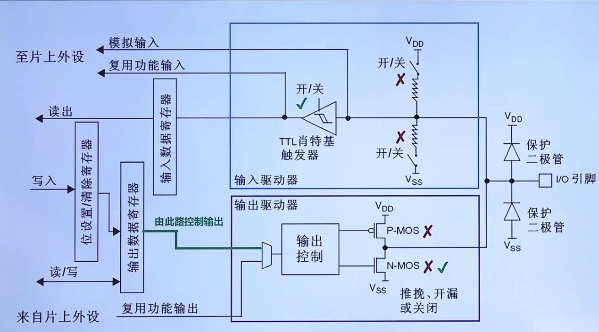GPIO\_Mode\_Out\_OD 开漏输出 GPIO\_Mode\_Out\_PP 推挽输出 GPIO\_Mode\_AF\_OD 复用开漏输出 GPIO\_Mode\_AF\_PP 复用推挽输出

### 应用总结

1. 上拉输入、下拉输入可以用来检测外部信号;例如,按键等;

1. 浮空输入模式,由于输入阻抗较大,一般把这种模式用于标准通信协议的 I2C、 USAR 的接收端;
1. 普通推挽输出模式一般应用在输出电平为 0 和 3.3V 的场合。可以输出高,低电平,连接数字器件;推挽结构一般是指两个三极管分别受两互补信号的控制,总是在一个三极管导通的时候另一个截止。高低电平由 IC 的电源低定。推挽电路是两个参数相同的三极管或 MOSFET,以推挽方式存在于电路中,各负责正负半周的波形放大任务,电路工作时,两只对称的功率开关管每次只有一个导通,所以导通损耗小、效率高。输出既可以向负载灌电流,也可以从负载抽取电流。推拉式输出级既提高电路的负载能力,又提高开关速度。
1. 普通开漏输出模式一般应用在电平不匹配的场合,芯片内部的电路结构只能输出低电平(与 GND 相连接的 mos 管导通漏极直接接地),如需要输出 5V 的高电平,就需要在外部一个上拉电阻,电源为 5V,把 GPIO 设置为开漏模式,当输出高阻态时,由上拉电阻和电源向外输出 5V 电平。(这种情况目前对于 F4 以下的芯片是这样,更高级的芯片在 IO 的设计时候在最外层输出口有上下拉电阻,所以开漏输出也可以输出高电平)
1. 对于相应的复用模式(复用输出来源片上外设),则是根据 GPIO 的复用功能来选择,如GPIO 的引脚用作串口的输出(USART/SPI/CAN),则使用复用推挽输出模式。如果用在 I2C、SMBUS 这些需要线与功能的复用场合,就使用复用开漏模式。在使用任何一种开漏模式时,都需要接上拉电阻。

### Cube MX 相关配置

1. 选择引脚类型

GPIO\_Input-输入引脚 GPIO\_Output-输出引脚

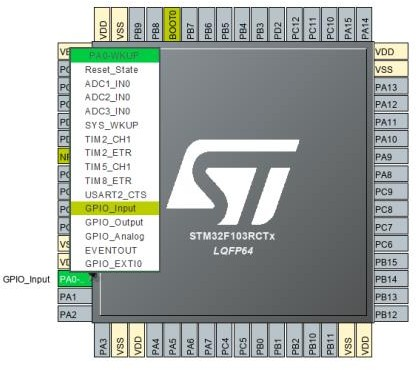

1. 配置引脚

对于输入引脚,可以配置的就是 GPIO Pull-up/Pull-down。这分别对应的是 Pull-up(输入上拉)与Pull-down(输入下拉)。

Pull-up:输入上拉就是把电位拉高,比如拉到 Vcc。上拉就是将不确定的信号通过一个电阻嵌位在高电平。电阻同时起到限流的作用。弱强只是上拉电阻的阻值不同,没有什么严格区分。

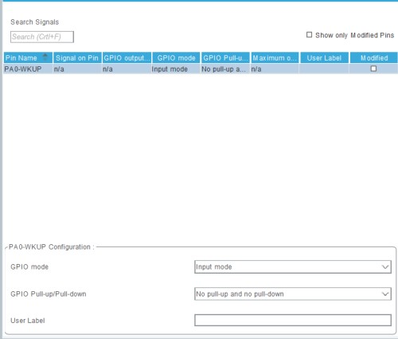Pull-down:输入下拉就是把电压拉低,拉到 GND。与上拉原理相似。简单的说,如果你希望你的引脚平时处于高电平用于检测低电平,你就使用 Pull-up。如果你希望你的引脚平时处于低电平用于检测高电平,你就使用 Pull-down。

配置输入引脚对于输出引脚,比输入多了更多的配置:

GPIO output level->初始化输出电平 GPIO mode->输出方式->开漏或推挽输出 GPIO Pull-up/Pull-down->上拉或下拉输出

Maximum output speed 选中 GPIO 管脚的速率选中GPIO 管脚的速率:

I/O 口的输出模式下,有 3 种输出速度可选 (Low - 2MHz、Medium - 10MHz、High - 50MHz),这个速度是指 I/O 口驱动电路的响应速度而不是输出信号的速度,输出信号的速度与程序有关(芯片内部在 I/O 口的输出部分安排了多个响应速度不同的输出驱动电

路,用户可以根据自己的需要选择合适的驱动电路)。通过选择速度来选择不同的输出驱动模块,达到最佳的噪声控制和降低功耗的目的。高频的驱动电路,噪声也高,当不需要高的输出频率时,请选用低频驱动电路,这样非常有利于提高系统的 EMI 性能。当然如果要输出较高频率的信号,但却选用了较低频率的驱动模块,很可能会得到失真的输

出信号。

举个栗子:

1. USART 串口,若最大波特率只需 115.2k,那用 2M 的速度就够了,既省电也噪声

小。

1. I2C 接口,若使用 400k 波特率,若想把余量留大些,可以选用 10M 的GPIO 引脚速度。
1. SPI 接口,若使用 18M 或 9M 波特率,需要选用 50M 的GPIO 的引脚速度。

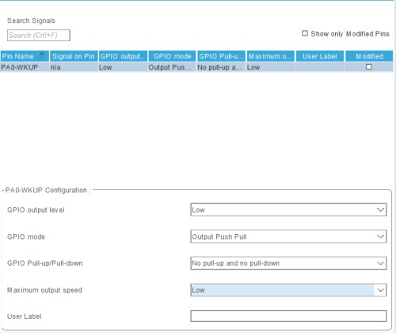

1. 编写业务代码

同时HAL 库我定义好了 GPIO\_PIN\_RESET 与 GPIO\_PIN\_SET,代表着(高电平)、0(低电平)。

1. User Label

对于任意引脚,它都有这么一个选项。我想告诉你这个选项特别特别好用!这个选项简单的说就是它你在 main.h 中生成 define 语句。但是对于HAL 库编程, main.h 会被用户的每个模块调用,也就是这些 define 语句的作用域几乎是全局。

## 串口通信

串口通信(Serial Communications)的概念非常简单,串口按位(bit)发送和接收字节。

### UART 与 USART

UART:通用异步收发传输器(Universal Asynchronous Receiver/Transmitter),通常称作 UART。它将要传输的资料在串行通信与并行通信之间加以转换。作为把并行输入信号转成串行输出信号的芯片,UART 通常被集成于其他通讯接口的连结上。

USART:(Universal Synchronous/Asynchronous Receiver/Transmitter)通用同步/异步串行接收/发送器,USART 是一个全双工通用同步/异步串行收发模块,该接口是一个高度灵活的串行通信设备。

### Cube MX 相关配置

1. 初始化引脚

Mode:

Asynchronous:异步,整个过程,不会阻碍发送者的工作。

Synchronous:同步,同步信息一旦发送,发送者必须等到应答,才能继续后续的行为。 Single Wire:单总线,半双工。

Multiprocessor Communication:多处理器通信,多处理器通信模式是 STM32 串口通信中最基本的模式。在这种模式下,STM32 可以与多个外设通信,每个外设都有一个唯一的地址。STM32 通过将地址添加到数据帧中来实现与外设的通信。

IrDA:红外线数据关联(Infrared Data Association)的缩写,是一种通过红外线进行通信的协议。在 STM32 中,IrDA 模式可以用于通过红外线与其他设备进行通信。IrDA 通信协议支持半双工通信,通信距离一般较短,通常在几米以内。

LIN:局域网互联(Local Interconnect Network)的缩写,是一种用于汽车电子控制系统的串行通信协议。在 STM32 中,LIN 模式可以用于与汽车电子控制系统进行通信。LIN 通信协议支持半双工通信,通信速率不高,通常在 19.2kbps 以下。

SmartCard:一种智能卡,它可以存储和处理数据,并与其他设备进行通信。在 STM32

中,SmartCard 模式可以用于与智能卡进行通信。SmartCard 通信协议支持全双工通信,通信

速率较高,通常在 1Mbps 以上。

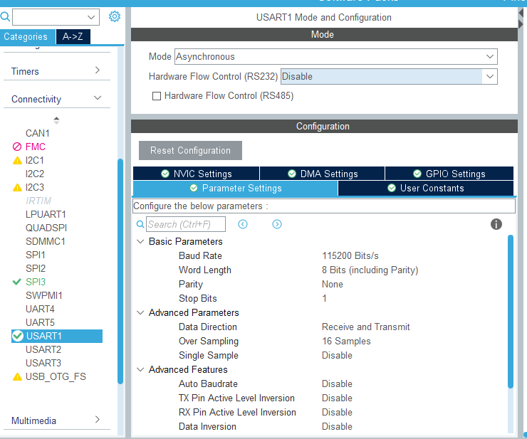

Hardware Flow Control(硬件流控)也称为RS232 硬件流控,是一种通过硬件信号线控制数据传输的方式。就是用过额外的两条硬件通信线来控制串口通信双方的状态。

当 USART 外设启用Hardware Flow Control 功能时,它会通过两条信号线(RTS 和 CTS)来控制数据的传输。当接收端准备好接收数据时,它会通过 CTS 信号线告知发送端可以发送数据;当接收端暂时无法接收数据时,它会通过 CTS 信号线告知发送端停止发送数据,直到接收端再次准备好接收数据。

在 STM32 的CubeMX 中,启用 Hardware Flow Control 功能可以提高串口通信的可靠性和稳定性,特别是在高速数据传输、长距离传输或噪声干扰环境下,能够有效地防止数据丢失和错误。

1. 配置引脚

Baud Rate:波特率,波特率表示每秒钟传送的码元符号的个数,是衡量数据传送速率的指标,它用单位时间内载波调制状态改变的次数来表示。对于串口最重要的就是波特 率,常用的波特率为 115200 与 9600。

Wrod Length:数据长

Parity:奇偶校验->无、奇校验、偶校验 Stop:停止位

以上的配置与需要通信双方完全配对,其他的高级参数一般无需修改。

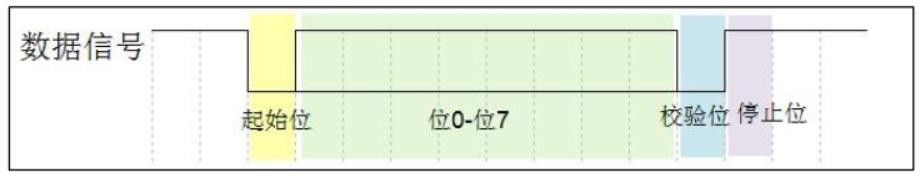

阻塞模式:CPU 会逐个发送完成以后再执行其他函数,按照上面配置即可。

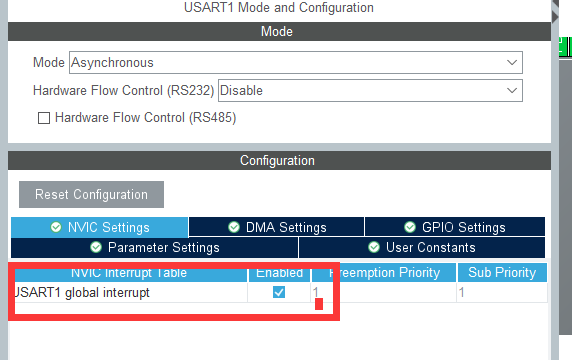中断模式:需要在配置的时候开启中断,并设置NVIC,发送完成或者接收完成即可进入中断。

1. 编写逻辑代码

如果采用中断的模式去接收或者发送,需要先开启中断,因为 CubeMX 生成的代码并不会给你开启中断,这点也符合需求,每个人的项目需要在特定的时候开启中断,并不都是在初始化的时候就开启!!!这一点很重要!!!

如果没有特殊需求就把中断开启函数写在初始化函数的用户沙箱里面,并重写中断回调函数,还再要在回调函数中重新开启中断。

除了上述的接收中断函数还有其他几个中断函数:

DMA 模式:只需在中断模式的基上开始 DMA 传输就行,同样的然后需要在使用前开始DMA 中断使能。

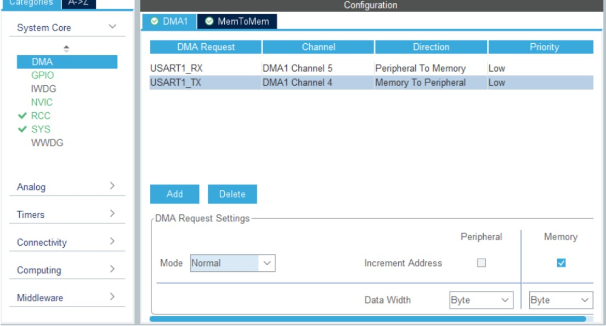

在 main 函数内部,while 循环外部添加以下代码,开启DMA 接收中断。

在 while 的内部添加如下代码,不断开启 DMA 发送中断。因为发送中断开启以后, DMA 会自动把内容发送出去,但是发送一次完成以后并不会再次发送,所以需要在 while里面不断开启发送中断。

编写DMA 中断回调函数,他和普通串口中断公用一个函数,大大简化了用户的实用难度,仍需在回调函数中再次开启DMA 中断。

至此,串口通信部分已经基本总结完成,下面还有几种利用串口的方式进行调试的方法。

1. printf 重定向

在 usart.c 文件中添加如下代码即可使用 printf 语句很方便的发送串口信息,进行调

试。他的本质还是将 C 语言中的 printf 函数重定向,它的内部是调用 fputc 函数一个字节一个字节的发送信息,通过重新改写 fpuct 函数在内部调用阻塞式的串口发送函数实现的。

注意:使用此方式需要打开 keil 里面 Use MicoreLIB 选项(微库法)。

### 优雅的 Log 信息格式

参考目前主流嵌入式、安卓等输出方式:

这里可以使用条件编译的方式对调试语句进行统一管理,方便后期开发。可以在 main.h 里面或者 usart.h 里面编写如下函数:

调试信息主要分为四类:直接输出类型

系统信息类型调试信息类型错误信息类型

可以配合使用VOFA+进行波形显示

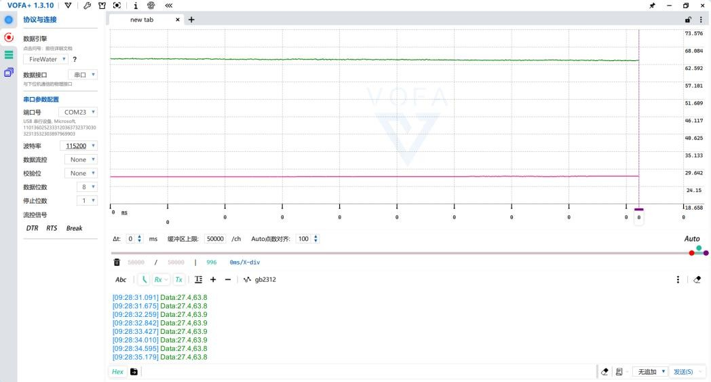

## 外部中断

外部中断是单片机实时地处理外部事件的一种内部机制。当某种外部事件发生时,单片机的中断系统将迫使 CPU 暂停正在执行的程序,转而去进行中断事件的处理;中断处理完毕后.又返回被中断的程序处,继续执行下去。

### Cube MX 相关配置

1. 初始化引脚

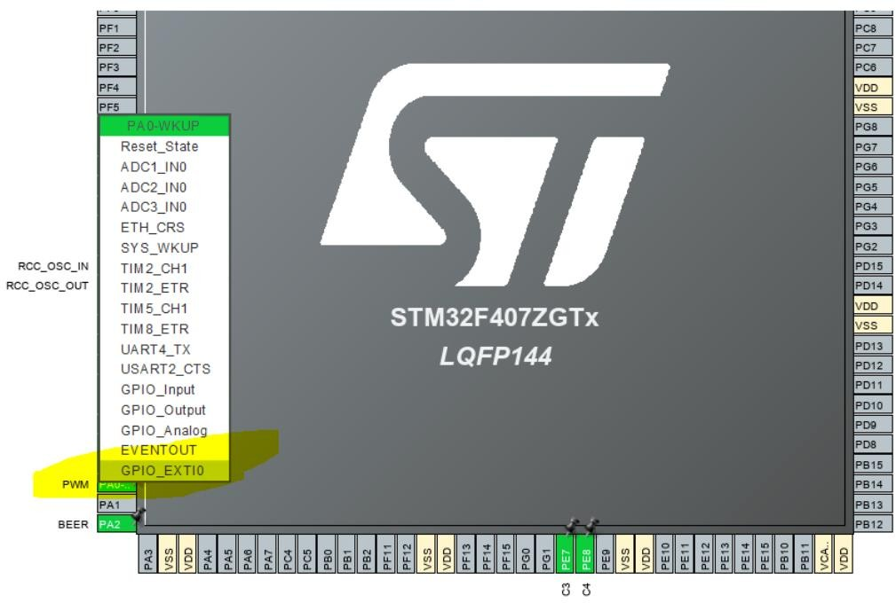如果你想使用 PA1 作为外部中断的接收引脚,那么你只需要点击 PA1,在点击它对应的 GPIO\_EXTIx

1. 使能中断
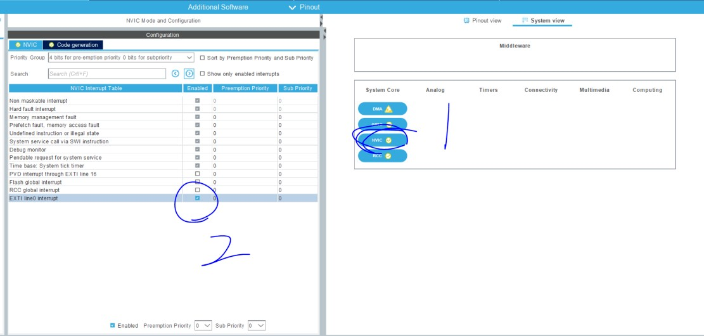

1. 配置引脚

这个地方与此前不同的地方在于 GPIO mode。

External Interrupt Mode with Rising edge trigger detection//上升沿触发 External Interrupt Mode with Falling edge trigger detection//下降沿触发

External Interrupt Mode with Rising/Falling edge trigger detection//上升沿或下降沿触发

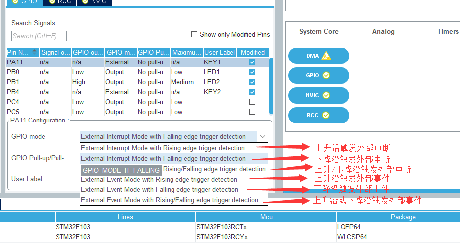

1. 编写逻辑代码

在 stm32f4xx\_it.c 内添加外部中断的回调函数,而这个回调函数还有一点非常便利的地方这里没有体现出来,就是当同时有多个中断使能的时候,STM32CubeMX 会自动地将几个中断的服务函数规整到一起并调用一个回调函数,也就是无论几个中断,我们只需要重写一个回调函数并判断传进来的端口号即可,还是非常方便的。

注意!!!这一点很重要!!!

在 stm32 中有很多中断线,可以看出 PA0、PB0...PG0 共用的 EXTI0 中断线,PA1、

PB1...PG1 共用的 EXTI1 中断线,也就是编程里面的(如下图库文件),对应 16 个中断线。

1. 同一pin 口不可同时配置外部中断

1. 不同pin 口可以同时配置外部中断

1. 共用中断服务函数(handler 句柄函数),以中断标志位区分

1. 外部中断的本质是某中断线得到信号触发,进入对应的中断服务函数的过程

1. 某一路中断线只能同时跟一个 pin 口搭上
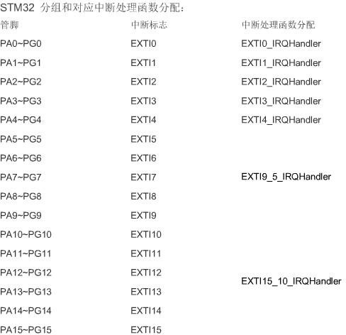

中断线 0-4 每个中断线对应一个中断函数, 中断线 5-9 共用中断函数,

EXTI9\_5\_IRQHandler,中断线 10-15 共用中断函数EXTI15\_10\_IRQHandler。

对于使用公用中断服务函数的中断线,需要先判断是那根中断线发生中断,然后直接在中断线服务函数中编写逻辑代码,不用在回调函数中编写,这就需要修改 Cubemx 生成的代码。

从此处就可以看出 HAL  库的封装逻辑,当发生中断的时候先调用中断线处理函数

(EXTI15\_10\_IRQHandler),然后进入外部中断处理函数(HAL\_GPIO\_EXTI\_IRQHandler),最后统一调用回调函数函数(HAL\_GPIO\_EXTI\_Callback)。

## 定时器

SMT32F1 系列共有 8 个定时器:

高级定时器(TIM1、TIM8);通用定时器(TIM2、TIM3、TIM4、TIM5);基本定时器

(TIM6、TIM7)。

SMT32F4 系列共有 15 个定时器:

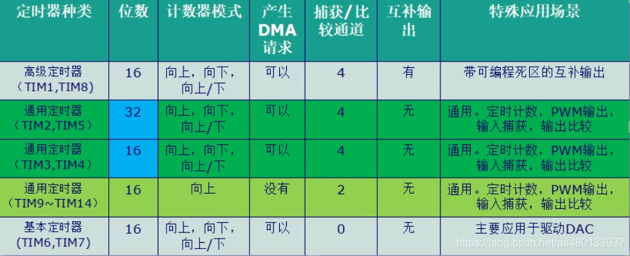高级定时器(TIM1、TIM8);通用定时器(TIM2、TIM3、TIM4、TIM5、TIM9~TIM14);基本定时器(TIM6、TIM7)。

基本定时器就是单纯的定时计数器,通用定时器多了四个通道,相对应的增加了功能,高级定时器具有基本,通用定时器的所有的功能,并且添加了其他功能。

### 计数模式

向上计数:

计数器从 0 向上计数(递增)到自动装载值,然后再次回到 0 开始计数,并产生一个计数溢出事件

向下计数:

计数器从自动装载值向下计数(递减)到 0,然后再次回到自动装载值开始计数,并产生一个计数器向下溢出事件

中央对齐模式(向上/向下计数):

计数器从 0 开始计数到自动装载值-1,并产生一个计数器溢出事件,然后再向下计数到

0+1,并产生一个计数溢出事件,然后再向上计数。

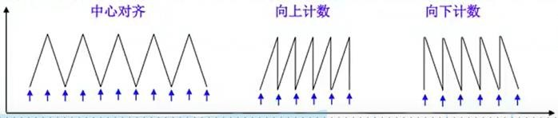

定时器的溢出时间计算:

time=(ARR+1)\*(PSC+1)/Tclk

ARR:自动装载值 PSC:预分频系数

Tclk:定时器的APB 时钟,通常等于系统时钟

#### CubeMX 设置

这里需要注意的是你所需要使用的定时器是挂载在APB1 还是APB2。相应的要调节他们时钟频率

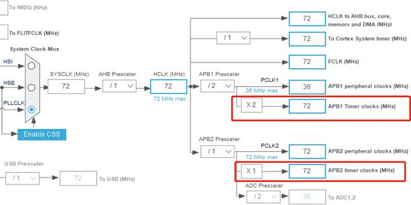

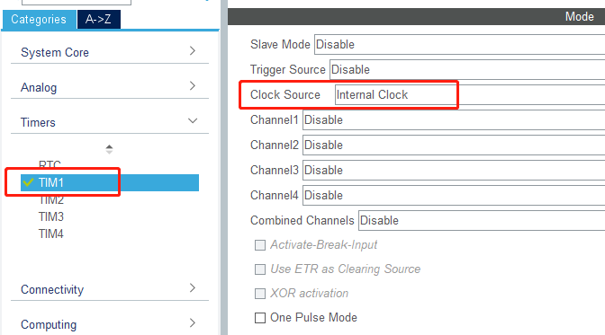

Prtscaler (定时器分频系数)    : 7199

Counter Mode(计数模式)    Up(向上计数模式) Counter Period(自动重装载值) :    4999

CKD(时钟分频因子) :    No Division 不分频选项: 可以选择二分频和四分频

auto-reload-preload(自动重装载)    :    Enable 使能

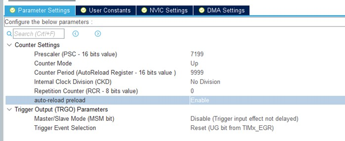TRGO Parameters    触发输出 (TRGO)    不使能与本节无关,之后做详细介绍 TRGO:定时器的触发信号输出 在定时器的定时时间到达的时候输出一个信号(如:定时器更新产生TRGO 信号来触发ADC 的同步转换,)

TlM1 break interrupt:断开中断

TIM1 update interrupt:定时器溢出更新中断

TIM1 trigger and commutation interrupts:触发和换相中断 TlM1 capture compare interrupt:捕获比较中断

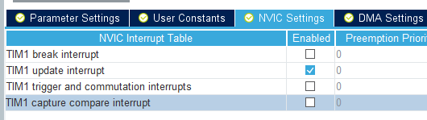

编写逻辑函数部分:

在 main.c 中开启定时器中断(到这里可以发现只要是中断配置,都需要自己在程序中手动开启中断使能)

定时器中断回调函数可以写在 tim.c 里面

### PWM 模式

PWM 即脉冲宽度调制,是一种模拟控制方式,通常用于 LED 的亮度调节。其实就是快速的高低电平变化让人感觉不出来。

hz 是频率的单位

1hz 表示 PWM 的周期是 1s

1Khz 表示一秒钟有一千个周期,也就是周期是 1ms

1KKhz、1Mhz 表示一秒钟有 100 万个周期,也就是周期是 1us

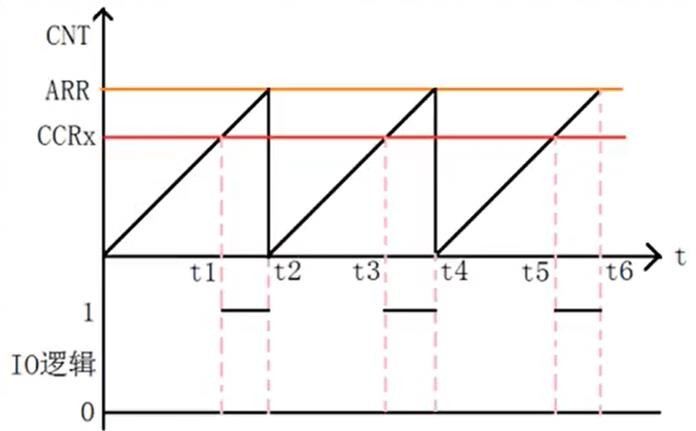

ARR 为自动装载值,CCRx 为捕获比较寄存器值

预分频系数决定了 PWM 的时钟速度,ARR 的大小决定了PWM 的周期,CRRx 决定了输出有效信号的时间

PWM 模式:

模式 1,不管是向上还是向下计数,当计数值小于重装载值是输出有效电平。模式 2,不管是向上还是向下计数,当计数值小于重装载值是输出无效电平。

占空比:

占空比=CCRx/arr(单位%)

CCRx 是可以预设的值

#### CubeMX 设置

设置定时器使用内部时钟,设置定时器的 PWM 通道 1 开启。

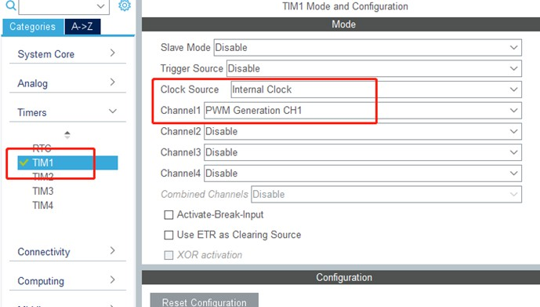

设置基参数

Prescaler,分配系数为 36

Counter Period,重装载值为 100

所以:

PWM 的频率为:72 000 000/35/100=20 000 HZ(20KHZ),周期为 1/20000= 0.00005 秒

PWM 脉宽调制的最大值与重装载值一致,其范围为\[0,100\]

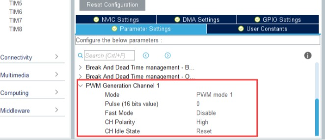

Mode:PWM 模式 1 Pulse(占空比值):0

Fast Mode PWM 脉冲快速模式(没啥用):不使能

PWM 极性(有效电平):设置为高电平

编写逻辑代码:

开启 PWM 的通道 1

通过修改CCR1 的值来改变 PWM 的占空比:

#### 死区时间

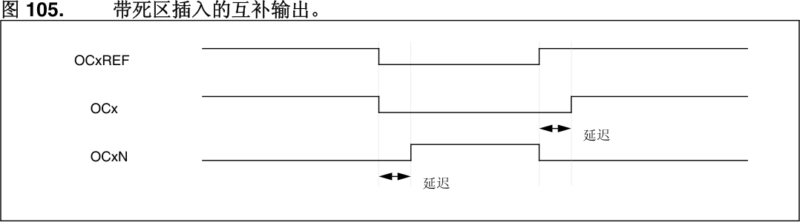死区是为了保障上下管不会同时导通,这个功能只有高级定时器才会有,其中 OCx 的占空比并不会影响,只会在影响 OCxN 的占空比。

死区时间的计算:

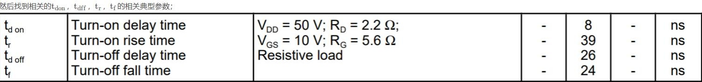

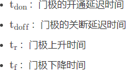

计算公式:

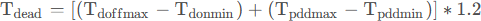

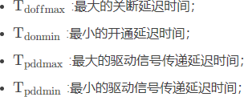

寄存器配置:

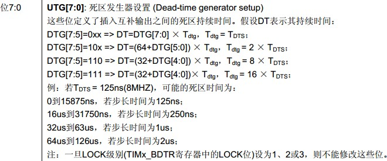

#### CubeMX 设置

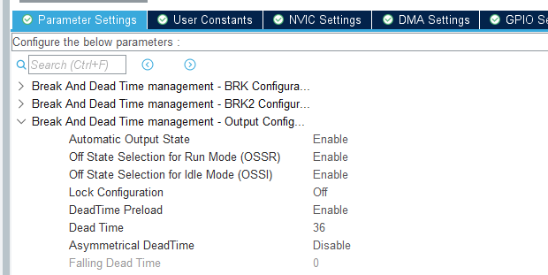

一般选择同步死区就是一个周期内开始的死区时间和结束的死区时间相同。

Asynchronous:异步 Synchronous:同步

### 定时器的高级应用

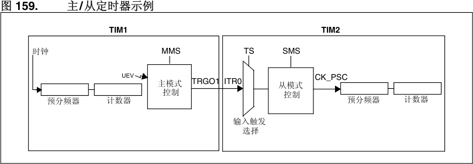定时器除了基本的定时功能,还能有实现定时器之间的组合完成一些高级功能。TIMx定时器从内部连接在一起,以实现定时器同步或级联。当某个定时器配置为主模式时,可对另一个配置为从模式的定时器的计数器执行复位、启动、停止操作或为其提供时钟。

定时器的输出比较模式有多种,一下是分类:

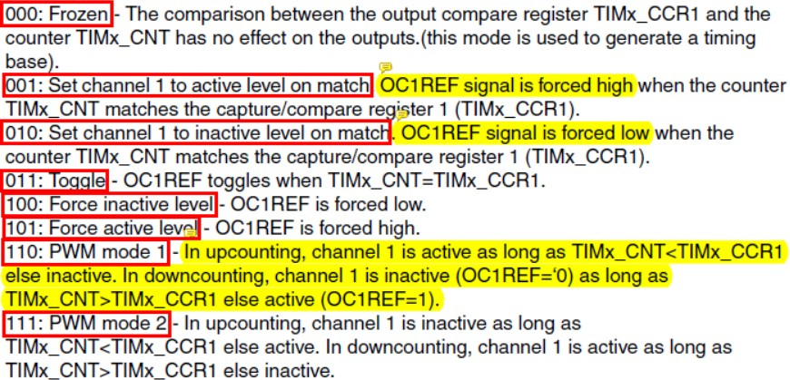

000:冻结——输出比较寄存器 TIMx\_CCR1 中的内容与计数器 TIMx\_CNT 中的内容之间的比较对输出无影响。(此模式用于时基的生成)

001:当匹配时,设置通道 1 为有效电平。当计数器 TIMx\_CNT 中的内容与捕捉/比较寄存器 1(TIMx\_CCR1)中的内容相匹配时,强行拉高 OC1REF 信号。

010:当匹配时,设置通道 1 为无效电平。当计数器 TIMx\_CNT 中的内容与捕捉/比较寄存器 1(TIMx\_CCR1)中的内容相匹配时,强行拉低 OC1REF 信号。

011:翻转——当 TIMx\_CNT= TIMx\_CCR1 时,OC1REF 信号取反。

100:强制无效电平——强行拉低 OC1REF 信号。

101:强制有效电平——强行拉高 OC1REF 信号。

110:PWM 模式 1——向上计数模式中,只要 TIMx\_CNT< TIMx\_CCR1,通道 1 有效,反之无效。向下计数模式中,只要 TIMx\_CNT> TIMx\_CCR1,通道 1 无效(OC1REF=0),反之有效(OC1REF=1)。

110:PWM 模式 2——向上计数模式中,只要 TIMx\_CNT< TIMx\_CCR1,通道 1 无效,反之有效。向下计数模式中,只要 TIMx\_CNT> TIMx\_CCR1,通道 1 有效,反之无效。

我用红色标出了提到有效、无效的地方。不难发现,有效与无效分别对应 OC1REF=1 和

OC1REF=0。这正是我们先前约定的结果。

#### 级联触发模式

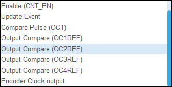级联触发模式就是当一个定时器启动以后,可以发出一个信号,这个信号可以是复位、 CNT\_EN(开始计数信号)使能、更新事件(溢出以后更新了)、比较脉冲(oc1 目前还不清楚)、4 个通道的比较输出(oc ref)、编码器时钟输出。

注意:在发出 OCxREF 的时候只有高电平才有效,所以发出触发信号的时候要选择合适的

pwm 模式。

PWM 模式 1:

在向上计数时,一旦 TIMx\_CNT<TIMx\_CCR1 时通道 1 为有效电平,否则为无效电平;在向下计数时,一旦 TIMx\_CNT>TIMx\_CCR1 时通道 1 为无效电平(OC1REF=0),否则为有效电平(OC1REF=1)。

PWM 模式 2:

在向上计数时,一旦 TIMx\_CNT<TIMx\_CCR1 时通道 1 为无效电平,否则为有效电平;在向下计数时,一旦 TIMx\_CNT>TIMx\_CCR1 时通道 1 为有效电平,否则为无效电平。

这里转化成常用的 pwm 逻辑就是:一般使用向上计数,模式 1 的时候,使用 OCREF 高电平作为有效电平。模式 2 的时候,使用 OCREF 低电平作为有效电平。这里的 OCREF 并不是最终的输出电平,还要看 pwm 的极性参数才能看最终的输出。

因为前面手册里面说了只有在发出 OCxREF 的时候只有高电平才有效,所以如果想使用两个定时器的级联实现移项 pwm 输出的话, 就必须用模式 2 , 开始的时候 TIMx\_CNT<TIMx\_CCR1,OCREF 输出无效电平 0,TIMx\_CNT>TIMx\_CCR1,OCREF 输出有效电平 1。这个时候就会在 PWM 为第二段电平开始时发出信号,从定时器接收到这个信号的时候在发出pwm 即可实现可控的移相操作。

这里存在一个很复杂的逻辑关系,原文链接如下:

[【转】STM32 定时器输出比较模式中的疑惑 - Ady Lee - 博客园 (cnblogs.com)](https://www.cnblogs.com/adylee/p/4935601.html)

# HRTIMER

HRTIM 是 STM32 的高分辨率定时器外设,分辨率可达 ps 级别,即可倍频到 4-5GHz,主要应用于数字功率转换应用,如数字电源,太阳能等。今天我们介绍下如何配置高分辨率定时器 HRTIM。高精度定时器是 ST 专门为电机控制和电源控制做的外设,目前只有 F334和 G4 系列才能用到。

这里以 G474VET6 为例,HRTIMER 经过最大 32 倍频以后可以达到 5.44Ghz。

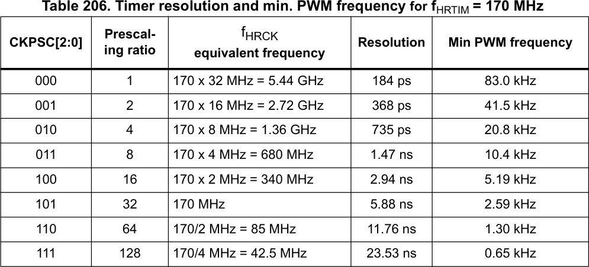

HRTIMER 主要有 MASTER 和A-F 6 个子定时器组成,主定时器负责所有定时器的时钟同步,所有的子定时器的时钟可以运行在自由模式、单次触发模式、重复触发模式、交错模式。Master timer 可以产生 4 路 compare 输出,可以作为其他子定时器的触发信号或者复位信号,实现移相操作。

子定时器也可以自己产生compare 输出,作为自己的不同通道的触发信号,或者是 PWM

极性反转的信号。

建议这块需要的时候再去学习对应的模块,寄存器比较多较为复杂。下图是 3 路移相的

PWM 产生的原理,CubeMX 的配置以这个为例子配置。

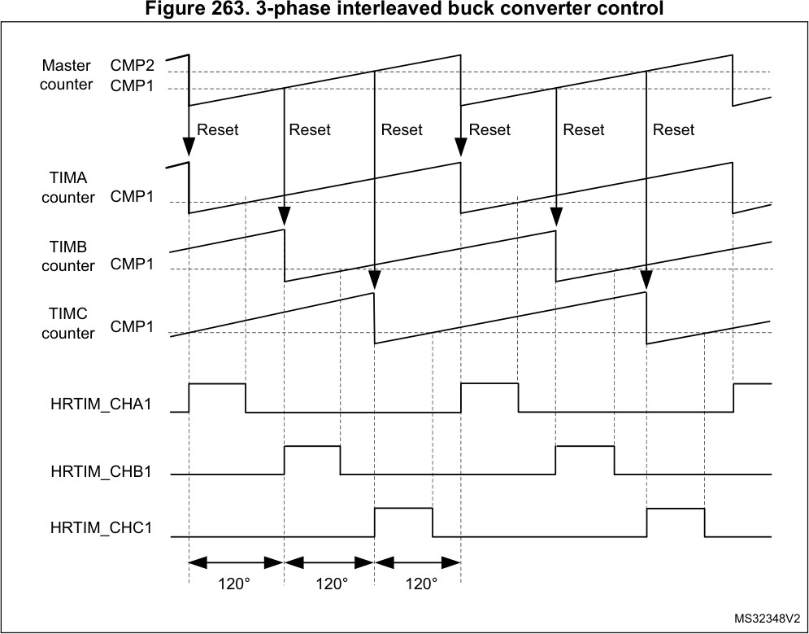

### CubeMX 设置

启动主定时器和相应的输出通道

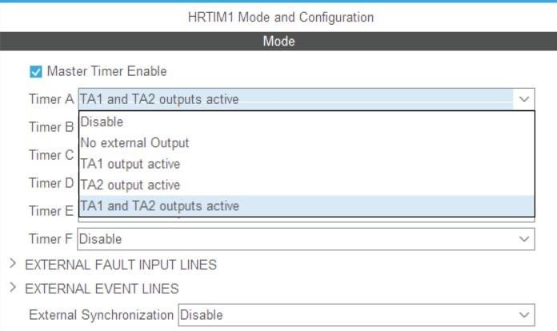

配置主定时器:

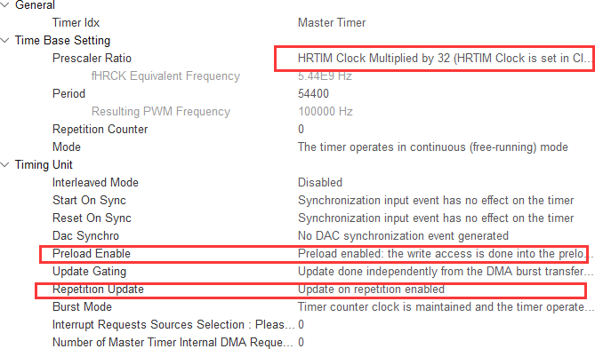

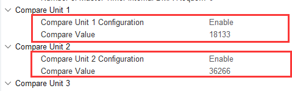

主要是频率和计数值,由于高分辨率定时器可以通过倍频产生 5.44G 的时钟频率,所以可以把 PWM 的分辨率做到很高,产生非常精确占空比的 PWM 信号。

这里还需要配置一下移相的触发信号,可以产生任意角度的移相范围,基本的逻辑就是使用主定时器和其他子定时器同时启动,然后在不同的时刻复位子定时器从而实现移相,主定时器的输出比较信号就是移相的触发信号。

子定时器A 配置:

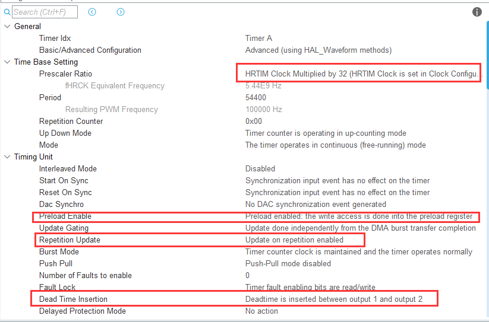

子定时器 A 的时钟也和主定时器的时钟配置一样,后面才能开启同步模式。因为是 A

定时器所以它不需要移相就和主定时的时钟保持同步即可,还需要开启死区设置。

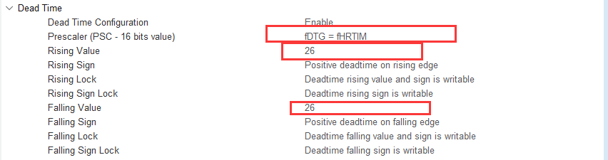

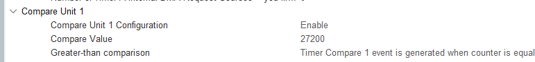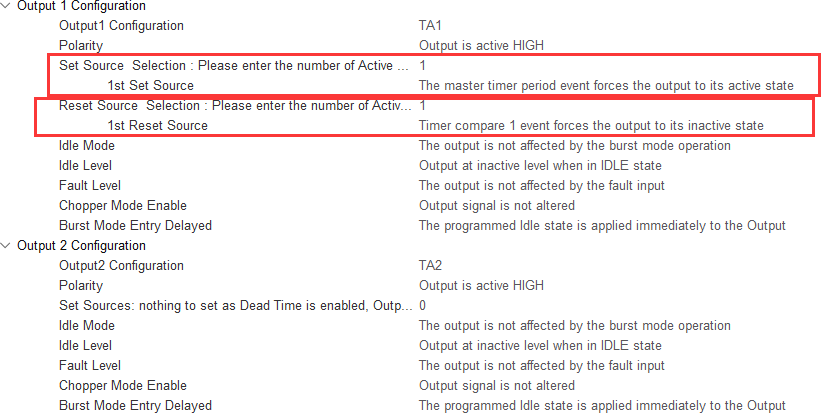

这里的 PWM 逻辑电平是高有效,置位信号为 master 的周期到时候输出,复位信号是自己的比较通道 1 输出有效电平的时候。通过修改子定时器比较通道 1 的值即可修改占空比。

子定时器B 配置:

其他所有的子定时器的配置都是一样的,只有一点不同的是后面的子定时器需要配置一个复位信号,将主定时器的输出比较事件 1 作为子定时器 B 的复位信号,这也是实现移相的关键。

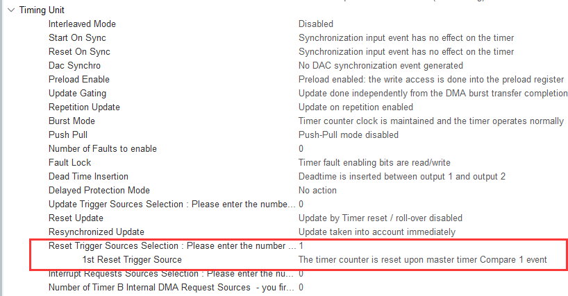

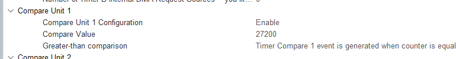

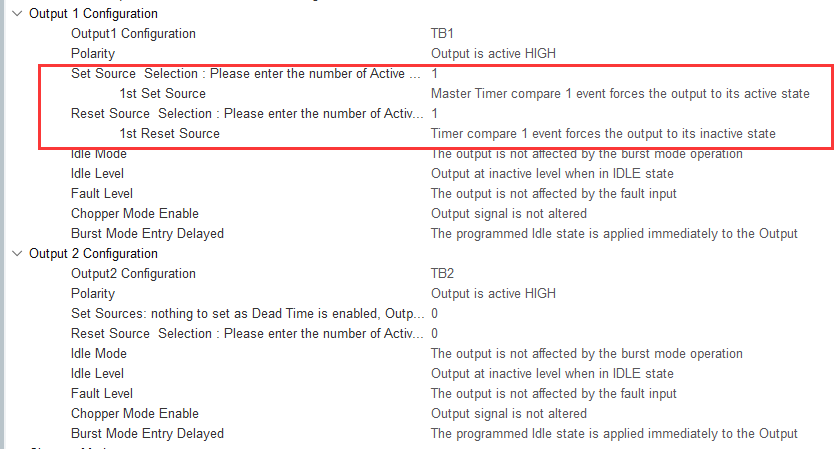

PWM 的输出极性选择高,置位信号选择主定时器的输出比较事件 1,复位信号选择子定时器 B 的输出比较事件 1,这样就是实现了移相。主定时器的输出比较事件 1 触发以后,先复位子定时器 B 并且 PWM 信号输出高电平,到了子定时器的输出比较事件 1 触发以后 PWM 信号输出低电平。后面的定时器也依次类推即可实现任意角度任意个数的 PWM 信号移相。

# ADC

参考网址:[HAL 库 ADC 超详细(查询、中断、DAM)\_hal adc\_小浣熊 zzz 的博客-CSDN](https://blog.csdn.net/zp200003/article/details/121325247)

[博客](https://blog.csdn.net/zp200003/article/details/121325247)

Analog-to-Digital Converter 的缩写。指模/数转换器或者模拟/数字转换器。是指将连续变量的模拟信号转换为离散的数字信号的器件。

12 位 ADC 是一种逐次逼近型模拟数字转换器。它有,3 个ADC 控制器,多达 18 个通道,可测量 16 个外部和 2 个内部信号源。各通道的A/D 转换可以单次、连续、扫描或间断模式执行。ADC 的结果可以左对齐或右对齐方式存储在 16 位数据寄存器中。

STM32 一共有 3 个ADC ADC1,ADC2,ADC3,16 个外部通道和 2 个内部信号源。

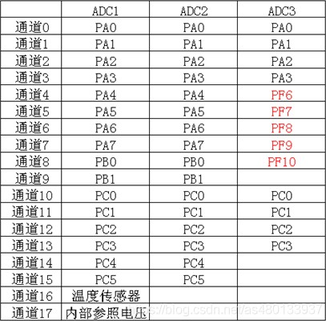

### ADC 的三种工作方式

阻塞模式(查询模式):需要 CPU 等待转化完成才能继续运行中断模式

DMA 模式

### 转换模式(重要,请务必看懂)

扫描模式:使用 STM32CUBEMX 配置了多通道后,这一项默认开启且无法设置成关闭。这个模式就是自动扫描你开启的所有通道进行转换,直至转换完。例如你开启了 CH0、CH1、

CH2、CH3 这四个通道,启动转换后 ADC 会自动将这 4 个通道全部转换完,但是这种连续性是可以被打断的,所以就引出了间断模式。

连续模式: 在CUBE 中选中 ENABLE 就是连续模式,DISABLE 就是单次模式。开启连续模式后,ADC 的转换不由其他控制。例如将 ADC 设置为了定时器的TGRO 触发采样,如果开启连续模式,ADC 将忽略定时器的触发采样。(连续转换模式开启后其实就是满频率的采样)。

间断模式: 可以将多个通道进行分组采集,例如你开启了 CH0~3 这 4 个通道,假如你设置了间断次数为 4,就相当于将 4 个通道分成了 4 组,每组 1 个通道,那么要想采集完这

4 个通道就需要手动触发 4 次 ADC 采集;如果设置了间断次数为 2,那么采集完 4 个通道就需要手动触发 2 次 ADC 采集。

扫描模式简单的说是一次对所有所选中的通道进行转换,比如开了 ch0,ch1,ch4,ch5。 ch0 转换完以后就会自动转换通道 1,4,5 直到转换完这个过程不能被打断。如果开启了连续转换模式,则会在转换完 ch5 之后开始新一轮的转换。

这就引入了间断模式,可以说是对扫描模式的一种补充。它可以把 0,1,4,5 这四个通道进行分组。可以分成 0,1 一组,4,5 一组。也可以每个通道单独配置为一组。这样每一组转换之前都需要先触发一次。

ADC 单通道:

只进行一次 ADC 转换:配置为“单次转换模式”,扫描模式关闭。ADC 通道转换一次后,就停止转换。等待再次使能后才会重新转换

进行连续ADC 转换:配置为“连续转换模式”,扫描模式关闭。ADC 通道转换一次后,接着进行下一次转换,不断连续。

ADC 多通道:

只进行一次 ADC 转换:配置为“单次转换模式”,扫描模式使能。ADC 的多个通道,按照配置的顺序依次转换一次后,就停止转换。等待再次使能后才会重新转换

进行连续 ADC 转换:配置为“连续转换模式”,扫描模式使能。ADC 的多个通道,按照配置的顺序依次转换一次后,接着进行下一次转换,不断连续。

也就是:多通道必须使能扫描模式

规则组和注入组:

规则组就是按照顺序依次转化,注入组可以打断规则组的转化,类似于中断,使用的场景较少,作为了解目前先不深究。

STM32 的 ADC 最大的转换速率为 1MHz,也就是说最快转换时间为 1us,为了保证 ADC

转换结果的准确性,ADC 的时钟最好不超过 14M。

T=采样时间+12.5 个周期,其中 1 周期为 1/ADCCLK

例如, ADCCLK=14Mhz 的时候, 并设置 1.5 个周期的采样时间, 则得到:

Tcovn=1.5+12.5=14 个周期=1us。

看门狗的作用:可以设置中断电压,当采集的电压低于或者高于设置电压的时候进入看门狗中断。

### 查询模式

查询模式对CPU 的占用比较高,多用于单通道采集、不连续转化。

如果强行在此模式下使用多通道采集,需要开启不连续转化模式,否则采集到的数据有误。

#### Cube MX 设置

这几种模式一般都选择单端模式,一个信号采集信号。

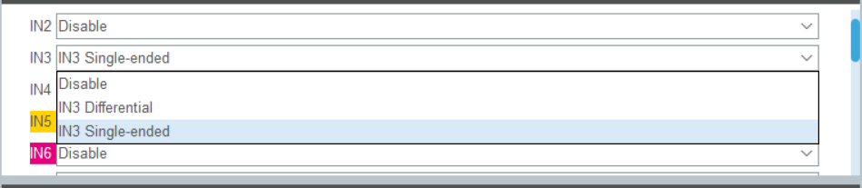

单端(Single-Ended)模式:

对于每一个信号源,都有一根线,连接到你所用到的数据采集接口上,测量信号与地

(ground)之间的差别。

1. 地电平差异:一般设备是认为 ground 是 0V 的常量,但是实际上,不同的位置,常有不同的电平。两者位置越接近,电平越接近于相同。但是如果将两者的地连接在一起的话,电平差值会导致一个大电流,即接地回路。这会导致在使用 Single-ended 模式输入的时

候会出错。

1. 噪音错误:Single-ended 模式输入对于噪音错误很敏感。噪音,即非期望的信号组合。由于信号线就像天线,会捕获环境电子活动,导致了噪音的产生。而对于 Single-ended模式,是无法区分噪音和实际信号的。

差分(Differential)模式:

两根信号线,连接对应的信号源。每一根接到对应的输入端,比如 a+和 a-。有两个高阻抗的功率放大器,检测输入端与接口地端之间的电压。还有第三个功率放大器,用来算出前两个功放所测得的电压,即 a+和 a-,之间差值。这样就排除了两者之间公共的电压所带来的影响。

1. 信号浮空:使用差分模式最常见的一个问题就是忘了将某个连接接地,即浮空。例如电池供电的设备和热电偶没有接地的连接。例如,你可以在+和–输入之间接上一个电池。然后两个输入放大器会去监视+到地的电压和–到地的电压。然而,由于没有电池和地之间没有连接,这些测得的电压可能是任何的值,也许就就会超过放大器的处理范围。
对于这些浮空的信号源,应当提供一个参考源。

比如 Microlink 有一个标示为 0V 的插槽。从“–”线上连一个连到这个 0V 的插槽,或者直接通过一个电阻相连,即可解决此问题。而如果你的信号本身是自接地的,那么就不需要接这个 0V 了。

1. 三个用来差分输入检测的放大器,总称为设备放大器。如前所述,理想情况下,对于两根线共有的电压,都可以因差分计算而被消除掉。而实际上,两个输入放大器,并不能完美的互相匹配,因此对于公共电压,多少会出现一些差别的。对于设备放大器接近于理想情况的程度大小,可以表述为共模抑制比,单位是分贝。此参数越高越好。
另外需要考虑的一点是,公共电压的范围,即放大器所能处理的最大的公共电压,如果环境电压超过此阈值,那么测量结果就不准确了。(你的硬件操作范围也许可以设计的比公共电压范围更大,但是操作电压范围只能保证你的硬件不会被损坏,却不能保证一定能正常工作。)

1. 差分输入需要更少的信号?
差分输入和 Single-ended 输入相比,有一个显而易见的缺点:你需要两倍数目的线,然后你才可以连接到一半数目的信号。如果你只有更短的信号线,信号线之间更近,信号大于 100mV 的话,经过评估,觉得用 Single-ended 输入,对你也是 OK 的,这时,你可以在 Single-

ended 输入模式中使用差分输入模式。具体做法是,短路其中一根信号线(通常是短路输入端)接到V 输入上。这样的话,差分输入,就可以提供两种模式任你选了。

解决了 Single-ended 模式所具有的问题,即,(只要他们的电压不是太大,而使得功法无法处理的话)使用此法测得的值,是与接地无关的。

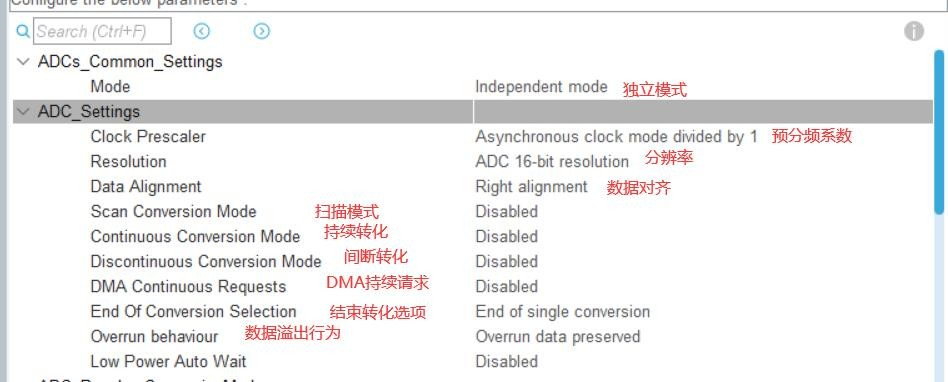同样地,此法中,两个信号线,如果有噪音,那么也是相同的,而做了差值后,也就消除了,减去了噪音的干扰。

编写逻辑代码:

在 adc.c 文件中编写开启ADC

然后就可以在其他函数中调用上面的函数,就可以得到采集的电压

注意!!!如果是多通道采用还想用查询模式,一定打开不连续转化模式,否则就会出错,采集到的数据就有误。多通道采样推荐采用DMA 的方式传输。按照下图方式配置。

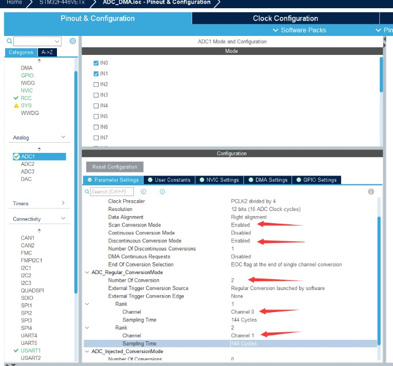

### 中断模式

中断模式相比与查询模式提高了 CPU 的利用率,开启 ADC 中断以后,自动进行采集完成转化以后进入中断,用户可以在中断中完成信号的采集。

#### Cube MX 设置

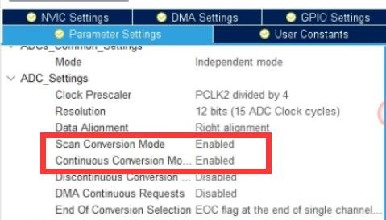中断模式只需要在查询模式的基上开启连续转化就可以,采集完成以后自动转化,转换好以后进入中断,执行完中断以后自动开启下一次转化。单通道关闭扫描模式,多通道开启扫描模式。

然后开启 NVIC 中断

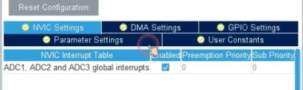

编写逻辑代码:

在 main.c 开启ADC 中断模式

重写ADC 转化完成回调函数

### DMA 模式

DMA 模式相比与中断模式极大的提高的 CPU 的利用率,用户只需要开启 DMA, ADC 会直接把采集到的数据放在用户给定的存储区,全程不需要CPU 的干预,当需要调用数据的时候直接从自定义存储区拿就好了。

#### Cube MX 设置

DMA 模式在查询模式的基上开始,ADC 参数配置如下:如果是单通道 DMA 就把扫描模式关闭,多通道就开启扫描模式。其他参数按照下图开启。

开启DMA 设置,打开循环模式,选择Half Word(16 位字节)传输

编写逻辑函数:

开启DMA 传输即可

这里我们还可以采用滤波算法,让采集到的波形更加平滑。

最后直接调用即可

### 定时器触发+ADC+DMA

在这种模式下可以实现顶频率采样,减少主控的负担,如果将来需要 FFT 可以采样固定的点数,然后在对数据进行处理。因为规则通道的数据寄存器只有一个,所以要通过 DMA的方式及时搬运数据。

#### Cube MX 设置

首先配置 TIM1 的 TRGO,选择合适的触发信号,可以是更新信号,复位信号,或者输出比较信号。(这个触发信号是定时器更新的时候发出,也可以选择 pwm 或者的比较输出模式,可以在任意时刻触发ADC)

下面配置 ADC,多通道选择扫描模式,关闭持续转换模式(转化完成所有规则通道以后需要等下下次触发,可以和定时器配合实现定频采样),DMA 请求使能。EOC 这里可以设置成单个通道转化完成,或者一个序列转化完成都可以。建议设置成一个序列,这样多个通道全部转化完以后才会进入EOC 中断。

DMA 并不是通过 EOC 中断来进行数据传输的,芯片手册如下:

开启DMA 以后会自动的判断当前通道的转化情况,然后把将转化完成的数据搬运到对应的内存地址。然后自动开启下一个通道的转化,转化一个搬运一个,直到所有的通道数据全部搬运完成。

下面是 ADC 所有通道全部转化完成的回调函数,可以在这里面进行数据处理。

注意:使用 TIM 触发的时间一定要大于ADC 所有通道转换完成的时间,否则会发生未知的错误。换算成频率就是采样的频率要低于 ADC 所有通道转换完成的频率。对于 DMA

的回调函数和ADC 的回调函数这里做一下说明,这俩有相同的地方也有不同的地方。

DMA 的回调函数会在 DMA 传输完成一半或者传输完成的时候进去入口函数两次,在函数内部进行判断,并清除响应的标志位。规则通道转化一半或者转化完成以后都会进入该入口函数,但是HAL 库没有给用户留弱函数的入口供用户去调用。

其实这是因为 HAL 库把用户调用的入口函数放在了 ADC.C 文件中,有转换一半的回调函数和转换完成的回调函数,特别声明改函数只能在非阻塞模式下使用。

参考网址:[STM32CubeMX \| HAL 库的 ADC 多通道数据采集(轮训、DMA、DMA+TIM)、](https://blog.csdn.net/qq153471503/article/details/108123019?spm=1001.2101.3001.6650.6&utm_medium=distribute.pc_relevant.none-task-blog-2%7Edefault%7ECTRLIST%7ERate-6-108123019-blog-128246871.235%5Ev38%5Epc_relevant_anti_t3&depth_1-utm_source=distribute.pc_relevant.none-task-blog-2%7Edefault%7ECTRLIST%7ERate-6-108123019-blog-128246871.235%5Ev38%5Epc_relevant_anti_t3&utm_relevant_index=10)

[读取内部传感器温度\_stm32cubemx \| stm32 使用hal 库的 adc 多通道数据采集(dma+非dma 方](https://blog.csdn.net/qq153471503/article/details/108123019?spm=1001.2101.3001.6650.6&utm_medium=distribute.pc_relevant.none-task-blog-2%7Edefault%7ECTRLIST%7ERate-6-108123019-blog-128246871.235%5Ev38%5Epc_relevant_anti_t3&depth_1-utm_source=distribute.pc_relevant.none-task-blog-2%7Edefault%7ECTRLIST%7ERate-6-108123019-blog-128246871.235%5Ev38%5Epc_relevant_anti_t3&utm_relevant_index=10)

[式)+ -CSDN 博客](https://blog.csdn.net/qq153471503/article/details/108123019?spm=1001.2101.3001.6650.6&utm_medium=distribute.pc_relevant.none-task-blog-2%7Edefault%7ECTRLIST%7ERate-6-108123019-blog-128246871.235%5Ev38%5Epc_relevant_anti_t3&depth_1-utm_source=distribute.pc_relevant.none-task-blog-2%7Edefault%7ECTRLIST%7ERate-6-108123019-blog-128246871.235%5Ev38%5Epc_relevant_anti_t3&utm_relevant_index=10)

## IIC 通信

IIC(Inter-Integrated Circuit)总线是一种由 NXP(原 PHILIPS)公司开发的两线式串行总线,用于连接微控制器及其外围设备。多用于主控制器和从器件间的主从通信,在小数据量场合使用,传输距离短,任意时刻只能有一个主机等特性。在 CPU 与被控 IC 之间、IC 与 IC 之间进行双向传送,高速 IIC 总线一般可达 400kbps 以上。

PS:这里要注意 IIC 是为了与低速设备通信而发明的,所以 IIC 的传输速率比不上 SPI。

### 物理层

SDA(Serial data)是数据线,D 代表 Data 也就是数据,Send Data 也就是用来传输数据的 SCL(Serial clock line)是时钟线,C 代表Clock 也就是时钟也就是控制数据发送的时序的所有接到I2C 总线设备上的串行数据SDA 都接到总线的SDA 上,各设备的时钟线 SCL

接到总线的 SCL 上。I2C 总线上的每个设备都自己一个唯一的地址,来确保不同设备之间访问的准确性。

特点:

IIC 主设备功能:主要产生时钟,产生起始信号和停止信号

IIC 从设备功能:可编程的 IIC 地址检测,停止位检测

它支持多主控(multimastering), 其中任何一个能够进行发送和接收的设备都可以成为

主总线。一个主控能够控制信号的传输和时钟频率。当然,在任何时间点上只能有一个主控。支持不同速率的通讯速度,标准速度(最高速度 100kHZ),快速(最高 400kHZ)

SCL 和SDA 都需要接上拉电阻 (大小由速度和容性负载决定一般在 3.3K-10K 之间) 保证数据的稳定性,减少干扰。

IIC 是半双工,而不是全双工 ,同一时间只可以单向通信

为了避免总线信号的混乱,要求各设备连接到总线的输出端时必须是漏极开路(OD)输出或集电极开路(OC)输出。这一点很重要!!!

漏极开路(Open Drain)即高阻状态,适用于输入/输出,其可独立输入/输出低电平和高阻状态,若需要产生高电平,则需使用外部上拉电阻。

高阻状态:高阻状态是三态门电路的一种状态。逻辑门的输出除有高、低电平两种状态外,还有第三种状态——高阻状态的门电路。电路分析时高阻态可做开路理解。

为了避免总线信号的混乱,IIC 的空闲状态只能有外部上拉, 而此时空闲设备被拉到了高阻态,也就是相当于断路, 整个 IIC 总线只有开启了的设备才会正常进行通信,而不会干扰到其他设备。

IIC 器件地址:每一个 IIC 器件都有一个器件地址,有的器件地址在出厂时地址就设定好了,用户不可以更改,比如 OV7670 的地址为 0x42。有的器件例如EEPROM,前四个地址已经确定为 1010,后三个地址是由硬件链接确定的,所以一 IIC 总线最多能连 8 个EEPROM芯片。

### 协议层

I2C 总线在传送数据过程中共有三种类型信号,它们分别是:开始信号、结束信号和应答信号。

开始信号:SCL 为高电平时,SDA 由高电平向低电平跳变,开始传送数据。结束信号:SCL 为高电平时,SDA 由低电平向高电平跳变,结束传送数据。

应答信号:接收数据的 IC 在接收到 8bit 数据后,向发送数据的 IC 发出特定的低电平脉冲,表示已收到数据。CPU 向受控单元发出一个信号后,等待受控单元发出一个应答信号,CPU 接收到应答信号后,根据实际情况作出是否继续传递信号的判断。若未收到应答信号,由判断为受控单元出现故障。

这些信号中,起始信号是必需的,结束信号和应答信号,都可以不要。

保证数据的有效性:IIC 信号在数据传输过程中,当 SCL=1 高电平时,数据线 SDA 必须保持稳定状态,不允许有电平跳变,只有在时钟线上的信号为低电平期间,数据线上的高电平或低电平状态才允许变化。

SCL=1 时数据线 SDA 的任何电平变换会看做是总线的起始信号或者停止信号。也就是在 IIC 传输数据的过程中,SCL 时钟线会频繁的转换电平,以保证数据的传输

每发送一个字节(8 个 bit)在一个字节传输的 8 个时钟后的第九个时钟期间,接收器接收数据后必须回一个 ACK 应答信号给发送器,这样才能进行数据传输。

应答出现在每一次主机完成 8 个数据位传输后紧跟着的时钟周期,低电平 0 表示应答,

1 表示非应答

在起始信号后必须传送一个从机的地址(7 位) 1~7 位为 7 位接收器件地址,第 8 位为读写位,用“0”表示主机发送数据(W),“1”表示主机接收数据 (R), 第 9 位为 ACK 应答位,紧接着的为第一个数据字节,然后是一位应答位,后面继续第 2 个数据字节。

### 软件IIC CubeMX 设置

对于模拟 IIC 主要有两种配置方式,参考链接:

[模拟 IIC——关于模拟 IIC 的 IO 口的配置选取推挽输出还是开漏输出,以及是否需要更改](https://blog.csdn.net/m0_62243928/article/details/125779308)

[IO 口输入输出模式和是否需要对 IO 配置上拉\_模拟 i2c 对 io 口的要求\_我和你拼了'的博客-](https://blog.csdn.net/m0_62243928/article/details/125779308)

[CSDN 博客](https://blog.csdn.net/m0_62243928/article/details/125779308)

选择好 SDA 和SCL 引脚,开漏输出,初始化电平是高电平

### 硬件IIC CubeMX 设置

选择 I2C 模式

配置相关参数参数

这里使用的是查询的方式进行通信,以AHT20 温湿度传感器为例,进行逻辑代码编写:

这里有一个注意的点:“1<<20”是一个位移操作,表示将二进制数 1 向左移动 20

位,即将 1 的二进制表示从 00000000000000000001 变为 00000100000000000000,其结果

是 2 的 20 次方,即 1048576

## SPI 通信

SPI,是一种高速的,全双工,同步的通信总线,并且在芯片的管脚上只占用四根线,节约了芯片的管脚,同时为 PCB 的布局上节省空间,提供方便,主要应用在 EEPROM, FLASH,实时时钟,AD 转换器,还有数字信号处理器和数字信号解码器之间。

SPI 分为主、从两种模式,一个 SPI 通讯系统需要包含一个(且只能是一个)主设备,一个或多个从设备。提供时钟的为主设备(Master),接收时钟的设备为从设备(Slave),SPI接口的读写操作,都是由主设备发起。当存在多个从设备时,通过各自的片选信号进行管理。

SPI 是全双工且SPI 没有定义速度限制,一般的实现通常能达到甚至超过 10 Mbps

### 物理层

SPI 接口一般使用四条信号线通信,可实现全双工通信:

SDI(数据输入),SDO(数据输出),SCK(时钟),CS(片选)或者是:

MISO: 主设备输入/从设备输出引脚。该引脚在从模式下发送数据,在主模式下接收数据。 MOSI: 主设备输出/从设备输入引脚。该引脚在主模式下发送数据,在从模式下接收数据。 SCLK:串行时钟信号,由主设备产生。

CS/SS:从设备片选信号,由主设备控制。它的功能是用来作为“片选引脚”,也就是选择指定的从设备,让主设备可以单独地与特定从设备通讯,避免数据线上的冲突。

SPI 应用也有 3 根线(三线制),实现半双工通信。

SPI 比较混乱,主要是没有标准的协议,只有 moto 的事实标准。所以衍生出多个版本,但没有本质的差异。

常见的 SPI 信号有:SS 片选、SCK 同步时钟、MISO、MOSI(也有叫 SDI、SDO 的)数据输入和输出,还的有包括DCX 命令数据选择。

SPI 分 4 线和 3 线,4 线接口:包括 SCLK、SDO、SDI、SS;3 线接口:包括SCLK、 SDA、SS。所以 3 线和 4 线的不同在于,4 线接口可以实现的是 master in 和master out。但 3 线只有 master out。不管是 3 线还是 4 线,SS 是必须有的。master 使用不同的 SS 信号可以连接多个salve。

### 协议层

SPI 模块为了和外设进行数据交换,根据外设工作要求,其输出串行同步时钟极性和相位可以进行配置,通过CPHA(时钟相位)、CPOL(时钟极性)来控制设备的通信模式。

时钟极性 CPOL:指 SPI 通讯设备处于空闲状态时,SCK 信号线的电平信号(即 SPI 通讯开始前、 CS 片选线为高电平时 SCK 的状态)。

CPOL = 0:SCK 在空闲状态时为低电平

CPOL = 1:SCK 在空闲状态时为高电平

时钟相位CPHA:指数据的采样的时刻

CPHA = 0:MOSI/MISO 数据线上的信号将会在 SCK 时钟线的“奇数边沿”被采样(第一个跳变沿开始)

CPHA = 1:MOSI/MISO 数据线上的信号将会在 SCK 时钟线的“偶数边沿”被采样(第二个跳变沿开始)

由 CPOL 及 CPHA 的不同状态,SPI 分成了四种模式,主机与从机必须工作在相同的模式下才可以正常通讯,实际中采用较多的是“模式 0”与“模式 3”。

| 0 | 0 | 0 | 低电平 | 第一个边沿(奇) |
| --- | --- | --- | --- | --- |
| 1 | 0 | 1 | 低电平 | 第二个边沿(偶) |
| 2 | 1 | 0 | 高电平 | 第一个边沿(奇) |
| 3 | 1 | 1 | 高电平 | 第二个边沿(偶) |

SPI 相对于 IIC,没有规定最大传输速率、设备地址、通信应答机制、流控制规则;只要四根线连接正确,SPI 模式一致,将设备的 CS 片选线拉低,即可与其直接通信,且读写数据同时进行。

由图知:SCK 空闲时为低电平,则 CPOL = 0;第二个边沿开始采样,则CPHA = 1;即 SPI 模式 2。

1 NSS 片选线由高变低,是 SPI 通讯的起始信号

2/3/4/5 奇数边沿触发、偶数边沿采样

6 NSS 片选线由低变高,是 SPI 通讯的停止信号

### 软件 SPI CubeMX 设置

软件模拟的实现 SPI 通信与模拟 IIC 相比会简单很多,把所有的 IO 都配置成推挽输出模式即可,初始化电平根据 SPI 的模式选择,空闲状态即可。

发送时高字节在前,每次发送 8bit。编写逻辑代码:

读写同时进行,全双工模式:

### 硬件 SPI CubeMX 设置

全双工主机/从机模式半双工主机/从机模式只接收主机/从机模式只发送主机/从机模式

不使能

NSS 输入信号

NSS 输出信号

基本参数:

Frame Format 帧格式:Motorola 摩托罗拉 或 TI Data size 数据大小:8 位 或 16 位

First Bit:MSB/LSB 先行

时钟参数:

波特率分配因子:

CPOL 时钟极性:low or high CPHA 时钟相位:1 edge or 2 edge

注意:这里的时钟极性是说空闲状态的电位。时钟相位是第一个边缘进行采样。下图是第二个边缘采样

高级参数:

CRC 循环校验:使能/失能

NSS 信号类型:软件逻辑代码编写:

目前只用了阻塞的方式发送,后期还可以使用 DMA 或者中断的方式使用。

# PID

适用范围:二阶以内线性系统。

高阶系统并不适用,但是可以化为二阶系统。

非线性系统也不适用,可以通过其他方式化为线性系统。

优势:应用范围 95%,不需要对系统进行精细化建模,可以直接上 PID。

串级 PID

误差 Error=期望值-实际采样值

推荐使用 PID 库开发

首先编写 pid.c 与pid.h 文件代码,这里编写的是 pid 位置式算法。

1. pid.h

1. pid.c

## RT-Thread 操作系统

此部分的学习属于进阶部分,RTT 的生态现在做的已经很好了,这里不在详细写如何使用,主要是参考文档《RT-thread 编程指南》和内核实验指导书。

后文只记录一些本人在学习过程中遇到的问题和一些比较复杂的地方。

### 内核基知识

上面提到的 Program Size 包含以下几个部分:

1. Code:代码段,存放程序的代码部分;

1. RO-data:只读数据段,存放程序中定义的常量;

1. RW-data:读写数据段,存放初始化为非 0 值的全局变量;

1. ZI-data:0 数据段,存放未初始化的全局变量及初始化为 0 的变量;

编译完工程会生成一个. map 的文件,该文件说明了各个函数占用的尺寸和地址,在文件的最后几行也说明了上面几个字段的关系:

1. RO Size 包含了 Code 及 RO-data,表示程序占用 Flash 空间的大小;

1. RW Size 包含了 RW-data 及 ZI-data,表示运行时占用的 RAM 的大小;

1. ROM Size 包含了 Code、ROData 以及 RWData,表示烧写程序所占用的 Flash 空间的大小;

#### RTT 时钟系统

此处要先说明一个知识点,STM32 芯片中,分为ARM 内核(如 SysTick)和普通外设

(如 IIC,USART,TIM)。ARM 内核的部件也是具有中断的,这些中断当然也具有优先级。RT thread OS 通过重定义和配置,来使能 SysTick 计时,并产生 SysTick\_Handler 中断。

在使用 CubeMX 配置完 RCC 以后,RTT 会自己调用生产的时钟初始化代码,并更新滴答定时器的时钟,然后改写滴答定时器的回调函数作为 RTOS 的时钟源,所以 RTOS 内部的时钟周期并不一定是我们设置的系统时钟。

如果想要修改RTOS 的系统节拍,修改 RT\_TICK\_PER\_SECOND 的值即可,1000 代表 1ms, 100 代表 10ms,即 1/RT\_TICK\_PER\_SECOND 秒。

#### 内存堆设置

目前没有好的文章可以去看的,先参考一下的文章。

[RT-Thread 堆区大小设置 - 浇筑菜鸟 - 博客园 (cnblogs.com)](https://www.cnblogs.com/jzcn/p/16427067.html)

#### 自动初始化机制

自动初始化机制是指初始化函数不需要被显式调用,只需要在函数定义处通过宏定义的方式进行申明,就会在系统启动过程中被执行。

rt\_components\_board\_init() 函数执行的比较早,主要初始化相关硬件环境,执行这个函数时将会遍历通过 INIT\_BOARD\_EXPORT(fn) 申明的初始化函数表,并调用各个函 数。

rt\_components\_init() 函数会在操作系统运行起来之后创建的 main 线程里被调用执行,这个时候硬件环境和操作系统已经初始化完成,可以执行应用相关代码。 rt\_components\_init() 函数会遍历通过剩下的其他几个宏申明的初始化函数表。

RT-Thread 的自动初始化机制使用了自定义 RTI 符号段,将需要在启动时进行初始化的函数指针放到了该段中,形成一张初始化函数表,在系统启动过程中会遍历该表,并调用表中的函数,达到自动初始化的目的。

### 线程

RT-Thread 中使用线程这个概念,而不是任务。两者相似,我在这里把他的线程当作任务来理解了。

#### 线程创建

1、任务处理: 动态任务相关API

创建任务:rt\_thread\_create 函数,创建任务之后会返回 rt\_thread\_t 类型的任务 ID

创建之后启动任务:rt\_thread\_startup删除任务:rt\_thread\_delete

任务延时函数:rt\_thread\_delay 延时时候,任务处于 suspend 状态任务运行情况可用 finish 模块,在电脑终端查看

2、动态创建线程和静态创建线程

RT-Thread 中支持静态和动态两种定义方式。用线程来举例的话,rt\_thread\_init 对应静态定义方式,rt\_thread\_create 对应动态定义方式。

使用静态定义方式时,必须先定义静态的线程控制块,并且定义好堆栈空间,然后调用 rt\_thread\_init 来完成线程的初始化工作。采用这种方式,线程控制块和堆栈占用的内存会放在 RW 段,这段空间在编译时就已经确定,它不是可以动态分配的,所以不能被释放,而只能使用 rt\_thread\_detach 函数将该线程控制块从对象管理器中脱离。

使用动态定义方式 rt\_thread\_create 时,RT-Thread 会动态申请线程控制块和堆栈空间。在编译时,编译器是不会感知到这段空 间的,只有在程序运行时,RT-Thread 才会从系统堆中申请分配这段内存空间,当不需要使用该线程时,调用 rt\_thread\_delete 函数就会 将这段申请的内存空间重新释放到内存堆中。

这两种方式各有利弊,静态定义方式会占用 RW/ZI 空间,但是不需要动态分配内存,运行时效率较高,实时性较好。 动态方式不会占用额外的 RW/ZI 空间,占用空间小,但是运行时需要动态分配内存,效率没有静态方式高。

静态创建线程代码:

动态创建线程代码:

对于线程的编写有二种方式

1. 无限循环模式:使用 while(1),但是里面要有让出 CPU 的操作,比如加延时函数。

1. 有限循环模式或顺序执行:使用 for 有限循环,或者是没有循环按照顺序执行。注意:第二种方式运行时,任务完成以后会自动删除线程。
注意:无论是静态线程还是动态线程,他们都是在RAM 里的。静态线程在创建的时候需要用户手动对提供的栈首地址需做系统对齐(例如 ARM 上需要做 4 字节对齐)。

注意:每个线程都包含一个入口参数,他是空的指针类型,也就是说他其实可以是任意类型的变量都可以传递进去,这个其实会很有很多玩法,比如多个线程使用一个入口函数,但是入口参数并不一样,所以内部还可以根据入口参数执行对应的程序等。或者还可以传递字符串打印线程的执行情况等。

入口函数定义:

注意:

这里还有一个现象,所有的 RTT 的动态和静态对象都是按照这个逻辑去创建的。

在定义结构体的时候,使用了 typedef 的命令使用一个\*rt\_thread\_t 的指针去重定义了这个结构体。以后你在初始化的时候如果是不加 t 的创建的就是结构体,如果需要这个结构体的地址还需要手动添加&。但是如果使用新名字\*rt\_thread\_t 创建它本身就是一个指向结构体的指针,所以可以直接调用。特别是 rt\_thread\_init()的入口参数,这里传递的就是指针。

这里我感觉是 RTT 故意为之,用来区分动态和静态的。但是我测试了一下你用创建动态线程的方式创建静态线程却不行,这个地方我还要自己在研究一下这个区别。

typedef struct rt\_thread \*rt\_thread\_t 这句话的作用一定要搞明白!!!

#### 钩子函数

  1. 空闲钩子函数,如果设置了空闲钩子函数,就可以在系统执行空闲线程时,自动执行空闲钩子函数来做一些其他事情,比如系统指示灯。设置删除空闲钩子的接口如下:

空闲线程是一个线程状态永远为就绪态的线程,因此设置的钩子函数必须保证空闲线程在任何时刻都不会处于挂起状态,例如 rt\_thread\_delay(),rt\_sem\_take() 等可能会导致线程

挂起的函数都不能使用。所以不能在钩子函数内写加延迟函数!!

  1. 调度钩子函数,在系统线程切换时,这个钩子函数将被调用:

请仔细编写你的钩子函数,稍有不慎将很可能导致整个系统运行不正常(在这个钩子函数中,基本上不允许调用系统 API,更不应该导致当前运行的上下文挂起)。

注意:使用之前一定在 config 菜单中开启 Hook,否则无法使用。

#### 线程休眠

线程睡眠的时间:

sleep/delay 的传入参数 tick 以 1 个 OS Tick 为单位 ;

mdelay 的传入参数 ms 以 1ms 为单位;

### 定时器

rt-thread 内核定义了软件定时器,和硬件定时器不同,硬件定时器需要占用一个定时器外设,还有各种比较、捕获等功能。软件定时器仅仅是简单的设定一个时间,时间 timeout的时候执行我们设定的回调函数。

rt-thread 定义的软件定时器还细分两种,“硬定时器”“软定时器”,前一种是在 SysTick中断中执行回调函数的,多数用于线程内置定时器,应用层也可以用,但是要时刻谨记它的回调函数是在中断中执行的。后一种,是在一个线程中运行的,应用层对定时精度要求不是很高的可以用这种,但是也要注意“定义定时器和执行定时器回调函数的线程是两个不同的线程!

RTT 内核的定时器有两种类型一个硬定时器,一个软定时器。硬定时器类似于 stm32 的硬件定时器,之所以叫硬定时器是因为他的运行机制。

hard\_timer 中断服务程序不能被打断,这里说的打断应该是不能被线程打断,而且定时器一旦确定好执行周期以后会自动在定时器链表里排好序,按顺序执行。

soft\_timer 中断服务程序会创建一个 time 的线程,这个定时器线程和其他线程一样参与任务的调度。

大部分环境还是使用 hard 定时器的情况比较多,但是无论是软或硬定时器不会像线程一样,定时器任务没有执行完,被下个定时器任务打断以后下次只会重新开始执行中断服务函数,并不会从被打断的地方恢复运行。

注意:这里的定时器周期是按照 OS 心跳执行的,只能是 OS 的整数倍!!!

Ps:一直到这里我才知道动态对象和静态对象的区别,无论是线程还是定时器,表面上

看只是 init 和 creat 的区别,但是实际有很大的不同,就我目前的理解是动态的东西是在需

要的时候在内存中创建,不用的时候直接删除,对于设备的内存占用大。静态的东西是直接

在创建在 flash 里面的,在编译的以后就已经创建,直接保存到对应存储区,即使不需要用

了只能够去系统中 detach 分离,并不能够删除资源。所以性能好的芯片可以多创建动态的

对象比较合适,芯片内存不够的多使用静态的对象。

#### 高精度延迟

RT-Thread 定 时 器 的 最 小 精 度 是 由 系 统 时 钟 节 拍 所 决 定 的 ( 1 OS Tick = 1/RT\_TICK\_PER\_SECOND 秒,RT\_TICK\_PER\_SECOND 值在 rtconfig.h 文件中定义),定时器设定的时间必须是 OS Tick 的整数倍。当需要实现更短时间长度的系统定时时,例如 OS Tick 是 10ms,而程序需要实现 1ms 的定时或延时,这种时候操作系统定时器将不能够满足要求,只能通过读取系统某个硬件定时器的计数器或直接使用硬件定时器的方式。

如何获得 us 级的延迟???还要去查资料,暂时不重要!

### 线程同步

之前对线程有了一定的了解,一个线程可以是一个任务或者一类任务。初始化或者创建一个线程以后,线程的执行机制就是按照优先级和时间片,高优先级能抢占低优先级的线程,同等优先级的线程,按照时间片的轮流执行,同时保存上下文环境。在同等优先级的线程下从宏观的角度可以近似任务这些任务都是并行运行的,执行的效率很高。但是当这些线程对同一个变量进行操作时,会出现竞争关系,由于很多的语法并不知原子操作,导致最终的结果并不是用户期望的状态。

所谓同步,即同时起步,协调一致。不同的对象,对“同步”的理解方式略有不同。如,设备同步,是指在两个设备之间规定一个共同的时间参考;数据库同步,是指让两个或多个数据库内容保持一致,或者按需要部分保持一致;文件同步,是指让两个或多个文件夹里的文件保持一致。

在编程中、通信中所说的同步与生活中大家印象中的同步概念略有差异。“同”字应是指协同、协助、互相配合。主旨在协同步调,按预定的先后次序运行。

线程同步,同步即协同步调,按预定的先后次序运行。指一个线程发出某一功能调用时,在没有得到结果之前,该调用不返回。同时其它线程为保证数据一致性,不能调用该功能。

举例 1: 银行存款 5000。柜台,折:取 3000;提款机,卡:取 3000。剩余:2000

举例 2: 内存中 100 字节,线程 T1 欲填入全 1, 线程 T2 欲填入全 0。但如果 T1 执行了 50 个字节失去 cpu,T2 执行,会将 T1 写过的内容覆盖。当 T1 再次获得 cpu 继续 从失去 cpu 的位置向后写入 1,当执行结束,内存中的 100 字节,既不是全 1,也不是全 0。产生的现象叫做“与时间有关的错误”(time related)。为了避免这种数据混乱,线程需要同步。

“同步”的目的,是为了避免数据混乱,解决与时间有关的错误。实际上,不仅线程间需要同步,进程间、信号间等等都需要同步机制。

因此,所有“多个控制流,共同操作一个共享资源”的情况,都需要同步。数据混乱原因:

1. 资源共享(独享资源则不会)

1. 调度随机(意味着数据访问会出现竞争)

1. 线程间缺乏必要的同步机制

在 RT-THREAD 的内核主要有三种方式:信号量,互斥量,事件集。

Ps:这个机制的操作很简单,关键是理解那些场景使用合适的同步方式才是关键,理论

上每一个同步方式都可以使用,但是对于不同的情况如何保证实时性,提高线程的效率才是

关键,尽量减少线程因为操作临界区而需要等待的时间。

##### 信号量

只要一个线程对一块资源加了锁,就默认该线程对这个资源的整体使用。

但实际情况中可能存在,一份公共资源是允许多个线程同时访问其中的不同区域的。所

以,在这种情况下,一个线程要访问资源,就必须先申请信号量。

多数情况是有值初始化。这种情况必须先 take 后 release。take 和 release 必须成对出现。而且,要遵守谁 take 谁 release 原则。这样可以保证信号量的值在 0 和初始值之间,不会超出初始值。

##### 互斥量

互斥锁更适用于一整块的临界资源,而信号量更适用于看似是一块临界资源,但其实是可以分成一个个小部分的资源块的资源。

我觉得目前使用最多的应该是互斥量的使用,在编程是大量的变量是不可再分的资源,只能一对一的访问。

##### 事件集

事件主要用来同步,不能进行数据传输,所以我们可以将事件作为标志位。在裸机系统

中,我们常常使用全局变量作为标志位,但在实时操作系统中,使用全局标志极容易造成程

序可读性差,代码管理困难等问题。

事件使用的场合比信号量更广,既能实现一对一,还能一对多,多对多控制。

综上所述,事件集更像是用来做标志位而不是对临界区的访问,如果使用全局变量+互斥量或者信号量去做标志位,增加了系统的复杂度,使用事件集合就会非常的方便,创建一

个事件集合,里面可以存放 32 个事件标志位,每个线程都可以访问事件集合,当达到条件时线程就会运行。

注意:

事件集与信号量区别是,信号量只能识别单一释放动作,相当于只有事件集的一个事件标志位,但是信号量释放动作支持累加,因此可以用于资源计数。

可以在中断服务例程里发送事件给事件集对象,但不能在中断里接收事件。

### 线程通信

线程间的通信其实就是相当与我们两个线程操作同一个变量实现数据交互的,但是如果大量使用全局变量。当我们为了避免资源竞争时,需要加锁和解锁,而频繁的加锁和解锁必定会造成资源的损耗和开销,所以线程通信应运而生。

#### 邮箱

邮箱的机制类似与一个缓冲区,线程或者中断服务程序都可以给邮箱发送邮件,非阻塞方式的邮件发送过程能够安全的应用于中断服务中,中断服务函数、定时器向线程发送消息的有效手段,而阻塞方式的邮件发送只能应用于线程中。

缓冲区的作用就是,当其他的线程对临界资源进行操作的时候,数据已经被缓存到邮箱了,这样就不会出现竞争关系。但是一份邮件的大小只有 4 字节,刚好是 32 的最大单位存

储。如果是发送一个 32 位以下的变量直接把值传给邮件就可以了,但是如果发送的信息大

于 32 位可以直接发送地址。

Ps:这里解释一下,直接赋值给邮件的方式确实可以避免同时访问竞争资源,但是发送地址的方式是如何也能保证不发生竞争关系的呢。我自己想了一下,他发送和接收邮件的时候都要填一个超时时间,可以是一直等待或者是超时挂起,这个机制就其实进行了临界区的保护。只有当你对变量操作完以后才会发送邮件,这时候邮箱里面才会有邮件,这时候临界区的资源已经发生了改变,后面无论你是发送指针还是发送变量值,其他线程去访问的时候即使是访问指针的地址也同样不会产生竞争关系。

发送和接收函数:

发送函数有两种,一种是无需等待的发送,当发送邮箱满的时候直接返回错误。该方式可以在中断中使用。

等待的发送函数,如果邮箱已满会先把线程挂起,时间到了以后还不能发送成功的返回

错误,该方式多用于线程通信,禁止在中断中使用。

他们的入口参数只要是 32 位以内的数据就可以无论是指针还是变量的值都可以,但是

在发送指针的时候需要强制转化成 32 位的,其他变量无需转化,发送的什么类型,接收的时候同样创建相同类型的变量去接收。

接收变量的方式是通过寻址的方式修改变量的,十分方便。

#### 消息队列

消息队列是另一种常用的线程间通讯方式,是邮箱的扩展。可以应用在多种场合:线程间的消息交换、使用串口接收不定长数据等。

消息队列相比邮箱有以下优势:

- 支持发送紧急消息,这里的紧急消息是往队列头发送消息。
- 可以允许不同长度(不超过队列节点最大值)的任意类型消息。应用场合:
1. 发送长数据

1. 同步消息

Ps:这里说一下同步消息的意思,同步消息就是接收和发送的双方要相互同步,知道对方是否接收到消息,能够及时给反馈,是系统更加稳定,如果哪里出现 bug 可以快速定位。

在一般的系统设计中会经常遇到要发送同步消息的问题,这个时候就可以根据当时状态的不同选择相应的实现:两个线程间可以采用 \[消息队列 + 信号量或邮箱\] 的形式实现。发送线程通过消息发送的形式发送相应的消息给消息队列,发送完毕后希望获得接收线程的收到确认,工作示意图如下图所示:

消息队列和邮箱的明显不同是消息的长度并不限定在 4 个字节以内;另外,消息队列

也包括了一个发送紧急消息的函数接口。但是当创建的是一个所有消息的最大长度是 4 字节的消息队列时,消息队列对象将蜕化成邮箱。

在创建消息队列的时候,由于它可以发送任意长度的消息,但是他其实是先定义了你发的消息里面最大的长度是多少字节,然后按照最大的方式分配内存。发送和接收都是通过寻址的方式进行操作,发送什么类型,接收就定义什么类型变量,十分的简单。

发送函数与邮箱发送机制是差不多的,也有两个发送方式,阻塞和非阻塞的。同样不能在中断中使用阻塞式的发送方式。

相比于邮箱增加了紧急消息发送函数,当发送紧急消息的时候会把紧急消息放到消息队列的首部,优先发送。

接收函数只有一个

信号

### CubeMX 移植 RTT

使用CubeMX 移植过程中需要注意的问题!!!

1. 需要先配置好RCC,USART,调试接口,不生产 HardFault\_Handler 句柄函数
1. 编译以后按照提示打开#include "finsh\_config.h",并修改初始化的串口号

1. 根据错误提示修改串口接收寄存器DR 修改为RDR

1. 在 main.c 中添加包含头文件

1. 删除 main 中的初始化代码,在 RTT 内部已经初始化了。GPIO 并没有初始化!!!
